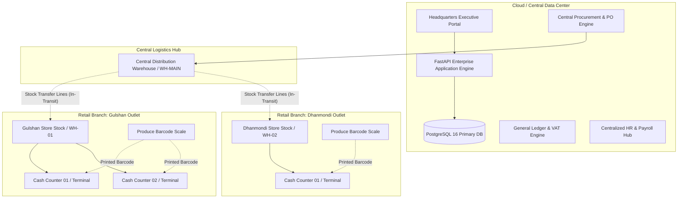
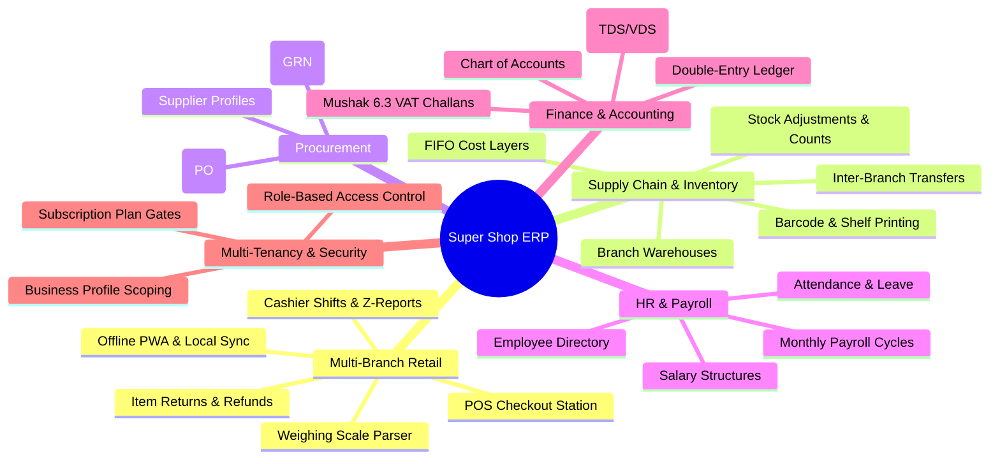

# Software Requirements Specification (SRS)
## Multi-Branch Super Shop & Enterprise Retail ERP Platform

**Document Identifier:** SRS-ERP-RET-2026-V1  
**Version:** 1.0.0 (Baseline Specification)  
**Target Architecture:** Multi-Tenant Distributed Micro-Modular Monolith  
**Core Stack:** Python 3.12 (FastAPI), SQLAlchemy 2.0 ORM, PostgreSQL 16, Jinja2, TailwindCSS, Progressive Web App (Service Worker / IndexedDB)  
**Last Updated:** October 2026

---

## Table of Contents
1. [Introduction](#1-introduction)
2. [Overall Description & System Architecture](#2-overall-description--system-architecture)
3. [Multi-Branch Super Shop & POS Module Requirements](#3-multi-branch-super-shop--pos-module-requirements)
4. [Inventory & Supply Chain Management](#4-inventory--supply-chain-management)
5. [Inbound Procurement & Vendor Master](#5-inbound-procurement--vendor-master)
6. [Human Resource & Payroll (HRM) Module](#6-human-resource--payroll-hrm-module)
7. [Financial Accounting & Statutory VAT (Mushak 6.3)](#7-financial-accounting--statutory-vat-mushak-63)
8. [Multi-Tenancy, Subscriptions & RBAC](#8-multi-tenancy-subscriptions--rbac)
9. [Hardware Interface & Peripherals Specification](#9-hardware-interface--peripherals-specification)
10. [Non-Functional Requirements (NFR)](#10-non-functional-requirements-nfr)
11. [Requirements Traceability Matrix (RTM)](#11-requirements-traceability-matrix-rtm)

---

## 1. Introduction

### 1.1 Purpose
This Software Requirements Specification (SRS) defines the end-to-end functional and non-functional requirements for the **Enterprise Multi-Branch Super Shop Retail Management & ERP System**. The platform is designed to govern distributed supermarket chain operations (FMCG, fresh produce, meat/poultry, dairy, household items, and electronics), unifying localized branch POS terminals, centralized procurement, inter-branch stock logistics, automated payroll, double-entry financial accounting, and national VAT (Mushak 6.3) compliance.

### 1.2 Scope of the Platform
The platform serves as an all-in-one ERP encompassing:
- **Distributed Multi-Branch Retail Engine:** Real-time branch inventory segregation, high-throughput Point of Sale (POS) terminals, barcode weighing scale integration, item returns/exchanges, cashier drawer balancing, and offline PWA resilience.
- **Centralized Warehouse & Supply Chain:** Automated replenishment, inter-branch transit tracking, FIFO cost-layer valuation, and thermal shelf-edge/barcode printing.
- **Procurement & Inbound Logistics:** Supplier lifecycle management, Purchase Orders (PO), and Goods Received Notes (GRN).
- **Human Resources & Payroll:** Multi-department hierarchies, staff directories, shift-based attendance, leave approval workflows, and monthly payroll computation with statutory tax withholdings.
- **Financial Accounting & National Tax Engine:** General ledger, Chart of Accounts, balanced Journal Vouchers, and automated statutory Bangladesh NBR Mushak 6.3 tax challans.
- **Multi-Tenant SaaS Foundation:** Tenant business profile isolation, subscription plan tiering, and granular Role-Based Access Control (RBAC).

### 1.3 Definitions, Acronyms, and Abbreviations
- **BIN:** Business Identification Number (13-digit mandatory VAT identifier).
- **COGS:** Cost of Goods Sold.
- **EAN-13:** 13-digit International Article Number barcode symbology.
- **FEFO:** First-Expired, First-Out perishables inventory management.
- **FIFO:** First-In, First-Out inventory cost layer tracking.
- **FMCG:** Fast-Moving Consumer Goods.
- **GRN:** Goods Received Note (formal warehouse inbound receiving document).
- **Mushak 6.3:** Statutory Tax Invoice Challan prescribed by the National Board of Revenue (NBR), Bangladesh.
- **POS:** Point of Sale.
- **PWA:** Progressive Web Application (Service Worker & IndexedDB offline cache).
- **RBAC:** Role-Based Access Control.
- **SKU:** Stock Keeping Unit.
- **UoM:** Unit of Measure (e.g., PCS, KG, GRAM, LTR, PACK, BOX).
- **Z-Report:** Certified end-of-day register closing report summarizing financial tenders, tax totals, and cash drawer variances.

---

## 2. Overall Description & System Architecture

### 2.1 Multi-Branch Super Shop Topology

### 2.2 System Modules Overview

---

## 3. Multi-Branch Super Shop & POS Module Requirements

### 3.1 Point of Sale (POS) Station Operations
- **REQ-POS-001 (Branch Register Association):** Every terminal instance must be registered under a physical `POSRegister` record bound to a specific `warehouse_id` (the branch outlet). All stock deductions initiated during checkout must deduct inventory from that branch's warehouse only.
- **REQ-POS-002 (Shift Lifecycle & Drawer Control):**
  1. A cashier cannot process sales without an open shift (`POSSession`).
  2. The cashier must declare opening float cash when opening a session.
  3. At shift close, the cashier records physical drawer cash count. The system computes drawer variance (`cash_difference = closing_cash_counted - expected_cash`).
  4. The system produces a certified **Z-Report** detailing net sales, tax breakdown, and tender splits.
- **REQ-POS-003 (Barcode Scanner Ergonomics):**
  - High-speed scanner support for EAN-13, UPC-A, Code128, and QR codes with sub-80ms item addition.
  - Complete keyboard shortcuts for touchless cash register operations:
    - `F1`: Focus search bar
    - `F2`: Item discount modal
    - `F4`: Trigger Tender / Pay modal
    - `F8`: Hold / Suspend open bill
    - `F9`: Open Returns / Refunds modal
    - `Esc`: Clear cart / Close modals
- **REQ-POS-004 (Barcode Scale Auto-Decoding):**
  - Supermarkets weigh loose items (vegetables, fruits, fish, meat) and produce price/weight embedded EAN-13 barcodes.
  - The POS scanner parser must recognize EAN-13 barcodes with prefix `20` or `21`:
    - Format: `20 [5-digit SKU / Item Code] [5-digit Weight in Grams or Price] [1-digit Checksum]`.
    - Automatically decodes weight/price, attaches the item to the bill, and computes line total without cashier manual input.
- **REQ-POS-005 (Split Tenders & Payment Methods):**
  - Supports split payment tenders in a single invoice:
    - Cash (with exact tender buttons: 10, 20, 50, 100, 500, 1000 and auto change calculator).
    - Credit / Debit Card (records POS machine approval code).
    - Mobile Financial Services (bKash, Nagad, Rocket with TrxID recording).
    - Store Credit / Gift Vouchers.
- **REQ-POS-006 (Bill Suspension / Hold Orders):**
  - Allows cashiers to park/suspend an open cart when a customer steps away, serving the next customer immediately. Parked carts can be resumed with a single click or shortcut.
- **REQ-POS-007 (Quick Customer Enrollment):**
  - In-terminal modal allows enrolling walk-in customers (`first_name`, `phone`, `email`, `address`) scoped to the tenant's `business_id` without leaving the checkout screen.
- **REQ-POS-008 (Offline PWA Architecture):**
  - In the event of network disruption or internet outage, the POS terminal functions seamlessly using IndexedDB local storage (Dexie.js).
  - Transactions queued offline automatically push to the server upon connection restoration with conflict resolution.

### 3.2 POS Item Returns, Refunds & Exchanges
- **REQ-RET-001 (Past Invoice Lookup):**
  - Cashiers can open the Return Modal (`F9`), scan or type the original invoice number (`POS-YYYYMMDD-XXXXXX`) or search by customer mobile number.
- **REQ-RET-002 (Itemized Partial/Full Return):**
  - Displays original line items, sold unit prices, purchased quantities, and remaining returnable quantities.
  - Cashier enters the return quantity (validating `return_qty <= remaining_qty`).
  - Cashier selects Return Reason: *Damaged / Defective*, *Customer Exchange*, *Wrong Item Sold*, *Expired Goods*.
- **REQ-RET-003 (Restock vs. Damage Disposal):**
  - Checkbox: *Restock to Branch Inventory*.
  - If checked: Increments branch `InventoryItem.quantity_on_hand` and variant `stock_qty` with `StockMovement(RETURN)`.
  - If unchecked: Logs item as shrinkage/damaged waste without returning to sellable stock.
- **REQ-RET-004 (Refund Tender Issuance):**
  - Issues refund as Cash (deducted from current shift drawer), Store Credit / Gift Voucher, or original electronic payment method.
  - Generates an official Credit Note / Return Receipt with barcode.

---

## 4. Inventory & Supply Chain Management

### 4.1 Branch Warehouses & Multi-Location Stock
- **REQ-INV-001 (Branch Warehouse Segregation):**
  - Stock levels (`quantity_on_hand`) are tracked independently per branch warehouse (`Warehouse`).
  - No branch can sell stock belonging to another branch unless an official stock transfer is executed.
- **REQ-INV-002 (Inter-Branch Stock Transfers):**
  - Workflow: Source Warehouse (e.g., Central Hub) ➔ Destination Warehouse (e.g., Gulshan Outlet).
  - Status progression: `PENDING` ➔ `IN_TRANSIT` ➔ `COMPLETED` (or `CANCELLED`).
  - Items dispatched are immediately deducted from source stock and marked as in-transit. Destination stock increments only upon physical delivery check-in.
- **REQ-INV-003 (Double-Entry Stock Audit Trail):**
  - Every stock alteration generates an immutable `StockMovement` entry capturing `delta`, `unit_cost`, `reason` (Sale, Return, Transfer, Purchase Receipt, Shrinkage), `source_type`, and `actor_id`.
- **REQ-INV-004 (FIFO Cost Layer Valuation):**
  - Goods inbound from purchase orders establish `CostLayer` records with quantity and cost.
  - Outbound POS sales consume the oldest active cost layers first, ensuring 100% compliant Cost of Goods Sold (COGS) reporting.
- **REQ-INV-005 (Automated Reorder Thresholds):**
  - Configurable minimum safety stock and reorder quantities per branch item.
  - Automatic alerts and draft transfer generation when branch stock reaches threshold.
- **REQ-INV-006 (Barcode & Shelf Label Generator):**
  - Batch generation and direct thermal printing of Code128 / EAN-13 labels for retail shelves and individual packaged items with prices and VAT indicators.

---

## 5. Inbound Procurement & Vendor Master

### 5.1 Vendor Directory & Purchase Order Engine
- **REQ-PROC-001 (Supplier Master):**
  - Central directory of approved suppliers with contact profiles, payment terms (Net 15, Net 30, Net 60, COD, Advance), and national tax identification (BIN).
- **REQ-PROC-002 (Purchase Order Lifecycle):**
  - Creation of formal purchase orders specifying destination warehouse, supplier, expected delivery date, itemized quantities, and purchase prices.
  - Statuses: `DRAFT` ➔ `ISSUED` ➔ `PARTIALLY_RECEIVED` ➔ `COMPLETED` ➔ `CANCELLED`.
- **REQ-PROC-003 (Goods Received Note [GRN]):**
  - Inbound delivery receiving against purchase orders.
  - Validates delivered quantity against ordered quantity.
  - Directly creates branch stock layers (`CostLayer`), updates variant cost prices, and records inventory receiving movements.

---

## 6. Human Resource & Payroll (HRM) Module

### 6.1 Organization & Employee Master
- **REQ-HRM-001 (Department & Job Designation):**
  - Hierarchical department trees and standardized job titles with reporting designations.
- **REQ-HRM-002 (Employee Profiles):**
  - Digital employee master files capturing personal identity, national ID (NID), emergency contacts, branch assignment, employment type, and bank account details.

### 6.2 Attendance & Leave Management
- **REQ-HRM-003 (Shift & Attendance Tracking):**
  - Multi-shift scheduling (Morning, Evening, Night retail shifts).
  - Daily check-in/check-out logs, late-in flags, and overtime tracking.
- **REQ-HRM-004 (Leave Policies & Quotas):**
  - Configurable leave types (Annual Leave, Sick Leave, Casual Leave, Maternity Leave) with annual quota allocations, balance deduction, and supervisor approval hierarchy.

### 6.3 Compensation & Monthly Payroll
- **REQ-HRM-005 (Salary Breakdown Structure):**
  - Salary profiles configured per employee: Basic Pay, House Rent Allowance, Medical Allowance, Conveyance, Gross Salary, and Provident Fund (PF) contribution.
- **REQ-HRM-006 (Automated Payroll Runs):**
  - Generation of monthly payroll cycles (`PayrollPeriod`).
  - Automated calculation of earnings, overtime pay, unpaid leave deductions, Tax Deducted at Source (TDS), and net payable salary.
  - Generation of printable employee pay slips.

---

## 7. Financial Accounting & Statutory VAT (Mushak 6.3)

### 7.1 Double-Entry General Ledger
- **REQ-ACC-001 (Chart of Accounts):**
  - Localized 5-tier Chart of Accounts for Bangladesh commercial retail:
    - 1000s: Assets (Cash, Bank, Trade Receivables, Inventory, Input VAT)
    - 2000s: Liabilities (Accounts Payable, Output VAT, TDS/VDS Payable)
    - 3000s: Equity (Owner's Capital, Retained Earnings)
    - 4000s: Revenue (Retail Sales Revenue, Service Revenue)
    - 5000s: Expenses (COGS, Rent, Utilities, Salaries & Wages)
- **REQ-ACC-002 (Journal Vouchers):**
  - Automated and manual balanced double-entry vouchers enforcing `sum(debit) == sum(credit)`.
  - Automatic posting of POS daily sales totals to Cash/Bank and Sales Revenue accounts.

### 7.2 Bangladesh VAT & Mushak Compliance
- **REQ-VAT-001 (Mushak 6.3 Tax Invoice Challan):**
  - Automated generation of statutory National Board of Revenue (NBR) **Mushak 6.3** tax invoice challans for retail sales.
  - Mandatory fields: Registered Business Name & BIN, Branch Outlet Address, Customer Details, Serialized Challan Number, Fiscal Year, Itemized Goods Description, Unit Value, Supplementary Duty (SD), and VAT rate (15% standard, 5%, 7.5%, or exempt).
- **REQ-VAT-002 (Withholding Tax [TDS/VDS]):**
  - Automated tracking of VAT Deducted at Source (VDS) on vendor payments and Tax Deducted at Source (TDS) on payroll and procurement.

---

## 8. Multi-Tenancy, Subscriptions & RBAC

### 8.1 Tenant Scoping & Identity
- **REQ-SEC-001 (Data Partitioning):**
  - Strict tenant partitioning using `business_id` across all relational database entities.
  - Non-superadmin users are locked to their assigned tenant profile. Cross-tenant access is strictly denied at both API and ORM layers.
- **REQ-SEC-002 (Subscription Tiers & Gating):**
  - Feature gating enforced via `FEATURE_CONFIG` and `SubscriptionPlan` (Free, Basic, Pro, Enterprise).
  - Locked features render upsell prompts without breaking page layouts.
- **REQ-SEC-003 (Granular RBAC Permissions):**
  - Permission matrix based on `(module, feature, action)` (e.g., `ecommerce:pos:create`, `hrm:payroll:view`, `finance:vouchers:create`).

---

## 9. Hardware Interface & Peripherals Specification

| Peripheral Type | Supported Standards / Interfaces | Functional Integration |
| :--- | :--- | :--- |
| **Barcode Scanners** | USB HID, Bluetooth Keyboard Wedge | Scans SKU / EAN-13 barcodes directly into active POS listener without requiring mouse focus. |
| **Weighing Scales** | Embedded Barcode Label (EAN-13 prefix `20`/`21`) or Serial RS-232 / USB HID scale | Auto-decodes produce weight and price directly into cart lines. |
| **Thermal Receipt Printers** | 80mm / 58mm Thermal Printers (USB, Network LAN, ESC/POS) | Fast graphic & text receipt printing with store branding, VAT breakdowns, and barcodes. |
| **Electronic Cash Drawers**| RJ11 / RJ12 connection through Receipt Printer | Drawer kick pulse triggered automatically upon cash payment completion. |
| **Customer Displays (VFD)** | 2-Line USB / Serial Pole Displays | Real-time line item price and total payable display facing the customer. |

---

## 10. Non-Functional Requirements (NFR)

### 10.1 Performance & Response Times
- **NFR-PERF-001:** POS Barcode scanning and line addition must complete in under **80 milliseconds**.
- **NFR-PERF-002:** POS checkout completion and receipt generation must finalize in under **500 milliseconds**.
- **NFR-PERF-003:** DataTables paginated views must load within **250 milliseconds** for datasets up to 50,000 records.

### 10.2 Reliability & Fault Tolerance
- **NFR-REL-001:** System API availability objective: **99.9% uptime**.
- **NFR-REL-002:** In the event of complete store internet disconnection, POS cashiers can continue uninterrupted offline checkout operations. Queued transactions sync automatically upon reconnection.

### 10.3 Security & Cryptography
- **NFR-SEC-001:** Passwords hashed using `bcrypt` / `argon2` with high work factors.
- **NFR-SEC-002:** Stateless JWT authentication tokens with configurable expiration (180 minutes).
- **NFR-SEC-003:** Role-Based Access Control verified on every individual API endpoint and template route.

---

## 11. Requirements Traceability Matrix (RTM)

| Requirement Code | Module | Database Entity | Controller / Route | UI Template |
| :--- | :--- | :--- | :--- | :--- |
| **REQ-POS-001** | Retail POS | `POSRegister` | `/pos/terminal` | `terminal.html` |
| **REQ-POS-002** | Retail POS | `POSSession` | `/pos/sessions` | `terminal.html` |
| **REQ-POS-004** | Retail POS | `ProductVariant` | `/pos/checkout` | `terminal.html` |
| **REQ-POS-005** | Retail POS | `POSPayment` | `/pos/checkout` | `terminal.html` |
| **REQ-RET-001** | Retail POS | `Order`, `OrderItem` | `/pos/orders/{id}/return` | `terminal.html` |
| **REQ-INV-001** | Inventory | `Warehouse`, `InventoryItem` | `/inventory/` | `inventory_list.html` |
| **REQ-INV-002** | Inventory | `StockTransfer`, `StockTransferLine` | `/inventory/transfers` | `stock_transfer_list.html` |
| **REQ-INV-003** | Inventory | `StockMovement` | `/inventory/movements` | `stock_movements.html` |
| **REQ-INV-004** | Inventory | `CostLayer` | `/inventory/valuation` | `valuation_report.html` |
| **REQ-INV-006** | Inventory | `ProductVariant` | `/inventory/barcode-print` | `barcode_print_manage.html` |
| **REQ-PROC-001**| Procurement | `Supplier` | `/procurement/suppliers` | `suppliers_list.html` |
| **REQ-PROC-002**| Procurement | `PurchaseOrder` | `/procurement/purchase-orders` | `po_list.html` |
| **REQ-HRM-001** | HRM | `Department`, `JobTitle` | `/departments/manage` | `department_list.html` |
| **REQ-HRM-002** | HRM | `Employee` | `/employees/manage` | `employee_list.html` |
| **REQ-HRM-006** | HRM | `EmployeeSalary`, `PayrollPeriod` | `/payroll/settings` | `payroll_settings.html` |
| **REQ-ACC-001** | Finance | `Account` | `/finance/accounts` | `account_list.html` |
| **REQ-ACC-002** | Finance | `JournalVoucher`, `JournalEntry` | `/finance/vouchers` | `voucher_list.html` |
| **REQ-VAT-001** | Finance | `MushakChallan`, `SalesInvoice` | `/finance/mushak-6-3` | `mushak_6_3_list.html` |
| **REQ-SEC-001** | Core | `BusinessProfile`, `User` | `/businesses/manage` | `business_list.html` |
