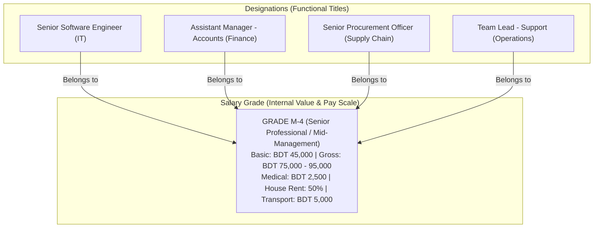

# Plan: Job Designation & Grade Architecture (Bangladesh Context)

## Executive Summary
In Bangladesh, organizational structures and human resource compensation systems frequently decouple or associate the **Job Designation** (functional role/title) from the **Job Grade / Salary Grade** (compensation band, hierarchy level, and statutory compliance scale).

This document details:
1. **What a Grade is in the Bangladesh context** (Corporate, Banking, RMG / Garments, and National Pay Scale).
2. **The relationship between Job Designation and Grade**.
3. **Why organizations need a Grade system** (Benefits, compliance, fairness, payroll automation).
4. **Why Grade MUST be optional** in our SaaS ERP platform.
5. **Proposed architectural blueprint & implementation plan** for introducing an optional Grade framework.

---

## 1. Understanding Grade Setup in Bangladesh

### What is a Grade?
In Bangladesh, a **Grade** (also referred to as *Pay Scale*, *Salary Grade*, or *Job Band*) is a standardized classification tier that determines:
- The **Salary Bracket** (Minimum, Midpoint, and Maximum Gross / Basic salary).
- The **Statutory Allowance Structure** (House Rent, Medical Allowance, Conveyance/Transport, and Food Allowance compliant with the Bangladesh Labour Act 2006).
- **Perks & Entitlements** (Festival Bonus eligibility, Provident Fund / Gratuity tiers, Executive Health Insurance coverage, Company Car / Fuel allowance).
- **Approval & Financial Authority Limits** (e.g., Grade 3 can approve purchase orders up to BDT 100,000; Grade 1 up to BDT 1,000,000).

```
┌────────────────────────────────────────────────────────────────────────┐
│                   Job Designation vs. Job Grade                         │
├───────────────────────────────────┬────────────────────────────────────┤
│         JOB DESIGNATION           │             JOB GRADE              │
│    (Functional Title / External)  │   (Internal Value / Pay Band)      │
├───────────────────────────────────┼────────────────────────────────────┤
│ • Describes *what* the person does│ • Describes the *compensation band*│
│ • Department-specific             │ • Cross-departmental & standardized│
│ • Client- and external-facing     │ • Internal & confidential          │
│ • E.g.: "Senior Software Engineer"│ • E.g.: "Grade 5" or "Band M-3"    │
│ • E.g.: "Assistant Manager - HR"  │ • Scale: BDT 65,000 - 90,000       │
└───────────────────────────────────┴────────────────────────────────────┘
```

### Grade Structures in Bangladesh Industries

| Sector / Context | Typical Grade Hierarchy | Real-World Bangladesh Example |
| :--- | :--- | :--- |
| **Corporate, IT & FMCG** | Band 1 to Band 8 or Executive Levels (E1-E4, M1-M4) | **Band M-3**: Senior Software Engineer (IT), Assistant Brand Manager (Marketing), and Senior Accountant (Finance) all share Band M-3 with equal salary brackets. |
| **Banking & Financial Sector** | Standardized Officer & Management Cadres | **Cadres**: Trainee Officer (TO) $\rightarrow$ Probationary Officer (PO) $\rightarrow$ Officer $\rightarrow$ Senior Officer (SO) $\rightarrow$ Principal Officer (PO) $\rightarrow$ Senior Principal Officer (SPO) $\rightarrow$ AVP $\rightarrow$ VP $\rightarrow$ EVP $\rightarrow$ SEVP. |
| **RMG, Textile & Manufacturing** | Government Minimum Wage Board Gazettes (Statutory) | **BLA / Wage Board Grades (Grade 1 to 5)**: Grade 1 (Pattern Master), Grade 2 (Cutting/Mechanic Master), Grade 3 (Senior Operator), Grade 4 (General Operator), Grade 5 (Junior Operator / Helper). Regulated basic pay + house rent + medical allowance. |
| **Public & Semi-Government** | National Pay Scale (Grade 1 to Grade 20) | **Grade 9**: Entry Class-1 Officer (BCS Cadre, University Lecturer, Assistant Director). **Grade 10**: Class-2 (Sub-Assistant Engineer, Staff Nurse). **Grade 20**: Support Staff. |

---

## 2. The Relationship Between Job Designation and Grade

In enterprise HR management, **Job Designation** and **Grade** have an **N-to-1** or **N-to-N** relationship:



### Key Differences & Synergies:
1. **Designations describe roles; Grades describe pay and seniority**: An IT department and a Marketing department have completely different job titles, but both need an objective way to compare seniority and pay equity.
2. **Career Progression without Title Inflation**: An employee might be a "Software Engineer" at **Grade 6 (Junior)**, then receive an internal promotion to **Grade 5 (Intermediate)** with higher compensation, even if their public title remains "Software Engineer".
3. **Recruitment Salary Ranges**: When hiring, the company doesn't guess what to pay; they state "We are hiring an HR Specialist at Grade 4", which automatically enforces the approved budget range.

---

## 3. Why Organizations Need a Grade System

### 1. Internal Pay Equity & Fairness (Preventing Favoritism)
Without grades, salaries are often decided arbitrarily during individual negotiations. This leads to severe internal pay disparities where two employees doing the exact same work receive wildly different salaries. A Grade structure establishes objective pay bands:
$$\text{Grade Gross Range} = [\text{Min Salary}, \text{Midpoint}, \text{Max Salary}]$$

### 2. Statutory Compliance with Bangladesh Labour Act (BLA 2006)
For manufacturing units, factories, garments, and export processing zones (EPZ):
- The Government of Bangladesh periodically publishes **Minimum Wage Gazettes** categorized strictly by **Grades**.
- Inspections, buyer audits (RMG social compliance, BSCI, SEDEX), and labor court audits require proof that workers are mapped to approved statutory grades and paid at or above that grade's minimum basic and gross salary.

### 3. Automated Payroll Formulae & Breakdown
Under the Bangladesh tax and labor structure, gross salary is split into components:
- **Basic Salary**: typically $50\% - 60\%$ of gross.
- **House Rent**: $40\% - 50\%$ of basic (tax-exempt up to BDT 25,000/month or 50% of basic under Bangladesh Income Tax Act 2023).
- **Medical Allowance**: 10% of basic or BDT 120,000/year tax exemption limit.
- **Conveyance / Transport Allowance**: Fixed allowance (tax-exempt up to BDT 30,000/year).
- **Festival Bonus**: Typically 1 month's Basic salary or $50\%$ of Basic twice a year (Eid-ul-Fitr, Eid-ul-Adha, Puja).
When an employee is assigned to a Grade, the ERP can **auto-calculate their exact salary breakdown** instantly!

### 4. Promotion & Appraisal Calibration
During annual performance appraisals, HR and Management can award:
- **In-Grade Step Increment**: A standard percentage increment within the current grade's pay scale.
- **Grade Promotion**: Upgrading an employee from Grade 5 to Grade 4, unlocking a higher pay band, larger bonus, and higher medical insurance entitlement.

---

## 4. Why Grade Setup MUST Be Optional

While large corporations, banks, and factories depend on Grades, **forcing a Grade requirement on all businesses would break the user experience**:

```
                       ┌─────────────────────────┐
                       │   Business Organization │
                       └────────────┬────────────┘
                                    │
            ┌───────────────────────┴───────────────────────┐
            ▼                                               ▼
┌─────────────────────────┐                     ┌─────────────────────────┐
│     STARTUP / SME       │                     │    LARGE ENTERPRISE     │
│   (Grade is DISABLED)   │                     │   (Grade is ENABLED)    │
├─────────────────────────┤                     ├─────────────────────────┤
│ • 5 - 30 employees      │                     │ • 50 - 5,000+ employees │
│ • Ad-hoc negotiations   │                     │ • Formal pay scales     │
│ • Simple titles only    │                     │ • Wage board compliance │
│ • Quick employee onboard│                     │ • Structured appraisals │
│ • Zero setup overhead   │                     │ • Standardized bands    │
└─────────────────────────┘                     └─────────────────────────┘
```

### Reasons for Making Grade Strictly Optional:
1. **Low Friction Onboarding for SMEs & Startups**:
   - Small businesses, digital agencies, and retailers do not have formal salary grades.
   - Forcing them to create "Grades" before they can add a Department, Designation, or Employee would cause user abandonment and frustration.
2. **Hybrid / Mixed Organizations**:
   - Even in mid-sized companies, factory/operational workers may be strictly graded (to comply with labor law), while corporate/tech executives may have customized negotiated contracts without a grade.
3. **Decoupled Architecture**:
   - Designations can exist independently: `JobTitle.default_grade_id` $\rightarrow$ `NULLABLE`.
   - Employees can exist independently: `Employee.grade_id` $\rightarrow$ `NULLABLE`.
   - If a business leaves Grades disabled or empty, everything in the platform functions identically to how it does today.

---

## 5. Proposed Implementation Blueprint

### A. Data Modeling (SQLAlchemy)

#### 1. [NEW] `SalaryGrade` Model (`app/modules/hr_payroll/organization/models.py`)
```python
class SalaryGrade(Base, UUIDMixin, TimestampMixin):
    __tablename__ = "salary_grades"
    __table_args__ = (
        UniqueConstraint("business_id", "code", name="uq_salary_grade_business_code"),
        UniqueConstraint("business_id", "name", name="uq_salary_grade_business_name"),
    )

    business_id: Mapped[int] = mapped_column(
        Integer, ForeignKey("business_profiles.id", ondelete="CASCADE"), nullable=False, index=True
    )
    name: Mapped[str] = mapped_column(String(100), nullable=False)  # e.g., "Grade 1", "Band M-3"
    code: Mapped[str] = mapped_column(String(50), nullable=False, index=True)  # e.g., "G-1", "M3"
    level_rank: Mapped[int] = mapped_column(Integer, default=5, nullable=False)  # 1 (Highest) to 20
    description: Mapped[str | None] = mapped_column(Text, nullable=True)

    # Optional Salary Scale Bounds (BDT)
    min_gross_salary: Mapped[float | None] = mapped_column(Numeric(12, 2), nullable=True)
    max_gross_salary: Mapped[float | None] = mapped_column(Numeric(12, 2), nullable=True)
    default_basic_percent: Mapped[float | None] = mapped_column(Numeric(5, 2), default=50.0) # e.g. 50%

    is_active: Mapped[bool] = mapped_column(Boolean, default=True, nullable=False)

    # Relationships
    job_titles: Mapped[list["JobTitle"]] = relationship("JobTitle", back_populates="default_grade")
    employees: Mapped[list["Employee"]] = relationship("Employee", back_populates="grade")
```

#### 2. [MODIFY] `JobTitle` Model
- Add optional foreign key:
```python
default_grade_id: Mapped[uuid.UUID | None] = mapped_column(
    UUID(as_uuid=True),
    ForeignKey("salary_grades.id", ondelete="SET NULL"),
    nullable=True,
    index=True,
)
default_grade: Mapped["SalaryGrade | None"] = relationship("SalaryGrade", back_populates="job_titles")
```

#### 3. [MODIFY] `Employee` Model
- Add optional direct foreign key:
```python
grade_id: Mapped[uuid.UUID | None] = mapped_column(
    UUID(as_uuid=True),
    ForeignKey("salary_grades.id", ondelete="SET NULL"),
    nullable=True,
    index=True,
)
grade: Mapped["SalaryGrade | None"] = relationship("SalaryGrade", back_populates="employees")
```

---

### B. UI / UX Design in Organization Hub (`/hr-payroll/organization`)

In the Organization Hub, we can offer:
1. **New "Grades" TAB** (Positioned after Job Designations):
   - **Grade Cards & Table View**: Code, Grade Name, Seniority Rank, Salary Band Range (e.g., `৳60,000 - ৳85,000`), Associated Designations, and Stationed Staff Count.
   - **Preset Templates for Bangladesh**:
     - *Bangladesh RMG Wage Board (Grade 1 - 5)*.
     - *Standard Corporate Banding (Executive, M1-M4, Associate)*.
     - *Banking Cadre Structure (TO to SEVP)*.
     - *Custom (Create your own)*.
   - **Slide-Over Drawer**: Shows all designations assigned to this grade and all employees currently on this pay scale.
2. **In Job Designations TAB**:
   - Optional dropdown: **"Assigned Grade (Optional)"** $\rightarrow$ e.g., `[None / Unassigned]`, `Grade 1 - Executive`, `Grade 4 - Mid-Level`.
3. **In Employee Create / Edit Form**:
   - Optional field: **"Salary Grade"** $\rightarrow$ Automatically suggests the default grade from the chosen Job Title, while allowing custom assignment or leaving blank.

---

## 6. Open Questions & Alignment for User

> [!IMPORTANT]
> **User Clarifications to Finalize:**
> 1. **Preset Templates**: Would you like the system to provide ready-made standard Bangladesh Grade templates (e.g., Corporate 7-Tier, RMG 5-Tier, Banking Cadre) that a business can load with 1 click?
> 2. **Salary Band Visibility**: Should the salary scale (Min/Max gross) on a Grade be visible to standard HR users, or restricted strictly to Payroll Admins / Business Owners?
> 3. **Compensation Auto-fill**: When hiring an employee, if they select a Grade, should the system automatically validate or warn if their salary offer is below the Grade's minimum basic/gross?

---

## 7. Next Steps
Once you review and approve this conceptual explanation and design, we will:
1. Implement the optional `SalaryGrade` backend models, repository, service, and router.
2. Add the **Grades Tab** in the Next.js Organization Hub (`/hr-payroll/organization`) matching the exact Enterprise layout as Department and Branch tabs.
3. Enhance the Job Designation and Employee modal/drawer with optional Grade selection.
