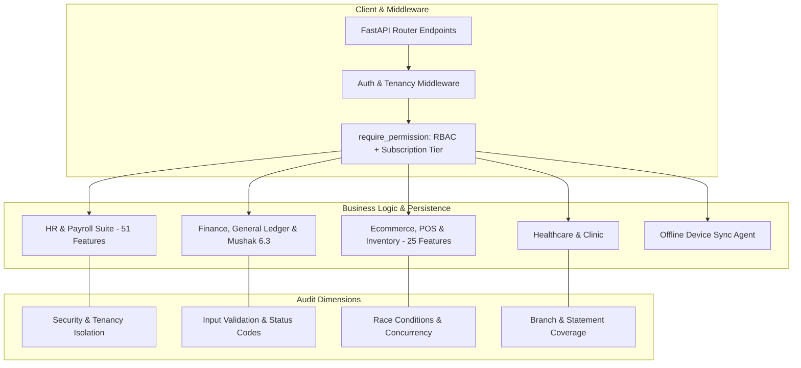

# Python Backend Test Coverage, Security & Validation Audit Plan

## Goal Description
Conduct an end-to-end automated testing, security, and validation audit of the ProERP Python FastAPI backend codebase. The objective is to maximize meaningful test coverage using `pytest` and `pytest-cov`, detect and eliminate security vulnerabilities (authentication bypass, tenant leakage, injection, privilege escalation), verify robust input validation with clear user-friendly error codes, fix discovered defects with regression testing, and provide a transparent audit report detailing test metrics, uncovered paths, performance bottlenecks, and residual risks.

---

## User Review Required

> [!IMPORTANT]
> **Universal Test Database Isolation (`tests/conftest.py`)**:
> Currently, several test files connect to `DATABASE_URL` directly (which defaults to PostgreSQL host `db:5432` from `.env`). To enable fast, deterministic test execution and CI reproducibility without requiring a running Docker Postgres instance, we will introduce a root `tests/conftest.py` that configures an isolated in-memory SQLite (`StaticPool`) / mock test engine for all test runs unless PostgreSQL integration is explicitly enabled.

> [!WARNING]
> **Test Coverage Tooling**:
> `pytest-cov` is not yet installed in the active virtual environment (`venv`). We will install `pytest-cov` (`.\venv\Scripts\pip.exe install pytest-cov`) to measure branch and statement coverage.

---

## Core System Architecture & Audit Scope



---

## Audit Dimensions & Methodology

### 1. Security & Authorization Audit
- **Tenant Isolation**: Verify that every read, write, update, and delete operation across all models enforces `business_id` scoping to prevent cross-tenant data leakage.
- **RBAC & Subscription Dual-Gating**: Verify `require_permission` strictly blocks unauthorized roles and locked subscription tiers (Basic vs. Pro vs. Enterprise) with HTTP 403 Forbidden.
- **Token Security**: Validate JWT token signing, expiration checking, algorithm pinning (`HS256`), invalid signatures, and revoked/inactive user sessions.
- **Template & Token Injection**: Ensure employee document template rendering (`{{employee_name}}`, etc.) safely escapes malicious HTML/script injections.
- **Cryptographic Signatures**: Verify digital certificate hashes (SHA-256) and tamper-detection mechanisms compliant with the ICT Act 2006.

### 2. Validation & Error Handling Audit
- **Schema & Type Enforcement**: Ensure all input endpoints reject malformed payloads with structured HTTP 422/400 and clear, actionable error messages.
- **Boundary & Negative Testing**: Test extreme values (negative salaries, zero quantities, future dates for past events, max-length overflow, null/empty required fields).
- **Duplicate & Conflict Handling**: Verify unique constraints (SKU, employee ID, national ID, voucher number, tax number) return HTTP 409 Conflict instead of unhandled 500 database crashes.
- **Financial Precision**: Audit all monetary operations (payslips, allowances, taxes, Mushak 6.3 VAT, POS change calculations, discount coupons) to ensure exact `Decimal` precision without binary floating-point drift.

### 3. Concurrency, Performance & Edge Cases
- **Stock Deductions & POS Checkout**: Audit inventory allocation for race conditions and overselling during concurrent checkout requests.
- **Payroll Period Locking**: Ensure processed and approved payroll periods cannot be modified or re-run concurrently.
- **Circular Dependencies & Memory Leaks**: Verify SQLAlchemy relationships and session closures prevent connection pool exhaustion.

---

## Proposed Execution Plan

### Phase 1: Test Infrastructure & Universal Harness
Establish a clean, robust testing environment with universal SQLite test fixtures and coverage reporting.

#### [NEW] `tests/conftest.py`
- Configure `os.environ["APP_ENV"] = "test"` and `os.environ["DATABASE_URL"] = "sqlite:///:memory:"`.
- Provide global fixtures:
  - `test_db`: Isolated SQLite session with all models registered.
  - `async_test_db`: Async session for async endpoints.
  - `client`: `httpx.AsyncClient` with auto-wired database overrides.
  - `make_user(role, business_id)`: Factory fixture to generate test users for any tier.
  - `make_business(subscription_plan)`: Factory fixture for multi-tenancy testing.

#### [MODIFY] `pyproject.toml`
- Add `[tool.pytest.ini_options]` with default flags: `-ra -q --tb=short`.
- Add `[tool.coverage.run]` and `[tool.coverage.report]` targeting `app/` excluding migrations and test files.

---

### Phase 2: Core Identity, Auth & Tenancy Security Audit
Audit all authentication, authorization, token, and tenancy enforcement logic.

#### [MODIFY/NEW] `tests/test_security_audit.py`
- Test JWT token manipulation (expired, invalid signature, corrupted payload, algorithm confusion).
- Test cross-tenant data breach scenarios (User A from Business 1 attempting to view/edit Business 2 entities).
- Test superuser permission overrides vs. regular role boundaries.
- Test subscription gating under `auth_strategy="rbac"`, `"subscription"`, and `"dual"`.
- Test rate-limiting and brute-force protections on `/auth/login`.

---

### Phase 3: HR & Payroll Suite Comprehensive Audit
Audit business logic, statutory labour law rules (BLA 2006), workflows, and edge cases.

#### [NEW] `tests/test_hr_payroll_audit.py`
- **Employee Directory & Dossier**:
  - Boundary: Empty fields, duplicate National IDs, invalid email/phone formats.
  - Document verification state transitions (`pending` -> `verified` / `rejected`).
- **Biometric Attendance & Overtime**:
  - Ingestion of valid/duplicate biometric punch logs.
  - Overtime calculations exceeding legal daily caps (BLA 2006 max 2 hours/day).
  - Attendance regularizations and period approval locking.
- **Leave Allocations & Lifecycle**:
  - Leave application overlapping with existing approved leave or holidays.
  - Balance exhaustion and unauthorized negative leave quotas.
  - Statutory leave entitlement allocations (Casual, Sick, Earned).
- **Payroll & Tax Processing**:
  - Zero-salary, negative deduction, and excessive deduction edge cases.
  - Payslip generation and salary certificate validation.
  - Approval state immutability (cannot modify paid records).
- **Separation & Offboarding**:
  - Resignation submission, multi-department clearance completion checks.
  - FnF settlement calculation (gratuity, notice pay, leave encashment).
- **Document Management & Bulk Letters**:
  - Template preview with missing tokens, malformed token delimiters.
  - Batch letter jobs with empty employee lists or mixed-tenant employees.
  - Digital signature verification and tamper detection.

---

### Phase 4: Ecommerce, POS & Inventory Audit
Audit transactional integrity, multi-warehouse inventory, and checkout operations.

#### [NEW] `tests/test_ecommerce_pos_audit.py`
- **Catalog & Products**:
  - Duplicate SKU / barcode validation.
  - Product price vs. cost validations (negative prices, cost higher than price warnings).
- **Inventory & UoM**:
  - Stock adjustment audit trail immutability.
  - Fractional quantity conversions (Boxes to Pieces).
  - Negative inventory prevention on order confirmation.
- **POS & Checkout**:
  - Split tender payments (Cash + Card + Mobile Wallet) exact sum verification.
  - Underpayment / overpayment handling and exact change calculation.
  - Coupon application (minimum spend, expiry, usage limits, duplicate coupon prevention).
  - Order returns and refund calculation.
- **Procurement & GRN**:
  - Purchase order status lifecycles (`draft` -> `approved` -> `received`).
  - Partial goods received note (GRN) and quantity ledger reconciliation.

---

### Phase 5: Finance, General Ledger & Tax Audit
Audit financial accounting principles, general ledger balancing, and Mushak 6.3 compliance.

#### [NEW] `tests/test_finance_audit.py`
- **Double-Entry Bookkeeping**:
  - Strict assertion: `Total Debits == Total Credits` on journal voucher posting.
  - Rejecting unbalanced vouchers with HTTP 400.
  - Period close / fiscal year locking (preventing backdated journal entries).
- **Mushak 6.3 & VAT**:
  - Exact VAT (15%, 5%, 0%) calculation on sales invoices.
  - Mushak 6.3 generation, sequential numbering, and fiscal period reconciliation.

---

### Phase 6: Coverage Measurement, Defect Remediation & Audit Report
- Install `pytest-cov` and execute complete test suite:
  ```powershell
  .\venv\Scripts\pytest.exe --cov=app --cov-report=term-missing --cov-report=html
  ```
- Identify uncovered critical modules, functions, and branches.
- Implement fixes for any discovered vulnerabilities, logic errors, or missing validations without breaking backwards compatibility.
- Re-run full test suite and confirm 100% test pass rate.
- Generate final audit report artifact (`test_coverage_security_audit_report.md`).

---

## Verification Plan

### Automated Tests
1. **Infrastructure & Tooling Check**:
   ```powershell
   .\venv\Scripts\pip.exe install pytest-cov
   .\venv\Scripts\pytest.exe --version
   ```
2. **Module-by-Module Verification**:
   ```powershell
   # Core & Security
   .\venv\Scripts\pytest.exe tests/test_security_audit.py -v
   # HR & Payroll
   .\venv\Scripts\pytest.exe tests/test_hr_roles_and_permissions.py tests/test_hr_payroll_documents.py tests/test_hr_payroll_audit.py -v
   # Ecommerce & POS
   .\venv\Scripts\pytest.exe tests/test_ecommerce_pos_audit.py -v
   # Finance & Mushak
   .\venv\Scripts\pytest.exe tests/test_finance_audit.py -v
   ```
3. **Full Suite Coverage Execution**:
   ```powershell
   .\venv\Scripts\pytest.exe --cov=app --cov-report=term-missing
   ```

### Manual Verification
- Review generated HTML coverage report in browser (`htmlcov/index.html`).
- Verify error messages returned by modified endpoints match standard ProERP response formats.
- Review and approve the final Audit Report summarizing coverage statistics and residual risks.
