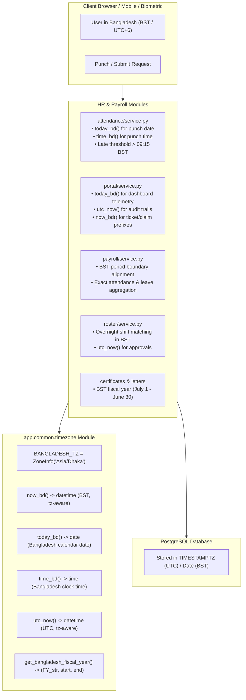

# Architecture & Implementation Plan: Bangladesh Standard Time (BST) Integration across HR & Payroll

## Goal Description
The objective is to analyze, diagnose, and permanently resolve all date and time inconsistencies across the **HR & Payroll** subsystem of ProERP SaaS by enforcing **Bangladesh Standard Time (BST / `Asia/Dhaka`, UTC+6:00)** across all operational workflows:
1. **Attendance Tracking & Digital Punch Clock**: Accurate calendar date assignment and late arrival detection for office and night shifts.
2. **Payroll Periods & Payslip Calculations**: Reliable month/period boundaries, attendance aggregation, and overtime deduction calculations.
3. **Leave Applications & Carry Forward**: Quota tracking, statutory leave year boundaries (BLA 2006), and yearly carry-forward transitions.
4. **Duty Roster & Shift Schedules**: Seamless shift allocation across overnight hours (e.g. 16:00 to 00:30 and 00:00 to 08:30).
5. **Income Tax Act 2023 (ITA 2023) Tax Cards & Fiscal Years**: Dynamic calculation based on Bangladesh's July 1 – June 30 fiscal year cycle.
6. **Audit Timestamps & Code Prefixes**: Clean replacement of deprecated `datetime.utcnow()` with timezone-aware UTC, while ensuring business document codes (`TKT-YYYYMM`, `EXP-YYYYMM`) reflect Bangladesh local calendar months.

---

## Current Situation & Technical Diagnosis

### 1. The Container Clock vs Bangladesh Time Gap
A verification check inside the production Docker container `fastapi_app` reveals:
```text
Container Clock: Fri Oct 23 06:17:52 UTC 2026
Bangladesh Local Time: Fri Oct 23 12:17:52 BST 2026 (UTC+6)
```
The application server runs **6 hours behind** Bangladesh Standard Time.

### 2. Critical Bugs Caused by Naive / UTC Time

#### A. The "Midnight to 6:00 AM" Date Skew Bug
- **Current Code**:
  - `attendance/service.py`: `now = datetime.now()`, `target_date = att_date or now.date()`.
  - `portal/service.py`: `today = date.today()`.
- **Failure Mode**:
  Between `00:00` (midnight) and `05:59:59 AM` in Bangladesh, the container's UTC date is still **yesterday** (e.g. 2:00 AM on Oct 23 in Dhaka is 8:00 PM on Oct 22 in UTC).
  - An employee punching in on a night shift or early shift has their attendance assigned to the **previous day**.
  - Duplicate key violations or overwriting of yesterday's punch can occur (`uq_attendance_employee_date`).
  - The employee portal dashboard queries `Attendance.date == date.today()` (evaluating to yesterday), falsely indicating that today has not yet been punched.

#### B. The Broken Late Arrival Threshold
- **Current Code**:
  - `attendance/service.py`:
    ```python
    now = datetime.now()
    target_check_in = check_in_time or now.time().replace(microsecond=0)
    if target_check_in > time(9, 15):
        status_val = AttendanceStatusEnum.LATE
    ```
- **Failure Mode**:
  If an employee checks in at `09:30 AM BST` (which is late by 15 minutes), the server records `now.time()` as `03:30:00` (UTC). Because `03:30:00 < 09:15:00`, the system marks the employee as **PRESENT (on time)**! Only employees arriving after `03:15 PM BST` (09:15 UTC) would be flagged as late.

#### C. Overnight Roster Shift Resolution
- **Current Code**:
  - Default shifts: Morning (`08:00`–`16:30`), Evening (`16:00`–`00:30`), Night (`00:00`–`08:30`).
- **Failure Mode**:
  When Night Shift workers arrive at midnight (`00:00`), naive UTC handling pairs their punch with yesterday's roster duty schedule rather than today's duty assignment.

#### D. Deprecated `datetime.utcnow()` Warnings & Off-by-One Month Prefixes
- **Current Code**:
  - `portal/service.py`: Uses `datetime.utcnow()` across 9 locations (`reviewed_at`, `disbursed_at`, `acknowledged_at`, `tkt_no`, `claim_number`).
- **Failure Mode**:
  Python 3.12 emits `DeprecationWarning: datetime.datetime.utcnow() is deprecated and scheduled for removal in a future version`. Furthermore, reference number generation around midnight on month transition (`datetime.utcnow().strftime('%Y%m')`) stamps the previous month on records created in the new month in Bangladesh.

---

## Target Architecture



---

## User Review Required

> [!IMPORTANT]
> **Container vs Code Timezone Strategy**:
> We will configure both:
> 1. **Code-Level Timezone Awareness (Primary & Resilient)**: Using Python's native `zoneinfo.ZoneInfo("Asia/Dhaka")` inside `app/common/timezone.py`. This guarantees accurate calculations even if the backend is hosted on multi-region cloud providers (AWS, GCP, Azure, Docker) where system clocks are locked to UTC.
> 2. **Container OS Timezone (Defense in Depth)**: Setting `TZ=Asia/Dhaka` in `docker-compose.yml` so system utilities (e.g. `date`, postgres logs) also align with Bangladesh local time.

> [!NOTE]
> **Database Invariant**:
> - Columns with `Date` type (e.g. `attendance.date`, `payroll_periods.start_date`, `duty_assignments.date`) represent **Bangladesh calendar dates**.
> - Columns with `Time` type (e.g. `attendance.check_in`, `attendance.check_out`, `shifts.start_time`) represent **Bangladesh local clock times**.
> - Columns with `DateTime(timezone=True)` (e.g. `created_at`, `updated_at`, `reviewed_at`) represent **absolute UTC instants** stored with timezone information, safely convertible to BST on display.

---

## Proposed Changes

### 1. Core Common Layer (`app/common/`)

#### [NEW] `app/common/timezone.py`
Create a dedicated, centralized timezone module for Bangladesh and UTC handling.

```python
"""
app/common/timezone.py
Centralized timezone & datetime utilities for Bangladesh Standard Time (BST)
and ISO UTC compliance.
"""
from datetime import date, datetime, time, timezone
from zoneinfo import ZoneInfo

# Bangladesh Standard Time is UTC+6 with no Daylight Saving Time
BANGLADESH_TZ = ZoneInfo("Asia/Dhaka")
UTC_TZ = timezone.utc


def now_bd() -> datetime:
    """Return the current timezone-aware datetime in Bangladesh (Asia/Dhaka, UTC+6)."""
    return datetime.now(BANGLADESH_TZ)


def today_bd() -> date:
    """Return current calendar date in Bangladesh."""
    return now_bd().date()


def time_bd() -> time:
    """Return current clock time in Bangladesh without microseconds."""
    return now_bd().time().replace(microsecond=0)


def utc_now() -> datetime:
    """Return the current timezone-aware datetime in UTC."""
    return datetime.now(UTC_TZ)


def to_bd(dt: datetime) -> datetime:
    """Convert any naive or aware datetime to Bangladesh timezone."""
    if dt.tzinfo is None:
        # If naive, assume stored as UTC
        dt = dt.replace(tzinfo=UTC_TZ)
    return dt.astimezone(BANGLADESH_TZ)


def get_bangladesh_fiscal_year(target_date: date | None = None) -> tuple[str, date, date]:
    """
    Returns Bangladesh income/fiscal year (July 1 to June 30).
    Example for Oct 2026: ('2026-2027', date(2026, 7, 1), date(2027, 6, 30))
    """
    d = target_date or today_bd()
    if d.month >= 7:
        start_year = d.year
        end_year = d.year + 1
    else:
        start_year = d.year - 1
        end_year = d.year
    fy_str = f"{start_year}-{end_year}"
    return fy_str, date(start_year, 7, 1), date(end_year, 6, 30)
```

---

### 2. Attendance Module (`app/modules/hr_payroll/attendance/`)

#### [MODIFY] `app/modules/hr_payroll/attendance/service.py`
- Import `today_bd`, `time_bd`, `now_bd` from `app.common.timezone`.
- In `check_in()`:
  - Replace `now = datetime.now()` with `target_date = att_date or today_bd()`.
  - Replace `now.time()` with `target_check_in = check_in_time or time_bd()`.
  - Late threshold comparison: `if target_check_in > time(9, 15): status = AttendanceStatusEnum.LATE`.
- In `check_out()`:
  - Replace `now = datetime.now()` with `target_date = att_date or today_bd()` and `target_check_out = check_out_time or time_bd()`.
- In `_compute_hours()`:
  - Replace `today = date.today()` with `today = today_bd()`.
- In `generate_monthly_register_excel()` and sample export routines:
  - Replace `date.today()` with `today_bd()`.

#### [MODIFY] `app/modules/hr_payroll/attendance/router.py`
- In `export_attendance_monthly_register_excel()`:
  - Replace `date.today().year` and `date.today().month` with `today_bd().year` and `today_bd().month`.

---

### 3. Portal Self-Service Module (`app/modules/hr_payroll/portal/`)

#### [MODIFY] `app/modules/hr_payroll/portal/service.py`
- Import `now_bd`, `today_bd`, `time_bd`, `utc_now`, `get_bangladesh_fiscal_year` from `app.common.timezone`.
- In `get_dashboard()`:
  - Replace `today = date.today()` with `today = today_bd()`.
  - Lookups for `attendances` (current month start to next month start) use `today_bd()`.
  - Upcoming holidays and shifts: `Holiday.start_date >= today_bd()`, `DutyAssignment.date >= today_bd()`.
  - Leave allocation lookup: `LeaveAllocation.year == today_bd().year`.
- Replace all 9 occurrences of deprecated `datetime.utcnow()`:
  - Review timestamps: `req.reviewed_at = utc_now()`.
  - Loan disbursement: `loan.disbursed_at = utc_now()`.
  - Reimbursement: `claim.reimbursed_at = utc_now()`.
  - Policy acknowledgement: `ack.acknowledged_at = utc_now()`.
  - Ticket resolution: `tkt.resolved_at = utc_now()`.
  - Reference number generation: Use `now_bd().strftime('%Y%m')` so serial numbers reflect the local Bangladesh month:
    ```python
    tkt_no = f"TKT-{now_bd().strftime('%Y%m')}-{uuid.uuid4().hex[:6].upper()}"
    claim_number = f"EXP-{now_bd().strftime('%Y%m')}-{uuid.uuid4().hex[:6].upper()}"
    ```
- In `get_tax_card_summary()`:
  - Use `get_bangladesh_fiscal_year()` to provide the current active Bangladesh fiscal year dynamically (e.g. `2026-2027`) instead of hardcoding `2024-2025`.

---

### 4. Payroll, Leave, Roster & Certificates

#### [MODIFY] `app/modules/hr_payroll/payroll/service.py`
- Ensure period boundary comparisons and holiday/leave attendance day calculation evaluate against Bangladesh calendar dates.

#### [MODIFY] `app/modules/hr_payroll/roster/service.py`
- Replace `datetime.now(timezone.utc)` with `utc_now()`.
- In shift scheduling and peer-review timestamps, standardize on `utc_now()` for audit timestamps and `today_bd()` for duty date queries.

#### [MODIFY] `app/modules/hr_payroll/certificates/service.py`
- In `parse_fiscal_year()`: Replace `today = datetime.date.today()` with `today_bd()` from `app.common.timezone`.

---

### 5. Infrastructure & Configuration

#### [MODIFY] `docker-compose.yml`
- Add `TZ: Asia/Dhaka` to `environment` for `api`, `frontend`, and `db`.

---

## Verification Plan

### Automated Tests
1. **Timezone Unit & Integration Tests**:
   Create `tests/test_bangladesh_timezone.py`:
   - Test `now_bd()`, `today_bd()`, `time_bd()` return BST (`+06:00`).
   - Test midnight boundary edge case (simulating 02:00 AM BST when UTC is previous day 20:00).
   - Test punch-in late threshold at 09:10 AM BST (PRESENT) vs 09:20 AM BST (LATE).
   - Test Bangladesh fiscal year transitions (June 30 vs July 1).
2. **Existing Portal Integration Tests**:
   Run full test suite:
   ```bash
   docker exec fastapi_app pytest tests/test_bangladesh_timezone.py tests/test_employee_portal.py -v
   ```
   Verify 0 deprecation warnings for `datetime.utcnow()`.
3. **Frontend Build Check**:
   ```bash
   docker exec nextjs_frontend npx tsc --noEmit
   ```

### Manual Verification
1. Call `/portal/dashboard` and verify `attendance_summary.month` and `today_status` reflect today's date in Bangladesh.
2. Punch in via digital punch clock and verify `attendance.date` matches Bangladesh date and `check_in` time matches current Dhaka time.
3. Verify Tax Card `/portal/tax-card` reflects current Bangladesh Fiscal Year (`2026-2027`).
