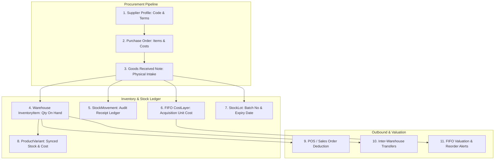

# Ecommerce Inventory Management & Procurement Testing, Security & Database Audit Plan

## Goal Description
Conduct a complete automated testing, security, and database integrity audit for the **Ecommerce Inventory Management System with Procurement** across the Python FastAPI backend, Next.js frontend, and PostgreSQL database schema. The objective is to verify end-to-end procurement workflows (Supplier Management $\rightarrow$ Purchase Orders $\rightarrow$ Goods Received Notes [GRN] $\rightarrow$ Double-Entry Stock Ledger Movements $\rightarrow$ FIFO Valuation Layers), test warehouse transfers, lot/serial tracking, UoM conversions, and stock reservations, ensure frontend form validations and in-place non-destructive filtering compliance, and audit database constraints, indices, and multi-tenant isolation.

---

## User Review Required

> [!IMPORTANT]
> **Procurement & Inventory Invariant Alignment**:
> In ProERP, Procurement is not an isolated CRUD module—it is the direct upstream authority for physical stock intake:
> 1. Creating a **Purchase Order (PO)** establishes contractual quantities and agreed unit costs.
> 2. Issuing a **Goods Received Note (GRN)** upon physical arrival triggers:
>    - Increment of `InventoryItem.quantity_on_hand` in the destination warehouse.
>    - Denormalized sync to `ProductVariant.stock_qty` and `cost_price`.
>    - Double-entry audit ledger entry in `StockMovement` with reason `RECEIPT` and link to `po_number` / `grn_number`.
>    - FIFO `CostLayer` creation preserving exact acquisition unit costs for GAAP/IFRS inventory valuation.
>    - Lot/Batch allocation in `StockLot` with expiration date tracking.

> [!WARNING]
> **Database Foreign Key Integrity & Deletion Safety**:
> Deleting a Supplier or ProductVariant with active Purchase Orders or non-zero warehouse stock must be strictly blocked (`ondelete="RESTRICT"`) to prevent orphaned stock movements or corrupt cost valuation layers. Multi-tenancy boundaries (`business_id`) must be strictly audited across all 16 inventory and procurement tables.

---

## Architecture & Procurement-to-Inventory Flow



---

## Audit & Testing Dimensions

### 1. Backend Testing & Business Logic Audit (`tests/test_ecommerce_procurement_inventory_audit.py`)
- **Supplier Master Integrity**:
  - Unique supplier code per business (`UniqueConstraint("business_id", "code")`).
  - Active/inactive filtering and tenant scoping.
- **Purchase Order (PO) Lifecycle**:
  - PO number generation (`PO-YYYYMMDD-XXXXXX`).
  - Calculation check: $\text{Total Amount} = \sum(\text{unit\_cost} \times \text{qty\_ordered}) + \text{Tax} + \text{Shipping}$.
  - State machine transitions: `DRAFT` $\rightarrow$ `SENT` $\rightarrow$ `CONFIRMED` $\rightarrow$ `PARTIALLY_RECEIVED` $\rightarrow$ `RECEIVED`.
  - Rejection of receiving goods on `CANCELLED` or already `RECEIVED` purchase orders (HTTP 400).
- **Goods Received Note (GRN) Inbound Receiving**:
  - GRN number generation (`GRN-YYYYMMDD-XXXXXX`).
  - Increments `InventoryItem.quantity_on_hand` at `destination_warehouse_id`.
  - Generates immutable `StockMovement` with `reason=RECEIPT`, `source_type="purchase_order"`, and `source_id=grn_number`.
  - Inserts FIFO `CostLayer` with `quantity_remaining = quantity_received` and acquisition `unit_cost`.
  - Inserts/increments `StockLot` with batch number and expiry date.
  - Updates `PurchaseOrderItem.quantity_received` and auto-transitions PO status (`PARTIALLY_RECEIVED` vs `RECEIVED`).
- **Inventory Outbound, Reservations & Transfers**:
  - Stock reservation: Temporary lock (`ACTIVE`), release (`RELEASED`), or checkout commit (`COMMITTED`).
  - Inter-warehouse transfer: `DRAFT` $\rightarrow$ `IN_TRANSIT` (stock deducted from origin) $\rightarrow$ `RECEIVED` (stock added to destination).
  - Physical cycle count adjustment: System vs counted variance generates audit `COUNT_CORRECTION` movement.
  - UoM fractional conversions (e.g. Master Box $\rightarrow$ Pieces) enforcing positive factors (`factor > 0`).

### 2. Frontend Testing & UI Invariant Audit (`frontend/src/components/ecommerce/__tests__/`)
- **Product & Inventory Form Validation**:
  - Mandatory fields: Title, SKU, price ($\ge 0$), category, and brand assignment.
  - Cost price validation: Numerical, non-negative, and hidden from unauthorized roles.
  - Form state locking: Submitting button disables during async network calls to prevent duplicate product creation.
- **In-Place Non-Destructive Filtering (`ui_in_place_filtering.md`)**:
  - Product catalog and inventory tables never unmount during search or category/brand filter selection.
  - Loading separation: Initial skeleton only on first mount; top indeterminate progress bar during background fetching (`isFetching`).
  - Rows smoothly dim (`opacity-60`) during debounced search without layout jump.
- **Pagination Invariants**:
  - Page reset to 1 batched via `startTransition` when filters change.
  - Next/Previous page buttons disable at boundary conditions.

### 3. Database Security, Performance & Integrity Audit (`docs/plans/ecommerce_inventory_database_security_audit.md`)
- **PostgreSQL Check Constraints Audit**:
  - `ck_po_items_qty_ordered_positive`: `quantity_ordered > 0`
  - `ck_po_items_qty_received_non_negative`: `quantity_received >= 0`
  - `ck_uom_conversion_factor_positive`: `factor > 0`
  - `ck_stock_lot_quantity_non_negative`: `quantity >= 0`
  - `ck_cost_layer_qty_remaining_non_negative`: `quantity_remaining >= 0`
- **Foreign Key Safety & Multi-Tenancy Scoping**:
  - Auditing `ondelete` strategies across all inventory and procurement tables (`RESTRICT` on variants, warehouses, and items to prevent orphaned stock movements).
  - Verifying `business_id` scoping index coverage on all composite keys.
- **Query Optimization & Indexing**:
  - B-Tree index on `(business_id, sku)` and `(business_id, barcode)`.
  - B-Tree index on `(business_id, po_number)` and `(business_id, grn_number)`.
  - B-Tree index on `(inventory_item_id, created_at)` for instant stock ledger history rendering.
  - Index on `(item_id, warehouse_id, quantity_remaining)` for sub-millisecond FIFO layer depletion.

---

## Proposed Changes

### 1. Backend Automated Testing Suite
#### [NEW] [tests/test_ecommerce_procurement_inventory_audit.py](file:///d:/Onoda%20Inc/Test%20Projects/python/python-fastapi-new/tests/test_ecommerce_procurement_inventory_audit.py)
- Test Supplier CRUD and code uniqueness.
- Test Purchase Order creation, tax/shipping math, and line item validation.
- Test GRN intake workflow: Stock arrival, inventory increment, FIFO cost layer generation, and lot tracking.
- Test Inter-warehouse stock transfer lifecycle (`draft` $\rightarrow$ `in_transit` $\rightarrow$ `received`).
- Test Stock reservation locks and timeout release.
- Test multi-tenant isolation: Tenant A cannot receive goods or view POs belonging to Tenant B.

### 2. Frontend Automated Testing Suite
#### [NEW] [frontend/src/components/ecommerce/__tests__/product-form-modal.test.tsx](file:///d:/Onoda%20Inc/Test%20Projects/python/python-fastapi-new/frontend/src/components/ecommerce/__tests__/product-form-modal.test.tsx)
- Test product create modal input validation (title, SKU, price $\ge 0$).
- Test auto-slug generation from title.
- Test form submission locking (`submitting === true`).
- Test edit mode pre-population with default variant and primary image.

#### [NEW] [frontend/src/components/ecommerce/__tests__/products-in-place-filtering.test.tsx](file:///d:/Onoda%20Inc/Test%20Projects/python/python-fastapi-new/frontend/src/components/ecommerce/__tests__/products-in-place-filtering.test.tsx)
- Test products table in-place non-destructive filtering against `ui_in_place_filtering.md`.
- Assert table structure remains mounted during search debounce and category filter changes.
- Assert top indeterminate progress bar indicates background fetching.

### 3. Database Security & Global Standards Audit
#### [NEW] [docs/plans/ecommerce_inventory_database_security_audit.md](file:///d:/Onoda%20Inc/Test%20Projects/python/python-fastapi-new/docs/plans/ecommerce_inventory_database_security_audit.md)
- Complete database audit of all 16 tables across Ecommerce Inventory and Procurement.
- Verification of check constraints, foreign keys, index coverage, and multi-tenant scoping.

---

## Verification Plan

### Automated Tests
```bash
# 1. Run Complete Backend Inventory & Procurement Audit Suite
.\venv\Scripts\pytest.exe tests/test_ecommerce_procurement_inventory_audit.py tests/test_inventory.py tests/test_inventory_uom_item_views.py tests/test_ecommerce_pos_audit.py -v

# 2. Run Frontend Testing Suite for Ecommerce & Inventory
cd frontend
npm test src/components/ecommerce/__tests__/
npm run test:coverage

# 3. TypeScript Type Safety Verification
npx tsc --noEmit
```

### Manual Verification
- Verify Purchase Order creation and GRN receiving in backend API docs (`/docs`).
- Verify warehouse stock level and FIFO cost layer creation upon receiving goods.
- Verify in-place table filtering and product modal behavior in the Next.js browser UI.
