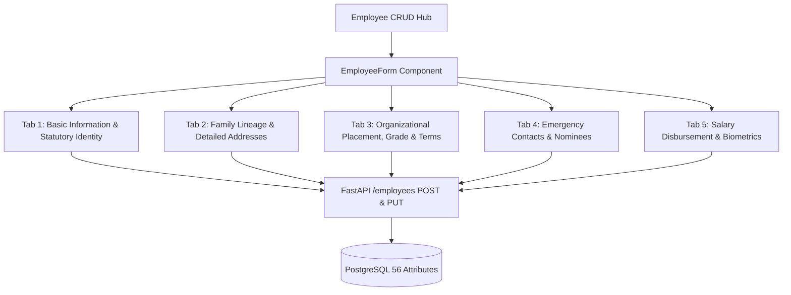

# Employee Basic & Details Information CRUD Architecture Plan

## Executive Summary
This document provides the technical design and execution strategy to address the gap in the Employee Onboarding (`/hr-payroll/employees/create`) and Editing (`/hr-payroll/employees/[id]/edit`) workflows.

Currently, while the backend FastAPI `Employee` model and schemas support **56 attributes** (including Bangladesh Labour Act statutory fields, family lineage, present/permanent address breakdown, salary grades, direct reporting manager, banking/MFS disbursement, and biometric punch IDs), the frontend [employee-form.tsx](file:///d:/Onoda%20Inc/Test%20Projects/python/python-fastapi-new/frontend/src/components/hr-payroll/employee-form.tsx) only exposes ~20 basic fields on a single flat form.

We propose upgrading [employee-form.tsx](file:///d:/Onoda%20Inc/Test%20Projects/python/python-fastapi-new/frontend/src/components/hr-payroll/employee-form.tsx) into a structured **5-Tab Enterprise HRIS Form** that aligns with the Bangladesh perspective for groups of companies and guarantees full two-way CRUD synchronization with the backend.

---

## Architecture & Component Mapping



---

## Detailed Tab Structure & Field Specifications

### Tab 1: Basic Information & Statutory Identity (প্রাথমিক তথ্য)
| Field Name | Type | UI Input Type | Description / Notes |
| :--- | :--- | :--- | :--- |
| `first_name` | string | Text (Required) | English First Name |
| `middle_name` | string | Text | English Middle Name |
| `last_name` | string | Text | English Last Name |
| `bangla_name` | string | Text (বাংলা ফন্ট) | পূর্ণ নাম (বাংলায়) — statutory for payslips and tax filings |
| `employee_id` | string | Text + Auto Gen | Auto-generated ID (e.g. `EMP-001`) with prefix selector |
| `photo_url` | string | Text / URL | Avatar / Profile Picture URL |
| `gender` | enum | Select | `Male`, `Female`, `Other` |
| `date_of_birth` | date | Date Picker | Date of Birth |
| `blood_group` | string | Select | `A+`, `A-`, `B+`, `B-`, `O+`, `O-`, `AB+`, `AB-` |
| `marital_status`| enum | Select | `Single`, `Married`, `Divorced`, `Widowed` |
| `religion` | string | Select | `Islam`, `Hinduism`, `Buddhism`, `Christianity`, `Other` |
| `nationality` | string | Text | Default: `Bangladeshi` |
| `national_id` | string | Text | Smart NID (10, 13, or 17 digits) |
| `tin` | string | Text | 12-digit e-TIN for income tax deduction |
| `passport_no` | string | Text | International Passport Number |

### Tab 2: Family Lineage & Addresses (পারিবারিক ও ঠিকানা তথ্য)
- **Family Information (BLA 2006 Form 6 & Service Book Statutory)**:
  - `father_name`: Father's Full Name (পিতার নাম)
  - `mother_name`: Mother's Full Name (মাতার নাম)
  - `spouse_name`: Spouse Full Name (স্বামী/স্ত্রীর নাম)
- **Present Address (বর্তমান ঠিকানা)**:
  - `present_address`: Street / Holding / Village
  - `present_thana`: Thana / Upazila (থানা/উপজেলা)
  - `present_district`: District (জেলা)
  - `present_division`: Division (বিভাগ)
  - `present_post_code`: Postal Code (পোস্ট কোড)
- **Permanent Address (স্থায়ী ঠিকানা)**:
  - `Same as Present Address` One-click Sync Checkbox
  - `permanent_address`, `permanent_thana`, `permanent_district`, `permanent_division`, `permanent_post_code`
- **Contact Details**:
  - `work_email`: Corporate Email (Required, validated)
  - `personal_email`: Personal Email
  - `phone`: Mobile Phone Number (Required)
  - `linkedin`: LinkedIn Profile URL

### Tab 3: Organizational Placement, Grade & Terms (পদবী, বিভাগ ও গ্রেড)
- **Corporate Placement**:
  - `branch_id`: Branch Office / Factory Location (Select from `/branches`)
  - `department_id`: Department (Select from `/departments`)
  - `job_title_id`: Job Title / Designation (Select from `/job-titles`)
  - `salary_grade_id`: Salary Grade (Select from `/salary-grades`) — *Missing previously*
  - `team`: Team / Sub-division
  - `direct_manager_id`: Direct Reporting Manager (Select from `/employees`) — *Missing previously*
  - `is_department_head`: Is Department Head toggle
  - `is_active`: Active Roster Status
- **Service Terms & BLA Compliance**:
  - `employee_category`: `Management`, `Staff`, `Worker`
  - `employment_type`: `Full Time`, `Part Time`, `Contractual`, `Intern`
  - `work_arrangement`: `Onsite`, `Remote`, `Hybrid`
  - `start_date`: Date of Joining
  - `confirmation_date`: Date of Permanent Confirmation
  - `contract_end_date`: Contract End Date
  - `probation_period_months`: Probation Period (Months)
  - `probation_end_date`: Probation Completion Date
  - `notice_period_days`: Resignation Notice Period (Days)
  - `is_overtime_eligible`: Overtime Entitlement toggle
  - `working_hours`: Standard Work Hours (e.g. `40 hrs/week`, `48 hrs/week`)
  - `working_days_per_week`: Days per week (5 or 6)

### Tab 4: Emergency Contacts & Nominees (জরুরী যোগাযোগ ও নমিনী)
- `emergency_contact_name`: Primary Emergency Contact Name
- `emergency_contact_relation`: Relationship (e.g. Spouse, Father, Brother)
- `emergency_contact_phone`: Emergency Phone Number
- `emergency_contact`: Secondary Notes / Address
- **Nominee Management**:
  - Displays link/inline manager for BLA 2006 Form 33 Nominees with share percentages.

### Tab 5: Salary Disbursement & Biometrics (ব্যাংকিং ও অ্যাক্সেস কন্ট্রোল)
- **Disbursement Method**: `Bank Transfer`, `bKash`, `Nagad`, `Rocket`, `Cash`
- **Banking Channel Details**:
  - `bank_name`: Bank Name (e.g. Dutch-Bangla, BRAC, City Bank, Islami Bank)
  - `bank_branch`: Branch Name
  - `bank_account_no`: Account Number
  - `bank_account_title`: Account Title
  - `bank_routing_number`: 9-digit BEFTN Routing Number
- **Mobile Financial Services (MFS)**:
  - `mfs_provider`: bKash, Nagad, Rocket
  - `mfs_number`: 11-digit Personal / Salary Wallet Number
- **Biometric Access Control**:
  - `biometric_user_id`: Fingerprint / Facial Recognition Punch ID
  - `rfid_card_number`: RFID Proximity Card Number
  - `skills_expertise`: Core Technical Competencies & Qualifications

---

## User Review Required

> [!IMPORTANT]
> **Unified Tabbed Form Experience**:
> Instead of a long 50-field vertical scroll, the form is divided into 5 clean tabs with a persistent bottom action bar containing:
> - **Previous / Next Tab Navigation buttons** for step-by-step onboarding.
> - **Direct Tab Jumping** allowing HR managers to jump directly to any tab.
> - **Instant Validation Feedback** highlighting which tab contains missing required fields.
> - **"Save & Continue Later" / "Save Changes" button** available on all tabs.

---

## Proposed Changes

### Component: `frontend/src/components/hr-payroll/employee-form.tsx`
#### [MODIFY] `employee-form.tsx`
- Refactor the component to manage all 56 state variables.
- Add lookups for:
  - `departments` (`/departments`)
  - `jobTitles` (`/job-titles`)
  - `branches` (`/branches`)
  - `salaryGrades` (`/salary-grades`)
  - `managers` (`/employees`)
- Implement 5 tabs: `basic`, `family_address`, `job_terms`, `emergency_nominee`, `disbursement_access`.
- Add "Same as Present Address" copy helper.
- Update `handleSubmit` to format the full payload for `POST /employees` and `PUT /employees/{id}`.

---

## Verification Plan

### Automated Build Verification
1. Run Next.js build:
   ```powershell
   npm run build
   ```
   *Expected: Zero TypeScript or lint errors.*

### Manual End-to-End Verification Flow
1. Navigate to `http://127.0.0.1:3000/hr-payroll/employees/create`.
2. Verify tab navigation between all 5 tabs.
3. Fill in basic info (English + Bangla name, NID, blood group).
4. Fill in family & address info, test "Same as Present Address" toggle.
5. Select Branch, Department, Job Title, Salary Grade, and Direct Manager.
6. Select disbursement method (Bank vs bKash/Nagad), enter bank account and routing number.
7. Enter Biometric User ID (`1001`) and RFID Card number.
8. Submit form and verify successful redirection to `/hr-payroll/employees`.
9. Click the created employee -> verify that all 56 attributes appear in the Employee Detail tabs (`/hr-payroll/employees/[id]`).
10. Click "Edit Profile" -> verify that all 5 tabs pre-populate the saved values cleanly.
