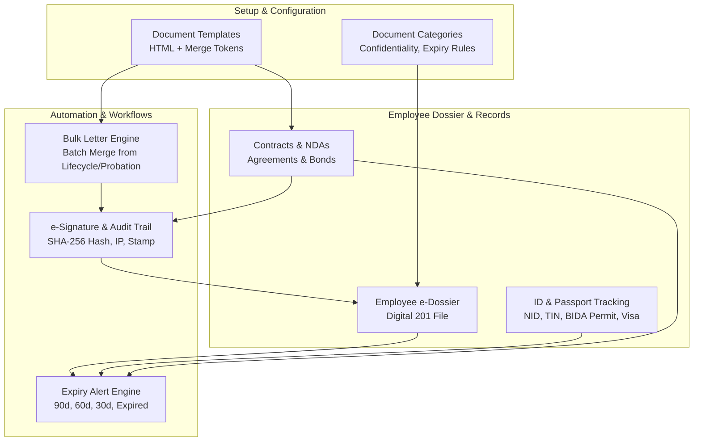

# Implementation Plan: Employee Document Management (HR & Payroll)

A comprehensive enterprise-grade Employee Document Management system conforming to global HR standards and statutory Bangladesh compliance (Bangladesh Labour Act 2006, Bangladesh Labour Rules 2015, BIDA Work Permit Guidelines, and ICT Act 2006 digital signature standards).

---

## 1. Goal Description

This module establishes a centralized, secure, and audited digital document repository across all employees in an organization. It eliminates paper personnel files ("201 files") through digital e-Dossiers, enforces statutory document verification (National ID / Smart Card, e-TIN, Passport, BIDA Work Permits), automates contract and NDA lifecycle management, provides proactive alerts for expiring credentials, enables batch generation of personalized HR letters (Appointments, Confirmations, Increments), and captures legally binding digital signatures and policy acknowledgements.

### Key Objectives
1. **Document Category & Template Setup**: Configurable document taxonomy with confidentiality tiers (Public, Internal, Confidential, Restricted/HR-Only) and a token-based template engine (`{{employee_name}}`, `{{designation}}`, `{{gross_salary}}`, `{{company_name}}`, etc.).
2. **Digital Personal File (e-Dossier / 201 File)**: Centralized employee folder view, document completeness scorecard (% compliant with mandatory statutory submissions), multi-format file uploads, versioning, and HR verification workflows (`unverified`, `verified`, `rejected`).
3. **Contract, NDA & Agreement Management**: Full lifecycle management of employment contracts, NDAs, non-compete agreements, and training/service bonds, including start/end dates, notice periods, bond penalties, and renewal tracking.
4. **ID, Passport, Visa & Work Permit Tracking**: Structured tracking of identity credentials with dual support for domestic compliance (Bangladesh 10-digit Smart NID / 13 or 17-digit classic NID, 12-digit e-TIN, Police Clearance) and expatriate compliance (Passport, BIDA/BEPZA Work Permits, Employment E-Visas).
5. **Document Expiry & Renewal Alert Engine**: Configurable proactive alert thresholds (90, 60, 30, 15 days, and Overdue) with renewal application tracking and direct document version replacement.
6. **Bulk Letter Generation**: Automated batch generation of personalized HR letters (Appointment Letters for new hires, Confirmation Letters for successful probationers, Annual Increment Letters from approved career movements) with sequential reference numbering and bulk PDF/ZIP export.
7. **e-Signature & Document Acknowledgement**: Legally binding digital signatures (drawn canvas pad, type-to-sign, clickwrap acknowledgement) with audit trail (SHA-256 document checksum, IP address, user agent, UTC timestamp, and verifiable digital stamp).

---

## 2. User Review Required

> [!IMPORTANT]
> **File Storage Strategy**:
> Document uploads will be stored securely on the backend server under `app/static/uploads/documents/{business_id}/{employee_id}/` and served via the authenticated static mount. For production environments, the architecture supports dropping in S3 or Google Cloud Storage without changing the schema.

> [!NOTE]
> **Bangladesh Statutory Alignment**:
> - **National ID (NID)**: Validates 10-digit Smart Card, 13-digit legacy, or 17-digit birth-year prefixed NID formats.
> - **e-TIN**: Validates 12-digit Taxpayer Identification Number required for Bangladesh payroll tax filings under Income Tax Act 2023.
> - **BIDA Work Permit**: Supports quota tracking, issuing authority (BIDA / BEPZA / NGO Affairs Bureau), and expatriate visa validity.
> - **BLA 2006 Contract Norms**: Incorporates statutory probation limits (3 months for clerical/worker, 6 months for supervisory) and notice periods (30/60 days per § 26/27).
> - **ICT Act 2006 Compliance**: Digital signatures capture cryptographic SHA-256 hashes of the signed document content, signer IP, and timestamp.

---

## 3. Architecture & Data Flow



---

## 4. Proposed Changes

### Backend Components (`app/modules/hr_payroll/documents/`)

#### 1. Models (`app/modules/hr_payroll/documents/models.py`) [NEW]
- `DocumentConfidentialityEnum`: `public`, `internal`, `confidential`, `strictly_confidential`.
- `DocumentVerificationStatusEnum`: `unverified`, `verified`, `rejected`.
- `AgreementTypeEnum`: `permanent_contract`, `probation_contract`, `fixed_term_contract`, `nda`, `non_compete`, `training_bond`, `consultancy_agreement`.
- `AgreementStatusEnum`: `draft`, `pending_signature`, `active`, `amended`, `renewed`, `expired`, `terminated`.
- `IdentityTypeEnum`: `nid_smart_card`, `nid_classic`, `passport`, `work_permit_bida`, `work_permit_bepza`, `work_visa`, `tin_certificate`, `birth_registration`, `driving_license`, `police_clearance`.
- `IdentityStatusEnum`: `valid`, `expiring_soon`, `expired`, `renewal_in_progress`, `cancelled`.
- `BulkLetterTypeEnum`: `appointment`, `confirmation`, `increment`, `transfer`, `promotion`, `bonus`.
- `BulkJobStatusEnum`: `draft`, `processing`, `completed`, `partial_failed`.
- `SignatureModeEnum`: `drawn_canvas`, `typed_signature`, `profile_stamp`, `clickwrap_acknowledge`.
- `SignatureStatusEnum`: `pending`, `signed`, `declined`, `revoked`.

**Database Tables**:
1. `hr_document_categories`:
   - `id` (UUID), `business_id` (int), `name` (str), `code` (str, unique per business), `description` (Text), `is_mandatory` (bool), `has_expiry` (bool), `confidentiality_level` (Enum), `allowed_extensions` (str), `max_file_size_mb` (int), `is_system` (bool), `is_active` (bool).
2. `hr_document_templates`:
   - `id` (UUID), `business_id` (int), `name` (str), `category_id` (UUID FK), `template_type` (Enum), `subject` (str), `content_html` (Text), `header_content` (Text), `footer_content` (Text), `signatory_title` (str), `requires_employee_signature` (bool), `is_active` (bool).
3. `hr_employee_documents`:
   - `id` (UUID), `business_id` (int), `employee_id` (UUID FK), `category_id` (UUID FK), `document_title` (str), `document_number` (str), `file_url` (str), `file_name` (str), `file_size_bytes` (int), `mime_type` (str), `issue_date` (Date), `expiry_date` (Date), `issuing_authority` (str), `confidentiality_level` (Enum), `verification_status` (Enum), `verified_by_user_id` (int), `verified_at` (DateTime), `rejection_reason` (Text), `version` (int), `notes` (Text).
4. `hr_employee_agreements`:
   - `id` (UUID), `business_id` (int), `employee_id` (UUID FK), `template_id` (UUID FK nullable), `agreement_type` (Enum), `reference_no` (str), `title` (str), `start_date` (Date), `end_date` (Date nullable), `notice_period_days` (int), `probation_months` (int), `bond_amount` (Numeric nullable), `governing_law` (str), `document_url` (str), `content_snapshot` (Text), `status` (Enum), `signed_at` (DateTime nullable).
5. `hr_employee_identity_records`:
   - `id` (UUID), `business_id` (int), `employee_id` (UUID FK), `identity_type` (Enum), `document_number` (str), `issuing_country` (str), `issuing_authority` (str), `issue_date` (Date), `expiry_date` (Date nullable), `visa_category` (str nullable), `place_of_issue` (str nullable), `document_file_url` (str nullable), `verification_status` (Enum), `alert_threshold_days` (int), `is_primary` (bool).
6. `hr_document_renewal_alerts`:
   - `id` (UUID), `business_id` (int), `employee_id` (UUID FK), `document_id` (UUID FK nullable), `identity_id` (UUID FK nullable), `agreement_id` (UUID FK nullable), `alert_type` (str), `expiry_date` (Date), `days_remaining` (int), `renewal_status` (str), `tracking_reference` (str), `notes` (Text).
7. `hr_bulk_letter_jobs` & `hr_bulk_letter_items`:
   - Job tracking batch parameters, template mapping, generation status, and individualized letter items with rendered HTML and document audit stamps.
8. `hr_document_acknowledgements`:
   - Cryptographic signing audit trail: `document_id`, `agreement_id`, `letter_item_id`, `document_checksum_sha256`, `signature_mode`, `signature_image_url`, `signer_full_name`, `signer_email`, `signer_ip_address`, `signer_user_agent`, `acknowledgement_text`, `status`, `signed_at`, `audit_certificate_no`.

#### 2. Schemas (`app/modules/hr_payroll/documents/schemas.py`) [NEW]
- Pydantic models for Category (In/Out/Update), Template (In/Out/Update, with preview endpoint schema), EmployeeDocument (Upload metadata, Verification, Rejection), Agreement (In/Out/Update/Renew), IdentityRecord (In/Out/Update), ExpiryAlert (Filter, UpdateRenewal), BulkLetterJob (CreateRequest, GenerateResponse, ItemOut), and DocumentAcknowledgement (SignRequest, VerificationCertificateOut).

#### 3. Repository (`app/modules/hr_payroll/documents/repository.py`) [NEW]
- High-efficiency database operations with `selectinload` for related Employee, Department, JobTitle, and DocumentCategory.
- Tenancy-enforced filtering on `business_id`.
- Dynamic query methods for expiring documents across configurable time windows (<= 90, <= 60, <= 30, <= 0 days).
- Dossier completeness calculation aggregation queries.

#### 4. Service (`app/modules/hr_payroll/documents/service.py`) [NEW]
- Business logic for file storage, MIME type validation, file size limits.
- Merge tag processor: dynamically parses HTML templates and replaces `{{employee_name}}`, `{{employee_code}}`, `{{designation}}`, `{{department}}`, `{{gross_salary}}`, `{{joining_date}}`, `{{confirmation_date}}`, etc.
- Bulk letter generator worker: iterates selected employee records, merges template content, generates unique reference numbers, creates letter records, and notifies e-Dossier.
- Digital signature verification: computes SHA-256 hash of document content, records client IP/user agent, stamps certificate number.
- Expiry scanner: scans identity records, agreements, and personal files to populate/refresh the active renewal alert ledger.

#### 5. Router (`app/modules/hr_payroll/documents/router.py`) [NEW]
- Fast, secure REST endpoints with granular RBAC permissions (`hrm:document_categories:*`, `hrm:document_templates:*`, `hrm:employee_documents:*`, `hrm:employee_agreements:*`, `hrm:identity_tracking:*`, `hrm:document_alerts:*`, `hrm:bulk_letters:*`, `hrm:document_signatures:*`).
- Endpoints:
  - `GET/POST /api/v1/documents/categories`
  - `GET/PUT/DELETE /api/v1/documents/categories/{id}`
  - `GET/POST /api/v1/documents/templates`
  - `POST /api/v1/documents/templates/preview` (renders template with sample employee data)
  - `GET/POST /api/v1/documents/dossier` (list, upload document)
  - `GET /api/v1/documents/dossier/summary/{employee_id}` (completeness score & category breakdown)
  - `PUT /api/v1/documents/dossier/{id}/verify` (approve/reject document)
  - `GET/POST /api/v1/documents/agreements` (contracts & NDAs)
  - `POST /api/v1/documents/agreements/{id}/renew` (contract renewal)
  - `GET/POST /api/v1/documents/identity-records` (NID, Passport, BIDA permits)
  - `GET /api/v1/documents/expiry-alerts` (urgent/warning alerts)
  - `POST /api/v1/documents/expiry-alerts/{id}/track-renewal`
  - `POST /api/v1/documents/bulk-letters/generate`
  - `GET /api/v1/documents/bulk-letters/jobs`
  - `GET /api/v1/documents/bulk-letters/jobs/{job_id}/items`
  - `POST /api/v1/documents/signatures/sign` (submit digital signature & acknowledge)
  - `GET /api/v1/documents/signatures/verify/{certificate_no}` (public audit certificate validator)

#### 6. Registration & Security
- Register new models in `app/models_registry.py`.
- Include router in `app/main.py` under prefix `/documents`.
- Seed granular permissions in `app/core/identity/seed.py`.

---

### Frontend Components (`frontend/src/`)

#### 1. Page (`frontend/src/app/hr-payroll/documents/page.tsx`) [NEW]
Following existing ProERP patterns (like Separation & Offboarding):
- Tabbed layout with 7 functional tabs:
  1. `e-Dossier (Personal Files)` (Icon: `FolderArchive`)
  2. `Identity & Permits` (Icon: `ShieldCheck`)
  3. `Contracts & NDAs` (Icon: `FileContract` / `FileSignature`)
  4. `Expiry & Renewals` (Icon: `AlertTriangle`)
  5. `Bulk Letters` (Icon: `MailPlus`)
  6. `Templates` (Icon: `FileCode`)
  7. `Categories & Policies` (Icon: `Sliders`)
- Header with document metrics counters:
  - Total Files in Dossiers
  - Expiring Documents (Next 30 Days)
  - Critical Expired Documents
  - Pending Verification Count
  - Unsigned Agreements

#### 2. Subcomponents (`frontend/src/components/hr-payroll/documents/`) [NEW]
1. `dossier/dossier-tab.tsx`:
   - Employee selector dropdown with search.
   - Circular/linear completeness progress bar (e.g. "9/10 Mandatory Documents Verified (90%)").
   - Categorized card grid or folder tree (Statutory ID, Contracts, Academic, Lifecycle, Medical).
   - Document upload modal with category picker, expiry date, confidentiality selector, and preview.
   - Verification badge and inline Approve / Reject dialog with reason.
2. `identity/identity-tab.tsx`:
   - Dual-mode listing: Domestic (NID 10-digit Smart / 17-digit Classic, e-TIN 12-digit, Police Clearance) and Expatriate (Passport, BIDA Work Permit, E-Visa).
   - Country filter, expiry badge (Valid, Expiring Soon, Expired), and inline verification actions.
   - Add Identity modal with field validations for NID and TIN.
3. `agreements/agreements-tab.tsx`:
   - Table of active and archived agreements (Probation contracts, Permanent agreements, NDAs, Service bonds).
   - Columns: Employee, Agreement Type, Reference No, Start Date, End Date / Indefinite, Notice Period, Bond Amount, Status, Actions.
   - Contract renewal / extension modal.
4. `expiry/expiry-alerts-tab.tsx`:
   - Urgency segmentation tabs: Critical Expired (Overdue), Expiring in 30 Days, Expiring in 60 Days, All Upcoming.
   - Renewal Tracker modal to log passport/visa/work permit government submission reference and upload renewed document version.
5. `bulk-letters/bulk-letters-tab.tsx`:
   - 4-Step Interactive Wizard:
     - **Step 1**: Choose Letter Type (Appointment, Confirmation, Increment) & Template.
     - **Step 2**: Select Target Employees (filter by Department, Designation, or pull confirmed probationers / approved increments).
     - **Step 3**: Configure Issue Date, Reference Prefix, and Preview sample generated letter.
     - **Step 4**: Execute Batch Generation -> Dispatches to employee e-Dossiers, triggers e-Signature requests, provides single-click Print / Export.
6. `templates/templates-tab.tsx`:
   - Template catalogue and rich editor modal.
   - Clickable merge-tag chips (`{{employee_name}}`, `{{designation}}`, `{{department}}`, `{{gross_salary}}`, `{{effective_date}}`, etc.) that insert tags directly into template body.
   - Live Preview tab rendering template with mock employee data.
7. `categories/categories-tab.tsx`:
   - Management table for document categories, system flags, confidentiality levels, allowed file formats, and mandatory onboarding checkboxes.
8. `modals/sign-document-modal.tsx`:
   - Clean signature pad modal supporting:
     - Drawn handwritten signature (HTML5 Canvas).
     - Typed signature with formal script font.
     - Compliance acknowledgment checkbox with legal notice.
     - Generates and displays cryptographic SHA-256 certificate and timestamp stamp.

#### 3. Sidebar Navigation (`frontend/src/components/layout/sidebar.tsx`) [MODIFY]
- Add "Document Management" link under HR & Payroll section pointing to `/hr-payroll/documents` with permission `feature: "employee_documents", action: "view"`.

---

## 5. UI Invariants Compliance (`ui_in_place_filtering.md`)

All 7 tabs will strictly obey [.agents/rules/ui_in_place_filtering.md](file:///d:/Onoda%20Inc/Test%20Projects/python/python-fastapi-new/.agents/rules/ui_in_place_filtering.md):
1. **Never unmount the table/card grid**:
   - `initialLoading` used only on first load.
   - Filter changes update `isFetching`, rendering a top-rim indeterminate progress bar (`h-0.5 bg-primary animate-pulse`) with subtle row opacity `opacity-60`.
2. **Debounced Filters & Batched State**:
   - Text inputs (search by name, document #, NID) debounced by 300ms.
   - React `startTransition` used to update filters and reset `page` to 1 simultaneously, eliminating duplicate cascading API requests.
3. **Dedicated Empty States**:
   - Differentiate "No documents uploaded yet" (zero total) from "No documents match current filters" (with a "Clear Filters" button).

---

## 6. Verification Plan

### Automated Tests
1. **Backend Test Suite (`tests/test_hr_payroll_documents.py`)**:
   - `test_document_category_crud`: Create, update, system protection.
   - `test_document_template_and_merge_tokens`: Validate merge token processor with employee attributes.
   - `test_employee_document_upload_and_verification`: Create document, verify status transition to `verified` and `rejected`.
   - `test_identity_records_and_expiry_alerts`: Create expiring passport (20 days remaining) and verify detection in `/expiry-alerts`.
   - `test_bulk_letter_generation`: Trigger bulk confirmation letter generation for 3 employees and verify generated items and unique reference numbers.
   - `test_esignature_audit_trail`: Submit digital signature, verify SHA-256 checksum, IP logging, and certificate number issuance.
2. **Execution Command**:
   ```powershell
   pytest tests/test_hr_payroll_documents.py -v
   ```

### Frontend Typecheck & Build
1. Run Next.js TypeScript check:
   ```powershell
   cd frontend
   npx tsc --noEmit
   npm run build
   ```
2. Verify all 7 tabs load without hydration warnings, layout shifts, or missing props.

### Manual Verification
1. Navigate to `/hr-payroll/documents`.
2. Inspect e-Dossier tab: select an employee, view category folders, upload a mock PDF, approve/verify it, and observe the completeness progress bar update.
3. Inspect Identity Tracking tab: add a Bangladesh Smart NID (10 digits) and an Expatriate Passport/BIDA permit; verify format badges.
4. Inspect Expiry Alerts tab: verify overdue and upcoming 30/60-day alerts appear with badge colors (red, amber, blue).
5. Inspect Bulk Letters: run a 2-employee test generation, view preview, and check that individualized letters land in the employee's dossier.
6. Open e-Signature modal: draw a signature, submit, and inspect the tamper-proof audit stamp with SHA-256 checksum and timestamp.
