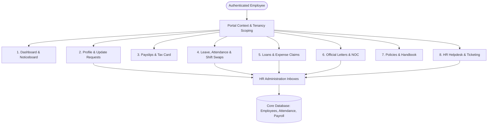

# Implementation Plan: Enterprise Employee Self-Service Portal (ESS)

An enterprise-grade, high-aesthetic **Employee Self-Service (ESS) Portal** for ProERP SaaS. This allows staff to view personal records, manage daily work, submit statutory requests, download earnings & tax documentation, and communicate with HR without paperwork or administrative friction.

---

## 1. Goal Description

Implement an end-to-end Employee Portal covering nine core operational pillars:
1. **Employee Profile (Self-Service View)**: Personal, statutory (BLA 2006, NID, e-TIN), bank/MFS, emergency contacts, job information, and nominees.
2. **Employee Dashboard & Noticeboard**: Real-time attendance meter, leave balance dials, upcoming holidays, weekly duty shifts, company announcements, and mandatory read receipts.
3. **Profile Update Request**: Self-service change requests (phone, addresses, bank/MFS, emergency contacts, profile photo) with HR approval workflow and automated data sync.
4. **Payslip & Tax Card Download**: Historical monthly payslips (HTML & PDF), gross-to-net deduction breakdown, and annual Tax Card (TDS certificates under Bangladesh Income Tax Act 2023).
5. **Leave, Attendance & Roster Self-Request**: Leave submission, statutory encashment requests (BLA 2006 § 117), manual attendance regularisation (missed punch/late excuse), and peer shift exchange requests.
6. **Loan & Expense Claim Application**: Salary advances and personal loans with installment scheduling; business expense claims with multi-item breakdown and receipt upload.
7. **Official Letter Request (NOC, Salary Certificate, Experience Letter)**: Request letters for visa/travel/banking, track HR generation status, and download stamped certificates.
8. **Company Policy & Handbook Directory**: Searchable repository of HR policies, code of conduct, holiday schedules, and health/safety handbooks with mandatory acknowledgement tracking.
9. **HR Helpdesk & Ticketing System**: Multi-category ticketing (Payroll, Leave, IT, Workplace), priority classification, attachments, and threaded real-time conversations with HR representatives.



---

## 2. User Review Required

> [!IMPORTANT]
> **User-to-Employee Association**:
> Each authenticated `User` account links to an `Employee` record via `user_id` on the `employees` table, falling back to matching `user.email == employee.work_email` within the same `business_id`. If an admin logs into the portal, they will view their own linked employee profile or can select a preview employee if they are a superadmin.

> [!NOTE]
> **Statutory Compliance Invariants**:
> - **Leave & Encashment**: Follows Bangladesh Labour Act 2006 (§ 117) encashment eligibility and carry-forward caps.
> - **Tax Card (TDS)**: Follows Bangladesh Income Tax Act (ITA 2023) formula: Basic, House Rent, Medical, Conveyance exemptions, and Tax Deducted at Source (TDS).
> - **In-Place Non-Destructive Filtering**: UI tables (payslips, requests, policies, tickets) use `isFetching` with top-rim progress bars and `startTransition` to eliminate cascading double network calls.

---

## 3. Proposed Changes

### Backend Architecture (`app/modules/hr_payroll/portal/` & additions)

#### Database Models & Schemas

1. **`app/modules/hr_payroll/employees/models.py`**:
   - Add `user_id: Mapped[int | None] = mapped_column(Integer, ForeignKey("users.id", ondelete="SET NULL"), nullable=True, unique=True, index=True)`.

2. **`app/modules/hr_payroll/portal/models.py`** [NEW]:
   - **`ProfileUpdateRequest`**:
     - `id`, `business_id`, `employee_id`, `requested_changes` (JSON of changed fields), `reason`, `status` (`PENDING`, `APPROVED`, `REJECTED`), `reviewed_by_id`, `review_notes`, `reviewed_at`.
   - **`AttendanceCorrectionRequest`**:
     - `id`, `business_id`, `employee_id`, `attendance_date`, `request_type` (`MISSED_PUNCH`, `LATE_EXCUSE`, `WORK_ON_HOLIDAY`), `requested_time_in`, `requested_time_out`, `reason`, `supporting_document_url`, `status` (`PENDING`, `APPROVED`, `REJECTED`), `reviewer_id`, `reviewer_notes`, `reviewed_at`.
   - **`EmployeeLoan`**:
     - `id`, `business_id`, `employee_id`, `loan_type` (`SALARY_ADVANCE`, `PERSONAL_LOAN`, `EMERGENCY_LOAN`), `principal_amount`, `monthly_installment_amount`, `total_installments`, `disbursed_amount`, `remaining_balance`, `repayment_start_date`, `status` (`PENDING`, `APPROVED`, `DISBURSED`, `REJECTED`, `COMPLETED`), `approved_by_id`, `disbursed_at`, `reason`.
   - **`ExpenseClaim` & `ExpenseClaimItem`**:
     - `id`, `business_id`, `employee_id`, `claim_number`, `title`, `claim_date`, `total_amount`, `status` (`DRAFT`, `SUBMITTED`, `APPROVED`, `REJECTED`, `REIMBURSED`), `reviewer_id`, `reviewer_notes`, `reimbursed_at`.
     - Items: `expense_date`, `category` (`TRAVEL`, `MEALS`, `HOTEL`, `SUPPLIES`, `TRAINING`, `OTHER`), `amount`, `description`, `receipt_url`.
   - **`OfficialLetterRequest`**:
     - `id`, `business_id`, `employee_id`, `letter_type` (`NOC_VISA`, `NOC_TRAVEL`, `SALARY_CERTIFICATE`, `EXPERIENCE_LETTER`, `JOB_CONFIRMATION`), `purpose`, `addressed_to`, `travel_country`, `travel_start_date`, `travel_end_date`, `status` (`PENDING`, `APPROVED`, `GENERATED`, `REJECTED`), `generated_file_url`, `reviewer_id`, `review_notes`.
   - **`CompanyPolicy` & `PolicyAcknowledgement`**:
     - `id`, `business_id`, `title`, `category` (`HR_POLICY`, `CODE_OF_CONDUCT`, `LEAVE_RULES`, `IT_SECURITY`, `BENEFITS`), `version`, `effective_date`, `summary`, `content`, `attachment_url`, `is_mandatory_acknowledgement`, `is_active`.
     - `PolicyAcknowledgement`: `policy_id`, `employee_id`, `acknowledged_at`, `ip_address`.
   - **`HRTicket` & `HRTicketComment`**:
     - `id`, `business_id`, `ticket_number`, `employee_id`, `category` (`PAYROLL`, `LEAVE`, `BENEFITS`, `WORKPLACE`, `IT`, `GENERAL`), `priority` (`LOW`, `MEDIUM`, `HIGH`, `URGENT`), `subject`, `description`, `attachment_url`, `status` (`OPEN`, `IN_PROGRESS`, `RESOLVED`, `CLOSED`), `assigned_to_id`, `resolved_at`, `resolution_notes`.
     - Comments: `ticket_id`, `author_user_id`, `is_hr_staff`, `message`, `attachment_url`, `created_at`.

3. **`app/modules/hr_payroll/portal/service.py`** [NEW]:
   - `PortalService`:
     - Resolves employee profile from current authenticated user context.
     - Aggregates dashboard telemetry (month attendance hours, late days, leave balances, upcoming holidays, weekly shifts, unread notice count).
     - Submits & approves profile update requests (auto-updates `Employee` on approval).
     - Computes annual Tax Card summary (TDS deduction breakdown across the fiscal year).
     - Submits attendance correction requests (updates `Attendance` on approval).
     - Manages Loan & Expense Claim workflows with installment balance tracking.
     - Dispatches Official Letter requests and attaches generated PDFs.
     - Fetches active Company Policies and tracks user acknowledgements.
     - Operates Helpdesk ticketing system with real-time threaded discussions.

4. **`app/modules/hr_payroll/portal/router.py`** [NEW]:
   - Endpoints mounted under `/api/v1/portal`:
     - `GET /api/v1/portal/me` — Authenticated employee profile & employment summary.
     - `GET /api/v1/portal/dashboard` — Aggregated KPI telemetry, active roster, notices.
     - `POST /api/v1/portal/profile-update-requests` — Submit profile update request.
     - `GET /api/v1/portal/profile-update-requests` — View submission history & review status.
     - `GET /api/v1/portal/payslips` — List all monthly payslips.
     - `GET /api/v1/portal/payslips/{id}/html` — Render printable statutory payslip.
     - `GET /api/v1/portal/tax-card` — Annual tax certificate & TDS withholding summary.
     - `GET /api/v1/portal/attendance/my-summary` — Current month punch logs & status counts.
     - `POST /api/v1/portal/attendance/correction-requests` — Request missed punch/late excuse.
     - `GET /api/v1/portal/leave/my-balances` — Live leave balances with statutory entitlements.
     - `POST /api/v1/portal/leave/apply` — Apply for leave directly from portal.
     - `GET /api/v1/portal/roster/my-schedule` — Monthly duty roster schedule.
     - `POST /api/v1/portal/roster/exchange-request` — Request shift swap with peer.
     - `GET`, `POST /api/v1/portal/loans` — Employee loan & advance applications.
     - `GET`, `POST /api/v1/portal/expense-claims` — Expense reimbursement claims.
     - `GET`, `POST /api/v1/portal/letter-requests` — Official letter & NOC requests.
     - `GET /api/v1/portal/policies` — Company policy & handbook directory.
     - `POST /api/v1/portal/policies/{id}/acknowledge` — Acknowledge policy reading.
     - `GET`, `POST /api/v1/portal/tickets` — Helpdesk tickets.
     - `GET`, `POST /api/v1/portal/tickets/{id}/comments` — Helpdesk ticket conversation thread.

5. **HR Administrative Approval Endpoints**:
   - `PATCH /api/v1/portal/admin/profile-update-requests/{id}/review`
   - `PATCH /api/v1/portal/admin/attendance-corrections/{id}/review`
   - `PATCH /api/v1/portal/admin/loans/{id}/review`
   - `PATCH /api/v1/portal/admin/expense-claims/{id}/review`
   - `PATCH /api/v1/portal/admin/letter-requests/{id}/review`
   - `PATCH /api/v1/portal/admin/tickets/{id}/status`

---

### Frontend Architecture (`frontend/src/app/portal/` & components)

#### Modern Portal UI & Design Tokens
Built using curated indigo/slate/violet design tokens, glassmorphism telemetry cards, interactive SVG progress rings, micro-animations, and in-place non-destructive filtering.

```
frontend/src/app/portal/
├── layout.tsx                     # Portal header, switch to Admin view, quick punch widget
├── page.tsx                       # Employee Dashboard & Noticeboard
├── profile/
│   └── page.tsx                   # My Profile View & Profile Update Request Modal
├── payslips/
│   └── page.tsx                   # Payslip Archive, Breakdown Drawer, Tax Card
├── requests/
│   └── page.tsx                   # Leave, Attendance Correction, & Shift Exchange Hub
├── finance/
│   └── page.tsx                   # Loans & Advances, Expense Reimbursement Claims
├── letters/
│   └── page.tsx                   # Official Letters & NOC Request Tracker
├── handbook/
│   └── page.tsx                   # Policy Directory & Handbook Viewer
└── helpdesk/
    └── page.tsx                   # Helpdesk Tickets & Threaded Discussion Drawer
```

#### Shared Components & Modules [NEW]
- `frontend/src/components/portal/punch-card-widget.tsx`: Real-time web punch clock (In/Out) with GPS coordinates / IP display.
- `frontend/src/components/portal/leave-balance-dial.tsx`: Circular radial SVG gauges showing Casual, Sick, and Earned leave balances.
- `frontend/src/components/portal/tax-card-modal.tsx`: Interactive Bangladesh Income Tax deduction breakdown & printable TDS certificate.
- `frontend/src/components/portal/ticket-chat-drawer.tsx`: Slide-over real-time chat interface for HR Helpdesk ticket resolution.

#### Navigation Integration
- Add top-level `"Employee Portal"` section in `frontend/src/components/layout/sidebar.tsx` with dedicated self-service navigation items.

---

## 4. Verification Plan

### Automated Tests
1. **Model & Service Tests** (`tests/modules/hr_payroll/test_portal.py`):
   - Test user-to-employee link resolution.
   - Test profile update request lifecycle and automated employee model field synchronization.
   - Test attendance correction approval updating the `Attendance` record.
   - Test loan application approval and remaining balance calculation.
   - Test expense claim calculation with multi-item receipt attachments.
   - Test official letter request lifecycle (visa/travel NOC, salary certificate).
   - Test policy directory read acknowledgement.
   - Test ticket conversation thread and state transition (`OPEN` → `IN_PROGRESS` → `RESOLVED`).

### Manual Verification Flow
1. **Employee Dashboard**: Log in as standard user, open `/portal`, verify attendance punch, leave dial stats, upcoming holidays, and read recent company notices.
2. **Profile & Edit Request**: Visit `/portal/profile`, trigger a profile edit request (update emergency contact and phone), approve request from admin endpoint, verify profile data updates automatically.
3. **Payslips & Tax Card**: Open `/portal/payslips`, click "View Payslip" to view the earnings breakdown; click "Annual Tax Card" to inspect fiscal year TDS summary.
4. **Time & Attendance Requests**: Submit a missed-punch attendance correction and a leave application; verify status tracking.
5. **Loans & Expenses**: Submit a Salary Advance request and an Expense Claim with receipt attachment; verify approval tracking.
6. **Official Letters**: Request a Visa NOC letter; confirm approval status.
7. **Policies & Handbook**: Browse policy handbook and click "Acknowledge Read".
8. **HR Helpdesk**: Open a ticket in `/portal/helpdesk`, send comments, and verify the two-way discussion thread.

---

## 5. Execution Steps

1. **Step 1: Backend Models & Migrations**
   - Implement `app/modules/hr_payroll/portal/models.py`.
   - Register models in `app/models_registry.py` and run schema sync.
2. **Step 2: Service & Business Logic**
   - Implement `app/modules/hr_payroll/portal/service.py` with multi-tenancy scoping and audit trails.
3. **Step 3: REST API Routers & Documentation**
   - Implement `app/modules/hr_payroll/portal/router.py`, mount in `app/main.py`, and update Postman collection.
4. **Step 4: Frontend Portal Pages & Components**
   - Build `/portal` dashboard, profile, payslips, requests, finance, letters, handbook, and helpdesk pages adhering to rule `ui_in_place_filtering.md`.
5. **Step 5: Sidebar Navigation & Polish**
   - Integrate with `frontend/src/components/layout/sidebar.tsx`.
6. **Step 6: End-to-End Verification**
   - Run automated test suite, verify container health, and validate UI responses.
