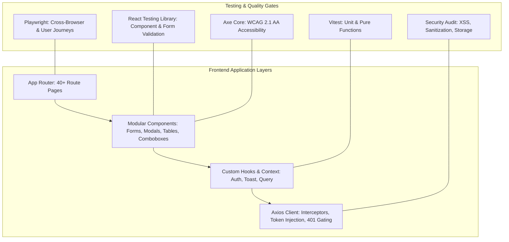

# Next.js Frontend Testing, Security & Validation Audit Plan

## Goal Description
Conduct an automated testing, security, and validation audit of the ProERP Next.js 16 (React 19, TypeScript, TailwindCSS v4) frontend codebase. The objective is to establish an automated testing infrastructure (**Vitest, React Testing Library, and Playwright**), audit and verify all form validations and error handling states, eliminate UI performance bottlenecks (memory leaks, infinite renders, double network calls), verify adherence to the mandatory In-Place Non-Destructive Filtering standard (`ui_in_place_filtering.md`), perform security auditing (XSS, token storage, sensitive data exposure), and verify WCAG 2.1 AA accessibility and cross-browser responsiveness.

---

## User Review Required

> [!IMPORTANT]
> **Testing Stack Architecture: Vitest vs Jest**:
> The project runs **Next.js 16.4.2** with **React 19.3.0** and Turbopack. We recommend **Vitest** over Jest because Vitest provides native ESM and TypeScript support with near-instant execution, seamless integration with `@testing-library/react`, and minimal configuration friction with React 19 / Next.js 16 compared to traditional Jest transform pipelines.

> [!WARNING]
> **DevDependencies Installation**:
> The frontend currently has zero testing dependencies installed in `package.json`. Executing this audit requires installing:
> - Unit & Component: `vitest`, `@vitejs/plugin-react`, `jsdom`, `@testing-library/react`, `@testing-library/jest-dom`, `@testing-library/user-event`
> - Coverage: `@vitest/coverage-v8`
> - E2E & Accessibility: `@playwright/test`, `@axe-core/playwright`
> - API Mocking: `msw` or `axios-mock-adapter`

---

## Architecture & Audit Scope



---

## Audit Dimensions & Methodology

### 1. Form Validation & User Feedback Audit
- **Field-Level Inline Error Display**: Verify that validation errors appear directly beneath their respective input fields with high-contrast text and accessible `aria-describedby` associations, rather than only in transient toasts.
- **Statutory & Format Constraints**:
  - Bangladesh National ID (NID): 10, 13, or 17 numeric digits.
  - Tax Identification Number (TIN): 12 numeric digits.
  - Phone format: BD standard `+8801XXXXXXXXX` or 11-digit local format.
  - Date boundary checks: Joining dates, contract end dates, probation review dates, and voucher dates cannot violate logical chronology.
- **Duplicate Submissions & State Locking**: Ensure submission buttons disable, display inline loading spinners, and prevent double network requests during asynchronous operations.
- **Server Error Mapping**: Verify API HTTP 422 validation errors (FastAPI `loc` error lists) are dynamically mapped and highlighted on the corresponding form fields.

### 2. UI Invariant & Table Audit (`ui_in_place_filtering.md`)
- **Non-Destructive Filtering**: Confirm tables, rosters, and catalog grids NEVER unmount during search queries, status filter changes, or page switches.
- **Two-Tier Loading Verification**:
  - `initialLoading`: Full skeleton displayed only on initial mount.
  - `isFetching`: Top-rim indeterminate progress bar, subtle row dimming (`opacity-50`), count spinner, and toolbar buttons remain enabled.
- **Batching & `startTransition`**: Ensure filter updates and `setCurrentPage(1)` resets are bundled inside `React.startTransition` to eliminate cascading double network requests.

### 3. Frontend Security & Data Protection Audit
- **Cross-Site Scripting (XSS)**: Audit all template previews, markdown renderers, and letter editors for `dangerouslySetInnerHTML`. Ensure `DOMPurify` is employed to sanitize rendered HTML content.
- **Session & Token Management**:
  - Validate JWT bearer token storage in `localStorage` / cookie headers.
  - Test automatic session expiration interception (HTTP 401 -> token purge -> redirect to `/login?redirect=...`).
  - Ensure cross-tenant data is never cached or leaked across user logouts.
- **Sensitive Data Masking**: Ensure bank account numbers, passwords, and cryptographic certificates are appropriately masked or hidden from browser console logs.

### 4. Accessibility (a11y) & Responsiveness
- **Keyboard Navigation**: Verify modals, comboboxes, and dropdowns can be navigated via `Tab`/`Shift+Tab`, opened via `Enter`/`Space`, and dismissed via `Escape`.
- **Screen Reader Support**: Ensure icons have `aria-hidden="true"`, inputs have matching `<label htmlFor="...">`, and buttons have descriptive text.
- **Responsive Layouts**: Audit layouts at 375px (mobile), 768px (tablet), and 1280px+ (desktop) to ensure no horizontal overflow, clipped text, or broken action bars.

---

## Proposed Execution Plan

### Phase 1: Test Infrastructure & Environment Setup
Establish a reliable test harness with Vitest, React Testing Library, and Playwright.

#### [NEW] `frontend/vitest.config.ts`
- Configure Vitest with React plugin, `jsdom` environment, `@/` path alias mapping, and setup files.
- Enable V8 coverage reporting (`text`, `json`, `html`).

#### [NEW] `frontend/vitest.setup.ts`
- Import `@testing-library/jest-dom/vitest`.
- Mock Next.js router (`useRouter`, `usePathname`, `useSearchParams`).
- Mock `window.matchMedia` and resize observers.
- Configure Axios mock harness.

#### [NEW] `frontend/playwright.config.ts`
- Configure Playwright for desktop Chrome, Firefox, Safari, and mobile viewport emulation.
- Set up local web server auto-start (`npm run dev`).

#### [MODIFY] `frontend/package.json`
- Add testing dependencies and NPM scripts:
  - `"test": "vitest run"`
  - `"test:watch": "vitest"`
  - `"test:coverage": "vitest run --coverage"`
  - `"test:e2e": "playwright test"`

---

### Phase 2: Core Context, Auth & Interceptor Testing
Audit authentication lifecycle, permission gating, and API client resilience.

#### [NEW] `frontend/src/context/__tests__/auth-context.test.tsx`
- Test initial mount user hydration from `localStorage` and `/auth/me`.
- Test successful login and token persistence.
- Test logout flow: token purge, state reset, and redirection.
- Test `hasPermission(module, feature, action)` across Basic, Pro, and Enterprise tiers.
- Test `hasModuleAccess(module)`.

#### [NEW] `frontend/src/lib/__tests__/api-client.test.ts`
- Test request interceptor attaching `Authorization: Bearer <token>`.
- Test response interceptor catching HTTP 401, purging tokens, and redirecting with `?redirect=...`.
- Test graceful handling of network drops, timeout errors (10s), and HTTP 500 server crashes.

---

### Phase 3: Forms & User Input Validation Audit
Audit critical forms across HR, Documents, and Ecommerce.

#### [NEW] `frontend/src/components/hr-payroll/__tests__/employee-form.test.tsx`
- Test mandatory field enforcement (first name, employee ID, department, designation, joining date).
- Test NID, TIN, and phone number validation patterns.
- Test tab navigation (Basic Info -> Contact -> Statutory -> Emergency -> Bank).
- Test API 422 validation error mapping to inline field error messages.
- Test submit button locking during async submission to prevent duplicate records.

#### [NEW] `frontend/src/components/hr-payroll/documents/__tests__/document-modals.test.tsx`
- Audit `DocumentTemplateModal`: Token syntax validation (`{{token}}`), HTML preview safety, subject and name required checks.
- Audit `EmployeeAgreementModal`: Contract dates chronological check (start date <= end date), salary numerical format.
- Audit `IdentityRecordModal`: ID type, expiration threshold days, file upload validation.
- Audit `BulkLetterGenerateModal`: Batch title required, minimum 1 employee selection validation.

#### [NEW] `frontend/src/components/ecommerce/__tests__/product-form.test.tsx`
- Audit `ProductFormModal`: Required SKU, title, price >= 0, category assignment, cost numerical checks.

---

### Phase 4: In-Place Filtering & Table UI Invariant Audit
Audit table behavior against `.agents/rules/ui_in_place_filtering.md`.

#### [NEW] `frontend/src/components/hr-payroll/__tests__/in-place-filtering.test.tsx`
- Test Employee Directory / Document Categories table rendering:
  - Assert table structure remains mounted during filter changes.
  - Assert top indeterminate progress bar is displayed when `isFetching === true`.
  - Assert row opacity classes transition to `opacity-50` without unmounting table rows.
  - Assert search input debounce (300ms) executes exactly one API call.
  - Assert filter selection and `setCurrentPage(1)` are batched with `startTransition`.

---

### Phase 5: Security, Accessibility & E2E Integration Audit
Audit XSS vectors, keyboard access, and full user flows.

#### [NEW] `frontend/src/lib/__tests__/security-sanitization.test.ts`
- Test template and letter HTML preview sanitization against malicious `<script>`, `onerror`, and `iframe` injections.
- Test password field masking and absence of sensitive credentials in console logs or serialized state.

#### [NEW] `frontend/e2e/auth-and-navigation.spec.ts`
- Playwright E2E: User login -> Redirect to Dashboard -> Role-based sidebar menu rendering.
- Test route protection: Direct navigation to `/hr-payroll/documents` when unauthenticated redirects to `/login`.
- Test Axe accessibility score across Login, Employee Directory, and Document Management pages.

---

### Phase 6: Defect Remediation, Coverage Run & Final Audit Report
- Run full test suite with coverage:
  ```bash
  npm run test:coverage
  ```
- Run E2E test suite:
  ```bash
  npx playwright test
  ```
- Fix identified bugs, UI flicker issues, broken error states, or accessibility violations.
- Compile and publish the final Audit Report artifact (`frontend_test_coverage_security_audit_report.md`).

---

## Verification Plan

### Automated Tests
```bash
# 1. Dependency installation & setup
cd frontend
npm install -D vitest @vitejs/plugin-react jsdom @testing-library/react @testing-library/jest-dom @testing-library/user-event @vitest/coverage-v8 axios-mock-adapter @playwright/test @axe-core/playwright

# 2. Type Check
npx tsc --noEmit

# 3. Unit & Component Test Suite Execution
npm run test:coverage

# 4. End-to-End & Accessibility Tests
npx playwright test
```

### Manual Verification
- Review generated coverage report in `frontend/coverage/index.html`.
- Manually trigger invalid form submissions in browser to verify immediate inline error messages.
- Verify smooth in-place filtering on tables without screen flicker or table unmounting.
