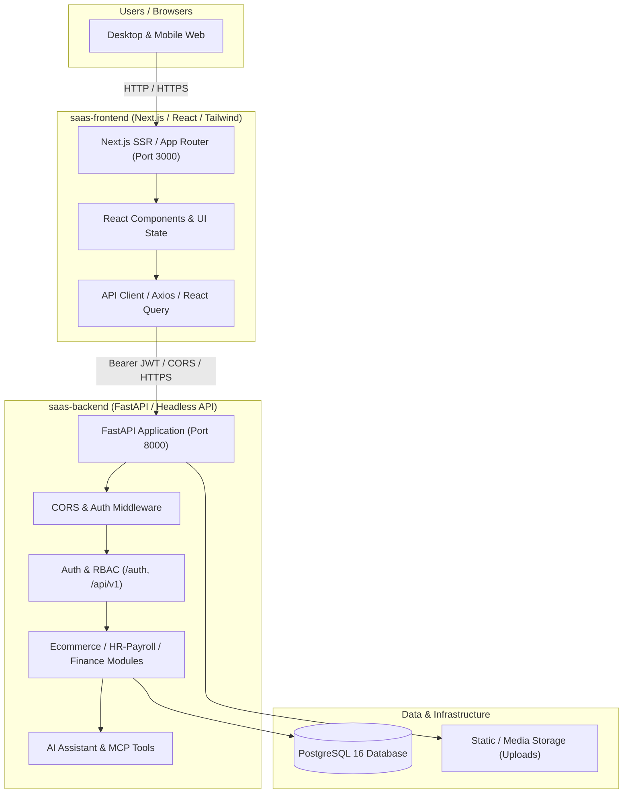
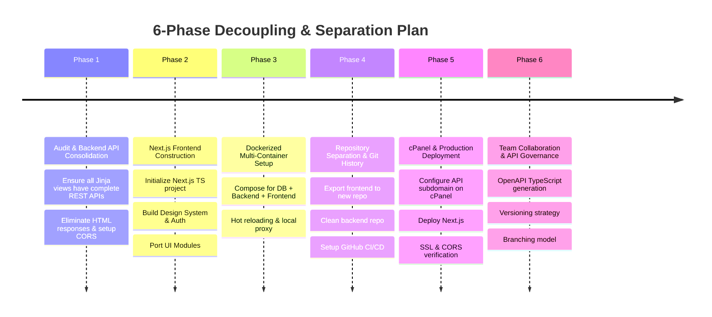

# Architecture & Migration Plan: Decoupling FastAPI Backend and Next.js Frontend

## 1. Executive Summary & Goal
The existing application is an enterprise SaaS platform (E-Commerce, HR & Payroll, Finance, and AI Assistant) built with **FastAPI**, **SQLAlchemy** (PostgreSQL), **Jinja2 Templates**, and **Tailwind CSS**. It is currently deployed via:
- **Local environment**: Multi-container Docker (`fastapi_app` + `fastgres_postgres`).
- **Live production**: **cPanel hosting** utilizing Phusion Passenger (`passenger_wsgi.py` with `a2wsgi` bridge) and a PostgreSQL database.

The goal is to transition from this coupled monolithic structure into a **modern decoupled architecture** with:
1. **Dedicated Backend (`saas-backend`)**: A headless FastAPI REST API project providing clean JSON endpoints, RBAC permissions, multi-tenancy isolation, Alembic migrations, and AI Assistant tools.
2. **Dedicated Frontend (`saas-frontend`)**: A modern **Next.js (React + TypeScript + Tailwind CSS)** application providing an interactive client/server rendered UI, client state management, responsive dashboards, and data tables.
3. **Independent Team Workflows**: Two standalone Git repositories enabling backend and frontend teams to develop, test, version, and deploy independently without cross-repository merge conflicts.



---

## 2. Key Architecture Decisions & User Review Required

> [!IMPORTANT]
> **Authentication Architecture Transition**:
> The existing system relies on both Bearer headers and `httponly` session cookies with HTML 302 redirects for unauthenticated requests (`auth_and_cache_middleware` in `app/main.py`). In a headless architecture:
> - The API must return standard **`401 Unauthorized` JSON** rather than 302 redirects to `/auth/login`.
> - The Next.js frontend handles authentication via either:
>   - **Option A (Recommended)**: Next.js API Route / BFF (Backend for Frontend) proxy or session cookie forwarding to FastAPI, keeping tokens in secure httpOnly cookies.
>   - **Option B**: Pure client-side Bearer token stored in browser memory/localStorage and attached via Axios/Fetch interceptor.
> - **CORS Configuration**: FastAPI must explicitly permit the Next.js frontend origin (e.g. `http://localhost:3000` in local dev, `https://yourdomain.com` or `https://app.yourdomain.com` in production) with `allow_credentials=True`.

> [!WARNING]
> **Production Hosting on cPanel**:
> cPanel is natively designed for LAMP/WSGI workloads. Running a decoupled Next.js + FastAPI setup on cPanel requires a concrete production strategy:
> - **Domain / Subdomain Topology**:
>   - Frontend: `https://yourdomain.com` (or `https://app.yourdomain.com`)
>   - Backend API: `https://api.yourdomain.com`
> - **Next.js Production Hosting Options on cPanel**:
>   1. **Static Export (`output: 'export'`)**: Generates pure HTML/CSS/JS files deployed directly into cPanel's `public_html`. Fastest and lowest resource usage on cPanel; communicates entirely with `https://api.yourdomain.com` via client-side fetch.
>   2. **cPanel Node.js Selector (Application Manager)**: Runs a Node.js daemon via Passenger inside cPanel. Supports Next.js SSR (Server-Side Rendering), but requires Node.js support enabled on the cPanel server.
>   3. **External Frontend Hosting (Vercel / Cloudflare Pages / Coolify / VPS)**: Host Next.js on Vercel or a VPS, keeping FastAPI and PostgreSQL on cPanel. This is widely considered the industry standard for Next.js performance and caching.

---

## 3. Target Folder Structures

### 3.1 Backend Folder Structure (`saas-backend`)
Eliminates Jinja2 HTML templates, HTML view routers, and web assets from the backend, leaving a clean, headless API structure:

```
saas-backend/
├── .env
├── .env.example
├── .gitignore
├── Dockerfile
├── Dockerfile.dev
├── README.md
├── alembic/
│   ├── env.py
│   ├── script.py.mako
│   └── versions/
├── alembic.ini
├── app/
│   ├── __init__.py
│   ├── main.py                     # API root, CORS, lifespan, global middleware
│   ├── database.py                 # AsyncSessionLocal & SessionLocal engines
│   ├── models_registry.py          # Central SQLAlchemy model imports
│   ├── api/
│   │   ├── __init__.py
│   │   └── v1/
│   │       ├── api.py              # Central router aggregating all v1 routers
│   │       └── endpoints/
│   │           ├── auth.py         # Login, register, me, token refresh
│   │           ├── users.py
│   │           ├── roles.py
│   │           └── sync.py
│   ├── common/                     # Global enums, pagination schemas, exceptions
│   ├── core/
│   │   ├── config.py               # Pydantic Settings
│   │   ├── security.py             # JWT encode/decode, pwd hashing
│   │   ├── deps.py                 # Dependency injections (get_current_user, permissions)
│   │   ├── billing/
│   │   ├── identity/
│   │   └── tenancy/
│   ├── modules/                    # Domain-driven modules (Pure REST APIs)
│   │   ├── ecommerce/              # products, categories, orders, inventory, etc.
│   │   │   └── products/
│   │   │       ├── models.py
│   │   │       ├── schemas.py
│   │   │       ├── repository.py
│   │   │       ├── service.py
│   │   │       └── router.py       # Exposes REST endpoints
│   │   ├── hr_payroll/             # employees, leave, attendance, payroll, etc.
│   │   └── finance/                # chart of accounts, vouchers, ledger, reports
│   ├── mcp/                        # AI Assistant tools & schemas
│   └── services/                   # Background tasks, export/import engines
├── passenger_wsgi.py               # cPanel production entrypoint (ASGIMiddleware)
├── pyproject.toml
├── requirements.txt
└── tests/                          # Pytest test suite for API endpoints
    ├── conftest.py
    ├── test_auth_api.py
    └── test_modules/
```

### 3.2 Frontend Folder Structure (`saas-frontend`)
A modern Next.js 14/15 App Router project:

```
saas-frontend/
├── .env.example
├── .env.local
├── .gitignore
├── Dockerfile
├── Dockerfile.dev
├── README.md
├── next.config.mjs
├── package.json
├── postcss.config.mjs
├── tailwind.config.ts
├── tsconfig.json
├── public/                         # Public branding, logos, icons, favicon
└── src/
    ├── app/                        # Next.js App Router
    │   ├── (auth)/                 # Route group: unauthenticated pages
    │   │   ├── login/page.tsx
    │   │   ├── register/page.tsx
    │   │   └── layout.tsx
    │   ├── (dashboard)/            # Route group: authenticated SaaS dashboard
    │   │   ├── layout.tsx          # Sidebar, Navbar, User Menu, RBAC guards
    │   │   ├── page.tsx            # Dashboard home overview
    │   │   ├── ecommerce/          # Products, Orders, Inventory pages
    │   │   │   ├── products/
    │   │   │   │   ├── page.tsx    # Data table with filtering & pagination
    │   │   │   │   ├── create/page.tsx
    │   │   │   │   └── [id]/page.tsx
    │   │   │   └── inventory/
    │   │   ├── hr-payroll/         # Employees, Leave, Attendance, Payroll
    │   │   ├── finance/            # Accounts, Vouchers, Reports
    │   │   └── ai-assistant/       # Interactive AI Chat UI
    │   ├── api/                    # Next.js API Routes (BFF proxy/auth session)
    │   ├── layout.tsx              # Root HTML layout, ThemeProvider, QueryClient
    │   └── globals.css             # Tailwind base & custom components
    ├── components/                 # Reusable UI components
    │   ├── ui/                     # Atoms: Button, Input, Modal, Badge, Dropdown
    │   ├── forms/                  # Form controls with validation (React Hook Form + Zod)
    │   ├── tables/                 # Reusable data table with sort/filter/pagination
    │   ├── layout/                 # Sidebar, Topbar, Breadcrumbs, Tenant Switcher
    │   └── ai/                     # AI Chat interface, stream renderer
    ├── hooks/                      # Custom hooks (useAuth, usePermissions, useTenant)
    ├── lib/                        # Utilities & libraries
    │   ├── api-client.ts           # Central Axios / Fetch instance with interceptors
    │   ├── auth.ts                 # Token management & session verification
    │   └── utils.ts                # Class merging (clsx/tailwind-merge), formatting
    ├── types/                      # TypeScript declarations & API response models
    │   ├── auth.ts
    │   ├── ecommerce.ts
    │   ├── hr-payroll.ts
    │   └── tenant.ts
    └── stores/                     # Client state (Zustand or React Context)
```

---

## 4. Phased Implementation Roadmap



### Phase 1: Backend Decoupling & API Standardization (In-Place)
Before splitting repositories, prepare the FastAPI backend so it functions 100% as a headless API:
1. **API Endpoint Parity Audit**:
   - Verify every action currently rendered in `app/routers/*_views.py` (e.g. `GET /products`, `GET /attendance/manage`) is fully backed by corresponding JSON endpoints in `app/modules/*` or `app/api/v1/`.
   - Ensure all list endpoints accept query params for pagination (`skip`, `limit`), sorting, and filtering (`business_id`, date ranges, search query).
2. **Remove HTML Redirects & Jinja Dependencies from Middleware**:
   - In `app/main.py`: Modify `auth_and_cache_middleware` to remove `RedirectResponse(url="/auth/login")`. Unauthenticated API requests must return `401 Unauthorized` with JSON payload `{"detail": "Not authenticated"}`.
   - Update error handlers (`custom_http_exception_handler`, `custom_general_exception_handler`) to return JSON only.
3. **CORS & Cookie Configuration**:
   - Configure `CORSMiddleware` in `app/main.py` with dynamic origin resolution:
     ```python
     app.add_middleware(
         CORSMiddleware,
         allow_origins=settings.cors_origins, # e.g. ["http://localhost:3000", "https://yourdomain.com"]
         allow_credentials=True,
         allow_methods=["*"],
         allow_headers=["*"],
     )
     ```
4. **Media & Static Files Strategy**:
   - Keep `app/static/uploads/` mounted purely for user media uploads (logos, product images, attachments) via FastAPI `StaticFiles` or migrate to S3/Cloudflare R2.
   - Remove UI CSS/JS bundles from `app/static` once Next.js takes over.

### Phase 2: Building the Next.js Frontend Foundation
1. **Bootstrap Next.js Project**:
   - Create Next.js 14/15 with TypeScript, Tailwind CSS, ESLint, and App Router.
2. **API Client & Authentication Layer**:
   - Implement `src/lib/api-client.ts` with Axios or native `fetch`.
   - Setup request interceptors to automatically attach Bearer token:
     ```typescript
     apiClient.interceptors.request.use((config) => {
       const token = getAccessToken();
       if (token) config.headers.Authorization = `Bearer ${token}`;
       return config;
     });
     ```
   - Setup response interceptors to catch 401 errors, clear tokens, and redirect to `/login`.
3. **Design System & Base Components**:
   - Port existing Tailwind design tokens and layout styling.
   - Build reusable layout components: Collapsible Sidebar, Breadcrumbs, Tenant / Business switcher, User Profile dropdown.
   - Build core UI primitives: Data tables with pagination, searchable selects, form modals, confirmation dialogs, toast notifications.
4. **Feature Module Migration**:
   - **Auth**: Login, Register, Profile, Password Change.
   - **E-Commerce**: Products catalog, Categories, Inventory, Orders, POS.
   - **HR & Payroll**: Employees list & details, Attendance tracking, Leave requests, Payroll processing.
   - **Finance**: Accounts chart, Vouchers, Financial reports.
   - **AI Assistant**: Interactive chat interface connecting to `/mcp/chat` or `/ai/chat`.

### Phase 3: Multi-Container Local Docker Environment
Update Docker Compose to run all 3 services together for local development:

```yaml
services:
  db:
    image: postgres:16
    container_name: saas_postgres
    restart: unless-stopped
    environment:
      POSTGRES_DB: ${DB_NAME:-fastapi}
      POSTGRES_USER: ${DB_USER:-postgres}
      POSTGRES_PASSWORD: ${DB_PASSWORD:-password123}
    ports:
      - "5432:5432"
    volumes:
      - postgres_data:/var/lib/postgresql/data
    healthcheck:
      test: ["CMD-SHELL", "pg_isready -U ${DB_USER:-postgres} -d ${DB_NAME:-fastapi}"]
      interval: 5s
      timeout: 5s
      retries: 5

  backend:
    build:
      context: ./backend
      dockerfile: Dockerfile.dev
    container_name: saas_backend
    ports:
      - "8000:8000"
    environment:
      DB_HOST: db
      DB_PORT: 5432
      CORS_ORIGINS: "http://localhost:3000,http://127.0.0.1:3000"
    volumes:
      - ./backend:/app
    depends_on:
      db:
        condition: service_healthy

  frontend:
    build:
      context: ./frontend
      dockerfile: Dockerfile.dev
    container_name: saas_frontend
    ports:
      - "3000:3000"
    environment:
      NEXT_PUBLIC_API_URL: http://localhost:8000
    volumes:
      - ./frontend:/app
      - /app/node_modules
      - /app/.next
    depends_on:
      - backend

volumes:
  postgres_data:
```

### Phase 4: Git Repository Separation Strategy
When ready to create two separate GitHub repositories:
1. **Option A: Clean Split (Recommended)**:
   - Create two new GitHub repositories: `organization/saas-backend` and `organization/saas-frontend`.
   - Copy the clean backend files to `saas-backend`, test all Pytest suites, and push initial commit.
   - Initialize `saas-frontend` as a clean Next.js repository and push initial commit.
2. **Option B: Git Subtree Split (Preserves History)**:
   - If git history must be preserved for both sides, use `git subtree split`:
     ```bash
     # From root repository
     git subtree split -P app -b backend-only
     git subtree split -P frontend -b frontend-only
     ```
   - Push each branch to its respective remote repository.

### Phase 5: Production Deployment & cPanel Strategy

#### Backend on cPanel (LiteSpeed / Phusion Passenger):
- Keep FastAPI on cPanel hosted under subdomain **`api.yourdomain.com`**.
- Configure `passenger_wsgi.py` (which already contains the LiteSpeed fork-safe `a2wsgi` bridge).
- Ensure `.env` in cPanel has:
  ```env
  APP_ENV=production
  CORS_ORIGINS=https://yourdomain.com,https://app.yourdomain.com
  COOKIE_DOMAIN=.yourdomain.com
  ```
- Run migrations: `alembic upgrade head` via cPanel terminal / SSH.

#### Frontend on cPanel:
Choose between two hosting patterns depending on server capabilities:
1. **Pattern 1: Static Export to `public_html` (Recommended for pure cPanel)**:
   - Set in `next.config.mjs`: `output: 'export'`.
   - Set `NEXT_PUBLIC_API_URL=https://api.yourdomain.com`.
   - Run `npm run build` which produces the `out/` folder.
   - Upload contents of `out/` to cPanel `public_html`.
   - Add `.htaccess` in `public_html` for client-side routing fallback:
     ```apache
     <IfModule mod_rewrite.c>
       RewriteEngine On
       RewriteBase /
       RewriteRule ^index\.html$ - [L]
       RewriteCond %{REQUEST_FILENAME} !-f
       RewriteCond %{REQUEST_FILENAME} !-d
       RewriteRule . /index.html [L]
     </IfModule>
     ```
2. **Pattern 2: Dedicated Next.js Hosting (Vercel / Node VPS)**:
   - Deploy `saas-frontend` to Vercel or a Node VPS with custom domain `https://app.yourdomain.com`.
   - Points `NEXT_PUBLIC_API_URL` to `https://api.yourdomain.com`.

---

## 5. Team Collaboration & API Contract Governance

To enable the backend and frontend teams to work seamlessly without blockers:
1. **OpenAPI / Swagger Contract**:
   - FastAPI automatically generates `/openapi.json` and interactive docs at `/docs`.
   - The backend team maintains typed Pydantic schemas for all requests and responses.
2. **Automatic TypeScript Types Generation**:
   - The frontend team can automatically generate TypeScript types from the backend OpenAPI schema with a single command:
     ```bash
     npx openapi-typescript http://localhost:8000/openapi.json -o src/types/api.ts
     ```
   - Ensures zero schema mismatch between backend response models and frontend TypeScript interfaces.
3. **Mocking & Parallel Development**:
   - Before backend endpoints are fully implemented, backend developers specify the Pydantic schema and route stub.
   - The frontend team uses MSW (Mock Service Worker) or Postman collections to build the UI immediately without waiting.
4. **CI/CD Pipelines**:
   - **Backend repo**: GitHub Actions running Ruff (linter), Alembic migration checks, and Pytest.
   - **Frontend repo**: GitHub Actions running ESLint, TypeScript check (`tsc --noEmit`), and Next.js build test (`npm run build`).

---

## 6. Verification Plan

### Automated Verification:
- **Backend Tests**: Run complete Pytest test suite with SQLite and PostgreSQL:
  ```bash
  python -m pytest tests/ -v
  ```
- **Frontend Build Test**: Verify Next.js compilation without type or lint errors:
  ```bash
  npm run lint
  npm run build
  ```
- **Docker Compose Test**: Spin up the entire multi-container stack locally:
  ```bash
  docker compose -f docker-compose.yml up --build -d
  docker compose ps
  ```

### Manual Verification:
1. **Authentication Flow**:
   - Log in from Next.js (`http://localhost:3000/login`).
   - Confirm token receipt, store in session/cookie, and redirect to dashboard.
2. **CORS Validation**:
   - Verify browser network tab shows `Access-Control-Allow-Origin: http://localhost:3000` with status 200.
3. **Data Fetching & Mutations**:
   - Test CRUD operations on Products, Employees, and Invoices from the Next.js UI.
4. **Tenant Isolation**:
   - Verify switching businesses updates data tables correctly according to `business_id` scoping.
5. **AI Assistant Chat**:
   - Verify real-time messaging with backend tools in the Next.js chat widget.
