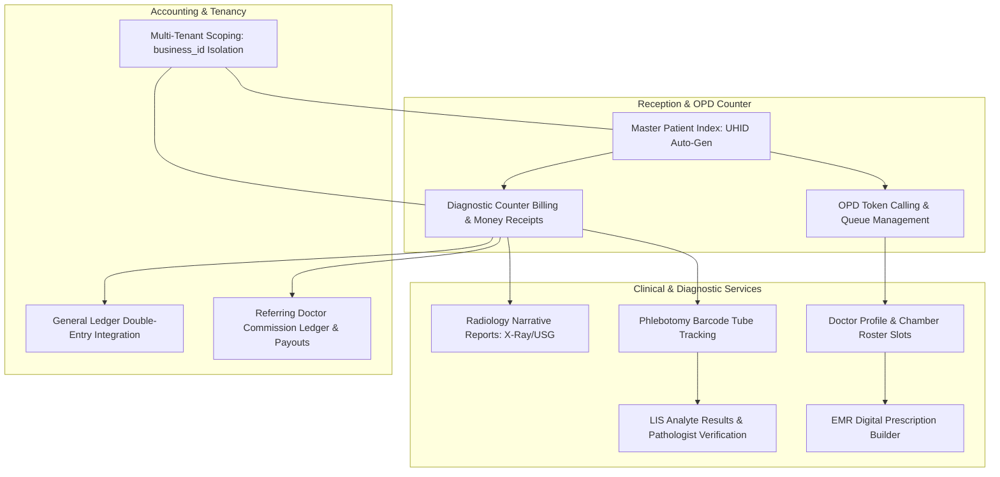
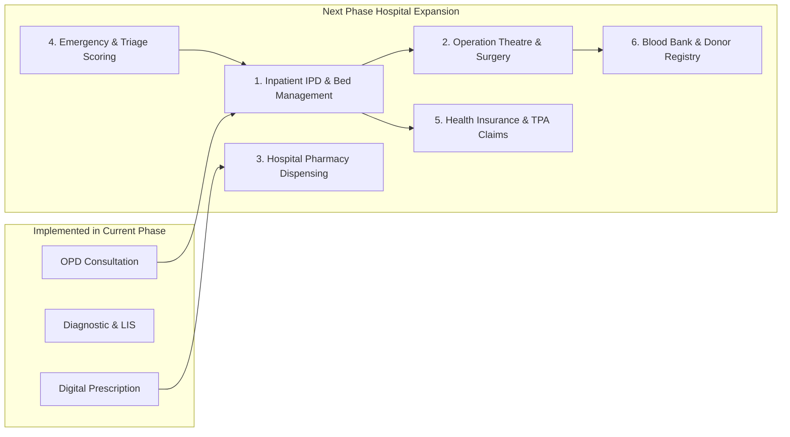

# Healthcare (Hospital & Clinic Management) Audit, Testing & Next-Phase Roadmap Plan

## Goal Description
Perform a comprehensive observation, testing, security, and architectural audit of the ProERP **Healthcare (Hospital, Clinic & Diagnostic Management)** module across both Python FastAPI backend and Next.js 16 frontend. Implement automated backend unit and integration test suites (`pytest`), automated frontend component and UI invariant tests (`Vitest` + RTL), perform a database schema and security audit (HIPAA/DGHS standards, indexing, constraints, tenant isolation), and outline the next-phase feature roadmap for hospital operations (IPD, OT, Pharmacy Dispensing, Emergency Triage, and Insurance TPA).

---

## User Review Required

> [!IMPORTANT]
> **Current Domain Coverage vs Next Phase Needs**:
> The currently implemented system excels at **Outpatient (OPD) & Diagnostic Centers**:
> - Master Patient Index (MPI) with auto-generated UHID (`UHID-{business_id}-{year}-{sequence}`)
> - Doctor Chambers, Roster Scheduling & Token Queue Calling
> - Diagnostic Counter Billing, Money Receipts, and Referring Doctor Commission Ledger
> - Phlebotomy Barcode Tracking & Laboratory Information System (LIS) Structured Result Entry
> - Radiology Narrative Reporting & Verified Lab Reports
> - Electronic Medical Records (EMR) Digital Prescriptions
>
> The **Next Phase** must expand into **Full Hospital Operations (IPD, OT, In-Hospital Pharmacy, Emergency Triage, and Insurance Billing)**.

> [!WARNING]
> **Data Privacy & Statutory Medical Compliance (DGHS & HIPAA)**:
> Medical records, clinical notes, and diagnostic results contain Protected Health Information (PHI). Strict tenancy boundaries (`business_id` scoping) and non-negative billing rules must be enforced at both the database level (PostgreSQL check constraints) and API layer to prevent cross-tenant record leakage or financial discrepancies.

---

## Architecture & Domain Observation Map



---

## Audit Dimensions

### 1. Backend Testing & Security Audit (`tests/test_healthcare_audit.py`)
- **Master Patient Index (MPI) Uniqueness**: Ensure UHID is strictly unique per business tenant (`UniqueConstraint("business_id", "uhid")`).
- **Token Queue Sequencing**: Verify that appointment token serials (`serial_number`) are strictly unique per doctor, per date, and per business tenant (`UniqueConstraint("business_id", "doctor_id", "appointment_date", "serial_number")`), preventing double-booking race conditions.
- **Phlebotomy Lifecycle Transitions**: Test status progression: `pending` $\rightarrow$ `collected` $\rightarrow$ `received` $\rightarrow$ `analyzed`. Samples cannot be collected without barcode tracking.
- **Diagnostic Order Financial Invariants**:
  - `net_amount = total_bill - discount_amount`
  - `net_amount = paid_amount + due_amount`
  - Total bill, net amount, and paid amount must never be negative.
- **LIS Critical Result Flagging**: Automatic evaluation of observed values against `male_ref_range` / `female_ref_range` with `is_abnormal` and `is_critical` flags.
- **Referring Doctor Commission Integrity**:
  - `commission_amount = bill_amount * (commission_rate / 100)`
  - Payout transitions: `accrued` $\rightarrow$ `paid`. Prevent payout on un-accrued or cancelled commissions.
- **Tenant Isolation**: Non-superusers cannot query or mutate patients, orders, or prescriptions belonging to other businesses.

### 2. Frontend Testing & UI Invariant Audit (`frontend/src/components/healthcare/__tests__/`)
- **In-Place Non-Destructive Filtering (`ui_in_place_filtering.md`)**:
  - Verify that `PatientsRegistryPage`, `DoctorsPage`, and `OPDChambersPage` never unmount tables during search or filter operations.
  - Verify top-rim progress bar appears during `isFetching === true`.
  - Verify row opacity dims (`opacity-60`) without skeleton replacement during debounced search.
- **Modal Input Validations**:
  - `PatientModal`: Mandatory full name and contact phone number, valid gender selection.
  - `AppointmentModal`: Doctor selection, appointment date, serial number preview, payment toggle.
  - `LISResultEntryModal`: Analyte numeric inputs, abnormal flag visual alerts, batch submission locking.
- **State Locking & Duplicate Prevention**: Buttons disable during `submitting === true` to avoid duplicate patient registrations or double bookings.

### 3. PostgreSQL Database Security & Schema Audit
- **Check Constraints**:
  - `ck_patient_phone_not_empty`: `LENGTH(phone) >= 6`
  - `ck_diagnostic_order_net_positive`: `net_amount >= 0`
  - `ck_referral_commission_rate_valid`: `commission_rate >= 0 AND commission_rate <= 100`
  - `ck_doctor_consultation_fee_non_negative`: `consultation_fee >= 0`
- **Foreign Key Safety**:
  - Orders link to Patients with `CASCADE` or `RESTRICT` (prevent accidental patient deletion with existing diagnostic bills).
  - Doctor deletion should `SET NULL` on past orders to preserve medical audit trails.
- **Indexes for Low-Latency Querying**:
  - B-Tree index on `(business_id, phone)` for reception patient lookup.
  - B-Tree index on `(business_id, uhid)` for barcode scanner lookup.
  - Composite index on `(business_id, doctor_id, appointment_date, status)` for live chamber queue screens.
  - B-Tree index on `(business_id, barcode)` for phlebotomy tube routing.

---

## Proposed Next Phase Features Roadmap (Hospital & Inpatient Expansion)

Based on our observation of the current OPD & Diagnostic implementation, the following 6 core modules are required to elevate the system into an enterprise Hospital Information System (HIS):



### 1. Inpatient Department (IPD) & Bed/Ward Management
- **Ward/Cabin Master**: General Ward, Semi-Cabin, VIP Cabin, ICU, CCU, NICU, Post-Operative Ward.
- **Admission & Bed Allocation**: Real-time interactive bed occupancy matrix with status (Occupied, Cleaning, Reserved, Maintenance).
- **Inpatient Daily Rounds & Nursing Station**: Vitals monitoring chart (Temperature, BP, SpO2, Pulse every 4 hours), fluid balance charts (Intake/Output), Medication Administration Record (MAR).
- **Discharge Summary & Final IPD Settlement**: Bed charge calculation per day/hour, nursing charges, medicine consumables, and formal discharge certificate.

### 2. Operation Theatre (OT) & Surgical Management
- **OT Scheduling**: Real-time OT table booking, surgeon, assistant, and anaesthesiologist assignments.
- **Pre-Anaesthesia Checkup (PAC)**: PAC fitness records, allergy warnings, consent documentation.
- **Intra-Operative & Post-Operative Notes**: Surgical procedure log, implant barcode tracking, surgical sponge & instrument count safety checklist (WHO Safe Surgery Guidelines).

### 3. Hospital Pharmacy & e-Prescription Dispensing Integration
- **Direct Prescription Routing**: Prescriptions generated at Doctor Desk automatically appear on the hospital pharmacy dispensing worklist.
- **Batch & Expiry Enforcement**: Automatic FIFO/FEFO (First Expired, First Out) batch deduction from Inventory.
- **Narcotics & Controlled Substance Register**: Double-authorization requirement for Schedule II/IV drugs.

### 4. Emergency & Triage Management
- **Triage Priority Scoring**: Manchester / ESI (Emergency Severity Index) categorizing into Red (Immediate/Resuscitation), Yellow (Emergent), Green (Urgent/Non-urgent).
- **Fast-Track Emergency Counter**: Rapid registration without upfront billing for critical trauma cases, transitioning to stabilized inpatient admission.

### 5. Health Insurance & Corporate TPA Claims Management
- **Policy Verification**: Patient policy number, pre-authorization approval tracking, corporate credit letter upload.
- **Split Invoicing**: Patient Co-Pay portion vs Corporate/TPA portion with claims submission invoice generation.

### 6. Blood Bank & Donor Registry
- **Blood Stock Management**: Whole Blood, PRBC, FFP, Platelets inventory categorized by blood group and expiry.
- **Donor Screening & Cross-Matching**: Hepatitis B/C, HIV, Syphilis, Malaria screening records and compatibility cross-match verification certificates.

---

## Proposed Changes for Current Phase Audit & Testing

### 1. Backend Audit & Test Suites
#### [NEW] [tests/test_healthcare_audit.py](file:///d:/Onoda%20Inc/Test%20Projects/python/python-fastapi-new/tests/test_healthcare_audit.py)
- Test UHID multi-tenant uniqueness and boundary constraints.
- Test appointment token race conditions and queuing.
- Test diagnostic order financial calculations (`net = total - discount`, `due = net - paid`).
- Test LIS critical analyte evaluation and pathologist verification.
- Test referral commission calculations and payout lifecycle.

### 2. Frontend Audit & Test Suites
#### [NEW] [frontend/src/components/healthcare/__tests__/patient-modal.test.tsx](file:///d:/Onoda%20Inc/Test%20Projects/python/python-fastapi-new/frontend/src/components/healthcare/__tests__/patient-modal.test.tsx)
- Test patient registration form validation (phone, name, gender).
- Test duplicate submission locking.
- Test edit mode pre-population.

#### [NEW] [frontend/src/components/healthcare/__tests__/in-place-filtering-healthcare.test.tsx](file:///d:/Onoda%20Inc/Test%20Projects/python/python-fastapi-new/frontend/src/components/healthcare/__tests__/in-place-filtering-healthcare.test.tsx)
- Test in-place non-destructive filtering on `PatientsRegistryPage` and `DoctorsPage`.
- Assert table structure remains mounted during search debounce.
- Assert top progress bar reflects `isFetching`.

### 3. Database Security & Global Standards Audit
#### [NEW] [docs/plans/healthcare_database_security_audit.md](file:///d:/Onoda%20Inc/Test%20Projects/python/python-fastapi-new/docs/plans/healthcare_database_security_audit.md)
- Complete database audit of all 13 Healthcare tables.
- Verification of check constraints, foreign key referential actions, index coverage, and HIPAA privacy rules.

---

## Verification Plan

### Automated Tests
```bash
# 1. Backend Healthcare Audit Test Suite
.\venv\Scripts\pytest.exe tests/test_healthcare_phase1.py tests/test_healthcare_phase2.py tests/test_healthcare_audit.py -v

# 2. Frontend Healthcare Test Suite
cd frontend
npm test src/components/healthcare/__tests__/
npm run test:coverage

# 3. Frontend Type Safety Verification
npx tsc --noEmit
```

### Manual Verification
- Verify patient registration and UHID generation in browser.
- Verify appointment booking and live token serial calling in OPD Chambers.
- Verify counter billing money receipt generation and LIS result verification.
