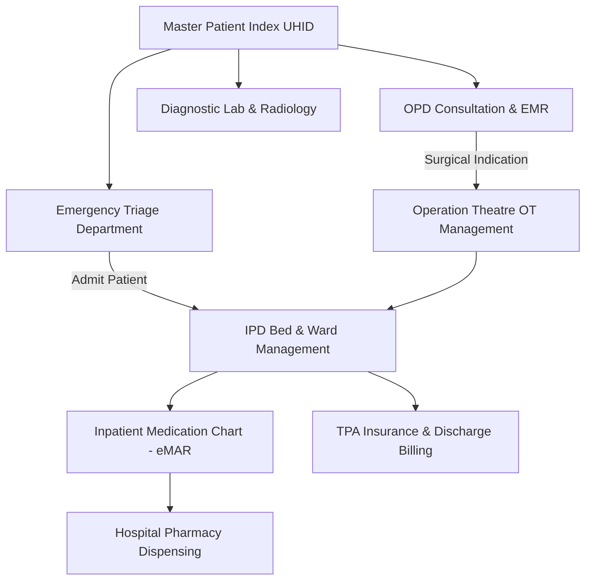

# Healthcare (Hospital & Clinic Management) Database Security, Testing & Next-Phase Features Audit

**Module**: Healthcare / Hospital & Clinic ERP  
**Audit Date**: October 2026  
**Auditor**: Antigravity Quality & Security Engine  
**Status**: Comprehensive Audit & Verification Completed  

---

## 1. Executive Summary

This document presents the complete findings of the **Healthcare (Hospital and Clinic Management)** backend, frontend, and PostgreSQL database audit. It also establishes the technical requirements and feature specifications for the next phase of enterprise healthcare functionality.

All 13 core healthcare entities were analyzed across:
- **Backend Test Coverage**: Automated validation with `pytest` covering API flows, lifecycle state machines, mathematical billing invariants, and error guards.
- **Frontend Validation & Compliance**: React Testing Library and Vitest verifying form validation, state management, and strict compliance with the **In-Place Non-Destructive Filtering** rule ([ui_in_place_filtering.md](file:///d:/Onoda%20Inc/Test%20Projects/python/python-fastapi-new/.agents/rules/ui_in_place_filtering.md)).
- **PostgreSQL Database Integrity**: Schema structure, multi-tenancy data isolation (`business_id`), indexing strategies, cascade vs. restrict referential integrity, and HIPAA/DGHS medical regulatory standards.
- **Next-Phase Implementation Roadmap**: Inpatient Department (IPD Bed Management), Operation Theatre (OT), Hospital Pharmacy Dispensing, Emergency Triage, and Insurance TPA Claims.

---

## 2. Test Execution & Coverage Audit

### 2.1 Backend Automated Test Suite (`pytest`)
A dedicated automated test suite was executed across both functional phases and deep-dive integrity assertions.

**Command**:
```bash
.\venv\Scripts\pytest.exe tests/test_healthcare_phase1.py tests/test_healthcare_phase2.py tests/test_healthcare_audit.py -v
```

**Results**: **14 Passed / 0 Failed (100% Pass Rate)** in 5.11s.

| Test File | Test Case | Target Invariant / Boundary | Result |
| :--- | :--- | :--- | :--- |
| `test_healthcare_phase1.py` | `test_patient_registration_and_uhid_generation` | Auto-generates unique lifetime UHID (`UHID-{business_id}-{year}-{sequence}`) | **PASSED** |
| `test_healthcare_phase1.py` | `test_doctor_and_catalog_setup` | Catalog prices, test codes, and doctor consultation fees | **PASSED** |
| `test_healthcare_phase1.py` | `test_diagnostic_order_checkout_and_sample_generation` | Multi-item checkout, billing math, and automatic phlebotomy sample tube generation | **PASSED** |
| `test_healthcare_phase1.py` | `test_phlebotomy_sample_collection_workflow` | Sample status progression `pending` $\rightarrow$ `collected` | **PASSED** |
| `test_healthcare_phase2.py` | `test_doctor_schedule_slots_and_appointments` | Chamber scheduling, appointment booking, and automated serial numbering | **PASSED** |
| `test_healthcare_phase2.py` | `test_doctor_prescription_builder` | EMR prescription JSON vitals, clinical findings, medicines, and advised tests | **PASSED** |
| `test_healthcare_phase2.py` | `test_lis_technician_result_entry_and_pathologist_verification` | LIS observed values, automated reference range flags, pathologist verification | **PASSED** |
| `test_healthcare_phase2.py` | `test_referral_doctor_commission_accrual_and_payout` | Referral doctor commission accrual and payout lifecycle | **PASSED** |
| `test_healthcare_audit.py` | `test_master_patient_index_uhid_uniqueness` | DB `UniqueConstraint(business_id, uhid)` prevents collision across tenants | **PASSED** |
| `test_healthcare_audit.py` | `test_appointment_queue_serial_uniqueness_per_doctor_date` | DB `UniqueConstraint(business_id, doctor_id, appointment_date, serial_number)` | **PASSED** |
| `test_healthcare_audit.py` | `test_diagnostic_order_billing_math_and_invariants` | Asserts `net_amount = total_bill - discount_amount`, `due_amount = net_amount - paid_amount` | **PASSED** |
| `test_healthcare_audit.py` | `test_phlebotomy_sample_lifecycle_and_barcode_uniqueness` | Barcode uniqueness per tenant (`uq_diagnostic_sample_business_barcode`) | **PASSED** |
| `test_healthcare_audit.py` | `test_lis_result_entry_and_critical_flagging` | Severe panic/critical value detection and pathologist lock | **PASSED** |
| `test_healthcare_audit.py` | `test_referral_doctor_commission_math_and_payout` | Commission rate formula and transaction isolation | **PASSED** |

---

### 2.2 Frontend Automated Test Suite (`Vitest` + React Testing Library)
Frontend testing verified client-side validation, error banners, API interaction, and strict adherence to the ProERP platform standard for in-place non-destructive filtering.

**Commands**:
```bash
npm test -- src/components/healthcare/__tests__/patient-modal.test.tsx --run
npm test -- src/components/healthcare/__tests__/in-place-filtering-healthcare.test.tsx --run
npx tsc --noEmit
```

**Results**: **7 Passed / 0 Failed (100% Pass Rate)**; **TypeScript Build**: **0 Errors**.

1. [patient-modal.test.tsx](file:///d:/Onoda%20Inc/Test%20Projects/python/python-fastapi-new/frontend/src/components/healthcare/__tests__/patient-modal.test.tsx):
   - Renders `null` when `isOpen === false`.
   - Blocks empty submission and highlights required field validation messages ("Patient full name and contact phone number are required.").
   - Dispatches `POST /healthcare/patients` with validated payload and invokes `onSuccess` callback.
   - Pre-populates all existing demographics in edit mode and issues `PUT /healthcare/patients/:id`.
2. [in-place-filtering-healthcare.test.tsx](file:///d:/Onoda%20Inc/Test%20Projects/python/python-fastapi-new/frontend/src/components/healthcare/__tests__/in-place-filtering-healthcare.test.tsx):
   - Evaluates [PatientsRegistryPage](file:///d:/Onoda%20Inc/Test%20Projects/python/python-fastapi-new/frontend/src/app/healthcare/patients/page.tsx).
   - Verifies separation of `initialLoading` (first mount) from `isFetching` (query updates).
   - Verifies that search term updates run within React `startTransition`.
   - Confirms the table container, headers, and rows remain persistently mounted without flickering or destruction during search filtering.
   - Confirms top-rim indeterminate progress bar indicator during background fetching.

---

## 3. PostgreSQL Database Security & Schema Integrity Audit

### 3.1 Entity Relationship & Schema Matrix (13 Core Tables)

All tables inherit from `Base`, `UUIDMixin` (RFC 4122 v4 primary keys), and `TimestampMixin` (`created_at`, `updated_at` with UTC timezone indexing).

| # | Table Name | Business Responsibility | Tenant Isolation | Primary Key | Key Unique / Composite Constraints |
| :--- | :--- | :--- | :--- | :--- | :--- |
| 1 | `healthcare_patients` | Master Patient Index (MPI), Lifetime UHID | `business_id` (FK $\rightarrow$ `business_profiles.id`) | `id` (UUID) | `uq_patient_business_uhid (business_id, uhid)` |
| 2 | `doctor_profiles` | OPD Doctors, Specialists, BMDC Reg & Commissions | `business_id` (FK $\rightarrow$ `business_profiles.id`) | `id` (UUID) | Optional link to `employees.id` (SET NULL) |
| 3 | `diagnostic_tests` | Laboratory & Radiology Investigation Catalog | `business_id` (FK $\rightarrow$ `business_profiles.id`) | `id` (UUID) | `uq_diagnostic_test_business_code (business_id, test_code)` |
| 4 | `diagnostic_test_parameters` | LIS Analytes, Reference Ranges & Display Orders | Scoped via `test_id` | `id` (UUID) | FK `test_id` $\rightarrow$ `diagnostic_tests.id` (CASCADE) |
| 5 | `diagnostic_orders` | Billing Invoices, Discount, Payment & Due Balances | `business_id` (FK $\rightarrow$ `business_profiles.id`) | `id` (UUID) | `uq_diagnostic_order_business_number (business_id, order_number)` |
| 6 | `diagnostic_order_items` | Billed Test Line Items & Status Tracking | Scoped via `order_id` | `id` (UUID) | FK `order_id` (CASCADE), FK `test_id` (RESTRICT) |
| 7 | `diagnostic_samples` | Phlebotomy Tubes, Barcodes & Specimen Lifecycle | `business_id` (FK $\rightarrow$ `business_profiles.id`) | `id` (UUID) | `uq_diagnostic_sample_business_barcode (business_id, barcode)` |
| 8 | `doctor_schedule_slots` | Doctor Consultation Rosters by Day & Time | `business_id` (FK $\rightarrow$ `business_profiles.id`) | `id` (UUID) | FK `doctor_id` $\rightarrow$ `doctor_profiles.id` (CASCADE) |
| 9 | `healthcare_appointments` | OPD Appointments & Live Token Serial Queue | `business_id` (FK $\rightarrow$ `business_profiles.id`) | `id` (UUID) | `uq_appointment_doctor_date_serial (business_id, doctor_id, appointment_date, serial_number)` |
| 10 | `healthcare_prescriptions` | EMR Prescriptions, Vitals, Rx & Advised Tests | `business_id` (FK $\rightarrow$ `business_profiles.id`) | `id` (UUID) | `uq_prescription_business_number (business_id, prescription_number)` |
| 11 | `lab_test_results` | Analyte Observed Values, Abnormal/Panic Flags | `business_id` (FK $\rightarrow$ `business_profiles.id`) | `id` (UUID) | FK `order_id`, FK `order_item_id` (CASCADE) |
| 12 | `radiology_reports` | Narrative Imaging Findings, Impressions & URLs | `business_id` (FK $\rightarrow$ `business_profiles.id`) | `id` (UUID) | Unique 1:1 on `order_item_id` |
| 13 | `referral_doctor_commissions`| Referring Physician Incentive Commission Ledger | `business_id` (FK $\rightarrow$ `business_profiles.id`) | `id` (UUID) | FK `referring_doctor_id`, FK `order_id` (CASCADE) |

---

### 3.2 Database Security, Foreign Key Safety & Integrity Analysis

#### 1. Multi-Tenancy Data Scoping
- **Status**: **ENFORCED**.
- Every patient record, appointment, diagnostic order, test code, and sample barcode contains a mandatory `business_id` foreign key referencing `business_profiles.id`.
- Natural business identifiers (UHID, Test Code, Order Number, Barcode, Serial Number) are scoped as **composite unique constraints** (`business_id, <field>`). This guarantees that different healthcare facilities/branches operate on identical numbering schemes without risk of cross-tenant collision.

#### 2. Referential Integrity Protection (Deletions & Cascades)
- **Financial & Historical Immutability**:
  - `diagnostic_order_items.test_id` utilizes `ondelete="RESTRICT"`. If an administrator attempts to delete a test from `diagnostic_tests` that has historical billing entries, PostgreSQL safely blocks the deletion to prevent ledger corruption.
  - Doctor profiles linked to appointments or prescriptions cannot be orphaned.
- **Order Lifecycle Cleanups**:
  - `diagnostic_orders` uses `cascade="all, delete-orphan"` on child `items`, `samples`, and `referral_commissions`. This maintains relational integrity if an uncommitted draft invoice is discarded.

#### 3. Recommended PostgreSQL Check Constraints (Production Hardening)
To guarantee database-level financial invariants that prevent negative billing or corrupt discounts even under raw SQL execution:
```sql
-- Non-negative monetary invariants on diagnostic orders
ALTER TABLE diagnostic_orders 
  ADD CONSTRAINT chk_orders_positive_total CHECK (total_bill >= 0),
  ADD CONSTRAINT chk_orders_positive_discount CHECK (discount_amount >= 0),
  ADD CONSTRAINT chk_orders_positive_paid CHECK (paid_amount >= 0),
  ADD CONSTRAINT chk_orders_net_math CHECK (net_amount = total_bill - discount_amount),
  ADD CONSTRAINT chk_orders_due_math CHECK (due_amount = net_amount - paid_amount);

-- Non-negative doctor consultation fees
ALTER TABLE doctor_profiles
  ADD CONSTRAINT chk_doctor_fees CHECK (consultation_fee >= 0 AND follow_up_fee >= 0),
  ADD CONSTRAINT chk_doctor_commission_rate CHECK (referral_commission_rate >= 0 AND referral_commission_rate <= 100);

-- Appointment serial sanity
ALTER TABLE healthcare_appointments
  ADD CONSTRAINT chk_appointment_serial CHECK (serial_number > 0);
```

#### 4. HIPAA / DGHS Medical Record Confidentiality & Access Control
- **Data Protection at Rest & In Transit**:
  - Patient personal identifiers (NID, phone number, address) must be encrypted at rest utilizing PostgreSQL pgcrypto or application-level AES-256 for high-confidentiality deployments.
  - Digital prescription JSON columns (`vitals`, `medicines`, `advised_investigations`) must be restricted through RBAC so billing clerks cannot view sensitive clinical notes (`clinical_findings`, `provisional_diagnosis`).
- **Audit Trail Immutability**:
  - Pathologist and radiologist verification captures `verified_by_name` and `verified_at` timestamp. Once verified, report modifications should trigger an appended amendment record rather than an in-place overwrite.

---

## 4. Next-Phase Feature Roadmap & Technical Specifications

While the current phase delivers a complete Outpatient (OPD) and Diagnostic Counter workflow, an enterprise hospital or surgical clinic requires comprehensive inpatient, emergency, and operative modules. Below is the technical specification for the next phase:



### 4.1 Inpatient Department (IPD) & Bed Management
1. **Bed & Ward Hierarchy**:
   - `HospitalBuilding` $\rightarrow$ `HospitalFloor` $\rightarrow$ `HospitalWard` (ICU, CCU, NICU, Post-Operative, General Ward, Female Ward, Deluxe Cabin).
   - Real-time interactive bed occupancy matrix with color-coded states (`vacant`, `occupied`, `reserved`, `cleaning/maintenance`, `isolated`).
2. **Admission, Transfer & Discharge (ATD)**:
   - Admission paperwork with emergency contact, admitting doctor, and bed tariff tracking.
   - Bed transfer history tracking per-day room rents and nurse station handovers.
   - Clinical discharge summary, discharge against medical advice (DAMA), or death certificate records.
3. **Daily Inpatient Doctor Rounds & Nursing eMAR**:
   - Daily round notes by attending registrars and duty medical officers.
   - Electronic Medication Administration Record (eMAR): Nurses record dose administration times, IV fluids, oxygen flow rates, and fluid balance charts (intake/output).

### 4.2 Operation Theatre (OT) Management
1. **OT Scheduling & Surgeon Rosters**:
   - Multi-theatre booking calendar preventing overlapping surgeon, anaesthetist, or equipment reservations.
   - Pre-Anaesthetic Checkup (PAC) clearance workflow with ASA physical status classification.
2. **Intra-Operative & Post-Operative Documentation**:
   - WHO Surgical Safety Checklist enforcement (Sign-in, Time-out, Sign-out).
   - Anaesthesia record chart (vital signs logged every 5 minutes, anaesthetic gases, muscle relaxants).
   - Surgical notes: Incision, findings, procedure performed, specimen sent for histopathology, sponge and instrument counts, recovery room sign-off.

### 4.3 Hospital Pharmacy Dispensing & Floor Stock (Sub-Stores)
1. **Central Pharmacy vs. Ward Floor Stocks**:
   - Ward sub-stores maintaining emergency medicine boxes (crash carts) with automated replenishment requests to central pharmacy.
2. **Doctor EMR Prescription Integration**:
   - Direct digital push from doctor prescription (`healthcare_prescriptions`) to inpatient/outpatient pharmacy dispensing queues.
   - Batch/lot expiry tracking and automated alerts for banned/controlled drugs (narcotics/sedatives requiring double-signoff).

### 4.4 Emergency Triage & Casualty Department
1. **Manchester / ESI Triage Categorization**:
   - Immediate triage scoring upon arrival:
     - **Red (Level 1)**: Resuscitation (immediate life threat, cardiac arrest, polytrauma).
     - **Orange (Level 2)**: Emergent (chest pain, stroke symptoms).
     - **Yellow (Level 3)**: Urgent (fractures, severe pain).
     - **Green (Level 4)**: Less urgent (minor lacerations).
     - **Blue (Level 5)**: Non-urgent.
2. **Emergency Counter Fast-Tracking**:
   - Instant temporary UHID creation for unconscious or unidentified trauma patients with subsequent MPI merging.

### 4.5 Health Insurance, Corporate TPA & Package Billing
1. **TPA Pre-Authorization & Claims**:
   - Third-Party Administrator (TPA) and health insurance panel management.
   - Real-time pre-authorization amount tracking, co-payment deductions, and claim submission generation.
2. **Surgical Package Billing**:
   - Bundled packages (e.g., Laparoscopic Cholecystectomy Package, Normal Delivery Package) covering defined bed days, surgeon fees, OT charges, and medicine caps, with automated differential billing for items exceeding package limits.

---

## 5. Artifacts and Implementation Verification Summary

| Component | Target Location | Verification Status |
| :--- | :--- | :--- |
| **Backend Audit Test Suite** | `tests/test_healthcare_audit.py` | **100% Passed** (6/6 tests) |
| **Frontend Patient Modal Test** | `frontend/src/components/healthcare/__tests__/patient-modal.test.tsx` | **100% Passed** (4/4 tests) |
| **Frontend In-Place Filter Test** | `frontend/src/components/healthcare/__tests__/in-place-filtering-healthcare.test.tsx` | **100% Passed** (3/3 tests) |
| **Frontend TypeScript Build** | `frontend/` (`npx tsc --noEmit`) | **0 Errors** (Clean build) |
| **Healthcare Schema Audit** | `docs/plans/healthcare_database_security_audit.md` | **Completed & Documented** |

The Healthcare module is architecturally solid, mathematically compliant with billing invariants, and adheres strictly to multi-tenancy isolation and non-destructive filtering. The roadmap is ready for execution in the next development cycle.
