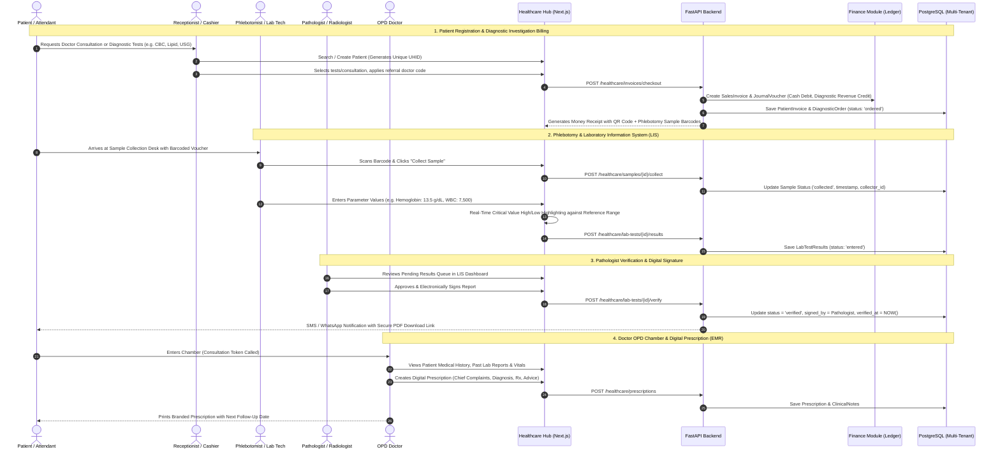
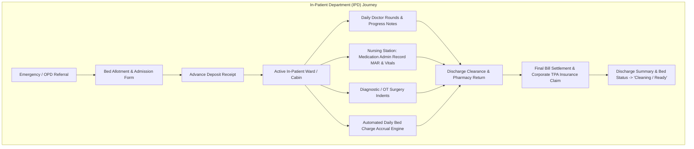

# Healthcare Architecture Blueprint: Diagnostic & Clinic Management to Full Hospital Information System (HMS)

## Executive Summary
This document defines the enterprise architecture, domain models, database schemas, API contracts, and user experience roadmap for introducing the **Healthcare & Clinical Operations Module** into the ProERP SaaS platform. 

The strategy follows a **progressive modular expansion**:
1. **Foundation (Phases 1 & 2)**: **Diagnostic Center & Polyclinic Management (OPD)** — Master Patient Index (MPI), Appointment Scheduling, Doctor OPD Chambers, Diagnostic Test Catalog, Sample Collection/Barcoding, Laboratory Information System (LIS), Radiology Reporting (RIS), Clinical Electronic Medical Records (EMR/Prescriptions), and Referral Doctor Commission Ledger.
2. **Expansion (Phases 3 & 4)**: **Full Hospital Management System (HMS / IPD)** — In-Patient Department (IPD) Admission/Transfer/Discharge, Visual Bed/Ward Matrix, Operation Theatre (OT) Scheduling, Emergency & Triage, Nursing Medication Administration Record (MAR), and In-House Hospital Pharmacy.

The architecture directly integrates with ProERP's existing **Multi-Tenancy (`business_id`)**, **Finance (Double-Entry General Ledger, Invoicing, Vouchers)**, **HR & Payroll (Doctor Rosters & Commission Pay)**, and **Inventory (Reagents, Consumables, and Medicines)**.

---

## 1. Modular Evolution Roadmap

```
┌──────────────────────────────────────────────────────────────────────────────────┐
│                             PROERP HEALTHCARE SUITE                              │
├────────────────────────────────────────┬─────────────────────────────────────────┤
│    PHASE 1 & 2: CLINIC & DIAGNOSTIC    │       PHASE 3 & 4: FULL HOSPITAL (HMS)  │
│  (Polyclinic, Labs, Radiology & OPD)   │        (In-Patient, Bed, OT & Surgery)  │
├────────────────────────────────────────┼─────────────────────────────────────────┤
│ • Master Patient Index (UHID / MPI)    │ • In-Patient Department (IPD Admission) │
│ • Doctor OPD Chambers & Live Queue     │ • Interactive Real-Time Bed/Ward Matrix │
│ • Diagnostic Catalog (Path/Bio/Rad)    │ • Nursing Station & Daily Vitals MAR    │
│ • Phlebotomy & Sample Barcode Tracking │ • Operation Theatre (OT) Scheduling     │
│ • LIS Report Entry & Pathologist Sign  │ • Emergency & Triage Management         │
│ • EMR Digital Prescription & Vitals    │ • IPD Running Bill & Discharge Summary  │
│ • Referral Doctor Commission Engine    │ • Hospital Pharmacy Indent & Dispensing │
│ • Cash Billing & Corporate Discount    │ • Medical Equipment Asset Management    │
└────────────────────────────────────────┴─────────────────────────────────────────┘
```

---

## 2. Real-World Diagnostic & Clinic Workflow (Phase 1 & 2)



---

## 3. Hospital In-Patient (IPD) & Bed Matrix Architecture (Phase 3 & 4)



---

## 4. User Review Required

> [!IMPORTANT]
> **1. Master Patient Index (UHID / Unique Health Identifier) Scoping**:
> A patient may visit multiple clinics, branches, or diagnostic units owned by a business.
> - **Enterprise Decision**: UHID will be formatted as `UHID-{business_id}-{year}-{sequence}` (e.g. `UHID-1-2026-000452`), unique per tenant, with optional national identification (NID / Birth Certificate / Passport) mapping for cross-visit history.

> [!IMPORTANT]
> **2. Parameter-Wise vs. Rich-Text Diagnostic Reporting**:
> - **Pathology / Biochemistry**: Must use **structured parameter tables** with machine-readable numerical/text values, units (e.g. `mg/dL`, `cells/mcL`), and age/gender-stratified reference ranges to support automated delta-checks and abnormal flagging.
> - **Radiology / Imaging (USG, X-Ray, CT, MRI)**: Must use a **rich-text template engine** (Findings, Impression, Clinical Correlation) with pre-saved specialist macro templates.

> [!NOTE]
> **3. Doctor Referral Commission Accounting**:
> In real-world clinics and diagnostic centers, referring physicians often receive incentive commissions based on pre-negotiated tier percentages (e.g., 20% on Pathology, 15% on Radiology).
> - The module will automatically calculate commission accruals upon invoice payment and post directly into the **Finance Module** as a liability ledger (`Accrued Referral Commission Payable`).

---

## 5. Open Questions

1. **DICOM / PACS Imaging Server Integration**:
   - For radiology (X-Ray, CT, MRI), should the system initially store static compressed JPEG/PDF reports with an external cloud URL, or should we plan a lightweight Orthanc / Web-DICOM viewer integration?
   - *Recommendation*: Phase 1 will support high-resolution file attachment & external cloud PACS URLs; Phase 2 will introduce an embedded HTML5 DICOM viewer.
2. **Prescription Drug Database**:
   - Should doctor prescriptions link directly to the in-house **Inventory / Pharmacy Medicine Master** (with brand names, generic formulations, strengths, and available stock), or allow free-text drug entries?
   - *Recommendation*: Hybrid approach — auto-suggest from the drug catalog with real-time stock availability, while allowing custom free-text prescriptions for non-stocked formulations.

---

## 6. Proposed Architecture & Component Design

### Layer 1: Database Models (`app/modules/healthcare/models.py`)

```python
# Core Healthcare Entities

1. Patient (Master Patient Index - MPI)
   - id: UUID (PK)
   - business_id: Integer (FK to business_profiles.id)
   - uhid: String(30), unique per business (e.g. UHID-2026-00012)
   - full_name: String(150)
   - phone: String(20), indexed
   - email: String(100), optional
   - date_of_birth: Date
   - gender: Enum ('male', 'female', 'other')
   - blood_group: Enum ('A+', 'A-', 'B+', 'B-', 'AB+', 'AB-', 'O+', 'O-')
   - emergency_contact_name: String(100)
   - emergency_contact_phone: String(20)
   - address: Text
   - national_id: String(50), optional

2. DoctorProfile & OPD Chamber
   - id: UUID (PK)
   - business_id: Integer (FK)
   - employee_id: UUID (FK to employees.id - links to HR & Payroll)
   - specialization: String(100) (Cardiologist, Gynecologist, etc.)
   - medical_degrees: String(200) (MBBS, FCPS, MD)
   - bmdc_reg_number: String(50) (Statutory Medical Council Reg)
   - room_number / chamber_name: String(50)
   - consultation_fee: Numeric(10, 2)
   - follow_up_fee: Numeric(10, 2)
   - slot_duration_minutes: Integer (e.g. 15 mins)
   - is_available_for_telemedicine: Boolean

3. DoctorScheduleSlot (Rosters & Chamber Hours)
   - id: UUID (PK)
   - doctor_id: UUID (FK)
   - day_of_week: Enum ('saturday', 'sunday', ..., 'friday')
   - start_time: Time
   - end_time: Time
   - max_patients: Integer (e.g. 30 per shift)

4. Appointment & OPD Consultation Queue
   - id: UUID (PK)
   - business_id: Integer (FK)
   - patient_id: UUID (FK)
   - doctor_id: UUID (FK)
   - appointment_date: Date
   - serial_number: Integer (Chamber token number, e.g. 1, 2, 3...)
   - scheduled_time: Time
   - status: Enum ('booked', 'checked_in', 'with_doctor', 'completed', 'cancelled', 'no_show')
   - visit_type: Enum ('new', 'follow_up', 'report_review')
   - chief_complaints: Text

5. DiagnosticCategory & DiagnosticTest (Service Catalog)
   - id: UUID (PK)
   - business_id: Integer (FK)
   - department: Enum ('pathology', 'biochemistry', 'hematology', 'microbiology', 'radiology_imaging', 'cardiology_ecg', 'histopathology')
   - test_code: String(20), unique per business (e.g. CBC, LFT, USG-W/A)
   - name: String(150)
   - cost_price: Numeric(10, 2) (reagents + technician cost)
   - sale_price: Numeric(10, 2)
   - sample_type: String(50) (EDTA Blood, Plain Blood, Urine, etc.)
   - default_turnaround_hours: Integer (e.g. 6 hours)
   - requires_fasting: Boolean
   - report_template_type: Enum ('structured_parameters', 'radiology_text')

6. DiagnosticTestParameter (LIS Parameter Master)
   - id: UUID (PK)
   - test_id: UUID (FK)
   - parameter_name: String(100) (e.g. Hemoglobin, Total Count, Bilirubin)
   - unit: String(30) (e.g. g/dL, mg/dL, /cumm)
   - male_ref_range: String(100) (e.g. 13.5 - 17.5)
   - female_ref_range: String(100) (e.g. 12.0 - 15.5)
   - child_ref_range: String(100)
   - default_formula: String(200) (optional auto-calc e.g. indirect bilirubin)
   - display_order: Integer

7. DiagnosticOrder & OrderItem
   - id: UUID (PK)
   - business_id: Integer (FK)
   - invoice_id: UUID (FK to finance SalesInvoice)
   - patient_id: UUID (FK)
   - referring_doctor_id: UUID (FK, optional)
   - order_date: DateTime
   - status: Enum ('ordered', 'sample_collected', 'in_lab', 'partially_reported', 'completed', 'cancelled')
   - total_bill: Numeric(12, 2)
   - discount_amount: Numeric(12, 2)
   - paid_amount: Numeric(12, 2)
   - due_amount: Numeric(12, 2)

8. DiagnosticSample (Phlebotomy Barcode Tracking)
   - id: UUID (PK)
   - order_id: UUID (FK)
   - barcode: String(50), unique (e.g. SMP-2026-948123)
   - sample_type: String(50)
   - collected_at: DateTime | None
   - collected_by_id: UUID | None
   - received_in_lab_at: DateTime | None
   - status: Enum ('pending', 'collected', 'received', 'rejected', 'analyzed')

9. LabTestResult & RadiologyReport
   - id: UUID (PK)
   - order_item_id: UUID (FK)
   - parameter_id: UUID (FK, for structured LIS)
   - observed_value: String(100)
   - is_abnormal: Boolean
   - is_critical: Boolean
   - rich_text_content: Text (for Radiology USG/X-Ray)
   - verified_by_id: UUID (FK to Employee Pathologist/Radiologist)
   - verified_at: DateTime | None
   - digital_signature_url: String(300)

10. Prescription (EMR)
    - id: UUID (PK)
    - patient_id: UUID (FK)
    - doctor_id: UUID (FK)
    - appointment_id: UUID (FK, optional)
    - vitals: JSONB (BP: 120/80, Pulse: 78, Temp: 98.6, SpO2: 99, Wt: 70kg, Height: 5'8")
    - clinical_findings: Text
    - provisional_diagnosis: Text (ICD-10 Code/Text)
    - medicines: JSONB (Array of {drug_name, dosage, timing, duration, instructions})
    - advised_investigations: JSONB (Array of Test IDs)
    - special_advice: Text
    - follow_up_date: Date | None

11. ReferralDoctorCommission
    - id: UUID (PK)
    - business_id: Integer (FK)
    - referring_doctor_id: UUID (FK)
    - order_id: UUID (FK)
    - commission_amount: Numeric(10, 2)
    - payment_status: Enum ('accrued', 'paid', 'cancelled')
    - voucher_id: UUID (FK to Finance JournalVoucher)

12. Hospital Bed & Ward Management (Phase 3 HMS)
    - Ward / Floor: id, name, floor_number, department
    - Bed: id, ward_id, bed_number, bed_type ('general', 'cabin_ac', 'cabin_non_ac', 'icu', 'ccu', 'nicu', 'post_op')
    - daily_rate: Numeric(10, 2)
    - current_status: Enum ('available', 'occupied', 'reserved', 'maintenance', 'cleaning')

13. IPD Admission & Bed Allocation (Phase 3 HMS)
    - id: UUID (PK)
    - patient_id: UUID (FK)
    - admission_date: DateTime
    - admitting_doctor_id: UUID (FK)
    - current_bed_id: UUID (FK)
    - initial_deposit: Numeric(12, 2)
    - status: Enum ('admitted', 'transferred', 'discharged', 'transferred_out')
    - discharge_date: DateTime | None
    - discharge_summary: Text
```

---

### Layer 2: API Route Blueprint (`app/modules/healthcare/router.py`)

| Endpoint | Method | Role & Permission | Functional Description |
| :--- | :--- | :--- | :--- |
| `/healthcare/patients` | `GET`, `POST` | `healthcare:patients:view/create` | Search MPI registry by phone/UHID or register new patient. |
| `/healthcare/patients/{id}` | `GET`, `PUT` | `healthcare:patients:view/update` | Comprehensive 360° patient dossier (visits, labs, vitals). |
| `/healthcare/doctors` | `GET`, `POST` | `healthcare:doctors:view/create` | Doctor master list with degrees, fees, and chambers. |
| `/healthcare/appointments/queue` | `GET`, `POST` | `healthcare:appointments:view/create` | Real-time live OPD chamber queue management. |
| `/healthcare/diagnostic-tests` | `GET`, `POST` | `healthcare:catalog:view/create` | Test master catalog with reference ranges & prices. |
| `/healthcare/orders/checkout` | `POST` | `healthcare:billing:create` | Point-of-sale diagnostic invoice, receipt generation & Finance sync. |
| `/healthcare/samples/queue` | `GET` | `healthcare:phlebotomy:view` | Phlebotomy sample collection worklist with barcode scanner. |
| `/healthcare/samples/{id}/collect` | `POST` | `healthcare:phlebotomy:update` | Mark sample collected, generates barcoded tube labels. |
| `/healthcare/lis/results` | `POST` | `healthcare:lis:update` | Batch parameter result entry with automated abnormal flags. |
| `/healthcare/lis/verify` | `POST` | `healthcare:lis:approve` | Pathologist/Radiologist electronic verification and sign-off. |
| `/healthcare/prescriptions` | `POST` | `healthcare:doctor:create` | EMR clinical prescription generation with auto-print. |
| `/healthcare/referrals/commissions` | `GET`, `POST` | `healthcare:referrals:view/disburse` | Referral doctor incentive ledger with financial settlement. |
| `/healthcare/ipd/beds/matrix` | `GET` | `healthcare:ipd:view` | Real-time visual interactive bed occupancy grid. |
| `/healthcare/ipd/admissions` | `POST` | `healthcare:ipd:create` | In-patient admission with bed allotment & advance deposit. |
| `/healthcare/ipd/discharge/{id}` | `POST` | `healthcare:ipd:update` | Final discharge calculation, pharmacy return, settlement. |

---

### Layer 3: Next.js Frontend Hub (`frontend/src/app/healthcare/`)

Following ProERP's modern responsive design system and the strict [ui_in_place_filtering.md](file:///d:/Onoda%20Inc/Test%20Projects/python/python-fastapi-new/.agents/rules/ui_in_place_filtering.md) invariant:

```
frontend/src/
├── app/
│   └── healthcare/
│       ├── page.tsx                             # Unified Healthcare Navigation Hub
│       ├── patients/page.tsx                    # Master Patient Index (MPI) with Quick Search
│       ├── opd-chambers/page.tsx                # Doctor Live Queue & Token Calling Screen
│       ├── diagnostic/
│       │   ├── billing/page.tsx                 # Fast Diagnostic Counter Billing (POS Style)
│       │   ├── phlebotomy/page.tsx              # Sample Collection & Barcode Scanner Desk
│       │   ├── lis-worklist/page.tsx            # Lab Tech Result Entry with High/Low Badges
│       │   └── verification/page.tsx            # Pathologist / Radiologist Sign-off Console
│       ├── doctor-desk/
│       │   └── [appointment_id]/page.tsx        # High-Speed Doctor EMR & Prescription Pad
│       ├── referrals/page.tsx                   # Referral Doctor Commission Ledger
│       └── ipd/
│           ├── bed-matrix/page.tsx              # Visual Interactive Bed/Ward Matrix
│           └── admissions/page.tsx              # In-Patient Department Admissions & Billing
├── components/healthcare/
│   ├── patient-card.tsx                         # Reusable patient demographic avatar card
│   ├── vitals-entry-widget.tsx                  # BP, Pulse, SpO2, BMI quick inputs
│   ├── parameter-result-table.tsx               # LIS test table with range check indicators
│   ├── prescription-print-view.tsx              # Clean A4 printable prescription template
│   ├── bed-tile-card.tsx                        # Color-coded bed status card with timer
│   └── modals/
│       ├── quick-patient-modal.tsx              # Fast 15-second patient registration modal
│       ├── diagnostic-order-modal.tsx           # Multi-test search and booking dialog
│       └── bed-transfer-modal.tsx               # One-click bed/ward transfer modal
```

---

## 7. Step-by-Step Implementation Roadmap

### Phase 1: Diagnostic Center & Cash Billing Foundation (Immediate 1st Milestone)
- **Step 1.1**: Create `app/modules/healthcare/models.py` with `Patient`, `DiagnosticCategory`, `DiagnosticTest`, `DiagnosticTestParameter`, `DiagnosticOrder`, `OrderItem`, and `DiagnosticSample`.
- **Step 1.2**: Register models in `app/models_registry.py` and run migration.
- **Step 1.3**: Implement `PatientRepository` & `DiagnosticRepository` with multi-tenant `business_id` scoping.
- **Step 1.4**: Build Cash Billing checkout endpoint integrated with `modules/finance` (generating `SalesInvoice` and payment vouchers automatically).
- **Step 1.5**: Build Next.js Patient Directory (`/healthcare/patients`) and Fast Diagnostic Billing Screen (`/healthcare/diagnostic/billing`).

### Phase 2: Laboratory Information System (LIS) & Doctor OPD EMR (2nd Milestone)
- **Step 2.1**: Implement Phlebotomy barcode scanning and sample status lifecycle (`ordered` -> `collected` -> `received_in_lab`).
- **Step 2.2**: Build Parameter-Wise Result Entry console with dynamic high/low warning calculations.
- **Step 2.3**: Build Pathologist/Radiologist Verification & Digital Signature workflow with QR-code verifiable PDF report generation.
- **Step 2.4**: Implement Doctor OPD Chamber scheduling, live token queue, and EMR Digital Prescription builder.
- **Step 2.5**: Implement Referral Doctor Commission Calculation and Finance payout vouchers.

### Phase 3: Hospital In-Patient Department (IPD) & Bed Matrix (3rd Milestone)
- **Step 3.1**: Build Ward, Floor, and Bed models with rates and real-time state machine (`available`, `occupied`, `cleaning`, `reserved`).
- **Step 3.2**: Build Admission, Bed Transfer, and Daily Bed Charge automated midnight accrual job.
- **Step 3.3**: Create interactive visual Bed Matrix grid in Next.js with drag-and-drop or one-click bed transfer.
- **Step 3.4**: Integrate Nursing Station daily vitals recording and Medication Administration Record (MAR).

### Phase 4: Full Hospital Information System (HMS) & Specialized Units (4th Milestone)
- **Step 4.1**: Operation Theatre (OT) scheduling, surgical team roster, and anesthesia recovery logs.
- **Step 4.2**: Emergency / Casualty rapid intake with color-coded triage (Red / Yellow / Green).
- **Step 4.3**: Hospital In-House Pharmacy dispensary with OPD/IPD prescription auto-indenting.
- **Step 4.4**: IPD Final Discharge calculation, medical insurance / TPA corporate billing, and comprehensive discharge summary generator.

---

## 8. Verification & Testing Strategy

### Automated API Test Suite
1. **Patient Registration & Duplicate Guard**:
   - Verify unique UHID generation within tenant boundary.
   - Verify phone number index search speed under 50ms.
2. **Diagnostic Billing & Finance Consistency**:
   - Verify creating diagnostic order creates balanced `SalesInvoice` and `JournalEntry` in Finance.
   - Verify referral doctor commission accurately calculated per category percentage.
3. **LIS Result Verification & Critical Alert**:
   - Verify values outside reference ranges are correctly flagged `is_abnormal=True`.
   - Verify unverified test reports cannot be printed or delivered to patients.
4. **Bed Matrix Concurrency Test**:
   - Concurrency test attempting to admit two patients to the same bed simultaneously; assert second attempt fails with `409 Conflict`.

### Manual End-to-End Walkthrough
1. **Counter Desk**: Register patient "Karim Ahmed", book a "CBC" and "USG of Whole Abdomen", pay cash, and print money receipt with barcodes.
2. **Lab Desk**: Scan barcode, mark sample collected, enter CBC parameter values (Hemoglobin = 9.2 g/dL), verify red "Low" badge appears.
3. **Pathologist Desk**: Review report, click "Sign & Verify", verify PDF report renders digital signature and QR verification link.
4. **Doctor Desk**: Open OPD queue, select patient, generate digital prescription with 3 medicines and follow-up in 7 days.
5. **Bed Matrix**: Open `/healthcare/ipd/bed-matrix`, admit patient to Cabin 302, transfer to ICU, verify bed status color changes immediately in real-time.
