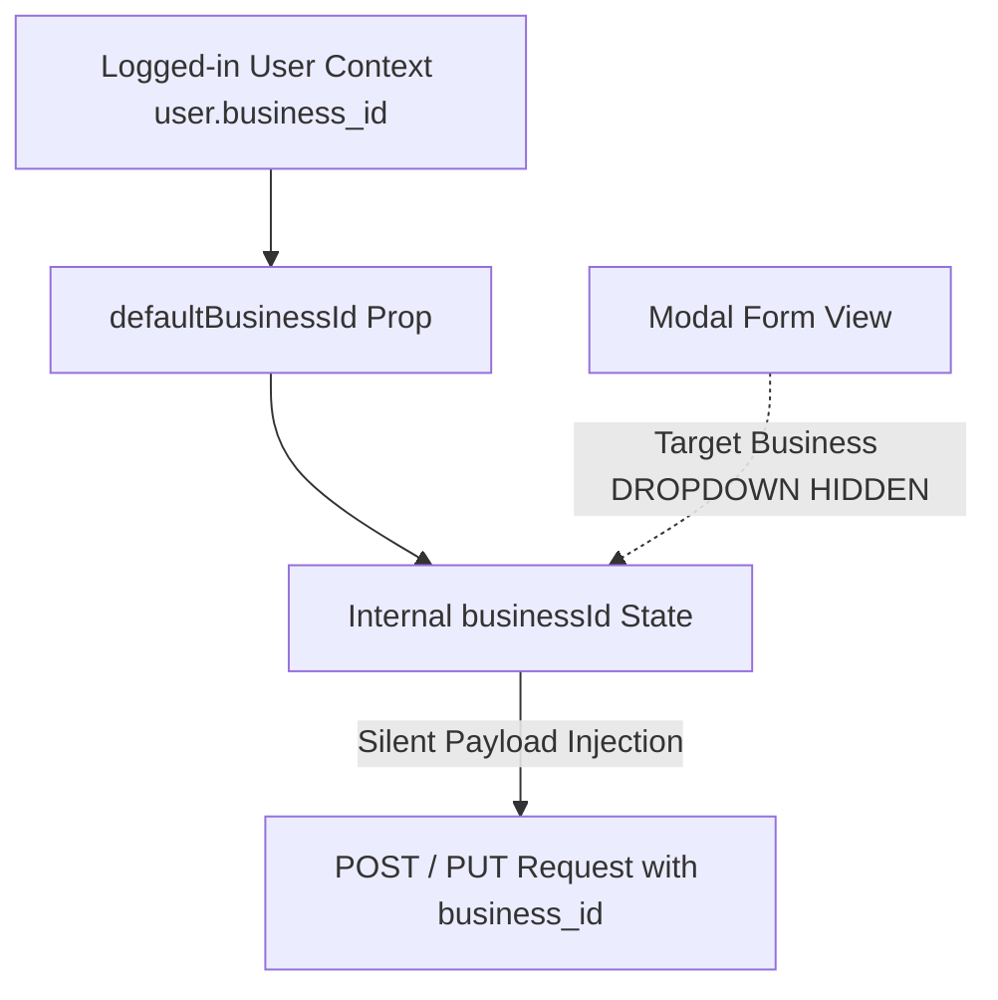

# Implementation Plan: Hide Target Business & Predefine Logged-In User Business ID

## Goal Description
In the HR & Payroll letter and certificate generation modals:
1. **Experience Letters**: `http://127.0.0.1:3000/hr-payroll/experience-letters` $\rightarrow$ "Issue Certificate of Experience" modal.
2. **Appointment Letters**: `http://127.0.0.1:3000/hr-payroll/appointment-letters` $\rightarrow$ "Generate Appointment Letter" modal.
3. **Offer Letters**: `http://127.0.0.1:3000/hr-payroll/offer-letters` $\rightarrow$ "Issue Offer Letter" modal.
4. *(Consistent Safety Scope)* **Salary Certificates**: `http://127.0.0.1:3000/hr-payroll/salary-certificates` $\rightarrow$ "Issue Salary Certificate" modal.

Currently, whenever an administrative user or superuser accesses these modals, a manual `"Target Business *"` dropdown is exposed.
**User Requirement**:
> *"Target Business will be hidden and it is the logged in users business id which will be pre defined. so check this and fix this. Same error found in also Appointment Letter and Offer Letter."*

---

## User Review Required

> [!NOTE]
> **Predefining `business_id` Silently**:
> - The UI dropdown block for `Target Business` will be completely removed/hidden in all letter generation modals.
> - The component state `businessId` will be pre-initialized and bound to the logged-in user's business ID (`defaultBusinessId` derived from `user.business_id || 1`).
> - When editing an existing letter, `businessId` preserves `letter.business_id || defaultBusinessId`.
> - The payload submitted to the backend continues to transmit the exact `business_id`, ensuring strict database tenancy isolation without requiring or displaying manual business selection.
> - Additionally, for `ExperienceLetterModal` (and `SalaryCertificateModal`), we will upgrade the employee selector to the new `SearchableEmployeeCombobox` for a seamless search experience.

---

## Architecture & Proposed Changes



---

### Component Modifications

#### 1. [MODIFY] `frontend/src/components/hr-payroll/experience-letters/modals/experience-letter-modal.tsx`
- **Remove UI Dropdown**: Remove lines 200–217 (the `{isSuperuser && ( <div>Target Business...</div> )}` element).
- **Predefine Business ID**: Keep `businessId` state silently set to `letter ? (letter.business_id || defaultBusinessId) : defaultBusinessId`.
- **Searchable Employee Dropdown**: Replace the static `<select>` on lines 220–237 with `<SearchableEmployeeCombobox />`.

```diff
-          {isSuperuser && (
-            <div>
-              <label className="block text-xs font-semibold text-slate-700 mb-1">
-                Target Business <span className="text-red-500">*</span>
-              </label>
-              <select
-                value={businessId}
-                onChange={(e) => setBusinessId(Number(e.target.value))}
-                className="w-full text-xs rounded-xl border border-slate-200 p-2.5 bg-white focus:outline-none focus:ring-2 focus:ring-indigo-500"
-              >
-                {businesses.map((b) => (
-                  <option key={b.id} value={b.id}>
-                    {b.name_en}
-                  </option>
-                ))}
-              </select>
-            </div>
-          )}
```

---

#### 2. [MODIFY] `frontend/src/components/hr-payroll/offer-letters/modals/offer-letter-modal.tsx`
- **Remove UI Dropdown**: Remove lines 191–208 (`{isSuperuser && ( <div>Target Business...</div> )}`).
- **Predefine Business ID**: Keep `businessId` state silently set to `letter ? (letter.business_id || defaultBusinessId) : defaultBusinessId`.

---

#### 3. [MODIFY] `frontend/src/components/hr-payroll/appointments/modals/appointment-letter-modal.tsx`
- **Remove UI Dropdown**: Remove lines 220–237 (`{isSuperuser && ( <div>Target Business...</div> )}`).
- **Predefine Business ID**: Keep `businessId` state silently set to `appointment ? (appointment.business_id || defaultBusinessId) : defaultBusinessId`.

---

#### 4. [MODIFY] `frontend/src/components/hr-payroll/certificates/modals/salary-certificate-modal.tsx`
- **Remove UI Dropdown**: Remove lines 229–246 (`{isSuperuser && ( <div>Target Business...</div> )}`).
- **Predefine Business ID**: Keep `businessId` state silently set to `certificate ? (certificate.business_id || defaultBusinessId) : defaultBusinessId`.
- **Searchable Employee Dropdown**: Upgrade employee selector to `<SearchableEmployeeCombobox />`.

---

## Verification Plan

### Automated Tests
1. **Frontend Unit Tests**:
   - Run vitest suite across updated components:
     ```bash
     cd frontend && npm test
     ```
2. **TypeScript Compilation**:
   - Verify strict compilation across the entire frontend:
     ```bash
     cd frontend && npx tsc --noEmit
     ```

### Manual & Browser Verification
1. Navigate in browser to `http://127.0.0.1:3000/hr-payroll/experience-letters`.
2. Click **"Issue Certificate of Experience"**:
   - Confirm that the **Target Business** field is completely gone / hidden.
   - Confirm that the **Employee** selector offers instant search.
   - Fill in details and verify that the letter is created with the current user's `business_id` without error.
3. Navigate to `http://127.0.0.1:3000/hr-payroll/appointment-letters` $\rightarrow$ click **"Generate Appointment Letter"**:
   - Confirm that **Target Business** is completely gone / hidden.
4. Navigate to `http://127.0.0.1:3000/hr-payroll/offer-letters` $\rightarrow$ click **"Issue Offer Letter"**:
   - Confirm that **Target Business** is completely gone / hidden.
5. Capture clean screenshot evidence to confirm in the final walkthrough.
