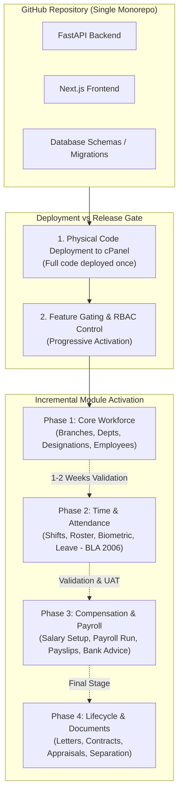
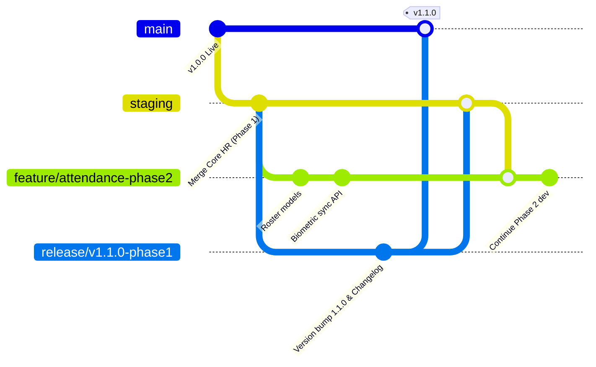

# Enterprise Incremental Release & cPanel Live Deployment Plan: ProERP HR & Payroll

## Goal Description
The objective is to establish an enterprise-grade, standard software engineering workflow to deploy the updated ProERP platform to a live **cPanel** production environment. Specifically, while the GitHub repository contains complete code for the platform, the organization requires an **incremental, module-by-module rollout of HR & Payroll** (e.g., Organization & Employees first, followed by Attendance & Leave, then Compensation & Payroll, and finally Lifecycle & Document Management) without disrupting existing live services or overwhelming end users.

This plan details:
1. **Decoupling Code Deployment from Feature Release**: How to deploy the codebase safely while enabling HR & Payroll sub-modules progressively via RBAC and Feature Gating.
2. **Release Documentation & Management Reporting**: How to create executive release notes, risk assessments, and sign-off artifacts for the management body.
3. **Engineering Team Sync & Project Tracking**: How to maintain transparency across the dev team regarding what is built, what is released, and what is scheduled.
4. **End-to-End cPanel Production Deployment Runbook**: Exact, step-by-step technical procedures for deploying the FastAPI Python ASGI backend (via Passenger/`a2wsgi`) and Next.js frontend on cPanel.
5. **Verification & Rollback Strategy**: Pre-deployment audits, automated testing, sanity checks, and emergency rollback procedures.

---

## User Review Required

> [!IMPORTANT]
> **Key Architectural Invariant: Deployment vs. Release Decoupling**
> In standard modern software engineering (especially with unified monorepos and compiled frontends like Next.js), you **do not physically cherry-pick or delete backend folders or frontend route files** on the server. Attempting to deploy partial source files leads to missing imports, broken routing, and crashed builds.
> Instead, **all tested code is deployed**, and sub-modules are **progressively released** to users through **Database RBAC Permission Scoping** and **Feature Flags**. Non-released modules remain dormant and inaccessible to regular tenant users.

> [!WARNING]
> **PostgreSQL Requirement on cPanel**
> ProERP uses PostgreSQL with async capabilities (`psycopg2` + `asyncpg`). Standard shared cPanel accounts frequently only offer MySQL/MariaDB out of the box. Ensure that your cPanel host has the **PostgreSQL Database service enabled** or that you are connecting to an external/managed PostgreSQL database instance (e.g., AWS RDS, Supabase, or a dedicated VPS).

---

## Open Questions

> [!NOTE]
> Please review and confirm the following before executing the live release:
> 1. **cPanel Server Environment**: Does your cPanel account provide SSH terminal access and CloudLinux "Setup Python App" + "Setup Node.js App"?
> 2. **Domain Architecture**: Are you deploying frontend and backend to distinct subdomains (e.g., Frontend: `app.wbsoftbd.com`, Backend: `api.wbsoftbd.com`), or on a single domain with `.htaccess` reverse proxying `/api`?
> 3. **Planned Rollout Timeline**: What is your proposed interval between Phase 1 (Core HR) and Phase 2 (Attendance/Leave) releases (e.g., 1 week, 2 weeks)?

---

## Proposed Changes & Phasing Strategy



---

### Component 1: Incremental Module Activation (One-by-One Rollout)

To deliver modules one-by-one without altering the core codebase on the live server, we follow a strict dependency sequence:

#### Dependency Hierarchy Matrix
| Phase | Sub-Modules Included | Technical Dependencies | User Persona Activated |
|---|---|---|---|
| **Phase 1: Core Foundation** | • Branches & Organization<br>• Departments & Designations<br>• Employee Master Records<br>• Digital Personal Files | Multi-Tenancy (`business_id`), System Admin RBAC | HR Admins, System Superadmins |
| **Phase 2: Attendance & Leave** | • Shift Definitions & Duty Roster<br>• Attendance Logs & Machine Sync<br>• Statutory Leave Types (BLA 2006)<br>• Leave Allocations & Requests | Requires Phase 1 (Employees & Departments) | Department Managers, All Staff (Self-Service) |
| **Phase 3: Compensation & Payroll** | • Salary Components & Grades<br>• Compensation Profiles<br>• Monthly Payroll Processing<br>• Payslips & Salary Certificates | Requires Phase 1 (Employees) & Phase 2 (Attendance/Leave Deductions) | Accounts / Payroll Officers, Management |
| **Phase 4: Lifecycle & Docs** | • Offer & Appointment Letters<br>• Promotions & Department Transfers<br>• Disciplinary Actions & Warnings<br>• Final Settlement & Separation | Requires Phase 1, Phase 2, and Phase 3 | HR Directors, Legal/Compliance |

#### Implementation Mechanism: RBAC & Navigation Gating
In `frontend/src/components/layout/sidebar.tsx`, each navigation link already checks `hasPermission(module, feature, action)`. 
When rolling out Phase 1:
- Do **not** assign permissions for `hrm:attendance:*`, `hrm:leave_applications:*`, or `hrm:payroll_periods:*` to business tenant roles.
- Seed only Phase 1 permissions (`hrm:departments:*`, `hrm:job_titles:*`, `hrm:employees:*`).
- The backend API (`app/api/v1/endpoints/`) enforces these permissions using FastAPI dependency `get_current_user_with_permissions(...)`, returning `403 Forbidden` for any unauthorized access to unreleased modules.

---

### Component 2: Release Documentation & Management Reporting

Standard software engineering demands two distinct documentation streams before any release:
1. **Executive / Management Briefing Document** (Business-oriented)
2. **Technical Release Notes & Changelog** (Engineering & Support-oriented)

#### 1. Pre-Release Executive Document Template (For Management Body)

Save as: `docs/releases/v1.1.0-Phase1-Management-Brief.md`

```markdown
# Executive Release Brief: HR & Payroll Phase 1 Rollout
**Target Version:** v1.1.0 (Core HRIS & Employee Directory)  
**Planned Live Date:** [YYYY-MM-DD] | **Maintenance Window:** 02:00 AM - 03:00 AM BST (1 hour)  
**Release Lead:** Lead Software Engineer | **Business Sponsor:** Head of HR  

---

### 1. Executive Summary & Business Objectives
This release activates Phase 1 of the ProERP HR & Payroll modernization program. It establishes a centralized, multi-tenant digital workforce repository, replacing manual spreadsheet management. Phase 1 provides the single source of truth for all employee profiles, organizational structures, and document dossiers.

### 2. Scope & Features Delivered
| Module | Business Capability | Operational Impact |
|---|---|---|
| **Organizational Setup** | Multi-branch offices, department hierarchies, and standard designation catalog. | Eliminates naming duplicates and standardizes reporting lines. |
| **Employee Directory** | Unified digital master profile (Personal, Contact, Emergency, Identity, Banking, Statutory fields). | Immediate lookup of 100% active staff across all business branches. |
| **Digital Document e-Dossier** | Encrypted storage for National IDs, Passports, Educational credentials, and CVs. | Ensures audit compliance for labour inspectorates (BLA 2006). |
| **Statutory Data Compliance** | Built-in validation for Bangladesh Labour Act (BLA) mandatory record-keeping. | Zero penalty risk during compliance audits. |

### 3. Out of Scope (Scheduled for Subsequent Releases)
- **Phase 2 (Scheduled [Date + 2 Weeks]):** Daily Biometric Attendance, Duty Roster & Leave Requests.
- **Phase 3 (Scheduled [Date + 4 Weeks]):** Monthly Payroll Computation, Payslips & Bank Transfer sheets.

### 4. Risk Assessment & Mitigation Plan
- **Risk 1: User Login Difficulties**  
  *Mitigation:* Self-service password reset active; default temporary passwords delivered via secure SMS/email.
- **Risk 2: Discrepancy in Historical Employee Data**  
  *Mitigation:* Pre-release dry run bulk import validated with HR Operations team on Staging.
- **Rollback Decision Gate:** If database migration fails or core login experiences >5% error rate during the 30-minute post-deployment check, the release lead will trigger an immediate rollback to v1.0.8 backup.

### 5. Training, User Onboarding & Go-Live Support
- **Admin Training Session:** Scheduled for [Date/Time] (45 minutes via Zoom/Office).
- **Dedicated Support Hotline:** Dedicated WhatsApp/Slack channel staffed by QA & Engineering for the first 48 hours post-release.

### 6. Management Sign-Off Required
- [ ] Head of HR Operations: ___________________ Date: _________
- [ ] Chief Technology Officer: ________________ Date: _________
```

---

#### 2. Technical Release Notes Template (For Engineering, QA, Support)

Follow the standard **Keep a Changelog** conventions and **Semantic Versioning (SemVer 2.0.0)**. Maintain this centrally in `CHANGELOG.md`:

```markdown
# Changelog

All notable changes to this project will be documented in this file.
The format is based on [Keep a Changelog](https://keepachangelog.com/en/1.0.0/),
and this project adheres to [Semantic Versioning](https://semver.org/spec/v2.0.0.html).

## [1.1.0] - 2026-11-05
### Phase 1: HR & Payroll Core Foundation Release

#### Added
- **Core HR Models & Schema**: `Department`, `JobTitle`, `Employee`, `EmployeeDocument` tables with tenant isolation (`business_id`).
- **REST Endpoints**:
  - `GET /api/v1/departments`, `POST /api/v1/departments`
  - `GET /api/v1/job-titles`, `POST /api/v1/job-titles`
  - `GET /api/v1/employees`, `POST /api/v1/employees`, `PUT /api/v1/employees/{id}`
  - `POST /api/v1/employees/bulk-import` for CSV/Excel data onboarding.
- **Frontend Views**:
  - In-place searchable employee listing adhering to ProERP UI invariants.
  - Multi-tab employee profile edit modal (Personal, Identity, Job & Org, Emergency).
- **Statutory Validation**: BLA 2006 required fields (NID validation, age threshold checks).

#### Changed
- Updated `sidebar.tsx` to group Core HR & Workforce navigation under `sectionKey: "hr"`.
- Enhanced `_sync_missing_columns` in `app/main.py` to auto-reconcile schema changes without full downtime.

#### Database Migrations
- Added tables: `departments`, `job_titles`, `employees`, `employee_documents`.
- Added indexes on `(business_id, employee_code)` and `(business_id, email)`.

#### Security & RBAC
- Seeded permission codes: `hrm:departments:*`, `hrm:job_titles:*`, `hrm:employees:*`.
- Phase 2/3 permissions remain withheld from default business roles.
```

---

### Component 3: Keeping the Engineering Team Aligned

To eliminate confusion between "What is being built", "What is released", and "What is on schedule", implement the standard 4-pillar engineering tracking cadence:



1. **Git Branching Strategy**:
   - `main`: Reflects strictly what is live in Production on cPanel. Every merge to `main` is tagged with a git release tag (`git tag -a v1.1.0 -m "Release v1.1.0 - HR Phase 1"`).
   - `staging`: Integration branch for QA and Staging environment testing.
   - `release/vX.Y.Z`: Temporary stabilization branch cut from `staging` 3 days before live release. Only documentation and critical bug fixes are committed here.
   - `feature/hrm-<module>`: Feature branches for ongoing work (e.g. `feature/hrm-leave-management`).
2. **Project Board Columns (GitHub Projects / Jira / Linear)**:
   - 📋 **Backlog**: Scheduled future modules (e.g., Phase 3 Payroll, Phase 4 Letters).
   - 🛠️ **In Development**: What devs are actively coding right now.
   - 🔍 **Code Review & QA**: Pull requests undergoing peer review and automated test suites.
   - 🧪 **Staged / Ready for Release**: Passed QA, deployed on staging, pending management maintenance window.
   - 🚀 **Live in Production**: Verified live on cPanel.
3. **Weekly Release Cadence & Standup Protocol**:
   - **Monday Release Planning**: Review scheduled release candidates for the week.
   - **Thursday Code Freeze**: No new features merged into the upcoming release branch after 6:00 PM.
   - **Friday Morning Deployment & Sanity Check**: Deploy to cPanel, run diagnostics, and confirm stability before weekend operations.

---

### Component 4: Complete cPanel Live Server Deployment Guide

This section provides the exact technical commands and steps to deploy the FastAPI backend and Next.js frontend on a cPanel server.

#### Architectural Topology on cPanel

```
+--------------------------------------------------------------------------+
| cPanel Hosting Server (CloudLinux / LiteSpeed / Apache)                  |
|                                                                          |
|  [Subdomain: api.yourdomain.com]       [Subdomain: app.yourdomain.com]   |
|   Directory: ~/api.yourdomain.com       Directory: ~/app.yourdomain.com  |
|                                                                          |
|   +---------------------------+         +----------------------------+   |
|   | FastAPI Application       |         | Next.js Frontend App       |   |
|   | Managed by "Setup Python" |         | Node.js / PM2 / Static     |   |
|   | passenger_wsgi.py         |         | SSR port 3000 or Export    |   |
|   | a2wsgi ASGI bridge        |         | .htaccess reverse proxy    |   |
|   +-------------+-------------+         +--------------+-------------+   |
|                 |                                      |                 |
|                 +------------------+-------------------+                 |
|                                    |                                     |
|                       +------------v-------------+                       |
|                       | PostgreSQL Database      |                       |
|                       | Local cPanel / Managed   |                       |
|                       +--------------------------+                       |
+--------------------------------------------------------------------------+
```

---

#### Step 1: Pre-Deployment Server Preparation (cPanel)

1. **Create Subdomains in cPanel**:
   - Go to **cPanel > Domains**.
   - Create:
     - `api.yourdomain.com` (Document root: `/home/USERNAME/api.yourdomain.com`)
     - `app.yourdomain.com` (Document root: `/home/USERNAME/app.yourdomain.com` or `public_html`)
   - Ensure **SSL/TLS (Let's Encrypt / AutoSSL)** is activated for both subdomains.
2. **PostgreSQL Database Setup**:
   - Go to **cPanel > PostgreSQL Databases** (or connect your remote managed database).
   - Create database: `username_proerp_db`.
   - Create user: `username_proerp_user` with a strong password.
   - Associate user with database and grant **ALL PRIVILEGES**.

---

#### Step 2: Deploying FastAPI Backend on cPanel

ProERP includes a production-tested WSGI bridge: [passenger_wsgi.py](file:///d:/Onoda%20Inc/Test%20Projects/python/python-fastapi-new/passenger_wsgi.py), which handles LiteSpeed process forking and converts ASGI lifespan to WSGI via `a2wsgi`.

1. **Configure "Setup Python App" in cPanel**:
   - Open **cPanel > Software > Setup Python App**.
   - Click **Create Application**.
   - Fill in configuration:
     - **Python Version**: Select `3.11` or `3.10`.
     - **Application root**: `api.yourdomain.com` (path where backend files reside).
     - **Application URL**: `api.yourdomain.com`.
     - **Application startup file**: `passenger_wsgi.py`.
     - **Application Entry point**: `application`.
     - **Passenger log file**: `/home/USERNAME/api.yourdomain.com/passenger_app.log`.
   - Click **Create**.
2. **Clone / Upload Source Code**:
   - Connect via SSH or use **cPanel Terminal**:
     ```bash
     cd ~/api.yourdomain.com
     git init
     git remote add origin https://github.com/your-org/python-fastapi-new.git
     git fetch origin
     git checkout main
     ```
3. **Configure Production Environment (`.env`)**:
   - In `~/api.yourdomain.com/.env`:
     ```env
     APP_ENV=production
     DEBUG=False
     
     # Database Connection
     DB_NAME=username_proerp_db
     DB_USER=username_proerp_user
     DB_PASSWORD=YourStrongDbPassword
     DB_HOST=127.0.0.1
     DB_PORT=5432
     
     SECRET_KEY=generate_a_random_64_char_secret_key_here
     
     # CORS Settings (Allow the frontend live domain)
     BACKEND_CORS_ORIGINS=["https://app.yourdomain.com","http://localhost:3000"]
     
     # AI Assistant (Optional)
     OPENROUTER_API_KEY=your_key_if_enabled
     ```
4. **Install Dependencies in Virtualenv**:
   - The cPanel Python App screen displays an activation command at the top, for example:
     ```bash
     source /home/USERNAME/virtualenv/api.yourdomain.com/3.11/bin/activate && cd /home/USERNAME/api.yourdomain.com
     ```
   - Run this in the terminal, then install requirements:
     ```bash
     pip install --upgrade pip
     pip install -r requirements.txt
     pip install a2wsgi psycopg2-binary
     ```
5. **Run Database Initialization & Diagnostic Check**:
   ProERP has a built-in diagnostic tool [cpanel_diag.py](file:///d:/Onoda%20Inc/Test%20Projects/python/python-fastapi-new/cpanel_diag.py) that tests sync/async database connectivity, table initialization, and the Passenger WSGI entry point without hanging:
   ```bash
   python cpanel_diag.py
   ```
   *Expected Output:*
   ```text
   === 1. Load settings
       OK (0.01s) host='127.0.0.1' port=5432 db=username_proerp_db user=username_proerp_user
   === 2. Sync DB connect (psycopg2)
       OK (0.04s)
   === 3. Async DB connect (asyncpg)
       OK (0.05s)
   === 4. Count tables in public schema
       OK (0.02s) tables=48
   === 5. Import passenger_wsgi.application
       OK (0.12s)
   ```
6. **Restart Passenger Backend**:
   Whenever backend code or `.env` changes, restart Passenger:
   ```bash
   mkdir -p tmp && touch tmp/restart.txt
   ```
   Or click **Restart** inside the cPanel "Setup Python App" web interface.
7. **Verify Backend Health**:
   Visit in browser or run curl:
   ```bash
   curl -I https://api.yourdomain.com/docs
   ```
   Ensure it returns `HTTP/2 200 OK`.

---

#### Step 3: Deploying Next.js Frontend on cPanel

Next.js can be deployed on cPanel in two standard ways:
- **Method A (Recommended for SSR & Dynamic Routes)**: CloudLinux "Setup Node.js App".
- **Method B (Static Build / Reverse Proxy)**: Build standalone Next.js server proxied via Apache `.htaccess`.

##### Method A: Deployment via cPanel "Setup Node.js App"

1. **Build the Production Artifact on Local Machine / CI**:
   Because cPanel shared hosts have strict RAM and CPU limits, building Next.js with Turbopack on the shared server can trigger out-of-memory errors. The industry standard practice is to **build locally or in GitHub Actions, then upload the output**.
   
   On your local machine/CI:
   ```bash
   cd frontend
   
   # Set the live production backend URL
   export NEXT_PUBLIC_API_URL="https://api.yourdomain.com"
   
   # Run production build
   npm run build
   ```
2. **Setup Node.js App in cPanel**:
   - Go to **cPanel > Software > Setup Node.js App**.
   - Click **Create Application**.
   - Configure:
     - **Node.js version**: `20.x` or `18.x`.
     - **Application mode**: `Production`.
     - **Application root**: `app.yourdomain.com`.
     - **Application URL**: `app.yourdomain.com`.
     - **Application startup file**: `server.js` (or use custom custom runner below).
3. **Standalone Production Server Runner (`server.js`)**:
   In `frontend/next.config.ts`, ensure `output: "standalone"` is enabled:
   ```typescript
   // frontend/next.config.ts
   import type { NextConfig } from "next";

   const nextConfig: NextConfig = {
     output: "standalone",
     allowedDevOrigins: ["127.0.0.1", "localhost"],
   };

   export default nextConfig;
   ```
   When `npm run build` runs, Next.js generates `.next/standalone/server.js`, which bundles a minimal Node server requiring zero extraneous dependencies.
4. **Deploy files to cPanel**:
   - Copy `.next/standalone/` contents into `~/app.yourdomain.com/`.
   - Copy `frontend/public/` into `~/app.yourdomain.com/public/`.
   - Copy `.next/static/` into `~/app.yourdomain.com/.next/static/`.
5. **Restart Node.js App in cPanel**:
   - Inside cPanel "Setup Node.js App", click **Restart**.
   - Or touch `tmp/restart.txt`.

##### Method B: Alternative Apache `.htaccess` Reverse Proxy
If running Node.js as a background service via PM2 or a dedicated port (e.g. `3000`):
In `~/app.yourdomain.com/.htaccess`:
```apache
RewriteEngine On
RewriteCond %{REQUEST_FILENAME} !-f
RewriteCond %{REQUEST_FILENAME} !-d
RewriteRule ^(.*)$ http://127.0.0.1:3000/$1 [P,L]
```

---

#### Step 4: Activating Modules Incrementally on Live Production

Once code is deployed, execute the incremental release plan:

##### Day 1: Deploy & Activate Phase 1 (Core HR & Workforce)
1. Log in as **Superadmin** at `https://app.yourdomain.com/login`.
2. Navigate to **Administration > Roles & Permissions** (`/administration/roles`).
3. For the standard business role (e.g., "HR Manager", "Branch Admin"):
   - ✅ Check: `hrm:departments:*`, `hrm:job_titles:*`, `hrm:employees:*`, `hrm:documents:*`.
   - ❌ Uncheck / Keep Disabled: `hrm:attendance:*`, `hrm:roster:*`, `hrm:leave_applications:*`, `hrm:payroll_periods:*`.
4. Run bulk upload of departments, designations, and employee rosters using the built-in CSV/Excel importer.
5. Verify that regular users only see **Core HR & Workforce** in the sidebar.

##### Day 14: Activate Phase 2 (Time, Attendance & Statutory Leave)
1. Verify Phase 1 data accuracy with HR.
2. Navigate to **Administration > Roles & Permissions**.
3. Enable `hrm:leave_types:*`, `hrm:leave_allocations:*`, `hrm:leave_applications:*`, `hrm:attendance:*`, `hrm:roster:*`.
4. Configure company leave policies and annual holiday calendars adhering to **BLA 2006 statutory limits**.
5. Announce self-service leave portal availability to staff.

##### Day 28: Activate Phase 3 (Payroll & Compensation)
1. Navigate to **Administration > Roles & Permissions**.
2. Enable `hrm:compensation:*`, `hrm:payroll_settings:*`, `hrm:payroll_periods:*`, `hrm:payroll_records:*` **strictly for Finance/Payroll roles**.
3. Generate trial payroll for the current month and verify gross-to-net salary slips against historical ledgers.

---

## Verification Plan

### Automated Tests
Run the following test commands before cutting a release:

1. **HR & Payroll Core & Tenancy Tests (Backend)**:
   ```bash
   DATABASE_URL="sqlite+aiosqlite:///:memory:" SECRET_KEY=testsecretkey APP_ENV=production python -m pytest tests/test_hr_payroll_organization.py tests/test_hr_payroll_employees.py tests/test_hr_payroll_documents.py tests/test_tenant_isolation.py -v
   ```
2. **Statutory Labour Compliance & Payroll Tests**:
   ```bash
   DATABASE_URL="sqlite+aiosqlite:///:memory:" SECRET_KEY=testsecretkey APP_ENV=production python -m pytest tests/test_hr_payroll_leave_types.py tests/test_leave_lifecycle.py tests/test_payroll_extended_features.py -v
   ```
3. **Frontend In-Place Filtering & Unit Tests**:
   ```bash
   cd frontend
   npm run test
   ```

### Manual Verification Checklist (Live cPanel Sanity Check)
Execute this immediately following cPanel deployment:
1. **Connectivity**: Verify `https://api.yourdomain.com/cpanel_diag.py` equivalent or `/docs` loads with zero 500 errors.
2. **Passenger Hang Check**: Check `~/api.yourdomain.com/passenger_app.log` to confirm no thread blocking or database pool deadlocks.
3. **Authentication**: Log into `https://app.yourdomain.com` with a standard tenant account; confirm access token issuance and valid user payload.
4. **Sidebar Visibility Check**:
   - Confirm only **Core HR & Workforce** appears for tenant staff under Phase 1.
   - Confirm unreleased modules do not appear in the sidebar and direct URLs return a clean unauthorized state rather than a crash.
5. **In-Place Table Operation**: Load employee list; perform search and pagination. Confirm table does not unmount or flicker (top-rim progress bar appears, subtle opacity transition).
6. **Multi-Tenancy Scoping**: Create a record in Tenant A; log in as Tenant B and verify zero data leakage.

---

## Emergency Rollback Runbook

If any unrecoverable failure occurs during the live maintenance window:
1. **Database Rollback**:
   Restore the pre-deployment PostgreSQL snapshot taken before migration:
   ```bash
   bash scripts/restore_database.sh /path/to/backup_pre_v1.1.0.sql
   ```
2. **Code Rollback**:
   Revert git HEAD to the previous stable release tag:
   ```bash
   cd ~/api.yourdomain.com
   git checkout v1.0.8
   mkdir -p tmp && touch tmp/restart.txt
   ```
3. **Frontend Rollback**:
   Revert `.next` build or point `.htaccess` back to the previous stable release artifact.
4. **Notify Management & Dev Team**: Send incident briefing with root-cause analysis schedule.
