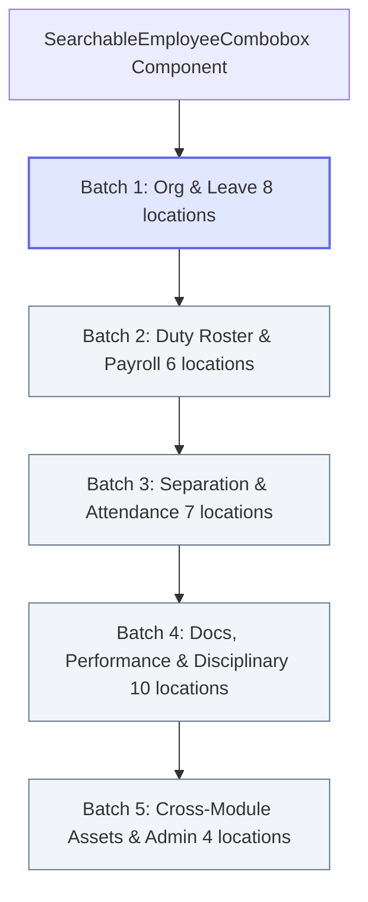

# Implementation Plan: Module-Wide Searchable Employee Combobox Rollout

## Goal Description
Following the successful pilot implementation in the Branch Manager / Lead selector, the user requested an exhaustive identification and rollout plan for all static HTML `<select>` dropdowns across the application where dynamic employee data is selected from the database.

This document identifies all **36 employee select locations** across the platform, categorizes them into 5 cohesive batches, and outlines the step-by-step rollout plan using our reusable, tested [`SearchableEmployeeCombobox`](file:///d:/Onoda%20Inc/Test%20Projects/python/python-fastapi-new/frontend/src/components/common/searchable-employee-combobox.tsx).

---

## User Review Required

> [!IMPORTANT]
> **Total Identified Dropdowns: 36 Locations**
> - **Completed Pilot**: 1 dropdown (`branch-modal.tsx` - Branch Manager / Lead)
> - **Core HR & Payroll Modules**: 31 dropdowns
> - **Cross-Module Linkages** (Assets, Administration, Healthcare): 4 dropdowns

We recommend executing the rollout in organized batches to ensure zero regression, verified test passing, and clean deployment at each stage:

| Batch | Module Scope | Dropdowns Count | Focus Area |
| :--- | :--- | :---: | :--- |
| **Batch 1** | **HR Org & Leave Management** | **8** | HOD, Direct Reporting Manager, Leave Applications & Reviews |
| **Batch 2** | **Duty Roster & Payroll** | **6** | Roster Exchanges/Changes, Payroll Records, Loans, Adjustments |
| **Batch 3** | **Separation & Attendance** | **7** | Resignations, Handovers, Attendance Logs, Overtime, Regularization |
| **Batch 4** | **Documents, Performance & Lifecycle** | **10** | Letters, Certificates, Dossiers, Goals, Appraisals, Movements, Disciplinary |
| **Batch 5** | **Cross-Module Linkages** | **4** | Asset Custodians, User-Employee Linkage, Healthcare Doctor Link |

---

## Detailed Inventory of All 36 Employee Select Locations

### 1. HR Organization & Core Employee Form (3 locations)
1. ✅ **`Branch Manager / Lead`** — [`branch-modal.tsx`](file:///d:/Onoda%20Inc/Test%20Projects/python/python-fastapi-new/frontend/src/components/hr-payroll/branches/branch-modal.tsx#L224) *(Completed in Pilot)*
2. 🔄 **`Head of Department (HOD)`** — [`department-modal.tsx`](file:///d:/Onoda%20Inc/Test%20Projects/python/python-fastapi-new/frontend/src/components/hr-payroll/departments/department-modal.tsx#L273)
3. 🔄 **`Direct Reporting Manager`** — [`employee-form.tsx`](file:///d:/Onoda%20Inc/Test%20Projects/python/python-fastapi-new/frontend/src/components/hr-payroll/employee-form.tsx#L1271)

### 2. Leave Management (6 locations)
4. 🔄 **`Leave Applicant Employee`** — [`leave-application-modal.tsx`](file:///d:/Onoda%20Inc/Test%20Projects/python/python-fastapi-new/frontend/src/components/hr-payroll/leave/modals/leave-application-modal.tsx#L174)
5. 🔄 **`Leave Allocation Recipient`** — [`leave-allocation-modal.tsx`](file:///d:/Onoda%20Inc/Test%20Projects/python/python-fastapi-new/frontend/src/components/hr-payroll/leave/modals/leave-allocation-modal.tsx#L292)
6. 🔄 **`Leave Rollback Manager`** — [`leave-rollback-modal.tsx`](file:///d:/Onoda%20Inc/Test%20Projects/python/python-fastapi-new/frontend/src/components/hr-payroll/leave/modals/leave-rollback-modal.tsx#L142)
7. 🔄 **`Leave Reviewing Manager`** — [`leave-review-modal.tsx`](file:///d:/Onoda%20Inc/Test%20Projects/python/python-fastapi-new/frontend/src/components/hr-payroll/leave/modals/leave-review-modal.tsx#L171)
8. 🔄 **`Leave Encashment Applicant`** — [`leave-encashment-modal.tsx`](file:///d:/Onoda%20Inc/Test%20Projects/python/python-fastapi-new/frontend/src/components/hr-payroll/leave/modals/leave-encashment-modal.tsx#L208)
9. 🔄 **`Leave Encashment Reviewer`** — [`leave-encashment-modal.tsx`](file:///d:/Onoda%20Inc/Test%20Projects/python/python-fastapi-new/frontend/src/components/hr-payroll/leave/modals/leave-encashment-modal.tsx#L348)

### 3. Duty Roster & Shift Scheduling (3 locations)
10. 🔄 **`Roster Change Staff`** — [`roster-change-modal.tsx`](file:///d:/Onoda%20Inc/Test%20Projects/python/python-fastapi-new/frontend/src/components/hr-payroll/roster/modals/roster-change-modal.tsx#L89)
11. 🔄 **`Roster Exchange Requesting Staff (Emp A)`** — [`roster-exchange-modal.tsx`](file:///d:/Onoda%20Inc/Test%20Projects/python/python-fastapi-new/frontend/src/components/hr-payroll/roster/modals/roster-exchange-modal.tsx#L101)
12. 🔄 **`Roster Exchange Target Staff (Emp B)`** — [`roster-exchange-modal.tsx`](file:///d:/Onoda%20Inc/Test%20Projects/python/python-fastapi-new/frontend/src/components/hr-payroll/roster/modals/roster-exchange-modal.tsx#L128)

### 4. Payroll & Compensation (3 locations)
13. 🔄 **`Payroll Record Beneficiary`** — [`payroll-record-modal.tsx`](file:///d:/Onoda%20Inc/Test%20Projects/python/python-fastapi-new/frontend/src/components/hr-payroll/payroll-records/modals/payroll-record-modal.tsx#L351)
14. 🔄 **`Loan Beneficiary Employee`** — [`loan-management-tab.tsx`](file:///d:/Onoda%20Inc/Test%20Projects/python/python-fastapi-new/frontend/src/components/hr-payroll/payroll/loans/loan-management-tab.tsx#L642)
15. 🔄 **`Adjustment Beneficiary Employee`** — [`adjustments-tab.tsx`](file:///d:/Onoda%20Inc/Test%20Projects/python/python-fastapi-new/frontend/src/components/hr-payroll/payroll/adjustments/adjustments-tab.tsx#L542)

### 5. Separation & Offboarding (3 locations)
16. 🔄 **`Separation Employee`** — [`separation-tab.tsx`](file:///d:/Onoda%20Inc/Test%20Projects/python/python-fastapi-new/frontend/src/components/hr-payroll/separation/separations/separation-tab.tsx#L426)
17. 🔄 **`Resignation Employee`** — [`resignation-tab.tsx`](file:///d:/Onoda%20Inc/Test%20Projects/python/python-fastapi-new/frontend/src/components/hr-payroll/separation/resignations/resignation-tab.tsx#L452)
18. 🔄 **`Asset Handover Separating Employee`** — [`asset-handover-tab.tsx`](file:///d:/Onoda%20Inc/Test%20Projects/python/python-fastapi-new/frontend/src/components/hr-payroll/separation/assets/asset-handover-tab.tsx#L146)

### 6. Attendance & Time Tracking (4 locations)
19. 🔄 **`Log Attendance Employee`** — [`log-attendance-modal.tsx`](file:///d:/Onoda%20Inc/Test%20Projects/python/python-fastapi-new/frontend/src/components/hr-payroll/attendance/modals/log-attendance-modal.tsx#L228)
20. 🔄 **`Regularization Request Employee`** — [`attendance-requests-tab.tsx`](file:///d:/Onoda%20Inc/Test%20Projects/python/python-fastapi-new/frontend/src/components/hr-payroll/attendance/regularizations/attendance-requests-tab.tsx#L444)
21. 🔄 **`Overtime Claim Employee`** — [`overtime-tab.tsx`](file:///d:/Onoda%20Inc/Test%20Projects/python/python-fastapi-new/frontend/src/components/hr-payroll/attendance/overtime/overtime-tab.tsx#L426)
22. 🔄 **`Outdoor Duty Employee`** — [`outdoor-duty-tab.tsx`](file:///d:/Onoda%20Inc/Test%20Projects/python/python-fastapi-new/frontend/src/components/hr-payroll/attendance/outdoor/outdoor-duty-tab.tsx#L431)

### 7. Documents, Letters & Certificates (6 locations)
23. 🔄 **`Salary Certificate Employee`** — [`salary-certificate-modal.tsx`](file:///d:/Onoda%20Inc/Test%20Projects/python/python-fastapi-new/frontend/src/components/hr-payroll/certificates/modals/salary-certificate-modal.tsx#L253)
24. 🔄 **`Experience Letter Employee`** — [`experience-letter-modal.tsx`](file:///d:/Onoda%20Inc/Test%20Projects/python/python-fastapi-new/frontend/src/components/hr-payroll/experience-letters/modals/experience-letter-modal.tsx#L224)
25. 🔄 **`Identity Document Employee`** — [`identity-tab.tsx`](file:///d:/Onoda%20Inc/Test%20Projects/python/python-fastapi-new/frontend/src/components/hr-payroll/documents/identity/identity-tab.tsx#L390)
26. 🔄 **`Agreement Employee`** — [`agreements-tab.tsx`](file:///d:/Onoda%20Inc/Test%20Projects/python/python-fastapi-new/frontend/src/components/hr-payroll/documents/agreements/agreements-tab.tsx#L457)
27. 🔄 **`Dossier Filter Employee`** — [`dossier-tab.tsx`](file:///d:/Onoda%20Inc/Test%20Projects/python/python-fastapi-new/frontend/src/components/hr-payroll/documents/dossier/dossier-tab.tsx#L265)
28. 🔄 **`Template Preview Employee`** — [`templates-tab.tsx`](file:///d:/Onoda%20Inc/Test%20Projects/python/python-fastapi-new/frontend/src/components/hr-payroll/documents/templates/templates-tab.tsx#L571)

### 8. Performance, Lifecycle & Disciplinary (4 locations)
29. 🔄 **`Goal Assigned Employee`** — [`goals/page.tsx`](file:///d:/Onoda%20Inc/Test%20Projects/python/python-fastapi-new/frontend/src/app/hr-payroll/performance/goals/page.tsx#L351)
30. 🔄 **`Appraisal Candidate`** — [`appraisals/page.tsx`](file:///d:/Onoda%20Inc/Test%20Projects/python/python-fastapi-new/frontend/src/app/hr-payroll/performance/appraisals/page.tsx#L363)
31. 🔄 **`Lifecycle Movement Employee`** — [`movements/page.tsx`](file:///d:/Onoda%20Inc/Test%20Projects/python/python-fastapi-new/frontend/src/app/hr-payroll/lifecycle/movements/page.tsx#L451)
32. 🔄 **`Disciplinary Action Employee`** — [`disciplinary/page.tsx`](file:///d:/Onoda%20Inc/Test%20Projects/python/python-fastapi-new/frontend/src/app/hr-payroll/disciplinary/page.tsx#L451)

### 9. Cross-Module Linkages (4 locations)
33. 🔄 **`Asset Custodian / Assignee`** — [`assets/page.tsx`](file:///d:/Onoda%20Inc/Test%20Projects/python/python-fastapi-new/frontend/src/app/assets/page.tsx#L612)
34. 🔄 **`User Creation Employee Link`** — [`users/create/page.tsx`](file:///d:/Onoda%20Inc/Test%20Projects/python/python-fastapi-new/frontend/src/app/administration/users/create/page.tsx#L525)
35. 🔄 **`User Edit Employee Link`** — [`users/[id]/edit/page.tsx`](file:///d:/Onoda%20Inc/Test%20Projects/python/python-fastapi-new/frontend/src/app/administration/users/[id]/edit/page.tsx#L665)
36. 🔄 **`Healthcare Doctor Employee Link`** — [`doctor-modal.tsx`](file:///d:/Onoda%20Inc/Test%20Projects/python/python-fastapi-new/frontend/src/components/healthcare/modals/doctor-modal.tsx#L314)

---

## Proposed Rollout Strategy



### Replacement Pattern
For each target location, the replacement will replace the legacy native `<select>` element:

```tsx
// BEFORE (Native HTML select with static scrolling)
<select
  value={employeeId}
  onChange={(e) => setEmployeeId(e.target.value)}
  className="..."
>
  <option value="">Select Employee</option>
  {employees.map(emp => (
    <option key={emp.id} value={emp.id}>
      {emp.full_name} ({emp.employee_id})
    </option>
  ))}
</select>

// AFTER (High-performance instant-search combobox)
<SearchableEmployeeCombobox
  employees={employees}
  value={employeeId}
  onChange={(val) => setEmployeeId(val)}
  placeholder="Search & select employee..."
  allowClear={!isRequired}
  emptyUnassignedLabel={emptyLabel}
/>
```

---

## Verification Plan

### Automated Tests
1. **Unit Test Suite**:
   ```bash
   cd frontend && npm test -- --run searchable-employee-combobox
   ```
2. **Strict TypeScript Compilation**:
   ```bash
   cd frontend && npx tsc --noEmit
   ```
3. **Full Frontend Test Regression**:
   ```bash
   cd frontend && npm test
   ```

### Manual Verification
- Verify each updated modal opens cleanly, filters in real-time as letters are typed, selects accurately, and submits without payload alteration.
- Reload the Next.js container after batch completion to verify instant hot-reloaded functionality in the live browser.
