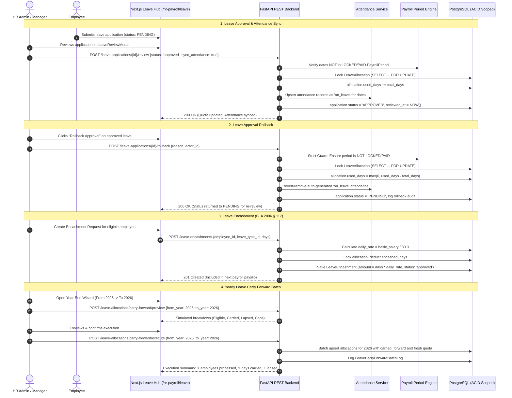

# Leave Management Advanced Lifecycle Architecture Plan

## Executive Summary
This document establishes the end-to-end technical specification and step-by-step implementation plan for four core leave lifecycle mechanisms in the ProERP platform:
1. **Leave Approval & Attendance Sync**: Robust managerial review with atomic quota deduction and bidirectional attendance synchronization.
2. **Leave Approval Rollback**: Concurrency-safe reversion of approved decisions with payroll lock guarding and attendance rollback.
3. **Leave Encashment (BLA 2006 § 117)**: Conversion of accumulated annual leave into monetary wages using employee basic daily rates with payroll integration.
4. **Yearly Leave Carry Forward Process**: Enterprise year-end transition engine supporting dry-run simulation, statutory accumulation caps, lapse tracking, and batch atomic quota creation for Year N+1.

---

## 1. Statutory Business Logic & Architectural Foundation

### Statutory Alignment (Bangladesh Labour Act 2006)
| Policy Type | Code | Standard Entitlement | Cumulative / Carry Forward | Statutory Cap | Encashment Eligibility |
| :--- | :--- | :--- | :--- | :--- | :--- |
| **Casual Leave** | `CL` | 10 days / year | **No** (Lapses Dec 31) | 0 days | **No** (Non-encashable) |
| **Sick Leave** | `SL` | 14 days / year | **No** (Lapses Dec 31) | 0 days | **No** (Non-encashable) |
| **Earned / Annual Leave** | `AL` / `EL` | 1 day per 18 days worked | **Yes** (Cumulative) | 40 days (shops/commercial) / 60 days (factories) | **Yes** (§ 117 with wages) |
| **Maternity Leave** | `ML` | 16 weeks (112 days) | **No** | 0 days | **No** |

---

## 2. End-to-End Workflow Diagram



---

## 3. User Review Required

> [!IMPORTANT]
> **1. Payroll Period Guard Invariant on Rollback**:
> If a leave application falls into a payroll period that has already been `LOCKED` or `PAID`, rolling back an approved leave changes the underlying attendance and unpaid deduction calculations of a finalized payslip. 
> - **Default Decision**: The system will **strictly reject** rollbacks if the period is locked/paid, with an error message indicating that payroll for this month has already been finalized.
> - **Superuser Override**: A superuser can optionally force a rollback with a required audit reason, flagging the associated payroll record for retroactive adjustment.

> [!NOTE]
> **2. Daily Wage Rate Formula for Encashment**:
> Under Bangladesh Labour Act 2006 § 117, leave encashment daily wage is calculated based on monthly basic wages:
> $$\text{Daily Rate} = \frac{\text{Employee Basic Salary}}{30}$$
> If basic salary is not individually defined, fallback to `gross_salary / 30` or configured company policy setting.

---

## 4. Open Questions

1. **Attendance Conflict Handling during Approval**:
   - If an employee already has an attendance punch (e.g. `present` or biometric swipe) on a date covered by an approved leave application, should the approval overwrite it to `on_leave`, or skip that specific day and prompt the manager?
   - *Recommendation*: Overwrite with warning, or preserve actual physical check-ins if `work_hours > 4.0` (marking as `half_day` leave).
2. **Encashment Payment Channel**:
   - Should leave encashment be paid strictly as an earning line item inside the monthly **Payroll Record Payslip**, or should it support **Direct Cash/Bank Voucher** disbursement?
   - *Recommendation*: Support both — default to linking with an open `PayrollPeriod`, with an option for direct standalone settlement.

---

## 5. Proposed Changes by Component

### Backend: Database Models & Schemas

#### [MODIFY] `app/modules/hr_payroll/leave/models.py`
- Add `encashed_days` column to `LeaveAllocation`:
  ```python
  encashed_days: Mapped[float] = mapped_column(Numeric(5, 2), default=0, nullable=False)
  ```
- Update `remaining_days` formula:
  ```python
  @property
  def remaining_days(self) -> float:
      return (
          float(self.allocated_days)
          + float(self.carried_forward)
          - float(self.used_days)
          - float(self.encashed_days)
      )
  ```
- Add rollback audit fields to `LeaveApplication`:
  ```python
  rolled_back_at: Mapped[DateTime | None] = mapped_column(DateTime(timezone=True), nullable=True)
  rolled_back_by_id: Mapped[uuid.UUID | None] = mapped_column(UUID(as_uuid=True), ForeignKey("employees.id", ondelete="SET NULL"), nullable=True)
  rollback_reason: Mapped[str | None] = mapped_column(Text, nullable=True)
  ```
- Add `LeaveEncashment` entity:
  - `id`: UUID (PK)
  - `business_id`: Integer (FK to `business_profiles.id`)
  - `employee_id`: UUID (FK to `employees.id`)
  - `leave_type_id`: UUID (FK to `leave_types.id`)
  - `year`: Integer
  - `encashable_days`: Float (Numeric(5, 2))
  - `daily_rate`: Float (Numeric(12, 2))
  - `total_amount`: Float (Numeric(12, 2))
  - `status`: Enum (`pending`, `approved`, `rejected`, `paid`, `cancelled`)
  - `payroll_period_id`: UUID | None (FK to `payroll_periods.id`)
  - `reviewed_by_id`: UUID | None
  - `reviewed_at`: DateTime | None
  - `payment_date`: Date | None
  - `payment_reference`: String(100) | None
- Add `LeaveCarryForwardLog` entity:
  - Tracks execution of yearly carry-forward batches with `business_id`, `from_year`, `to_year`, `total_employees`, `total_days_carried`, `total_days_lapsed`, `executed_by_id`, `executed_at`.

#### [MODIFY] `app/models_registry.py`
- Register `LeaveEncashment` and `LeaveCarryForwardLog` with `Base.metadata`.

#### [MODIFY] `app/modules/hr_payroll/leave/schemas.py`
- Add schemas for Rollback: `LeaveApplicationRollback` (`reason: str`, `actor_id: UUID`, `force_override: bool = False`).
- Add schemas for Encashment:
  - `LeaveEncashmentCreate`, `LeaveEncashmentReview`, `LeaveEncashmentOut`.
- Add schemas for Carry Forward:
  - `LeaveCarryForwardPreviewRequest` (`from_year: int`, `to_year: int`, `leave_type_id: UUID | None`, `department_id: UUID | None`, `max_cap: float | None`).
  - `LeaveCarryForwardPreviewItem` (breakdown per employee: name, type, previous balance, carried, lapsed, new quota).
  - `LeaveCarryForwardExecuteRequest` & `LeaveCarryForwardExecuteResponse`.

---

### Backend: Services & Business Logic

#### [MODIFY] `app/modules/hr_payroll/leave/service.py`
1. **Enhanced `review_application`**:
   - Optional parameter `sync_attendance: bool = True`.
   - On `APPROVED`, checks if date range overlaps a locked/paid payroll period.
   - If `sync_attendance` is true, invokes `AttendanceService` to mark/upsert `Attendance` records for the employee across the date span with `status = AttendanceStatusEnum.ON_LEAVE`.
2. **New `rollback_application_approval`**:
   - Validates current status is `APPROVED`.
   - Checks `PayrollPeriod` status: if period covering leave dates is `LOCKED` or `PAID`, raises `HTTP 400 Bad Request` unless `force_override=True` by a superuser.
   - Concurrency lock on `LeaveAllocation`: decrements `used_days = max(0, used_days - total_days)`.
   - Rolls back synchronized attendance records (reverts `on_leave` entries to absent/cleared).
   - Updates `application.status = LeaveStatusEnum.PENDING`, stores `rollback_reason`, `rolled_back_by_id`, and `rolled_back_at`.
3. **New `LeaveEncashmentService`**:
   - `create_encashment_request`: Checks employee eligibility (active status, leave type `carry_forward=True` or `code='AL'/'EL'`), fetches employee basic salary, computes `daily_rate = basic / 30.0` and `total_amount = days * daily_rate`.
   - `review_encashment`: Approves/rejects encashment. On approval, locks `LeaveAllocation` and increments `allocation.encashed_days += days`.
   - `disburse_encashment`: Marks status `PAID`, links with payroll period or voucher.
4. **New `LeaveCarryForwardService`**:
   - `preview_carry_forward`: Evaluates all active employees for `from_year`. For each leave type:
     - If `carry_forward=False`: `carry_forward_days = 0`, `lapsed_days = remaining_balance`.
     - If `carry_forward=True`: `carry_forward_days = min(remaining_balance, policy_cap)`, `lapsed_days = remaining_balance - carry_forward_days`.
     - Returns dry-run response without modifying DB.
   - `execute_carry_forward`: Idempotent batch execution in a single database transaction. Upserts `LeaveAllocation` for `to_year` with calculated `carried_forward` and fresh `allocated_days = leave_type.max_days_per_year`. Writes audit log to `LeaveCarryForwardLog`.

---

### Backend: API Router Endpoints

#### [MODIFY] `app/modules/hr_payroll/leave/router.py`
- `POST /leave-applications/{id}/rollback` (Role: `hrm:leave_applications:update`)
- `GET /leave-encashments` (Role: `hrm:leave_allocations:view`)
- `POST /leave-encashments` (Role: `hrm:leave_allocations:create`)
- `POST /leave-encashments/{id}/review` (Role: `hrm:leave_allocations:update`)
- `POST /leave-encashments/{id}/disburse` (Role: `hrm:leave_allocations:update`)
- `POST /leave-allocations/carry-forward/preview` (Role: `hrm:leave_allocations:view`)
- `POST /leave-allocations/carry-forward/execute` (Role: `hrm:leave_allocations:create`)

---

### Frontend: Next.js Enterprise Leave Hub (`/hr-payroll/leave`)

#### [MODIFY] `frontend/src/types/index.ts`
- Add TypeScript definitions for `LeaveEncashmentOut`, `LeaveEncashmentCreate`, `LeaveCarryForwardPreviewItem`, `LeaveCarryForwardBatchLog`.
- Add `encashed_days` and rollback properties to `LeaveAllocationOut` and `LeaveApplicationOut`.

#### [NEW] `frontend/src/components/hr-payroll/leave/modals/leave-rollback-modal.tsx`
- Dialog to rollback an approved leave request.
- Displays applicant info, duration to be restored to quota, reason text area, and payroll lock warning check.

#### [MODIFY] `frontend/src/components/hr-payroll/leave/leave-applications-tab.tsx`
- Implement **In-Place Non-Destructive Filtering** (`initialLoading` vs `isFetching`, top progress bar).
- Add "Rollback Approval" action button on approved cards/rows (triggering `LeaveRollbackModal`).
- Show rollback history badge and review details.

#### [NEW] `frontend/src/components/hr-payroll/leave/leave-encashment-tab.tsx` & `modals/leave-encashment-modal.tsx`
- Manage leave encashment applications.
- Real-time monetary calculation: displays applicant basic salary, calculated per-day wage, requested encashable days, and resulting gross encashment payout.
- Manager approval dialog with direct payout or payroll linking.

#### [NEW] `frontend/src/components/hr-payroll/leave/modals/carry-forward-modal.tsx`
- Two-step enterprise wizard for Yearly Leave Carry Forward:
  - **Step 1: Configuration**: Select `From Year` (e.g. 2025) and `To Year` (e.g. 2026), target policy (e.g. Annual Leave), and statutory maximum cap (e.g. 40 or 60 days).
  - **Step 2: Dry-Run Simulation Preview**: Interactive table displaying each employee's carried days, lapsed days, and new starting quota with summary KPI metrics (Total Employees, Total Days Carried, Total Lapsed).
  - **Step 3: Commit**: One-click batch execution with instant feedback.

#### [MODIFY] `frontend/src/components/hr-payroll/leave/leave-allocations-tab.tsx`
- Add "Encashed Days" metric column in visual quota table.
- Add "Year-End Carry Forward" action button on header toolbar.

---

## 6. Verification & Testing Plan

### Automated Tests
1. **Approval & Attendance Sync Test**:
   ```bash
   pytest tests/test_leave_approval.py -v
   ```
   - Verify balance deduction: `allocation.used_days` increments by `application.total_days`.
   - Verify attendance records: created with `status="on_leave"` for all dates in range.
2. **Approval Rollback & Payroll Guard Test**:
   ```bash
   pytest tests/test_leave_rollback.py -v
   ```
   - Verify rollback reverts `status="pending"`, decrements `used_days`, and removes/reverts attendance records.
   - Verify attempt to rollback when payroll period is `locked` throws `400 Bad Request`.
3. **Leave Encashment Test**:
   ```bash
   pytest tests/test_leave_encashment.py -v
   ```
   - Verify calculation: `amount == days * (basic_salary / 30)`.
   - Verify allocation deduction: `allocation.encashed_days` updates atomically.
4. **Yearly Carry Forward Batch Test**:
   ```bash
   pytest tests/test_leave_carry_forward.py -v
   ```
   - Verify simulation returns exact non-destructive preview.
   - Verify execute creates Year N+1 allocations with capped `carried_forward` and fresh quota.
   - Verify non-carry-forward types (CL, SL) lapse to 0.

### Manual Verification
1. Open `/hr-payroll/leave` in browser.
2. Submit a 3-day leave request, review and approve it.
3. Check Attendance table to verify `on_leave` entries exist for those days.
4. Click "Rollback Approval", provide a reason, and confirm. Verify status returns to Pending, quota restores, and attendance reverts.
5. Create a Leave Encashment request for an employee with annual leave balance, approve, and verify calculated wage amount.
6. Launch the "Year-End Carry Forward" modal, run preview for 2025 -> 2026, verify simulation, and execute batch.
