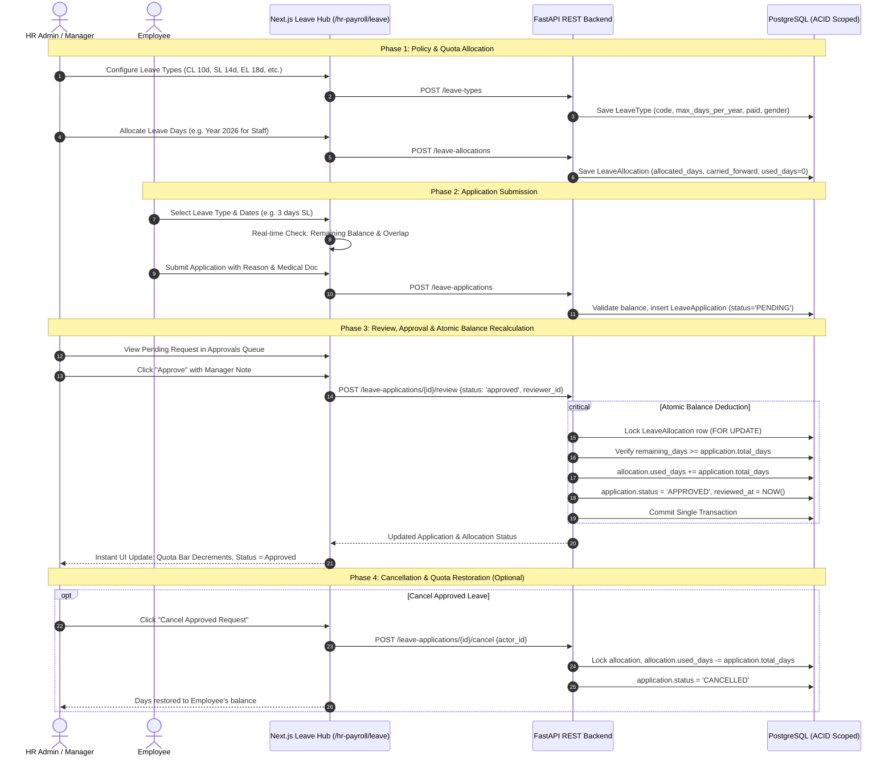

# Leave Management Next.js Enterprise Architecture Plan

## Executive Summary
This document establishes the architecture, design specifications, and implementation roadmap for modernizing the legacy server-rendered HTML/Tailwind Leave Management views (`/leave/types/manage`, `/leave/allocations/manage`, `/leave/applications/manage`) into a unified, responsive **Next.js Enterprise Leave Hub** at `/hr-payroll/leave`.

The implementation guarantees full compliance with the core business requirements:
1. **Leave Types & Policy Configuration**: Configurable entitlements (Paid/Unpaid, Carry Forward, Gender Applicability, Document Enforcement, statutory presets like Casual Leave 10d, Sick Leave 14d, Earned Leave 18d, Maternity Leave 112d).
2. **Leave Allocation & Quota Management**: Assigning annual leave allowances per employee/leave-type/year with carry-forward tracking, remaining balance calculation, and bulk annual allocation.
3. **Leave Application & Overlap Validation**: Real-time balance availability check, automated duration calculation, duplicate/overlapping request prevention, and supporting document attachments.
4. **Managerial Review & Atomic Balance Recalculation**: Multi-tier review (Approve / Reject) with concurrency-safe database row locking (`get_by_emp_type_year_locked`), automated deduction (`used_days += total_days`), and cancellation balance restoration (`used_days -= total_days`).

---

## Architecture & Workflow Diagram



---

## Detailed Observation of Existing Legacy Views

| Legacy Endpoint | Template & Execution Pattern | Key Features Observed | Transition to Next.js |
| :--- | :--- | :--- | :--- |
| **`GET /leave/types/manage`** | Jinja2 template `leave_type_list.html` with jQuery DataTables & client-side DOM search. | Stat cards (Total, Active, Inactive, Paid), Excel Export/Import, Create/Edit forms (`leave_type_form.html`). | Merged into **Tab 3: Policies & Leave Types** with instant live filtering, modal creation, and Bangladesh Labour Act presets. |
| **`GET /leave/allocations/manage`** | Jinja2 template `leave_allocation_list.html`. | Filter by Employee, Year, Leave Type. Stat cards (Allocated Days, Used Days, Remaining Days). Excel export. | Merged into **Tab 2: Balances & Allocations** with interactive visual progress meters, year picker, and bulk allocation modal. |
| **`GET /leave/applications/manage`** | Jinja2 template `leave_application_list.html` & `leave_application_detail.html`. | Status badges (`pending`, `approved`, `rejected`, `cancelled`). Review decision drawer, SweetAlert review modal with reviewer selection and review notes. | Merged into **Tab 1: Leave Requests & Approvals (Default View)** with slide-over review modal, instant status switching, and cancellation balance restoration. |

---

## User Review Required

> [!IMPORTANT]
> **Unified Enterprise Hub Architecture**: Instead of having three separate disjointed pages that require multiple page reloads, all three workflows will be combined into a cohesive, high-performance **Leave Management Hub** at `/hr-payroll/leave`. 
> 
> Navigation between **Requests & Approvals**, **Balances & Quotas**, **Leave Types & Policies**, and **Team Availability Calendar** is instantaneous via URL state and active tabs.

> [!NOTE]
> **Bulk Allocation Capability**: In Bangladesh and global enterprise setups, HR managers typically allocate standard annual leave allowances to hundreds of employees simultaneously at the beginning of each calendar year (e.g. 10 days Casual Leave + 14 days Sick Leave to all active employees). We are introducing a **Bulk Annual Leave Allocation Modal** in Tab 2 to automate this previously manual task.

---

## Proposed Component & File Structure

```
frontend/src/
├── app/
│   └── hr-payroll/
│       └── leave/
│           └── page.tsx                     # Unified Leave Management Hub (Tabs, State, KPIs)
├── components/
│   └── hr-payroll/
│       └── leave/
│           ├── leave-applications-tab.tsx   # Tab 1: Requests & Approvals Queue
│           ├── leave-allocations-tab.tsx    # Tab 2: Employee Balances & Quotas
│           ├── leave-types-tab.tsx          # Tab 3: Policy & Type Definitions
│           ├── leave-calendar-tab.tsx       # Tab 4: Team Availability Calendar
│           ├── modals/
│           │   ├── leave-application-modal.tsx  # Apply for leave with live balance check
│           │   ├── leave-review-modal.tsx       # Manager review dialog (Approve/Reject)
│           │   ├── leave-allocation-modal.tsx   # Individual quota grant / edit
│           │   ├── bulk-allocation-modal.tsx    # Bulk annual quota assignment
│           │   ├── leave-type-modal.tsx         # Create / Edit leave type with BLA presets
│           │   └── leave-export-modal.tsx       # Excel export modal for types/alloc/apps
│           └── leave-stat-cards.tsx         # Responsive KPI summary metric cards
└── types/
    └── index.ts                             # Extended with Leave TypeScript interfaces
```

---

## Detailed Component Specifications

### 1. Tab 1: Leave Requests & Approvals (`leave-applications-tab.tsx`)
- **KPI Metrics Cards**:
  - Total Applications
  - Pending Review (amber highlight, pulsating badge when > 0)
  - Approved Requests (emerald)
  - Rejected / Cancelled (slate)
- **Filters & Search**:
  - Filter pills: `All`, `Pending`, `Approved`, `Rejected`, `Cancelled`
  - Search applicant by name, employee code, or department
  - Filter by Leave Type (Casual, Sick, Annual, etc.)
  - Filter by Date Range
- **Table Columns**:
  - Applicant (Avatar, Employee Name, Employee ID, Designation/Dept)
  - Leave Policy (Badge with code e.g. `[SL] Sick Leave`, Paid/Unpaid pill)
  - Dates & Duration (Calendar icon, Start Date → End Date, Total Days badge)
  - Reason & Documents (Truncated reason with tooltip, clickable document link if attached)
  - Status Badge (`Pending`, `Approved`, `Rejected`, `Cancelled`)
  - Reviewed By (Reviewer name & review note tooltip if reviewed)
  - Action Buttons:
    - **Review**: Opens `LeaveReviewModal` (only for `pending`)
    - **Cancel Request**: Prompts confirmation and restores allocated quota (for `approved` or `pending`)
    - **Delete**: Soft/hard delete with confirmation

### 2. Tab 2: Balances & Quotas (`leave-allocations-tab.tsx`)
- **KPI Metrics Cards**:
  - Total Allocations
  - Total Allocated Days
  - Total Used Days
  - Total Available / Remaining Days
- **Filters & Controls**:
  - Year selector dropdown (e.g. `2026`, `2025`, `2024`)
  - Department filter
  - Employee search
  - "New Allocation" button & "Bulk Annual Allocation" button
  - "Export Excel" button
- **Visual Progress Table**:
  - Employee info
  - Leave Type
  - Year
  - Allocated Quota + Carried Forward
  - Used Days
  - **Remaining Balance** (bold colored badge)
  - **Usage Progress Bar**: Smooth visual percentage bar (Green < 50%, Amber 50-80%, Red > 80%)
  - Actions: Edit allocation quota, Delete

### 3. Tab 3: Policies & Leave Types (`leave-types-tab.tsx`)
- **KPI Metrics Cards**:
  - Total Policies
  - Active Policies
  - Paid Types
  - Document Required Policies
- **Bangladesh Statutory Presets in Modal**:
  - Quick-fill buttons:
    - `Casual Leave (CL)`: 10 Days, Paid, All genders, No document required.
    - `Sick Leave (SL)`: 14 Days, Paid, All genders, Requires document if > 3 days.
    - `Annual / Earned Leave (EL)`: 18 Days, Paid, Carry Forward enabled.
    - `Maternity Leave (ML)`: 112 Days (16 weeks), Paid, Female only, Document required.
    - `Paternity Leave (PL)`: 5 Days, Paid, Male only.
- **Table Columns**:
  - Code & Name (e.g. `CL - Casual Leave`)
  - Max Days / Year (or `Unlimited` if 0)
  - Payment Type (`Paid` vs `Unpaid`)
  - Carry Forward (`Allowed` vs `Lapses`)
  - Gender (`All`, `Male`, `Female`)
  - Supporting Document (`Required` vs `Optional`)
  - Status (`Active` vs `Inactive`)
  - Actions: Edit, Delete

### 4. Tab 4: Team Availability Calendar (`leave-calendar-tab.tsx`)
- Monthly visual calendar grid displaying approved leaves across departments.
- Color-coded badges per leave type.
- Helps managers prevent understaffing before approving new leaves.

---

## TypeScript Type Definitions (`frontend/src/types/index.ts`)

```typescript
export type GenderApplicabilityEnum = "all" | "male" | "female";
export type LeaveStatusEnum = "pending" | "approved" | "rejected" | "cancelled";

export interface LeaveTypeOut {
  id: string;
  name: string;
  code: string;
  description?: string | null;
  max_days_per_year: number;
  is_paid: boolean;
  requires_document: boolean;
  applicable_gender: GenderApplicabilityEnum;
  carry_forward: boolean;
  is_active: boolean;
  business_id: number;
  created_at: string;
  updated_at: string;
}

export interface LeaveAllocationOut {
  id: string;
  employee_id: string;
  leave_type_id: string;
  year: number;
  allocated_days: number;
  used_days: number;
  carried_forward: number;
  remaining_days: number;
  business_id: number;
  created_at: string;
  updated_at: string;
}

export interface LeaveApplicationOut {
  id: string;
  employee_id: string;
  leave_type_id: string;
  start_date: string;
  end_date: string;
  total_days: number;
  reason: string;
  document_url?: string | null;
  status: LeaveStatusEnum;
  reviewed_by_id?: string | null;
  review_note?: string | null;
  applied_at?: string | null;
  reviewed_at?: string | null;
  business_id: number;
  created_at: string;
  updated_at: string;
}
```

---

## Step-by-Step Implementation Roadmap

1. **Step 1: Type Definitions (`frontend/src/types/index.ts`)**
   - Add all Leave TypeScript interfaces (`LeaveTypeOut`, `LeaveAllocationOut`, `LeaveApplicationOut`, etc.).

2. **Step 2: Modals Implementation (`components/hr-payroll/leave/modals/`)**
   - `leave-type-modal.tsx`: Policy creation/editing with BLA presets.
   - `leave-allocation-modal.tsx`: Single employee allocation form.
   - `bulk-allocation-modal.tsx`: Bulk allocation wizard.
   - `leave-application-modal.tsx`: Leave request modal with dynamic balance preview and auto date calculation.
   - `leave-review-modal.tsx`: Manager review modal for approving or rejecting applications.

3. **Step 3: Tab Views Implementation (`components/hr-payroll/leave/`)**
   - `leave-applications-tab.tsx`: Main request queue with status filters and actions.
   - `leave-allocations-tab.tsx`: Balances table with progress bars.
   - `leave-types-tab.tsx`: Policy table with export/import triggers.
   - `leave-calendar-tab.tsx`: Monthly team availability calendar.

4. **Step 4: Master Hub Page (`frontend/src/app/hr-payroll/leave/page.tsx`)**
   - Implement the master page with shared data fetching, tab switching, and toast notifications.
   - Ensure the page is wrapped with `DashboardLayout` and adheres to full-width responsive standards (`w-full min-w-0`).

5. **Step 5: Verification & End-to-End Validation**
   - Run backend tests (`pytest`).
   - Run Next.js production build (`npm run build`).
   - Perform end-to-end user flow:
     - Configure leave type -> Allocate quota -> Submit application -> Verify real-time balance -> Approve -> Confirm balance deduction -> Cancel -> Confirm balance restoration.
