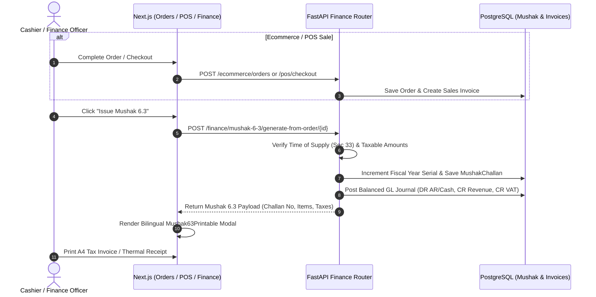

# Implementation Plan: Bangladesh Statutory Mushak 6.3 Generation & Finance VAT Module in Next.js

## Goal Description
Conduct an in-depth audit of the **Ecommerce**, **Inventory Management**, and **Finance** modules to determine their capability to generate statutory **Mushak (মূসক)** chalans under the **Bangladesh Value Added Tax and Supplementary Duty Act, 2012** (মূল্য সংযোজন কর ও সম্পূরক শুল্ক আইন, ২০১২) and **VAT Rules, 2016** (মূসক বিধিমালা, ২০১৬). Provide a comprehensive evaluation of the current condition from a Bangladesh business perspective, identify missing compliance elements, and present a complete architectural implementation plan for building the **Next.js frontend** Mushak and Finance experience.

---

## 1. Current Condition & Bangladesh Business Perspective Evaluation

### 1.1 What the Backend Currently Covers
The backend ([app/modules/finance/](file:///d:/Shakil/Python/python-fastapi-new/app/modules/finance)) contains a well-structured foundation for Mushak 6.3 tax invoices:
1. **Statutory Numbering & Serial Tracking** ([app/modules/finance/services.py:L142-L177](file:///d:/Shakil/Python/python-fastapi-new/app/modules/finance/services.py#L142-L177)):
   - Generates unique challan numbers following the NBR convention: `M6.3-{13-digit BIN}-{FiscalYear}-{06d Serial}` (e.g. `M6.3-1234567890123-2425-000001`).
   - Prevents duplicate issuance for the same sales invoice via unique database constraints (`MushakChallan.invoice_id`).
2. **Time of Supply Compliance (Section 33)** ([app/modules/finance/services.py:L268-L289](file:///d:/Shakil/Python/python-fastapi-new/app/modules/finance/services.py#L268-L289)):
   - Validates that an order is legally eligible for Mushak 6.3 only after:
     - Payment is received, OR
     - Goods are delivered/shipped, OR
     - An invoice has been explicitly issued.
3. **Statutory Tax & Duty Calculations**:
   - Computes Base Value, Supplementary Duty (সম্পূরক শুল্ক - SD), VAT (মূসক), and Total Price per line item and summary level.
   - Formats numbers in Bangladeshi Taka (BDT) with English number-to-words conversion.
4. **Automated Double-Entry General Ledger Postings**:
   - Automatically posts balanced journal vouchers debiting Accounts Receivable / Cash and crediting Sales Revenue & VAT Output Payable.
5. **Backend Jinja2 Printable Template** ([app/templates/modules/finance/mushak_6_3.html](file:///d:/Shakil/Python/python-fastapi-new/app/templates/modules/finance/mushak_6_3.html)):
   - Implements the 11-column statutory Tax Invoice layout prescribed by NBR Rule 40(1)(c)/(f).
   - Generates downloadable HTML/PDF invoices via `/api/v1/finance/invoices/{id}/mushak-6-3/pdf`.

---

### 1.2 Critical Gaps from Bangladesh Business Perspective

| Area | Current Condition | Bangladesh Statutory / Market Requirement | Severity |
| :--- | :--- | :--- | :--- |
| **Frontend UI for Finance** | `frontend/src/app/finance` does not exist. Navigation links lead to 404. | Finance officers & accountants must view, search, generate, and print Mushak 6.3 chalans from the web application. | 🔴 **CRITICAL** |
| **Ecommerce Order Integration** | Order Invoice modal ([order-invoice-modal.tsx](file:///d:/Shakil/Python/python-fastapi-new/frontend/src/components/ecommerce/orders/order-invoice-modal.tsx)) is a generic English layout with no Mushak 6.3 reference. | B2B & B2C customers in Bangladesh require the official Mushak 6.3 challan for tax rebate and accounting compliance. | 🔴 **CRITICAL** |
| **POS Thermal Cash Memo** | POS receipt ([pos/page.tsx](file:///d:/Shakil/Python/python-fastapi-new/frontend/src/app/ecommerce/pos/page.tsx)) prints a generic retail receipt without NBR-approved cash memo format. | NBR VAT Rule 40(1) requires retail POS cash memos to display 13-digit BIN, statutory tax breakdown (SD + VAT), and Mushak 6.3 sequence. | 🔴 **HIGH** |
| **Inventory Branch Transfers (Mushak 6.5)** | Inventory transfers ([inventory/transfers/page.tsx](file:///d:/Shakil/Python/python-fastapi-new/frontend/src/app/ecommerce/inventory/transfers/page.tsx)) have no tax chalan. | Under VAT Rule 40(1)(ga), moving stock between central warehouses and branch stores requires **Mushak 6.5 (পণ্য স্থানান্তর চালানপত্র)**. Moving goods without it leads to vehicle seizure by VAT audit officials. | 🔴 **HIGH** |
| **Harmonized System (H.S.) Code** | `SalesInvoiceLine` has no `hs_code` field. Products in ecommerce do not consistently carry 8-digit H.S. codes. | NBR mandates 8-digit H.S. Codes in Column 3 of Mushak 6.3 for all manufactured and imported goods. | 🟡 **MEDIUM** |
| **Bilingual Support & Bengali Numerals** | Jinja2 template is predominantly English with static Bengali headers; no dynamic Bengali numbers (`১২,৩৪,৫৬৭ টাকা`). | Audits by NBR circle offices frequently require Bengali text and numeral conversion on physical printed chalans. | 🟡 **MEDIUM** |
| **VDS / Withholding Tax (Mushak 6.6)** | Backend has general invoices but lacks dedicated VDS certificate tracking. | When supplying government, semi-autonomous bodies, or large corporations, buyers withhold VAT at source and require **Mushak 6.6**. | 🟡 **MEDIUM** |
| **Returns & Adjustments (Mushak 6.7 / 6.8)** | Backend has `CreditDebitNote` model, but no frontend UI to issue Mushak 6.7 (Credit Note) or 6.8 (Debit Note). | In Bangladesh, return of goods or price revisions requires Mushak 6.7 to decrease output VAT liability in monthly returns (Mushak 9.1). | 🟡 **MEDIUM** |

---

## User Review Required

> [!IMPORTANT]
> **Key Architecture Decisions:**
> 1. **Client-Side High-Fidelity Printable vs Server-Side PDF:**
>    - We propose generating the statutory Mushak 6.3 chalan directly on the client using a dedicated React component (`Mushak63Printable`) with print media queries (`@media print`), exact A4 millimeter scaling, and dual Bengali/English typography.
>    - This provides instant preview, zero-lag browser printing, and fallback to server-rendered PDF via the existing backend endpoint (`/api/v1/finance/invoices/{id}/mushak-6-3/pdf`).
> 2. **Auto-Generation Trigger on Order Delivery:**
>    - Should Mushak 6.3 be generated **automatically** when an Ecommerce Order transitions to `Delivered` / `Completed`, or should it remain a manual "1-Click Issue Challan" button for the finance team? *(Recommended: 1-Click issue button with auto-prompt when status is Delivered)*.
> 3. **H.S. Code Fallback:**
>    - If a product does not have an 8-digit H.S. Code assigned, should the system display a default classification code (e.g. `9900.00.00` for General Merchandise) or allow issuance with an empty H.S. Code?

---

## Open Questions

> [!WARNING]
> 1. **NBR Digital VAT Software Certification:** Does your organization require future integration with the NBR API / Electronic Fiscal Device Management System (EFDMS)? *(Our proposed architecture formats payload structures so they can easily plug into NBR EFDMS APIs).*
> 2. **Multi-Branch Transfers:** Do you operate multiple registered branches with separate 13-digit BIN sub-codes, or a single centralized BIN?

---

## Proposed Changes

### Component 1: Next.js Finance Module Structure & Mushak Registry
Create the missing Finance module in the Next.js frontend, centered around statutory VAT management and invoice operations. All tables will strictly follow [.agents/rules/ui_in_place_filtering.md](file:///d:/Shakil/Python/python-fastapi-new/.agents/rules/ui_in_place_filtering.md) (in-place non-destructive filtering, two-tier loading, top-rim progress bar).

#### [NEW] `frontend/src/app/finance/mushak/page.tsx`
- **Mushak 6.3 Registry & Management Dashboard**:
  - Filter by Fiscal Year (e.g., 2024-2025, 2025-2026), Challan Status (`ISSUED`, `DRAFT`, `CANCELLED`), Date Range, and Search by Customer Name / BIN / Challan Number.
  - In-place non-destructive filtering using React `startTransition`.
  - Action buttons: "Print Mushak 6.3", "Download PDF", "View Source Order / Invoice".
  - Summary metrics card: Total Taxable Value, Total SD, Total VAT Collected (Output VAT), and Withheld Tax.

#### [NEW] `frontend/src/components/finance/mushak-6-3-printable.tsx`
- **Statutory NBR Rule 40 Bilingual A4 Component**:
  - Header:
    - গণপ্রজাতন্ত্রী বাংলাদেশ সরকার, জাতীয় রাজস্ব বোর্ড (Government of the People's Republic of Bangladesh, National Board of Revenue)
    - কর চালানপত্র (মূসক-৬.৩) [Tax Invoice (Mushak-6.3)]
    - [বিধি ৪০ এর উপ-বিধি (১) এর দফা (গ) ও দফা (চ) দ্রষ্টব্য]
  - Registered Business Details: Name, 13-digit BIN, Business Address, Issue Date & Time, Challan Serial Number.
  - Buyer Details: Name, Address, 13-digit BIN (or NID if unregistered retail), Delivery Destination, Vehicle Type & Number (গাড়ির প্রকৃতি ও নম্বর).
  - 11 Statutory Table Columns:
    1. ক্রমিক নং (Sl)
    2. পণ্য বা সেবার বর্ণনা (Description of Goods/Services)
    3. এইচ.এস. কোড (H.S. Code)
    4. সরবরাহের একক (Unit of Supply)
    5. পরিমাণ (Quantity)
    6. একক মূল্য (টাকায়) [Unit Price in BDT]
    7. মোট মূল্য (টাকায়) [Total Value in BDT]
    8. সম্পূরক শুল্কের হার ও পরিমাণ (SD Rate & Amount)
    9. মূল্য সংযোজন করের হার ও পরিমাণ (VAT Rate & Amount)
    10. সকল প্রকার শুল্ক ও করসহ মূল্য (Total Price including SD & VAT)
    11. বিশেষ মন্তব্য (Remarks)
  - Bottom Section:
    - Amount in words in BDT (কথায়: ...)
    - Authorized Officer Signature, Seal, Date, and Legal Notice on Statutory Compliance.

#### [NEW] `frontend/src/components/finance/mushak-6-3-modal.tsx`
- Dialog modal with interactive print preview, full-screen toggle, download PDF button, and direct printer trigger via standard `@media print`.

#### [NEW] `frontend/src/app/finance/invoices/page.tsx`
- Sales Invoices list view with status badges (`PAID`, `PARTIAL`, `DRAFT`), customer BIN display, and direct "Generate Mushak 6.3" trigger action.

#### [NEW] `frontend/src/app/finance/accounts/page.tsx` & `frontend/src/app/finance/vouchers/page.tsx`
- Chart of Accounts and General Ledger Vouchers list implementing in-place filtering to complete the sidebar links and provide seamless navigation for the finance team.

---

### Component 2: Ecommerce Module Integration

#### [MODIFY] `frontend/src/components/ecommerce/orders/order-invoice-modal.tsx`
- Add a "Mushak 6.3 (NBR Tax Invoice)" tab/button alongside the existing standard invoice.
- Integrate with `Mushak63Service`:
  - If a Mushak 6.3 has already been generated for this order's invoice, display the official challan number (`M6.3-XXXXXXXX-XXXX-XXXXXX`) with an instant "Print Mushak 6.3" button.
  - If not yet generated, display a statutory "Issue Mushak 6.3" button that calls `POST /api/v1/finance/mushak-6-3/generate-from-order/{order_id}` and renders the printable challan upon success.

#### [MODIFY] `frontend/src/app/ecommerce/orders/page.tsx`
- Add a Mushak Challan indicator column in the order table displaying the Mushak 6.3 status (`Generated`, `Pending`, `Not Eligible`).
- Quick-action dropdown item: "View / Print Mushak 6.3".

#### [MODIFY] `frontend/src/app/ecommerce/pos/page.tsx`
- Upgrade the POS 80mm thermal receipt component:
  - Add registered business 13-digit BIN at the top.
  - Add statutory NBR header: "কর চালানপত্র (মূসক-৬.৩ ক্যাশ মেমো / NBR Retail Cash Memo)".
  - Display itemized tax breakdown (Net Amount, 5%/7.5%/15% VAT, SD, Gross Payable).
  - Include statutory invoice serial and verification QR code.

---

### Component 3: Inventory Management Integration (Mushak 6.5)

#### [MODIFY] `frontend/src/app/ecommerce/inventory/transfers/page.tsx`
- Under Bangladesh VAT Rule 40(1)(ga), transferring goods between registered premises (warehouses/outlets) requires **Mushak 6.5 (পণ্য স্থানান্তর চালানপত্র)**.
- Add "Issue Mushak 6.5 Transfer Chalan" button to stock transfer records.
- Create printable Mushak 6.5 chalan containing:
  - Dispatching warehouse address & BIN.
  - Receiving branch/warehouse address & BIN.
  - Vehicle details & driver information.
  - Itemized quantity and valuation.

---

### Component 4: Backend Enhancements (Supporting Data Integrity)

#### [MODIFY] `app/modules/finance/models.py` & `app/modules/finance/services.py`
- Add `hs_code` (8-digit Harmonized System code) to `SalesInvoiceLine` and ensure it propagates to `MushakChallan` JSON generation.
- Ensure fallback to product's category H.S. code if available.
- Provide a helper for Bengali numeral conversion (`to_bangla_digits(12345) -> ১২৩৪৫`) in `Mushak63Service.generate_mushak_json` so frontends can seamlessly render both English and Bengali forms.

---

## Technical Design & Workflow Diagram



---

## Verification Plan

### Automated Tests
1. **API Endpoints Test**:
   ```bash
   pytest tests/modules/finance/test_mushak_generation.py -v
   ```
   - Verify `issue_mushak_challan` creates non-repeating serials per fiscal year.
   - Verify Time of Supply rule rejects unpaid/unfulfilled draft orders where applicable.
   - Verify calculation of SD, VAT, and line totals match statutory formulas.
2. **Next.js Lint & Build**:
   ```bash
   npm run build --prefix frontend
   ```
   - Ensure zero TypeScript or React lint errors across all new finance and mushak components.

### Manual Verification
1. **Ecommerce Order Flow**:
   - Open [http://localhost:3000/ecommerce/orders](http://localhost:3000/ecommerce/orders).
   - Select an order and open Order Drawer.
   - Click "Issue Mushak 6.3". Verify modal displays NBR Rule 40 compliant bilingual A4 layout with 13-digit BIN, customer details, and 11 columns.
   - Test `Ctrl+P` / Browser Print to ensure exact A4 margins without cutting off headers or tables.
2. **Finance Mushak Registry**:
   - Navigate to `/finance/mushak`.
   - Test in-place filtering by Fiscal Year, Date, and Challan Status without table unmounting.
   - Verify top-rim progress bar appears during fetching.
3. **POS Thermal Receipt**:
   - Navigate to `/ecommerce/pos`.
   - Add items, select payment, and click Print Receipt.
   - Confirm retail cash memo carries BIN, tax breakdown, and Mushak reference.
4. **Inventory Transfer (Mushak 6.5)**:
   - Navigate to `/ecommerce/inventory/transfers`.
   - Confirm transfer challan preview contains from/to branch addresses, vehicle info, and item valuation.
