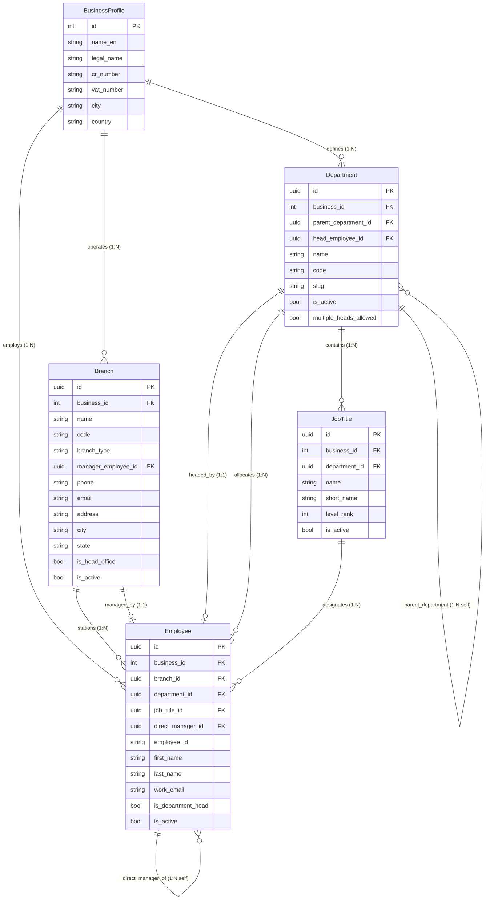

# Implementation Plan: Enriched Company, Branch, Department Setup & Organization Organogram

## Executive Summary
In modern enterprise ERP and HR architectures, an organization consists of a **Company** (Tenant / Corporate Headquarters), distributed **Branches** (Outlets, Regional Hubs, Offices), and functional **Departments** (Operations, IT, HR, Sales, etc.). **Employees** are assigned to specific branches and departments, reporting through a chain of command to direct managers.

This plan details the full end-to-end design and implementation of:
1. **Branch Domain & Entity**: Introducing a first-class `Branch` model linked to the Company (`BusinessProfile`), with branch types (HQ, Regional Office, Retail Outlet, Hub), manager assignment, address, and operational metrics.
2. **Hierarchical Department & Job Title Enrichment**: Enriching `Department` with `parent_department_id` (sub-departments), `head_employee_id` (department head), and `code`. Adding `level_rank` to `JobTitle` (C-Suite down to Intern).
3. **Employee Branch Assignment**: Associating `Employee` directly with `branch_id`, enabling branch-wise roster filtering and multi-branch analytics.
4. **Interactive Organization Organogram & Structure Module**:
   - **Mode 1: Reporting Organogram (Chain of Command)**: Dynamic tree visualization showing management hierarchies (CEO -> Executives -> Branch Managers / Dept Heads -> Team Leads -> Associates) with employee avatars, positions, badges, expand/collapse, zoom/pan, and search highlighting.
   - **Mode 2: Structural Breakdown (Company & Entity Hierarchy)**: Visual drilldown of Company -> Branches -> Departments -> Staff Headcount.
   - **Mode 3: Departmental Tree**: Parent-to-subdepartment relationships.
5. **Unified Settings & Organization Hub**: Providing unified management in both FastAPI Jinja2 Views and the Next.js 15 App Router (`/settings/organization` and `/organization/organogram`).

---

## Architecture & Entity Relationship Design



---

## User Review Required

> [!IMPORTANT]
> **Branch Relationship with Departments**:
> In enterprise setups, departments can either:
> - **Option A (Recommended)**: Be organization-wide (e.g., "Human Resources" or "Sales" exists for the company), and employees in any branch are assigned to a department and a branch (e.g., John is in *Chittagong Branch* under *Sales Department*). Additionally, departments can optionally specify which branches they operate in.
> - **Option B**: Be strictly branch-specific (e.g., each branch has its own separate Department records created individually).
> *We propose Option A as it avoids duplicate department entries (e.g., 5 identical "Finance" departments) while allowing accurate branch-wise and department-wise filtering and reporting.*

> [!NOTE]
> **Backward Compatibility**:
> Adding `branch_id` to `Employee` and `parent_department_id` to `Department` will have `nullable=True` with `ondelete="SET NULL"`. Existing employee records and department records will continue functioning smoothly without breaking legacy data.

---

## Proposed Changes

### 1. Database & Core Models Layer

#### `[NEW]` [app/modules/hr_payroll/organization/branch_models.py](file:///d:/Onoda%20Inc/Test%20Projects/python/python-fastapi-new/app/modules/hr_payroll/organization/branch_models.py)
- Create `Branch` model inheriting from `Base`, `UUIDMixin`, `TimestampMixin`:
  - `business_id`: Mapped[int] -> FK `business_profiles.id` (CASCADE)
  - `name`: Mapped[str] (e.g., "Corporate Head Office", "Gulshan Outlet", "Chittagong Hub")
  - `code`: Mapped[str] (unique per business, e.g. "HQ-01", "GLS-02")
  - `branch_type`: Mapped[str] ("headquarters", "regional_office", "branch_office", "retail_outlet", "warehouse_hub")
  - `manager_employee_id`: Mapped[uuid.UUID | None] -> FK `employees.id` (SET NULL)
  - `phone`, `email`, `address`, `city`, `state`, `country`, `zip_code`
  - `is_head_office`: Mapped[bool] = False
  - `is_active`: Mapped[bool] = True
  - Relationships to `BusinessProfile`, `manager`, `employees`.

#### `[MODIFY]` [app/modules/hr_payroll/organization/models.py](file:///d:/Onoda%20Inc/Test%20Projects/python/python-fastapi-new/app/modules/hr_payroll/organization/models.py)
- Re-export `Branch` from `branch_models.py` or define directly.
- Add to `Department`:
  - `code`: Mapped[str | None] = mapped_column(String(50), nullable=True)
  - `parent_department_id`: Mapped[uuid.UUID | None] = mapped_column(UUID(as_uuid=True), ForeignKey("departments.id", ondelete="SET NULL"), nullable=True)
  - `head_employee_id`: Mapped[uuid.UUID | None] = mapped_column(UUID(as_uuid=True), ForeignKey("employees.id", ondelete="SET NULL"), nullable=True)
  - Self-referencing relationships: `parent_department` and `sub_departments`.
- Add to `JobTitle`:
  - `level_rank`: Mapped[int] = mapped_column(Integer, default=5, nullable=False) *(1=Executive, 2=Director, 3=Manager, 4=Lead, 5=Senior, 6=Associate, 7=Support/Intern)*.

#### `[MODIFY]` [app/modules/hr_payroll/employees/models.py](file:///d:/Onoda%20Inc/Test%20Projects/python/python-fastapi-new/app/modules/hr_payroll/employees/models.py)
- Add `branch_id`:
  ```python
  branch_id: Mapped[uuid.UUID | None] = mapped_column(
      UUID(as_uuid=True),
      ForeignKey("branches.id", ondelete="SET NULL"),
      nullable=True,
      index=True,
  )
  ```
- Add relationship `branch: Mapped["Branch | None"] = relationship("Branch", foreign_keys=[branch_id], lazy="selectin")`.

#### `[MODIFY]` [app/models_registry.py](file:///d:/Onoda%20Inc/Test%20Projects/python/python-fastapi-new/app/models_registry.py)
- Register `Branch` in `models_registry.py`.

---

### 2. Schemas & Service Layer

#### `[NEW]` [app/modules/hr_payroll/organization/branch_schemas.py](file:///d:/Onoda%20Inc/Test%20Projects/python/python-fastapi-new/app/modules/hr_payroll/organization/branch_schemas.py)
- `BranchBase`, `BranchCreate`, `BranchUpdate`, `BranchOut`, `BranchDetailOut`:
  - Output includes `manager_name`, `employee_count`, `active_employee_count`.

#### `[MODIFY]` [app/modules/hr_payroll/organization/schemas.py](file:///d:/Onoda%20Inc/Test%20Projects/python/python-fastapi-new/app/modules/hr_payroll/organization/schemas.py)
- Update `DepartmentCreate`, `DepartmentUpdate`, `DepartmentOut` to support `parent_department_id`, `head_employee_id`, `code`, and `parent_department_name`.
- Add `DepartmentTreeNode`: recursive schema with `children: list[DepartmentTreeNode]`, `employee_count: int`.
- Add `OrganogramEmployeeNode`:
  - `id`, `name`, `employee_id`, `job_title`, `rank`, `department`, `branch`, `work_email`, `avatar_url`, `subordinates: list[OrganogramEmployeeNode]`.
- Add `OrganogramStructureTree`:
  - `company_name`, `branches: list[BranchStructureNode]`, where each branch lists its departments and team rosters.

#### `[NEW]` [app/modules/hr_payroll/organization/branch_service.py](file:///d:/Onoda%20Inc/Test%20Projects/python/python-fastapi-new/app/modules/hr_payroll/organization/branch_service.py)
- Implement `BranchService`:
  - `list_branches(db, business_id, search, is_active, skip, limit)`
  - `get_branch(db, branch_id)`
  - `create_branch(db, data)`
  - `update_branch(db, branch_id, data)`
  - `delete_branch(db, branch_id)`
  - `get_branch_stats(db, business_id)`
  - `export_branches_excel(db, business_id)`

#### `[MODIFY]` [app/modules/hr_payroll/organization/service.py](file:///d:/Onoda%20Inc/Test%20Projects/python/python-fastapi-new/app/modules/hr_payroll/organization/service.py)
- Add organogram builder services:
  - `build_reporting_organogram(db, business_id, branch_id=None, department_id=None)`: Constructs the recursive tree of employees based on `direct_manager_id`. Unassigned roots (top level leaders like CEO/MD) form the top echelon.
  - `build_structure_organogram(db, business_id)`: Constructs Company -> Branches -> Departments -> Employees.
  - `get_department_hierarchy(db, business_id)`: Constructs the parent-subdepartment tree.

#### `[MODIFY]` [app/modules/hr_payroll/employees/schemas.py](file:///d:/Onoda%20Inc/Test%20Projects/python/python-fastapi-new/app/modules/hr_payroll/employees/schemas.py)
- Add `branch_id: uuid.UUID | None = None` to `EmployeeBase`, `EmployeeCreate`, `EmployeeUpdate`, `EmployeeOut`.
- Add `branch_name: str | None = None` to `EmployeeOut`.

---

### 3. REST API Routers Layer

#### `[NEW]` Branch Router in [app/modules/hr_payroll/organization/branch_router.py](file:///d:/Onoda%20Inc/Test%20Projects/python/python-fastapi-new/app/modules/hr_payroll/organization/branch_router.py)
- `GET /branches` - List branches with search & pagination
- `POST /branches` - Create a new branch
- `GET /branches/{id}` - Get branch details with headcount and manager info
- `PUT /branches/{id}` - Update branch
- `DELETE /branches/{id}` - Delete branch
- `GET /branches/export-excel` - Export branches to Excel

#### `[MODIFY]` [app/modules/hr_payroll/organization/router.py](file:///d:/Onoda%20Inc/Test%20Projects/python/python-fastapi-new/app/modules/hr_payroll/organization/router.py)
- Include organogram endpoints:
  - `GET /organization/organogram/reporting`: Returns reporting tree
  - `GET /organization/organogram/structure`: Returns entity structure tree
  - `GET /organization/department-tree`: Returns nested department hierarchy
- Include branch router in `main.py`.

---

### 4. Frontend (Next.js 15) Decoupled UI Layer

#### `[NEW]` [frontend/src/types/organization.ts](file:///d:/Onoda%20Inc/Test%20Projects/python/python-fastapi-new/frontend/src/types/organization.ts)
- Type definitions:
  - `BranchOut`, `BranchCreateInput`, `BranchUpdateInput`
  - `DepartmentTreeNode`, `OrganogramNode`, `StructureTree`

#### `[NEW]` [frontend/src/app/hr-payroll/organization/page.tsx](file:///d:/Onoda%20Inc/Test%20Projects/python/python-fastapi-new/frontend/src/app/hr-payroll/organization/page.tsx)
- Modern enterprise Organization Hub with 4 main views:
  1. **Organogram (Visual Interactive Chart)**:
     - Toggle between **Reporting Hierarchy** (People/Chain of Command) and **Company Structure** (Company -> Branches -> Departments).
     - Visual tree canvas with smooth zoom controls (Zoom In, Zoom Out, Fit View), pan dragging, and branch/department filter selectors.
     - Rich cards: Employee avatar, Name, Job title badge, Branch pill, Department pill, Direct reports indicator, expand/collapse button.
     - Search bar to highlight and scroll to any employee in the organogram.
     - Node detail drawer showing full profile and direct reports.
  2. **Branches Management**:
     - Grid/Table view of all company branches.
     - Cards showing Branch Type (Headquarters, Regional, Retail, Hub), Code, Branch Manager, Contact info, Active Staff count, and Quick Actions (Edit, View Roster, Delete).
     - Modal for Create/Edit Branch.
  3. **Departments**:
     - Tree & List views with Parent Department hierarchy badges, Department Head avatar, and staff counts.
     - Modal for Create/Edit Department with parent-department dropdown and department head selector.
  4. **Job Titles / Designations**:
     - Roster with Rank Level badges (Level 1 to 7) and Department assignments.

#### `[MODIFY]` [frontend/src/components/layout/sidebar.tsx](file:///d:/Onoda%20Inc/Test%20Projects/python/python-fastapi-new/frontend/src/components/layout/sidebar.tsx)
- Update "Organization" nav link under HR & Payroll and add a direct "Branches" or "Organogram" shortcut.

#### `[MODIFY]` [frontend/src/app/hr-payroll/employees/create/page.tsx](file:///d:/Onoda%20Inc/Test%20Projects/python/python-fastapi-new/frontend/src/app/hr-payroll/employees/create/page.tsx) & Edit Form
- Add **Branch selection dropdown** next to Department and Job Title.

---

### 5. Backend Server-Rendered UI (FastAPI Jinja2 Views)

#### `[NEW]` [app/templates/modules/hr_payroll/organization/organogram/organogram_view.html](file:///d:/Onoda%20Inc/Test%20Projects/python/python-fastapi-new/app/templates/modules/hr_payroll/organization/organogram/organogram_view.html)
- Interactive Organogram view for Jinja2 users with SVG tree rendering, expand/collapse nodes, branch filters, and print/export to PDF.

#### `[NEW]` [app/templates/modules/hr_payroll/organization/branches/branch_list.html](file:///d:/Onoda%20Inc/Test%20Projects/python/python-fastapi-new/app/templates/modules/hr_payroll/organization/branches/branch_list.html) & `branch_form.html`
- Server-rendered branch management matching existing ProERP Tailwind layout.

#### `[MODIFY]` [app/routers/organization_views.py](file:///d:/Onoda%20Inc/Test%20Projects/python/python-fastapi-new/app/routers/organization_views.py)
- Add `/branches/manage`, `/branches/create`, `/branches/edit/{id}`, and `/organization/organogram` views.

---

## Verification Plan

### Automated Tests
1. **Model & Relationship Verification**:
   - Create test script `tests/test_organization_structure.py`:
     - Test branch creation under a business profile.
     - Test department hierarchy (`parent_department_id`).
     - Test employee assignment to both branch and department.
     - Test self-referential reporting line (`direct_manager_id`).
     - Run with: `pytest tests/test_organization_structure.py -v`.
2. **API Endpoint Verification**:
   - Verify `GET /branches`, `POST /branches`, `PUT /branches/{id}` return HTTP 200/201.
   - Verify `GET /organization/organogram/reporting` returns hierarchical JSON tree without circular reference errors.
   - Verify `GET /organization/organogram/structure` correctly groups branches, departments, and employees.

### Manual Verification
1. **Branch Setup**:
   - Create 2 branches (e.g. "Banani Head Office" [HQ] and "Dhanmondi Branch" [Retail Outlet]).
   - Assign branch managers.
2. **Employee Branch Assignment**:
   - Assign employees to different branches.
   - Verify employee directory reflects the assigned branch.
3. **Interactive Organogram**:
   - Open Organogram page in Next.js frontend (`http://localhost:3000/hr-payroll/organization`).
   - Test expand/collapse of reporting tree nodes.
   - Test zooming in/out and panning across the chart.
   - Test branch filter (e.g., filter by "Dhanmondi Branch" -> shows only staff in that branch).
   - Test search by employee name -> highlights matching card.
   - Switch to "Company Structure" mode -> verify Company -> Branch -> Department -> Employee breakdown.
