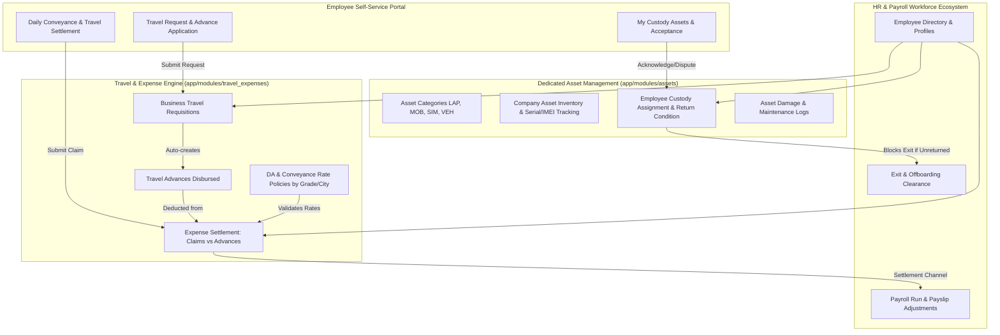

# Implementation Plan: HR & Payroll Asset, Travel & Expense Management

## Goal Description
Implement an enterprise-grade **Operational Asset Management** and **Travel & Expense (T&E)** subsystem strictly scoped to the **HR & Payroll / Workforce** module.
As explicitly requested by the user:
- **Zero eCommerce Integration**: Completely independent of eCommerce products, SKU catalog, cart, or inventory.
- **Dedicated Asset Management Subsystem**: Operational company assets (laptops, mobile phones, SIM cards, company vehicles, office equipment) with serial/IMEI tracking, employee custody assignment, digital handover acknowledgment, return inspections, maintenance ticketing, and offboarding exit clearance.
- **Unified Travel & Expense Engine**: Business travel requisitions, travel advances, per-diem Daily Allowance (DA) and conveyance mileage policies, itemized expense claim settlement, and payroll disbursement/deduction bridging.
- **UI Invariants**: Strict compliance with `AGENTS.md` Rule 1 (**In-Place Non-Destructive Filtering** across all catalog and table views).

---

## User Review Required

> [!NOTE]
> **Confirmed Decision on Module Placement**:
> - **Asset Management**: Implemented as a dedicated, top-level module (`/assets`) in the sidebar navigation with its own permission set, keeping IT/Office equipment administration cleanly separated from sensitive payroll data while maintaining tight links to employee profiles, custody handovers, and exit clearance.
> - **Travel & Expense Management**: Positioned under **HR & Payroll** (`/hr-payroll/travel-requests`, `/hr-payroll/expense-claims`, `/hr-payroll/expense-policies`) with settlement channels integrating into payroll adjustments.
> - **Zero eCommerce Dependency**: All physical inventory and SKUs in eCommerce remain completely untouched.
>
> 2. **Travel & Expense Portal Integration**:
>    - Replace the rudimentary expense claims tab in `/portal/finance` with a modern, dual-tabbed or dedicated portal view:
>      - `/portal/travel`: Travel requisition with advance application and status tracking.
>      - `/portal/expenses`: Conveyance, DA per-diem, and Travel settlement claim submission with receipt upload.
>      - `/portal/assets`: View assigned company custody items with "Accept Custody / Dispute" action.
>
> 3. **Payroll Settlement Bridging**:
>    - When an expense settlement is approved as "Payroll Adjustment", it links directly to the employee's next `PayrollRecord` as an addition (reimbursement) or deduction (unsettled advance refund).

---

## System Architecture



---

## Proposed Changes

Grouped logically by layer: Core Registration -> Backend APIs -> Frontend Admin & Portal -> Verification.

---

### Layer 1: Core System Registration & Security

#### [MODIFY] `app/models_registry.py`
Register the Asset and Travel & Expense models so SQLAlchemy includes them in metadata and migrations:
- Import `AssetCategory`, `CompanyAsset`, `AssetAssignment`, `AssetMaintenanceLog` from `app.modules.assets.models`.
- Import `TravelRequest`, `TravelAdvance`, `DAConveyancePolicy`, `ExpenseSettlementClaim`, `ExpenseClaimLine` from `app.modules.travel_expenses.models`.

#### [MODIFY] `app/main.py`
Include the routers for both modules:
```python
from app.modules.assets.router import router as assets_router
from app.modules.travel_expenses.router import router as travel_expenses_router

# Mount under api and hr_payroll
app.include_router(assets_router, prefix="/api/v1")
app.include_router(assets_router)
app.include_router(travel_expenses_router, prefix="/api/v1")
app.include_router(travel_expenses_router)
```

#### [MODIFY] `app/core/identity/seed.py`
Add permissions under `hrm` module in `SYSTEM_MODULES`:
- Category "Company Assets":
  - `("assets", "Company Asset Inventory")`
  - `("asset_allocations", "Asset Allocations & Handover")`
  - `("asset_maintenance", "Damage & Maintenance Work Orders")`
- Category "Travel & Expense":
  - `("travel_requests", "Travel Requisitions")`
  - `("travel_advances", "Travel Advances")`
  - `("expense_claims", "Expense Claims & Settlements")`
  - `("da_policies", "DA & Conveyance Policies")`

---

### Layer 2: Backend Integration & Offboarding Clearance

#### [MODIFY] `app/modules/hr_payroll/employees/router.py` or `services.py`
Hook asset custody checks into employee status change / exit:
- Add endpoint `/employees/{id}/clearance-check` which calls `AssetService.get_unreturned_assets_for_employee(db, biz_id, employee_id)`.
- If employee has assets with status `active` or `pending_acknowledgement`, warn or flag during termination/clearance.

#### [MODIFY] `app/modules/travel_expenses/router.py`
- Ensure router prefixes are clean:
  - `/travel/requests`
  - `/travel/advances`
  - `/expenses/policies`
  - `/expenses/claims`
  - `/expenses/stats`
- Add query parameters for employee filtering, status filtering, and date range.

---

### Layer 3: Frontend Navigation & Admin Views

#### [MODIFY] `frontend/src/components/layout/sidebar.tsx`
Add Asset Management and Travel & Expense navigation items:
```tsx
// Under HR & Payroll or as Dedicated Section:
{
  name: "Asset Management",
  href: "/assets",
  icon: Laptop,
  sectionKey: "assets",
  children: [
    { name: "Asset Inventory", href: "/assets" },
    { name: "Custody Allocations", href: "/assets/allocations" },
    { name: "Maintenance & Damage", href: "/assets/maintenance" },
    { name: "Categories Setup", href: "/assets/categories" },
  ],
},
// And under HR & Payroll -> Expenses & Travel:
{
  name: "Travel Requests",
  href: "/hr-payroll/travel-requests",
  permission: { module: "hrm", feature: "travel_requests", action: "view" },
},
{
  name: "Expense Claims",
  href: "/hr-payroll/expense-claims",
  permission: { module: "hrm", feature: "expense_claims", action: "view" },
},
{
  name: "DA & Conveyance Policies",
  href: "/hr-payroll/expense-policies",
  permission: { module: "hrm", feature: "da_policies", action: "view" },
}
```

#### [NEW] `frontend/src/app/assets/page.tsx`
Master Asset Inventory View:
- High-level overview cards: Total Assets, In Custody, Available in Pool, Under Maintenance, Damaged.
- Filter Bar: Category, Status (`available`, `assigned`, `under_maintenance`, `damaged`), search query (`asset_tag`, `serial_number`, `model`).
- **Rule 1 In-Place Filtering**: Preserves table mount with `isFetching` progress bar and `startTransition`.
- Quick Actions: "Allocate to Employee", "Log Maintenance", "Edit Asset", "View History".

#### [NEW] `frontend/src/app/assets/allocations/page.tsx`
Custody Allocation & Return Tracking:
- List of all allocations with employee badge, issue date, expected return date, condition, and status.
- Modal: Issue New Asset (select available asset, select employee, condition note).
- Modal: Process Return (return date, returned condition `good`/`damaged`, return notes).

#### [NEW] `frontend/src/app/assets/maintenance/page.tsx`
Damage & Repair Work Orders:
- Work orders tracking: Problem description, vendor/service center, repair cost, status (`reported`, `in_repair`, `repaired`, `irreparable`).
- Action: Mark repaired (returns asset to `available` pool) or mark irreparable (sets asset to `damaged`/`retired`).

#### [NEW] `frontend/src/app/assets/categories/page.tsx`
Category configuration: Name, Code prefix (e.g. LAP, MOB), useful life in months, depreciation type.

#### [NEW] `frontend/src/app/hr-payroll/travel-requests/page.tsx`
Admin Travel Requisition & Advance Management:
- Filter by status (`pending_approval`, `approved`, `rejected`, `completed`).
- Actions: Review requisition, Approve with Advance amount, Disburse Advance via Bank/Cash voucher.

#### [NEW] `frontend/src/app/hr-payroll/expense-claims/page.tsx`
Admin Expense Settlement & Claim Auditing:
- Claim breakdown: Total Claimed vs Advance Deducted = Net Payable / Refundable.
- Line items audit drawer: Receipts viewing, category breakdown, conveyance km validation against DA policy.
- Action: Approve claim, Settle via Direct Bank/Cash payment or mark for Next Payroll cycle.

#### [NEW] `frontend/src/app/hr-payroll/expense-policies/page.tsx`
Daily Allowance & Conveyance policy matrix:
- Rates configured per employee Grade (Executive, Manager, Director) and City Tier (Dhaka/Chittagong, Divisional, District, International).
- Conveyance per-KM rate for field travel.

---

### Layer 4: Employee Self-Service Portal Integration

#### [NEW] `frontend/src/app/portal/assets/page.tsx`
Employee My Assets View:
- Displays all hardware and items currently assigned to the logged-in employee.
- Shows asset details (serial number, model, assigned date, condition at issue).
- Direct digital acknowledgment button: "Acknowledge Receipt" (sets status from `pending_acknowledgement` to `active`).

#### [MODIFY] `frontend/src/app/portal/finance/page.tsx` & [NEW] `frontend/src/app/portal/travel/page.tsx`
- Seamless Travel Request submission with advance request.
- Interactive Expense Claim submission with itemized rows, receipt image upload, and real-time net payable calculation.

---

### Layer 5: Employee Profile Integration

#### [MODIFY] `frontend/src/app/hr-payroll/employees/[id]/page.tsx`
- Add an "Assets & Equipment" tab to the employee profile view.
- Displays currently held company assets and allocation history.
- Quick link to issue new equipment or view offboarding clearance status.

---

## Verification Plan

### Automated Tests
1. **Model Registration Verification**:
   - Verify SQLAlchemy loads `Base.metadata.tables` with `company_assets`, `asset_assignments`, `travel_requests`, `expense_settlement_claims`.
2. **Backend API End-to-End Tests**:
   - `tests/test_assets_workflow.py`:
     - Create asset category -> Add Laptop asset -> Assign to Employee -> Employee acknowledges -> Return asset in fair condition -> Asset returned to available status.
   - `tests/test_travel_expenses_workflow.py`:
     - Submit travel request with 10,000 BDT advance -> Admin approves & disburses advance -> Submit settlement claim with 14,000 BDT total lines -> Net payable calculated as 4,000 BDT -> Finance approves claim.
   - `tests/test_multi_tenancy.py`:
     - Verify business A cannot read or mutate business B's assets or travel claims.

### Manual Verification
1. **Asset Lifecycle**:
   - Navigate to `/assets` -> Create asset `PRO-LAP-001` -> Assign to employee "John Doe".
   - Log into `/portal/assets` as John Doe -> Click "Acknowledge Receipt".
   - Return to Admin -> Process Return -> Verify status updates in real time without page refresh.
2. **Travel & Settlement Lifecycle**:
   - Portal -> Submit Travel Request to Chittagong with 5,000 BDT advance.
   - Admin `/hr-payroll/travel-requests` -> Approve & Disburse.
   - Portal -> Submit Settlement with 6,500 BDT receipts -> Confirm net balance of 1,500 BDT payable.
   - Admin `/hr-payroll/expense-claims` -> Review receipt images and approve settlement.
3. **In-Place Non-Destructive Filtering**:
   - Test table filtering on `/assets` and `/hr-payroll/expense-claims` -> Confirm table does not unmount, top progress bar activates smoothly, and search query updates without cascading duplicate requests.
