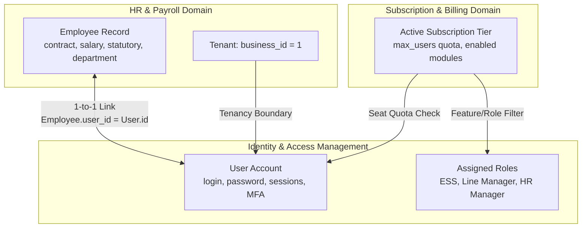
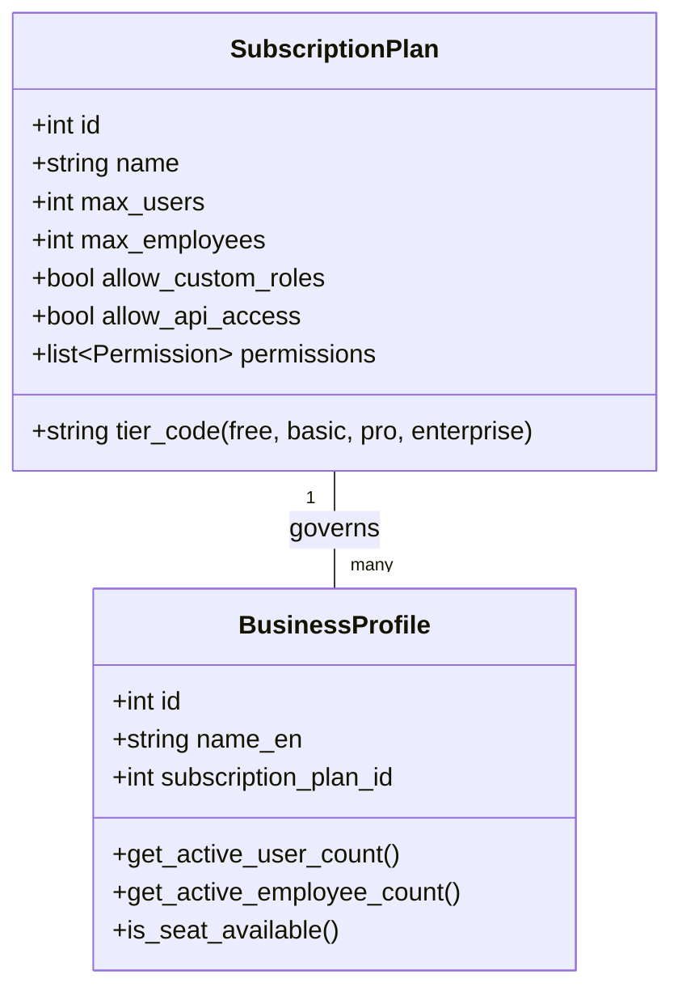

# Architectural Plan: Employee User Lifecycle, Standard RBAC, and Subscription Plan Governance

## 1. Executive Summary & Context

### 1.1 The User's Current State
- **Current User**: `test@test.com` (User ID `3`).
- **Tenant Context**: Business ID `1` (`WBSOFT Technologies Ltd.`).
- **Active Roles**: `hr_basic`, `hr_pro`, `hr_enterprise`.
- **Active Document / Inspection Target**: 
  - `http://127.0.0.1:3000/administration/users/3/edit` (Editing own/tenant user account)
  - `http://127.0.0.1:3000/administration/users/create` (Creating new user accounts)

### 1.2 Identified Architectural Gaps in Current System
1. **Decoupled Identity and HR Domain**:
   - In `app/modules/hr_payroll/employees/models.py`, `Employee.user_id` exists (`ForeignKey("users.id", ondelete="SET NULL")`), but it is currently **completely detached**:
     - The Employee creation and view forms (`/hr-payroll/employees/[id]`) do NOT offer user account provisioning or status indicators.
     - The User creation and edit forms (`/administration/users/create` and `.../edit`) have NO awareness of `Employee` records. Users are created as generic, floating credentials without employee linkage.
2. **Multi-Tenant Boundary Leaks in Admin UI**:
   - When a tenant admin (`test@test.com`) opens `/administration/users/create` or `/administration/users/3/edit`:
     - They see a global "Business Profile Tenant" dropdown allowing them to switch tenants or create unassigned/global users.
     - They see a "System Superuser" checkbox, introducing privilege escalation risks.
     - They see an unconstrained low-level permission matrix, bypassing role inheritance and subscription plan entitlements.
3. **Absence of Subscription Seat Governance**:
   - Tenants can theoretically create unlimited user accounts, regardless of their subscription plan's seat quotas.
   - Roles and permissions are not restricted to features unlocked by the tenant's active subscription tier.

---

## 2. Global Standard Approach for Employee User Lifecycle

Across global enterprise HRIS and ERP systems (Workday, SAP SuccessFactors, BambooHR, Rippling, Deel, Personio, Darwinbox), the separation of concerns and integration between **Employee Profiles** and **System User Accounts** follows strict industry standards:



### 2.1 The Three Global Standard Workflows for User Creation

#### Flow A: One-Click Portal Provisioning from Employee Profile (Primary HR Standard)
*Target Location: `/hr-payroll/employees/[id]` (Under a new "Portal & Access" card)*
- **Use Case**: HR Manager hires or onboards an employee (e.g., `John Doe`) and wants to give them login access to the Employee Self-Service (ESS) portal.
- **Workflow**:
  1. HR visits Employee Profile: `/hr-payroll/employees/42`.
  2. UI displays status: `No System User Linked`.
  3. HR clicks **"Provision Portal Access"** / **"Create User Account"**.
  4. A focused slide-over or modal opens, automatically prefilled:
     - **Full Name**: `John Doe` (from Employee record).
     - **Email / Username**: `john.doe@wbsoft.com` (from `employee.work_email` or `employee.email`).
     - **Default Role**: Defaults to `Employee Self-Service (ESS)`. If the employee is marked as a manager with subordinates, auto-suggests `Line Manager / Supervisor`.
     - **Initial Credentials**: Options for:
       - *Option 1*: Send secure welcome email with password-setup link (Tokenized).
       - *Option 2*: Set initial temporary password (with "Force password reset on first login" checked).
  5. Upon confirmation:
     - Backend verifies the tenant hasn't exceeded `max_users` seat quota.
     - Backend creates `User(username=..., email=..., business_id=employee.business_id)`.
     - Backend updates `Employee(id=42, user_id=user.id)`.
     - Employee immediately logs in to `/portal` to view payslips, apply for leave, and acknowledge assets.

#### Flow B: Create User with Searchable Employee Linkage (IAM Administrator Flow)
*Target Location: `/administration/users/create`*
- **Use Case**: Tenant Admin (`test@test.com`) creates a user directly from the User Accounts section.
- **Workflow**:
  1. Admin opens `/administration/users/create`.
  2. For tenant users (`not current_user.is_superuser`):
     - Business tenant is **locked and hidden** (automatically scoped to `current_user.business_id`).
     - "System Superuser" checkbox is **hidden**.
  3. First field: **"Account Type"**:
     - Segmented toggle: `[ Employee Account ]` | `[ Administrative / External User ]`.
  4. When `[ Employee Account ]` is selected:
     - Searchable Dropdown: **"Link to Employee"** queries `GET /employees/api/unlinked` (employees belonging to `business_id` with `user_id IS NULL`).
     - Selecting an employee (e.g., `EMP-104 - Sarah Jenkins - Senior Developer`) automatically fills:
       - Username: `sjenkins`
       - Email: `sarah.jenkins@wbsoft.com`
       - Phone: `+8801700000000`
     - Displays badge: *Linked to Department: Engineering | Designation: Senior Developer*.
  5. Role selection is strictly filtered by the tenant's subscription plan.

#### Flow C: Editing Existing User & Employee Link Management
*Target Location: `http://127.0.0.1:3000/administration/users/3/edit`*
- **Current State for User 3 (`test@test.com`)**:
  - Displays business selector, superuser toggle, and low-level permission table.
- **Standard Implementation**:
  1. **Linked Employee Banner**:
     - If linked: Displays employee chip with avatar, Employee ID, designation, department, and an "Unlink" or "View Employee Profile" button.
     - If unlinked: Displays alert banner: *"This user is not associated with an Employee profile. Link to an Employee to enable personal portal features (leave requests, payslips, asset custody)."* with a quick "Link Employee" selector.
  2. **Security & Boundary Lockdown**:
     - If the editing user is not a global superadmin:
       - The Tenant dropdown is disabled/read-only with badge: `WBSOFT Technologies Ltd. (Tenant ID: 1)`.
       - The Superuser toggle is hidden or disabled.
       - Direct permission overrides are collapsed by default; role assignment is the primary mechanism.

---

## 3. Role-Based Access Control (RBAC) Architecture

### 3.1 Standard Role Archetypes for Enterprise Multi-Tenant ERP

| Role Code | Role Name | Intended Persona | Scoping & Core Privileges |
| :--- | :--- | :--- | :--- |
| **`super_admin`** | Platform Superadmin | Cloud SaaS Provider / Hosting Owner | Cross-tenant global access, tenant creation, subscription plan definitions, billing infrastructure. |
| **`tenant_admin`** | Business Administrator / Owner | Company Executive / IT Lead (`test@test.com`) | Full administrative access within `business_id`: user management, company settings, subscription upgrade, audit logs. |
| **`hr_manager`** | HR Director / Operations Manager | HR Head | Full HR/Payroll module: employee directory, salaries, increments, promotions, transfers, disciplinary, leave approvals. |
| **`payroll_officer`** | Payroll & Finance Specialist | Accountant / Payroll Specialist | Salary structures, payslip generation, tax deductions, bank advice generation, expense claim approval. |
| **`line_manager`** | Team Lead / Supervisor | Department Head / Project Manager | Scoped strictly to subordinates: approve team leaves, approve asset requests, submit performance evaluations. |
| **`asset_custodian`** | IT & Asset Custodian | Office Admin / IT Support | Company asset inventory, custody allocation, maintenance logs, return processing. |
| **`employee_portal` (ESS)** | Employee Self-Service | Standard Employee | Scoped strictly to own record (`user.id == employee.user_id`): `/portal` attendance clock-in, leave application, view own payslips, acknowledge assets. |

### 3.2 Role Hierarchy and Inheritance
```mermaid
graph TD
    super_admin[super_admin (Platform Level)]
    
    subgraph Tenant Boundaries
        tenant_admin[tenant_admin / Business Owner]
        hr_manager[hr_manager]
        payroll_officer[payroll_officer]
        asset_custodian[asset_custodian]
        line_manager[line_manager / Supervisor]
        ess[employee_portal / ESS]
        
        tenant_admin --> hr_manager
        tenant_admin --> payroll_officer
        tenant_admin --> asset_custodian
        hr_manager --> line_manager
        line_manager --> ess
        payroll_officer --> ess
        asset_custodian --> ess
    end
```

### 3.3 Protection Against Privilege Escalation
In accordance with global IAM compliance standards (SOC 2, ISO 27001):
1. **No Granting of Higher Privileges**: A user with role `tenant_admin` cannot assign `super_admin`.
2. **Tenant Boundary Lockdown**: A tenant admin cannot create or modify roles outside their `business_id` (System default roles are read-only templates; tenant-custom roles have `business_id = current_tenant_id`).
3. **Pure Role Inheritance vs Direct Permissions**:
   - In standard mode, users inherit 100% of their permissions from their assigned Roles.
   - "Direct custom permissions" are treated as exceptional overrides and are only accessible if explicitly permitted by tenant policy.

---

## 4. Subscription Plan Governance & Seat Licensing

### 4.1 Domestic Pure-RBAC vs Commercial SaaS Modes
The platform currently has a dual capability configured via `SUBSCRIPTION_REQUIRED` in `.env`:
1. **Domestic / Internal ERP Mode (`SUBSCRIPTION_REQUIRED=false`)**:
   - Internal employees are never locked out of operational modules by hard paywalls.
   - However, **organizational quotas** (e.g. licensed employee capacity, active user seats) should still be displayed as administrative health metrics.
2. **Commercial Multi-Tenant SaaS Mode (`SUBSCRIPTION_REQUIRED=true`)**:
   - Hard quota and feature enforcement.

### 4.2 Subscription Tier Model & Quotas



### 4.3 Tier Feature & Role Entitlements

| Tier Feature Matrix | Free Tier | Basic Tier | Pro Tier | Enterprise Tier |
| :--- | :---: | :---: | :---: | :---: |
| **Max User Seats (`max_users`)** | 5 | 25 | 100 | Unlimited |
| **Max Employees (`max_employees`)** | 20 | 100 | 500 | Unlimited |
| **Available Roles** | ESS, Line Manager | + HR Basic, Storekeeper | + HR Pro, Payroll, Assets | + Full Suite, Disciplinary, Custom Roles |
| **Asset Management Module** | ❌ Locked | ❌ Locked | ✅ Full Access | ✅ Full Access |
| **Performance & Career Lifecycle** | ❌ Locked | ❌ Locked | ✅ Standard | ✅ Advanced 360 |
| **Custom Role Creation** | ❌ | ❌ | ❌ | ✅ |

### 4.4 Seat Quota Enforcement Logic in API
When `POST /users/api` or `POST /employees/api/{id}/provision-user` is called:
```python
# Pseudo-code for seat verification in User Service
current_user_count = await db.scalar(
    select(func.count(User.id)).where(User.business_id == tenant_id, User.is_active == True)
)
plan = tenant.subscription_plan

if plan and plan.max_users and current_user_count >= plan.max_users:
    raise HTTPException(
        status_code=status.HTTP_402_PAYMENT_REQUIRED,
        detail=f"User seat limit reached ({current_user_count}/{plan.max_users}). "
               f"Please upgrade your subscription plan to invite more users."
    )
```

---

## 5. Concrete Implementation Roadmap

### Phase 1: Database & Backend Model Extensions
1. **Extend `SubscriptionPlan` model** (`app/core/billing/models.py`):
   - Add `max_users: Mapped[int | None] = mapped_column(Integer, default=25)`
   - Add `max_employees: Mapped[int | None] = mapped_column(Integer, default=50)`
   - Add `tier_code: Mapped[str] = mapped_column(String(50), default="pro")`
2. **Employee <-> User Linkage in Service & Router**:
   - In `app/modules/hr_payroll/employees/service.py`:
     - Add `provision_employee_user(db, business_id, employee_id, role_ids, temp_password)`
     - Add `link_employee_to_user(db, business_id, employee_id, user_id)`
     - Add `unlink_employee_user(db, business_id, employee_id)`
     - Add `get_unlinked_employees(db, business_id)` endpoint to supply dropdown for user creation.
3. **Multi-Tenant Security in Identity Service** (`app/core/identity/service.py`):
   - Scope `get_all_users` and `create_user` strictly to `current_user.business_id` if not superuser.
   - Prevent non-superusers from setting `is_superuser=True`.
   - Filter assignable roles to those whose permissions are a subset of the business's active plan.

### Phase 2: Frontend User Form Refactoring
1. **Refactor `/administration/users/[id]/edit/page.tsx`**:
   - Check if current user is superadmin vs tenant admin (`test@test.com`).
   - If tenant admin:
     - Hide the Business selection dropdown (display fixed tenant banner).
     - Hide the `is_superuser` checkbox.
     - Restrict role checkboxes to tenant-eligible roles.
   - Add **"Linked Employee Record"** card:
     - Shows linked employee details (Badge, Department, Designation).
     - Allows linking to an unlinked employee or changing link.
2. **Refactor `/administration/users/create/page.tsx`**:
   - Add "Associate with Employee" section.
   - Pre-populate user details from selected employee.
   - Display live seat quota counter: `e.g. 8 / 25 Seats Active`.

### Phase 3: Employee Profile Portal Access Integration
1. **Update `/hr-payroll/employees/[id]/page.tsx`**:
   - Add a dedicated **"System Access & Portal"** card in the Overview or Security tab:
     - Shows User status: `Linked to User: test@test.com` or `No Portal Account`.
     - Action button: **"Provision Portal Account"** (opens modal to set username/password and role).
     - Quick link: "Edit User Privileges" (links to `/administration/users/{user_id}/edit`).

---

## 6. Verification & Demonstration Plan

1. **Unit & API Testing**:
   - Test employee user provisioning with seat limit validation.
   - Test multi-tenant isolation: ensure `test@test.com` cannot see or modify users from other tenants.
   - Test role assignment filtering based on subscription tier.
2. **Interactive UI Verification**:
   - Log in as `test@test.com`.
   - Navigate to `/administration/users/3/edit` to confirm clean tenant-scoped presentation.
   - Navigate to `/hr-payroll/employees/[id]`, provision a new employee user account, and log in as that employee to verify `/portal` access.
