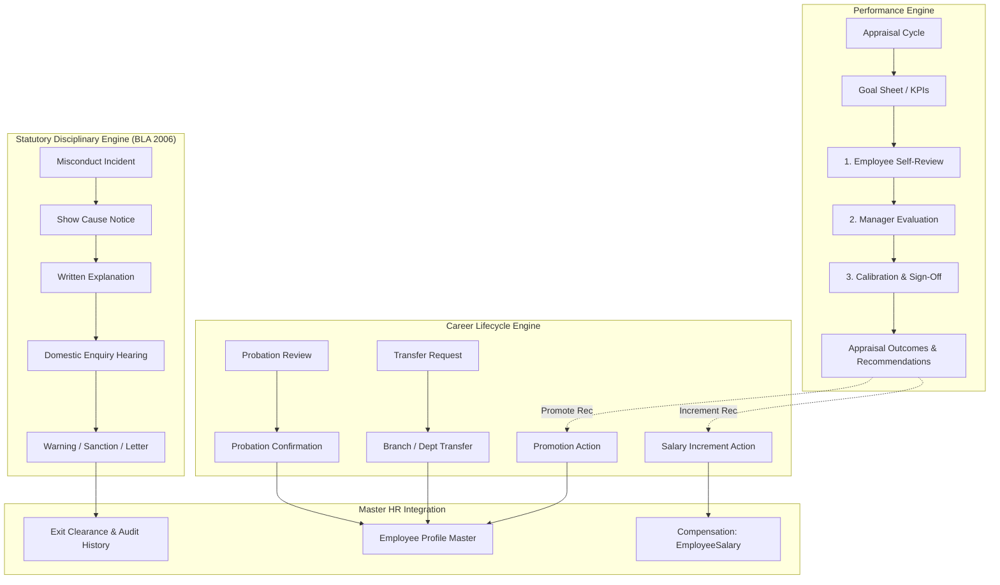

# Performance & Career Lifecycle Architecture & Implementation Plan

## 1. Goal Description
The objective is to implement a comprehensive **Performance and Career Lifecycle** subsystem strictly inside the **HR & Payroll** module (decoupled from eCommerce). The design follows global HCM best practices (Workday, SuccessFactors, Darwinbox) and adheres to Bangladesh Labour Act 2006 (BLA 2006) statutory compliance rules.

The subsystem encompasses three tightly-integrated functional pillars:
1. **Performance Management**:
   - **Goal / KPI Setup**: Appraisal cycles, individual/cascaded goal setting, KPI metrics (target vs actual, weighting up to 100%, milestones).
   - **Performance Evaluation (Appraisal)**: 3-stage appraisal workflows (Self-Review $\rightarrow$ Manager Evaluation $\rightarrow$ Department Head / HR Calibration & 1-on-1 Sign-off), 5-point rating scale, competency ratings, and recommendation outcomes.
2. **Career Movements & Employment Lifecycle**:
   - **Probation Confirmation**: Tracking `probation_end_date`, supervisory probation evaluation (Confirm, Extend, or Terminate), atomic update of `employment_type` to `permanent` and generation of statutory Confirmation Letters.
   - **Employee Promotion**: Requisition and approval of designation (`job_title_id`) and salary grade (`salary_grade_id`) progression, recording career movement history and generating Promotion Letters.
   - **Employee Increment**: Percentage-based or fixed-amount salary revisions, impact analysis against `EmployeeSalary`, effective payroll date locking, and Increment Letter issuance.
   - **Employee Transfer**: Lateral branch transfers, department changes, or reporting line changes, atomically synchronizing `branch_id`, `department_id`, and `direct_manager_id`.
3. **Disciplinary & Grievance Actions (BLA 2006 Statutory Process)**:
   - Complete statutory pipeline conforming to BLA 2006 Sections 23–24:
     `Misconduct Incident / Charge` $\rightarrow$ `Show Cause Notice` (with statutory 7–10 day response window) $\rightarrow$ `Employee Written Explanation` $\rightarrow$ `Domestic Enquiry / Hearing Committee` $\rightarrow$ `Sanction / Action` (Verbal Warning, Written Warning, Suspension with Subsistence Allowance, Withholding Increment, or Dismissal).

---

## 2. User Review Required

> [!IMPORTANT]
> **Subsystem Modular Packaging & Navigation Structure**:
> We propose housing these capabilities under two dedicated sub-packages within `app/modules/hr_payroll/`:
> 1. `app/modules/hr_payroll/performance/`: Cycles, Goals/KPIs, Appraisals.
> 2. `app/modules/hr_payroll/lifecycle/`: Probation, Promotions, Increments, Transfers, Disciplinary Actions.
> In the sidebar under **HR & Payroll**, we propose a grouped, clean structure:
> - **Performance**: Goals & KPIs (`/hr-payroll/performance/goals`), Appraisals (`/hr-payroll/performance/appraisals`)
> - **Career Lifecycle**: Probation Desk (`/hr-payroll/lifecycle/probation`), Career Movements (`/hr-payroll/lifecycle/movements` for Promotions, Increments, Transfers)
> - **Disciplinary Desk**: Show Cause & Warnings (`/hr-payroll/disciplinary`)
> - **Employee Portal**: My Goals & Appraisals (`/portal/performance`)

> [!WARNING]
> **Atomic Synchronization with Existing Master Records**:
> When a Probation Confirmation, Promotion, Increment, or Transfer is approved by management:
> - **Probation**: Updates `employees.confirmation_date = effective_date` and `employees.employment_type = EmploymentTypeEnum.PERMANENT`.
> - **Promotion**: Updates `employees.job_title_id` and optionally `employees.salary_grade_id`.
> - **Transfer**: Updates `employees.branch_id`, `employees.department_id`, and `employees.direct_manager_id`.
> - **Increment**: Automatically computes component breakdown and upserts `employee_salaries` (`EmployeeSalary`), preserving point-in-time payroll fidelity for historical payslips.

---

## 3. High-Level Architecture & Flow



---

## 4. Proposed Database Models & Schemas

### A. Performance Models (`app/modules/hr_payroll/performance/models.py`)
1. **`AppraisalCycle`** (`performance_cycles`):
   - `id: UUID`, `business_id: int`
   - `title: str` (e.g., "Annual Performance Review 2026", "H1 2026 Evaluation")
   - `cycle_type: str` (`annual`, `semi_annual`, `quarterly`, `probationary`)
   - `start_date: date`, `end_date: date`
   - `self_review_deadline: date`, `manager_review_deadline: date`
   - `status: str` (`draft`, `goal_setting`, `in_review`, `calibrating`, `completed`, `archived`)
2. **`EmployeeGoal`** (`employee_goals`):
   - `id: UUID`, `business_id: int`, `employee_id: UUID`, `cycle_id: UUID`
   - `title: str`, `description: text`
   - `category: str` (`operational`, `financial`, `strategic`, `learning_development`)
   - `metric_type: str` (`percentage`, `currency`, `count`, `boolean`)
   - `target_value: Decimal`, `achieved_value: Decimal`
   - `weightage: Decimal` (sum of goals per employee = 100.00%)
   - `due_date: date`
   - `status: str` (`not_started`, `on_track`, `at_risk`, `completed`, `deferred`)
   - `self_rating: Optional[float]`, `manager_rating: Optional[float]`
   - `self_comments: text`, `manager_comments: text`
3. **`PerformanceAppraisal`** (`performance_appraisals`):
   - `id: UUID`, `business_id: int`, `employee_id: UUID`, `cycle_id: UUID`, `reviewer_id: UUID`
   - `self_evaluation_text: text`
   - `self_overall_score: Decimal` (1.00 - 5.00)
   - `manager_evaluation_text: text`
   - `manager_overall_score: Decimal` (1.00 - 5.00)
   - `calibrated_score: Optional[Decimal]`
   - `final_rating_label: str` (`unsatisfactory`, `needs_improvement`, `meets_expectations`, `exceeds_expectations`, `outstanding`)
   - `status: str` (`draft`, `self_review_pending`, `manager_review_pending`, `calibration_pending`, `acknowledged`, `completed`)
   - `promotion_recommended: bool`, `recommended_job_title_id: Optional[UUID]`
   - `increment_recommended: bool`, `recommended_increment_pct: Optional[Decimal]`
   - `pip_recommended: bool` (Performance Improvement Plan)
   - `discussion_date: Optional[date]`, `employee_acknowledged_at: Optional[datetime]`

### B. Career Movements & Transitions Models (`app/modules/hr_payroll/lifecycle/models.py`)
1. **`ProbationReview`** (`probation_reviews`):
   - `id: UUID`, `business_id: int`, `employee_id: UUID`, `reviewer_id: UUID`
   - `due_date: date`, `review_date: date`
   - `performance_rating: int` (1 to 5)
   - `conduct_rating: int` (1 to 5)
   - `punctuality_rating: int` (1 to 5)
   - `recommendation: str` (`confirm`, `extend_probation`, `terminate`)
   - `extension_months: Optional[int]`
   - `effective_confirmation_date: Optional[date]`
   - `status: str` (`draft`, `submitted`, `approved`, `rejected`)
   - `letter_generated: bool`, `letter_reference_no: Optional[str]`
2. **`CareerMovement`** (`career_movements`):
   Unified audit & execution log for **Promotions**, **Increments**, and **Transfers**:
   - `id: UUID`, `business_id: int`, `employee_id: UUID`
   - `action_type: str` (`promotion`, `increment`, `transfer`, `promotion_and_increment`)
   - `status: str` (`draft`, `pending_approval`, `approved`, `rejected`, `applied`)
   - `effective_date: date`
   - `reason_category: str` (`annual_appraisal`, `merit`, `probation_confirmation`, `restructuring`, `request`)
   - `justification_notes: text`
   - **Promotion fields**:
     - `previous_job_title_id: Optional[UUID]`, `new_job_title_id: Optional[UUID]`
     - `previous_salary_grade_id: Optional[UUID]`, `new_salary_grade_id: Optional[UUID]`
   - **Transfer fields**:
     - `previous_branch_id: Optional[UUID]`, `new_branch_id: Optional[UUID]`
     - `previous_department_id: Optional[UUID]`, `new_department_id: Optional[UUID]`
     - `previous_manager_id: Optional[UUID]`, `new_manager_id: Optional[UUID]`
   - **Increment fields**:
     - `previous_basic_salary: Decimal`, `new_basic_salary: Decimal`
     - `previous_gross_salary: Decimal`, `new_gross_salary: Decimal`
     - `increment_type: str` (`percentage`, `fixed_amount`)
     - `increment_value: Decimal` (e.g. 10.00% or BDT 5000.00)
   - `approver_id: Optional[UUID]`, `approved_at: Optional[datetime]`
   - `letter_generated: bool`, `letter_reference_no: Optional[str]`

### C. Disciplinary Action Models (`app/modules/hr_payroll/lifecycle/models.py`)
1. **`DisciplinaryCase`** (`disciplinary_cases`):
   - `id: UUID`, `business_id: int`, `employee_id: UUID`
   - `case_number: str` (e.g. `DISC-202610-0001`)
   - `incident_date: date`
   - `allegation_title: str`, `allegation_details: text`
   - `allegation_category: str` (`misconduct`, `unauthorized_absence`, `insubordination`, `theft_fraud`, `safety_violation`, `negligence`)
   - `statutory_clause: Optional[str]` (e.g., "BLA 2006 Section 23(4)")
   - `current_stage: str` (`reported`, `show_cause_issued`, `explanation_received`, `enquiry_in_progress`, `hearing_completed`, `closed`)
   - `severity_level: str` (`minor`, `moderate`, `major`, `critical`)
2. **`ShowCauseNotice`** (`show_cause_notices`):
   - `id: UUID`, `case_id: UUID`, `business_id: int`, `employee_id: UUID`
   - `notice_number: str` (e.g. `SCN-202610-0001`)
   - `issue_date: date`, `response_deadline: date` (enforcing statutory $\ge 7$ days)
   - `notice_content: text`
   - `employee_explanation: Optional[text]`
   - `explanation_received_date: Optional[date]`
   - `explanation_accepted: Optional[bool]`
3. **`DisciplinaryActionLog`** (`disciplinary_action_logs`):
   - `id: UUID`, `case_id: UUID`, `business_id: int`, `employee_id: UUID`
   - `sanction_type: str` (`verbal_counseling`, `written_warning`, `final_warning`, `suspension`, `withholding_increment`, `demotion`, `dismissal`)
   - `effective_date: date`
   - `suspension_days: Optional[int]`
   - `subsistence_allowance_pct: Optional[Decimal]` (statutory 50% basic during inquiry suspension)
   - `letter_reference_no: Optional[str]`
   - `issued_by_id: UUID`

---

## 5. API Endpoints Surface

### 1. Performance Management (`/api/v1/performance` or `/performance`)
- `GET /performance/cycles`: List cycles with status and deadlines.
- `POST /performance/cycles`: Create/configure new appraisal cycle.
- `GET /performance/goals`: List/filter goals by employee and cycle.
- `POST /performance/goals`: Add individual or team KPI/goal.
- `PUT /performance/goals/{id}`: Update KPI target, progress %, self-score, manager score.
- `GET /performance/appraisals`: List appraisal reviews.
- `POST /performance/appraisals`: Initiate appraisal for an employee.
- `POST /performance/appraisals/{id}/self-review`: Employee submits self-evaluation.
- `POST /performance/appraisals/{id}/manager-review`: Supervisor submits ratings & recommendations.
- `POST /performance/appraisals/{id}/calibrate`: Department Head / HR sets final calibrated score.
- `POST /performance/appraisals/{id}/acknowledge`: Employee acknowledges 1-on-1 discussion.

### 2. Career Movements & Transitions (`/api/v1/lifecycle` or `/lifecycle`)
- `GET /lifecycle/probation`: List employees currently under probation with days remaining to `probation_end_date`.
- `POST /lifecycle/probation/{id}/review`: Submit probation evaluation and confirmation decision.
- `POST /lifecycle/probation/{id}/confirm`: Execute probation confirmation, updates employee to permanent, and generates Confirmation Letter.
- `GET /lifecycle/movements`: List promotion, increment, and transfer actions.
- `POST /lifecycle/movements`: Propose promotion, increment, or transfer with preview of changes.
- `POST /lifecycle/movements/{id}/approve`: Management approve and atomic apply to Employee profile & Compensation records.
- `GET /lifecycle/movements/{id}/letter`: Generate printable official Promotion/Increment/Transfer Letter.

### 3. Disciplinary & Grievance Desk (`/api/v1/disciplinary` or `/disciplinary`)
- `GET /disciplinary/cases`: List disciplinary cases by status and severity.
- `POST /disciplinary/cases`: Record misconduct incident.
- `POST /disciplinary/cases/{id}/show-cause`: Issue statutory Show Cause Notice with response deadline.
- `POST /disciplinary/cases/{id}/explanation`: Log employee's written response.
- `POST /disciplinary/cases/{id}/action`: Issue final sanction/warning letter and close case.
- `GET /disciplinary/cases/{id}/letter`: Generate printable Show Cause / Warning Letter.

---

## 6. Frontend UI Implementation

### A. Navigation & Menus
In [frontend/src/components/layout/sidebar.tsx](file:///d:/Onoda%20Inc/Test%20Projects/python/python-fastapi-new/frontend/src/components/layout/sidebar.tsx), under the "HR & Payroll" group:
- **Goals & Performance**:
  - `Performance Cycles` (`/hr-payroll/performance/cycles`)
  - `Goals & KPIs` (`/hr-payroll/performance/goals`)
  - `Appraisal Reviews` (`/hr-payroll/performance/appraisals`)
- **Career Movements**:
  - `Probation Desk` (`/hr-payroll/lifecycle/probation`)
  - `Promotions & Transfers` (`/hr-payroll/lifecycle/movements`)
  - `Salary Increments` (`/hr-payroll/lifecycle/increments`)
- **Disciplinary Desk**:
  - `Show Cause & Warnings` (`/hr-payroll/disciplinary`)

### B. Employee Profile Integration
In [frontend/src/app/hr-payroll/employees/[id]/page.tsx](file:///d:/Onoda%20Inc/Test%20Projects/python/python-fastapi-new/frontend/src/app/hr-payroll/employees/%5Bid%5D/page.tsx), add 3 dedicated tabs to the 360-degree profile view:
1. **Performance Tab**: View historical appraisal scores, core competencies, and active KPI goal progress.
2. **Career Timeline Tab**: Interactive visual timeline tracking initial joining $\rightarrow$ probation confirmation $\rightarrow$ transfers $\rightarrow$ promotions $\rightarrow$ salary increments.
3. **Disciplinary & Inquiries Tab**: View formal show causes and warning letters on record.

### C. Employee Portal Experience
In [frontend/src/app/portal](file:///d:/Onoda%20Inc/Test%20Projects/python/python-fastapi-new/frontend/src/app/portal):
- `/portal/performance`: Employee self-service for KPI updates, self-review submission, and manager review acknowledgment.
- `/portal/career`: Employee view of confirmation status, promotion orders, and increment letters.

---

## 7. Verification & Testing Plan

### Automated Tests
Create comprehensive integration test suite `tests/test_performance_career_lifecycle.py` covering:
1. **Cycle & Goal Lifecycle**: Create appraisal cycle, add employee goals with weightages summing to 100%, update progress, self-rate, manager-rate.
2. **Appraisal Review Pipeline**: Multi-stage evaluation (Self-Review $\rightarrow$ Manager Review $\rightarrow$ Calibration $\rightarrow$ Final sign-off) and outcome flags.
3. **Probation Review & Confirmation**: Create employee on probation, submit review with decision "confirm", verify employee `employment_type` transitions to `permanent` and `confirmation_date` is populated.
4. **Promotion & Transfer Execution**: Create career movement for promotion and branch transfer, verify atomic update of `employees.job_title_id`, `employees.branch_id`, and `employees.department_id`.
5. **Salary Increment Execution**: Propose increment (percentage and fixed), verify atomic update of `EmployeeSalary` (`gross_salary`, `basic_salary`, `net_salary`) and check point-in-time calculation.
6. **Disciplinary Pipeline (BLA 2006)**: File misconduct case, issue Show Cause notice, record response, issue formal Warning sanction, verify case audit log.

Commands to execute:
```powershell
# 1. Type safety check
cd frontend && npx tsc --noEmit

# 2. Automated Backend Subsystem Tests
.\venv\Scripts\pytest.exe tests/test_performance_career_lifecycle.py -v

# 3. Regression test on employee & clearance modules
.\venv\Scripts\pytest.exe tests/test_hr_payroll_employees.py tests/test_assets_travel_expenses.py -v
```

### Manual Verification Flows
1. **Goal Setting & Self-Review**: Log into portal as employee, fill progress on assigned KPIs, submit self-appraisal with feedback.
2. **Manager Review & Calibration**: As supervisor, open pending appraisal review, enter ratings, recommend promotion and increment.
3. **Probation Confirmation Desk**: Open `/hr-payroll/lifecycle/probation`, check probation countdown badge, review employee, execute confirmation, inspect employee profile updated to permanent.
4. **Increment Batch Execution**: Open `/hr-payroll/lifecycle/increments`, propose 10% increment, approve, verify updated salary breakdown and preview increment letter.
5. **Show Cause & Warning Flow**: Open `/hr-payroll/disciplinary`, issue show cause notice with 7-day statutory deadline, record employee's written statement, issue formal warning.
