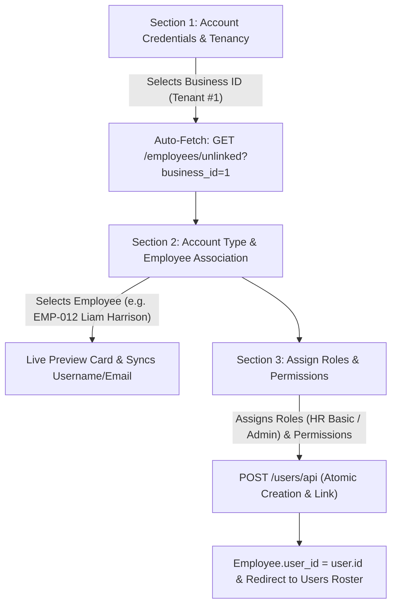

# Implementation Plan: User Creation 3-Section Hierarchy & Flow

## Goal Description
Re-architect and streamline the User Creation experience (`/administration/users/create`) into an intuitive, strict 3-tier hierarchy:
1. **Section 1: Account Credentials & Tenancy**: Establish the organizational anchor (Business ID / Tenant selection) alongside the core login credentials (Username, Email, Password, Phone, Status & Access Flags).
2. **Section 2: Account Type & Employee Association**: Dynamically populate employees for the selected Business ID. Provide an Account Type toggle (Employee ESS vs Standalone), employee selection dropdown, live employee preview card, and auto-sync binding.
3. **Section 3: Assign Roles & Permissions**: Role assignment cards (Admin, HR Basic, HR Pro, etc.) with permission counters, fine-grained custom direct permissions matrix (collapsible), and save/validation triggers.

---

## User Review Required

> [!IMPORTANT]
> **Tenancy Auto-Population Flow**:
> - In **Section 1**, selecting or changing the **Business Profile (Tenant ID)** immediately triggers `GET /employees/unlinked?business_id={id}` in the background.
> - **Section 2** automatically refreshes its employee list to display only unlinked employees belonging to that specific business.
> - Selecting an employee populates or synchronizes login credentials in Section 1 (Username, Work/Personal Email, Phone) and displays the employee's department, role, and WBSOFT ID badge.
> - For Tenant Admins (non-superusers with a fixed `business_id`), the Business ID in Section 1 is pre-selected and locked to their tenant, automatically populating their tenant's employees on initial page load.

---

## Architecture & Hierarchy Overview



---

## Proposed Changes

### Frontend (`frontend/src/app/administration/users/create/page.tsx`)

#### [MODIFY] `frontend/src/app/administration/users/create/page.tsx`
Refactor the form structure into the exact 3 sections requested:

```tsx
// ─────────────────────────────────────────────────────────────────────────────
// Section 1: Account Credentials & Tenancy Section
// ─────────────────────────────────────────────────────────────────────────────
<div className="bg-white rounded-2xl border border-slate-200 shadow-xs p-6 space-y-5">
  <div className="flex items-center gap-2.5 pb-4 border-b border-slate-100">
    <span className="p-2.5 rounded-xl bg-indigo-50 text-indigo-600 border border-indigo-200">
      <Building2 className="w-5 h-5" />
    </span>
    <div>
      <h3 className="text-sm font-bold text-slate-900 flex items-center gap-2">
        <span>Section 1: Account Credentials &amp; Tenancy</span>
        <span className="text-rose-500 font-bold">*</span>
      </h3>
      <p className="text-xs text-slate-500">
        Select business organization to scope tenancy, then configure account login credentials.
      </p>
    </div>
  </div>

  {/* Tenancy Selector */}
  <div>
    <label className="block text-xs font-semibold text-slate-700 mb-1.5">
      Business Profile / Tenant Organization <span className="text-rose-500">*</span>
    </label>
    <select
      value={businessId}
      onChange={(e) => handleBusinessChange(e.target.value)}
      disabled={!loggedInUser?.is_superuser && !!loggedInUser?.business_id}
      className="..."
    >
      <option value="">-- Choose Business Organization (Tenant ID) --</option>
      {businesses.map((b) => (
        <option key={b.id} value={b.id}>
          {b.name_en || b.legal_name} (Business ID: #{b.id})
        </option>
      ))}
    </select>
  </div>

  {/* Credentials Grid */}
  <div className="grid grid-cols-1 md:grid-cols-2 lg:grid-cols-4 gap-4 pt-2">
    {/* Username */}
    {/* Email Address */}
    {/* Password */}
    {/* Phone Number */}
  </div>

  {/* Account Flags (Active, Offline Sync, Superadmin) */}
</div>

// ─────────────────────────────────────────────────────────────────────────────
// Section 2: Account Type & Employee Association Section
// ─────────────────────────────────────────────────────────────────────────────
<div className="bg-white rounded-2xl border border-slate-200 shadow-xs p-6 space-y-4">
  <div className="flex flex-col sm:flex-row sm:items-center justify-between gap-3 pb-4 border-b border-slate-100">
    <div className="flex items-center gap-2.5">
      <span className="p-2.5 rounded-xl bg-blue-50 text-blue-600 border border-blue-200">
        <UserCheck className="w-5 h-5" />
      </span>
      <div>
        <h3 className="text-sm font-bold text-slate-900 flex items-center gap-2">
          <span>Section 2: Account Type &amp; Employee Association</span>
          {matchedBiz && (
            <span className="text-[10px] px-2 py-0.5 rounded-full bg-indigo-50 text-indigo-700 font-semibold border border-indigo-200">
              Populated for {matchedBiz.name_en || `Business #${businessId}`}
            </span>
          )}
        </h3>
        <p className="text-xs text-slate-500">
          Link user login to an existing employee profile or configure as standalone login.
        </p>
      </div>
    </div>

    {/* Toggle: Employee ESS vs Standalone */}
    <div className="flex items-center p-1 rounded-xl bg-slate-100 border border-slate-200">
      <button onClick={() => setAccountType("employee")}>Employee Account (ESS)</button>
      <button onClick={() => setAccountType("standalone")}>Standalone Account</button>
    </div>
  </div>

  {/* Populated Employee Dropdown & Live Preview Card */}
  {accountType === "employee" ? (
    !businessId ? (
      <div className="p-4 rounded-xl bg-amber-50 border border-amber-200 text-amber-800 text-xs">
        Please select a Business ID in Section 1 above to load employee records.
      </div>
    ) : isFetchingEmployees ? (
      <div className="p-4 rounded-xl bg-slate-50 border border-slate-200 text-slate-600 text-xs">
        <Loader2 className="w-4 h-4 animate-spin inline mr-2 text-indigo-600" />
        Populating employees under Business #{businessId}...
      </div>
    ) : (
      <>
        <select
          value={selectedEmployeeId}
          onChange={(e) => handleSelectEmployee(e.target.value)}
        >
          <option value="">-- Choose employee ({unlinkedEmployees.length} available) --</option>
          {unlinkedEmployees.map((emp) => (
            <option key={emp.id} value={emp.id}>
              {emp.employee_id} - {emp.full_name} ({emp.department_name || "General"})
            </option>
          ))}
        </select>

        {/* Live Employee Profile Card */}
        {selectedEmployee && (
          <div className="p-4 rounded-xl bg-slate-50 border border-indigo-200/80 flex items-center justify-between">
            {/* Employee avatar, name, ID badge, department, work email */}
          </div>
        )}
      </>
    )
  ) : (
    <div className="p-3.5 bg-slate-50 rounded-xl border border-slate-200 text-xs text-slate-600">
      Standalone account (not bound to an internal employee profile).
    </div>
  )}
</div>

// ─────────────────────────────────────────────────────────────────────────────
// Section 3: Assign Roles & Permissions Section
// ─────────────────────────────────────────────────────────────────────────────
<div className="space-y-6">
  {/* Predefined Roles Matrix */}
  <div className="bg-white rounded-2xl border border-slate-200 shadow-xs p-6">
    <div className="flex items-center gap-2 mb-4">
      <ShieldCheck className="w-5 h-5 text-indigo-600" />
      <div>
        <h3 className="text-sm font-bold text-slate-900">Section 3: Assign Roles &amp; Permissions</h3>
        <p className="text-xs text-slate-500">Select roles to grant predefined security privileges</p>
      </div>
    </div>
    {/* Role Cards Grid */}
  </div>

  {/* Collapsible Fine-Grained Custom Permissions Matrix */}
  <div className="bg-white rounded-2xl border border-slate-200 shadow-xs overflow-hidden">
    {/* PermissionsMatrix Component */}
  </div>

  {/* Bottom Save & Cancel Bar */}
  <div className="flex items-center justify-end gap-3 pt-2">
    <button type="submit">Save User Account</button>
  </div>
</div>
```

---

### Backend Verification
- Ensure `GET /employees/unlinked?business_id={id}` responds with HTTP 200 and unlinked employee records (already tested and verified).
- Ensure `POST /users/api` creates the user account and links `Employee.user_id = user.id` atomically.

---

## Verification Plan

### Automated Tests
1. Verify frontend TypeScript compilation:
   ```powershell
   docker exec nextjs_frontend npx tsc --noEmit -p tsconfig.json
   ```
2. Verify Python backend route execution:
   ```powershell
   docker exec fastapi_app python -c "
   import httpx
   with httpx.Client(base_url='http://127.0.0.1:8000') as client:
       r = client.post('/auth/login', data={'username': 'test@test.com', 'password': '123456'})
       headers = {'Authorization': f'Bearer {r.json()[\"access_token\"]}'}
       r_unlinked = client.get('/employees/unlinked?business_id=1', headers=headers)
       assert r_unlinked.status_code == 200, f'Failed: {r_unlinked.status_code}'
       print('Successfully verified /employees/unlinked API returns 200')
   "
   ```

### Manual & Browser Verification
1. Navigate to `http://127.0.0.1:3000/administration/users/create`.
2. Inspect the **3-Section Structure**:
   - **Section 1**: Select Business Organization `WBSOFT (Business ID: #1)`.
   - **Section 2**: Verify employee dropdown populates with unlinked employees under Business #1. Select `EMP-012 - Liam Harrison`. Observe username, email, and phone auto-populate, and the live preview card renders.
   - **Section 3**: Assign role `HR Basic` or `HR Pro`.
3. Click **Save User Account**.
4. Confirm successful redirect to `http://127.0.0.1:3000/administration/users` with the new user displayed in the roster and bound to `EMP-012`.
