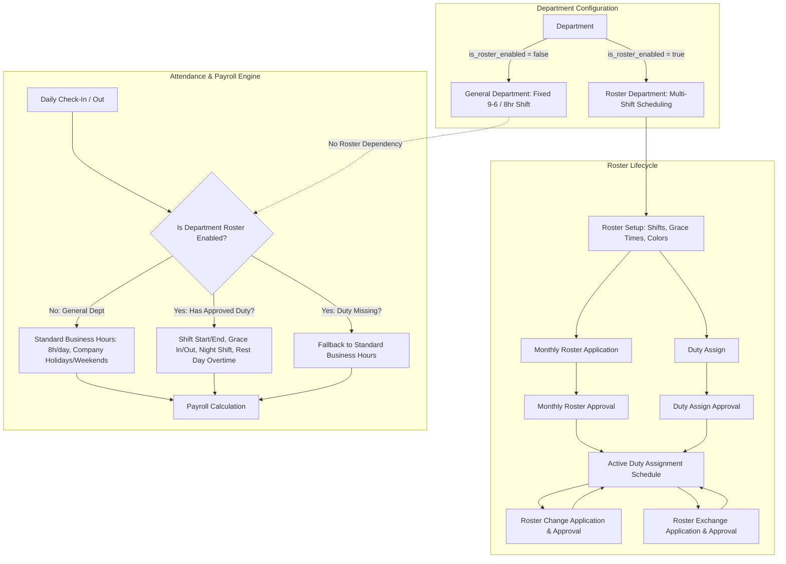

# Implementation Plan: Optional Department-Wise Roster Management System

## Goal Description
Implement an enterprise-grade, optional, department-wise **Roster Management System** in the HR & Payroll module. 

The system provides flexible shift management for shift-based operations (e.g. customer support, security, hospital/manufacturing shifts) while maintaining **zero-dependency fallback** for "General" departments that operate on fixed standard office hours.

The plan covers the 8 core workflows requested:
1. **Roster Setup** (Shifts, Shift Patterns, Department-Wise Roster Enablement)
2. **Duty Assign** (Direct & Bulk Shift Assignment to Employees)
3. **Duty Assign Approval** (Supervisory Review & Activation of Assigned Duties)
4. **Monthly Roster Application** (Department-wide Monthly Roster Matrix Planning & Submission)
5. **Roster Approval** (Operational / HR Head Review & Official Locking of Monthly Rosters)
6. **Roster Change Application** (Employee/Manager Requests to change an assigned shift)
7. **Roster Change Approval** (Managerial Approval & Roster Shift Adjustment)
8. **Roster Exchange Application** (Peer-to-Peer Shift Swapping between two employees)
9. **Roster Exchange Approval** (Peer Consent + Supervisor Approval & Atomic Duty Swap)

---

## Architecture & Design Principles



### 1. Department-Wise Optionality & Zero-Dependency Fallback
- **`departments.is_roster_enabled` (Boolean, default `False`)**:
  - Departments marked `False` (e.g., HR, Finance, Executive Management) are **General Departments**. They do **not** require shifts, duty rosters, or monthly allocations.
  - Departments marked `True` (e.g., Support, Security, Healthcare Staff, Retail POS) participate in shift planning.
- **Attendance & Payroll Compatibility**:
  - `AttendanceService` checks if `employee.department.is_roster_enabled` is active.
  - If `False` or if no active duty assignment is found for the employee on that day, it falls back to standard office hours (e.g. 8.0 hours/day and standard company calendar) with zero overhead and zero runtime errors.
  - If `True` and an approved duty assignment exists, the system compares punch times against the designated shift start/end times and calculates late arrival, early leave, night shift differential, and rest-day duty accordingly.

### 2. Statutory Labour Compliance (Bangladesh Labour Act 2006)
- **Mandatory Weekly Rest Day (BLA Sec 103)**: Every worker is entitled to at least 1 full 24-hour day off per calendar week. The monthly roster validator flags any schedule where an employee works 7 consecutive days without a scheduled `OFF` shift.
- **Daily & Weekly Working Hours (BLA Sec 100, 102)**: Standard 8 hours/day, 48 hours/week. Hours worked exceeding the shift limit are logged as overtime.
- **Night Shifts (BLA Sec 101)**: When shifts cross midnight (`is_night_shift = True`), 24-hour rest intervals between rotations are enforced.

---

## User Review Required

> [!IMPORTANT]
> **Department-Level Roster Flag**:
> We will add `is_roster_enabled` (boolean, default `False`) to the `departments` table. All existing departments will automatically remain as "General" departments with zero impact on existing operations.

> [!TIP]
> **Exchange Workflow Approval**:
> Shift exchange between two employees follows a two-step handshake:
> 1. Employee A requests to exchange with Employee B.
> 2. Employee B accepts the peer request.
> 3. Department Supervisor/HR approves. Upon approval, both duty assignments are atomically swapped.

---

## Proposed Changes

### Component 1: Database Models (`app/modules/hr_payroll/roster/models.py`)

#### [MODIFY] `app/modules/hr_payroll/organization/models.py`
- Add `is_roster_enabled: Mapped[bool] = mapped_column(Boolean, default=False, nullable=False)` to the `Department` model.

#### [NEW] `app/modules/hr_payroll/roster/models.py`
Models to implement:
1. **`Shift` (`shifts`)**:
   - `id`: UUID (Primary Key)
   - `business_id`: Integer (ForeignKey `business_profiles.id`, ondelete="CASCADE")
   - `code`: String(20) (e.g. `M1`, `E1`, `N1`, `OFF`)
   - `name`: String(100) (e.g. "Morning Shift 8AM - 4PM")
   - `start_time`: Time (nullable for OFF days)
   - `end_time`: Time (nullable for OFF days)
   - `work_hours`: Float (e.g. 8.0)
   - `break_duration_minutes`: Integer (default 60)
   - `grace_in_minutes`: Integer (default 15)
   - `grace_out_minutes`: Integer (default 15)
   - `is_night_shift`: Boolean (crosses midnight)
   - `is_off_day`: Boolean (designated rest day / weekly off)
   - `color_code`: String(20) (e.g. `#3B82F6` for badges)
   - `is_active`: Boolean (default True)

2. **`MonthlyRoster` (`monthly_rosters`)**:
   - `id`: UUID
   - `business_id`: Integer
   - `department_id`: UUID (ForeignKey `departments.id`)
   - `year`: Integer
   - `month`: Integer (1-12)
   - `status`: Enum (`draft`, `submitted`, `approved`, `rejected`)
   - `submitted_by_id`: UUID (ForeignKey `employees.id`)
   - `submitted_at`: DateTime
   - `approved_by_id`: UUID (ForeignKey `employees.id`)
   - `approved_at`: DateTime
   - `rejection_reason`: Text
   - `notes`: Text

3. **`DutyAssignment` (`duty_assignments`)**:
   - `id`: UUID
   - `business_id`: Integer
   - `monthly_roster_id`: UUID (nullable ForeignKey `monthly_rosters.id`)
   - `employee_id`: UUID (ForeignKey `employees.id`, ondelete="CASCADE")
   - `department_id`: UUID (ForeignKey `departments.id`)
   - `date`: Date
   - `shift_id`: UUID (ForeignKey `shifts.id`)
   - `status`: Enum (`draft`, `approved`, `cancelled`)
   - `source`: Enum (`monthly_roster`, `direct_assignment`, `shift_change`, `shift_exchange`)
   - `notes`: String(255)
   - Unique Constraint: `(business_id, employee_id, date)`

4. **`DutyAssignBatch` (`duty_assign_batches`)**:
   - `id`: UUID
   - `business_id`: Integer
   - `department_id`: UUID
   - `title`: String(255)
   - `start_date`: Date
   - `end_date`: Date
   - `status`: Enum (`draft`, `pending_approval`, `approved`, `rejected`)
   - `assigned_count`: Integer
   - `submitted_by_id`: UUID
   - `submitted_at`: DateTime
   - `approved_by_id`: UUID
   - `approved_at`: DateTime
   - `rejection_reason`: Text

5. **`RosterChangeApplication` (`roster_change_applications`)**:
   - `id`: UUID
   - `business_id`: Integer
   - `employee_id`: UUID
   - `duty_assignment_id`: UUID (ForeignKey `duty_assignments.id`)
   - `date`: Date
   - `current_shift_id`: UUID (ForeignKey `shifts.id`)
   - `requested_shift_id`: UUID (ForeignKey `shifts.id`)
   - `reason`: Text
   - `status`: Enum (`pending`, `approved`, `rejected`, `cancelled`)
   - `applied_at`: DateTime
   - `reviewed_by_id`: UUID
   - `reviewed_at`: DateTime
   - `review_note`: Text

6. **`RosterExchangeApplication` (`roster_exchange_applications`)**:
   - `id`: UUID
   - `business_id`: Integer
   - `requesting_employee_id`: UUID (Applicant)
   - `target_employee_id`: UUID (Exchange Partner)
   - `requesting_date`: Date
   - `requesting_shift_id`: UUID
   - `target_date`: Date
   - `target_shift_id`: UUID
   - `reason`: Text
   - `status`: Enum (`pending_peer_approval`, `pending_manager_approval`, `approved`, `rejected`, `cancelled`)
   - `peer_reviewed_at`: DateTime
   - `peer_note`: Text
   - `reviewed_by_id`: UUID
   - `reviewed_at`: DateTime
   - `review_note`: Text

#### [MODIFY] `app/models_registry.py`
- Register `Shift`, `MonthlyRoster`, `DutyAssignment`, `DutyAssignBatch`, `RosterChangeApplication`, `RosterExchangeApplication`.

---

### Component 2: Service, Repository & Router (`app/modules/hr_payroll/roster/`)

#### [NEW] `app/modules/hr_payroll/roster/repository.py`
- Database CRUD queries for shifts, rosters, assignments, change requests, and exchange requests.
- Optimized multi-employee monthly calendar matrix querying using window queries or grouped date fetches.

#### [NEW] `app/modules/hr_payroll/roster/schemas.py`
- Pydantic v2 schemas:
  - `ShiftCreate`, `ShiftUpdate`, `ShiftOut`
  - `DutyAssignCreate`, `DutyAssignBatchCreate`, `DutyAssignOut`
  - `MonthlyRosterCreate`, `MonthlyRosterSubmit`, `MonthlyRosterApproval`, `MonthlyRosterOut`, `MonthlyRosterMatrixOut`
  - `RosterChangeCreate`, `RosterChangeReview`, `RosterChangeOut`
  - `RosterExchangeCreate`, `RosterExchangePeerReview`, `RosterExchangeManagerReview`, `RosterExchangeOut`
  - `DepartmentRosterTogglePayload`

#### [NEW] `app/modules/hr_payroll/roster/service.py`
- **Validation**:
  - Enforce BLA 2006 statutory weekly rest day (at least 1 rest day in any 7-day rolling window).
  - Check employee department roster eligibility.
- **Workflows**:
  - Monthly roster generation, bulk matrix save, submission, and approval locking.
  - Duty assignment approval & direct batch generation.
  - Atomic shift swap on exchange approval (swapping shift IDs on target duty assignment records).
  - Shift change application and duty update.

#### [NEW] `app/modules/hr_payroll/roster/router.py`
- Endpoints:
  - `GET /roster/shifts`, `POST /roster/shifts`, `PUT /roster/shifts/{id}`, `DELETE /roster/shifts/{id}`
  - `PATCH /roster/departments/{dept_id}/toggle-roster` (enable/disable roster for department)
  - `GET /roster/duty-assignments`, `POST /roster/duty-assignments/bulk`
  - `GET /roster/duty-assign-batches`, `POST /roster/duty-assign-batches/{id}/approve`, `POST /roster/duty-assign-batches/{id}/reject`
  - `GET /roster/monthly-rosters`, `GET /roster/monthly-rosters/matrix`, `POST /roster/monthly-rosters`, `PUT /roster/monthly-rosters/{id}/cells`
  - `POST /roster/monthly-rosters/{id}/submit`, `POST /roster/monthly-rosters/{id}/approve`, `POST /roster/monthly-rosters/{id}/reject`
  - `GET /roster/change-requests`, `POST /roster/change-requests`, `POST /roster/change-requests/{id}/review`
  - `GET /roster/exchange-requests`, `POST /roster/exchange-requests`, `POST /roster/exchange-requests/{id}/peer-review`, `POST /roster/exchange-requests/{id}/manager-review`

#### [MODIFY] `app/modules/hr_payroll/attendance/service.py`
- Update `_compute_hours` and attendance verification:
  - Query active approved `DutyAssignment` for `(employee_id, date)`.
  - If department is not on roster or assignment is absent, gracefully fall back to default standard hours.
  - If duty assignment found:
    - Compare `check_in` with `shift.start_time` + `grace_in_minutes` to flag `LATE`.
    - If `shift.is_off_day == True` and employee worked, flag as Rest-Day Attendance / Overtime.

#### [MODIFY] `app/main.py`
- Include `roster_router`.

---

### Component 3: Frontend Next.js Client (`frontend/src/`)

#### [NEW] `frontend/src/app/hr-payroll/roster/page.tsx`
Unified Tabbed Roster Management Hub adhering strictly to [.agents/rules/ui_in_place_filtering.md](file:///d:/Onoda%20Inc/Test%20Projects/python/python-fastapi-new/.agents/rules/ui_in_place_filtering.md):
- **Tab 1: Monthly Roster Matrix**
  - Department selector + Month/Year picker.
  - Full matrix table: Employees on Y-axis, Days 1-31 on X-axis.
  - Color-coded shift pills (`M1`, `E1`, `N1`, `OFF`).
  - Interactive cell clicking to quickly reassign shifts.
  - Coverage summary bar at column footers (Total Morning, Evening, Night, Off).
  - Validation indicator highlighting any employee working > 6 consecutive days without a rest day.
  - Actions: "Save Draft", "Submit for Approval", "Approve Roster", "Export Excel".
- **Tab 2: Duty Assignments**
  - List and bulk assignment view with department filter, date range, and employee filter.
- **Tab 3: Approvals Queue**
  - Dual approval queues: (1) Monthly Department Rosters, (2) Direct Duty Assign Batches.
  - One-click approve/reject modal with review notes.
- **Tab 4: Shift Change Requests**
  - Application modal: Select date, view current shift, pick requested new shift, enter reason.
  - Review table: Pending change requests with Approve/Reject actions.
- **Tab 5: Shift Exchange Requests**
  - Peer swap application: Select Peer employee, date, swap shifts.
  - Two-stage status tracking: `Peer Acceptance` -> `Manager Approval`.
- **Tab 6: Shift Setup & Department Config**
  - Shifts CRUD (Name, Code, Timings, Work Hours, Grace, Overnight flag, Badge color).
  - Department Roster Enrolment: Simple switch per department to toggle between "General Fixed Hours" and "Roster-Based".

#### [NEW] Components in `frontend/src/components/hr-payroll/roster/`:
- `roster-matrix-tab.tsx`
- `duty-assign-tab.tsx`
- `roster-approvals-tab.tsx`
- `roster-changes-tab.tsx`
- `roster-exchanges-tab.tsx`
- `shifts-setup-tab.tsx`
- `modals/duty-assign-modal.tsx`
- `modals/shift-modal.tsx`
- `modals/roster-change-modal.tsx`
- `modals/roster-exchange-modal.tsx`
- `modals/roster-review-modal.tsx`

#### [MODIFY] `frontend/src/components/layout/sidebar.tsx`
- Add "Duty Roster" to the HR & Payroll sidebar sub-items (`/hr-payroll/roster`).

#### [MODIFY] `frontend/src/types/index.ts`
- Add TypeScript interfaces for `Shift`, `DutyAssignment`, `MonthlyRoster`, `RosterChangeApplication`, `RosterExchangeApplication`.

---

## Verification Plan

### Automated Tests
1. **Roster Unit & API Tests** (`tests/test_roster_service.py`):
   - Test shift creation and department roster toggle.
   - Test monthly roster matrix draft creation, BLA 2006 rest-day validation, submission, and approval.
   - Test direct duty assign batch approval.
   - Test roster change application approval and assignment update.
   - Test peer-to-peer roster exchange handshake and atomic swap.
   - Test attendance calculation fallback:
     - Employee in General department -> Calculates standard 8.0 hours.
     - Employee in Roster department with 08:00-16:00 shift -> Checks late arrival against 08:15 grace time.
   ```bash
   pytest tests/test_roster_service.py -v
   ```

2. **Frontend Typecheck & Build**:
   ```powershell
   cd frontend
   npm run build
   ```

### Manual Verification
1. Open `/hr-payroll/roster` in browser.
2. In **Shift Setup**, inspect existing shifts or create "Morning (08:00 - 16:30)" and "Night (22:00 - 06:30)".
3. Toggle "Customer Service" department to **Roster Enabled**. Keep "Finance" department as **General (Disabled)**.
4. Open **Monthly Roster Matrix** for Customer Service:
   - Assign shifts for employees across the month.
   - Verify non-destructive filter updates (table stays fixed, top-bar loader pulses).
   - Test BLA 2006 rest day warning if an employee has 7 continuous working days without an OFF day.
5. Submit Monthly Roster -> Log in as Manager -> Approve Roster.
6. Submit a **Roster Change Application** for 1 day -> Approve -> Confirm duty assignment changes.
7. Submit a **Roster Exchange Application** between 2 employees -> Peer accepts -> Manager approves -> Confirm shifts swapped.
8. Verify that employee in Finance (General department) continues to punch attendance without requiring any roster setup.
