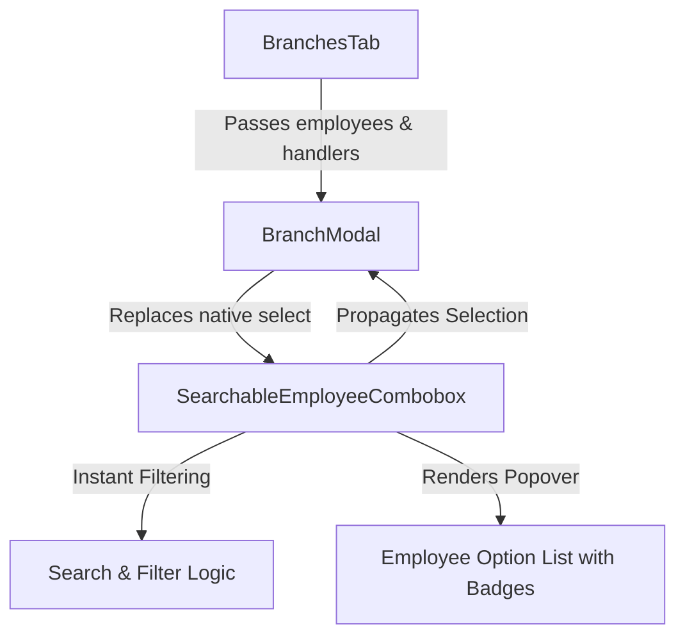

# Implementation Plan: Instant-Search Dynamic Dropdowns (Pilot: Branch Manager / Lead)

## Goal Description
In the HR & Payroll module, many dropdowns currently rely on native HTML `<select>` elements that render static lists without live search capabilities. When companies have tens or hundreds of records (employees, departments, designations, shifts, etc.), scrolling through native `<select>` lists is slow and cumbersome.

This plan details the design and implementation of an instant-search combobox pattern, starting with the pilot requirement:
**`http://127.0.0.1:3000/hr-payroll/organization` $\rightarrow$ Branch TAB $\rightarrow$ Add/Edit Branch Modal $\rightarrow$ "Branch Manager / Lead" employee selector.**

Once demonstrated and reviewed, this established architecture will be reusable across other dropdowns throughout HR & Payroll (e.g. Leave Allocations, Duty Roster assignments, Payroll structures, and Clearance handovers).

---

## User Review Required

> [!NOTE]
> **Component Design & Reusability**:
> We will create a dedicated, highly reusable component `SearchableEmployeeCombobox` in `frontend/src/components/common/searchable-employee-combobox.tsx` (or `frontend/src/components/hr-payroll/common/searchable-employee-combobox.tsx`).
> 
> It accepts `employees: EmployeeOut[]`, `value?: string | null`, `onChange: (employeeId: string) => void`, placeholder, and optional clearability.

### Key Interaction Details
1. **Trigger Input/Button**:
   - Styled consistently with existing modal form fields (`rounded-xl`, `border-slate-200`, subtle focus ring `focus:ring-2 focus:ring-indigo-100`).
   - Displays the selected employee's avatar/initials pill, full name, employee badge ID (`EMP-001`), and designation.
   - Includes a quick-clear (`X`) button when an employee is selected to easily unassign without opening the dropdown.
2. **Instant Search Popover**:
   - Opens immediately on click; automatically focuses the search input.
   - Searches instantly in real-time across:
     - Full Name
     - Employee ID (e.g., "EMP-001" or numeric digits)
     - Work Email
     - Designation / Job Title
     - Department Name
   - Highlights the currently selected employee with a checkmark.
   - Top unassign option: `-- No Branch Manager Assigned --`.
   - Empty state when no matches: "No employees found matching &ldquo;...&rdquo;".
3. **Keyboard Accessibility**:
   - `ArrowDown` / `ArrowUp` to traverse results.
   - `Enter` to select.
   - `Escape` to close.
   - Outside click dismisses the popover.

---

## Architecture & Proposed Changes



---

### Component Implementation

#### [NEW] `frontend/src/components/common/searchable-employee-combobox.tsx`
A reusable React component for selecting an employee with instant search:
- Props:
  ```typescript
  export interface SearchableEmployeeComboboxProps {
    employees: EmployeeOut[];
    value?: string | null;
    onChange: (employeeId: string) => void;
    placeholder?: string;
    allowClear?: boolean;
    disabled?: boolean;
    label?: string;
    error?: string;
    className?: string;
    id?: string;
  }
  ```
- Instant search filter:
  ```typescript
  const filteredEmployees = useMemo(() => {
    if (!searchTerm.trim()) return employees;
    const term = searchTerm.toLowerCase().trim();
    return employees.filter(emp => 
      emp.full_name?.toLowerCase().includes(term) ||
      emp.employee_id?.toLowerCase().includes(term) ||
      emp.work_email?.toLowerCase().includes(term) ||
      emp.job_title_name?.toLowerCase().includes(term) ||
      emp.department_name?.toLowerCase().includes(term)
    );
  }, [employees, searchTerm]);
  ```
- Rich employee card row in dropdown:
  - Initials badge (e.g. `TM` on indigo/slate background) or `emp.photo_url`.
  - Name: `emp.full_name` + ID badge `[EMP-001]`.
  - Designation & Department: `emp.job_title_name` • `emp.department_name`.
  - Status indicator (Active/Inactive).

---

#### [MODIFY] `frontend/src/components/hr-payroll/branches/branch-modal.tsx`
Replace the native `<select>` in the Branch Manager / Lead section (lines 218–238):

**Current Implementation:**
```tsx
{/* Branch Manager */}
<div>
  <label className="block text-xs font-semibold text-slate-700 uppercase tracking-wide mb-1">
    Branch Manager / Lead
  </label>
  <div className="relative">
    <select
      value={managerEmployeeId}
      onChange={(e) => setManagerEmployeeId(e.target.value)}
      className="w-full px-3.5 py-2.5 border border-slate-200 rounded-xl text-xs font-medium text-slate-900 outline-none focus:border-indigo-600 focus:ring-2 focus:ring-indigo-100 transition-all appearance-none bg-white"
    >
      <option value="">-- No Branch Manager Assigned --</option>
      {employees.map((emp) => (
        <option key={emp.id} value={emp.id}>
          {emp.full_name} ({emp.employee_id}) — {emp.job_title_name || "Staff"}
        </option>
      ))}
    </select>
    <User className="w-4 h-4 text-slate-400 absolute right-3 top-3 pointer-events-none" />
  </div>
</div>
```

**Proposed Implementation:**
```tsx
{/* Branch Manager with Instant Search Combobox */}
<div>
  <label className="block text-xs font-semibold text-slate-700 uppercase tracking-wide mb-1">
    Branch Manager / Lead
  </label>
  <SearchableEmployeeCombobox
    employees={employees}
    value={managerEmployeeId}
    onChange={(val) => setManagerEmployeeId(val)}
    placeholder="Select Branch Manager / Lead..."
    allowClear={true}
  />
</div>
```

---

## Verification Plan

### Automated Tests
1. **Frontend Unit Tests (Vitest)**:
   - Create unit test `frontend/src/components/common/searchable-employee-combobox.test.tsx` verifying:
     - Component renders with initial empty / selected state.
     - Clicking opens popover and focuses search input.
     - Typing into search input filters employees instantly by name, ID, and title.
     - Selecting an employee triggers `onChange(employee.id)` and closes popover.
     - Clearing selection triggers `onChange("")`.
     - Keyboard navigation (`ArrowDown`, `Enter`, `Escape`) works as expected.
   - Run:
     ```bash
     cd frontend && npm test -- --run searchable-employee-combobox
     ```
2. **TypeScript Type Check**:
   - Verify strict compilation across the entire frontend:
     ```bash
     cd frontend && npx tsc --noEmit
     ```

### Manual Verification
1. Navigate in browser to `http://127.0.0.1:3000/hr-payroll/organization`.
2. Click on the **Branch** tab.
3. Click **Add Branch** (or edit an existing branch).
4. Verify the **Branch Manager / Lead** field:
   - Click to open the combobox.
   - Type an employee name, employee code (e.g. `EMP-` or `001`), or job title.
   - Notice the instant filtering with highlight and employee details.
   - Click to select an employee; verify the selection displays properly with name, badge, and clear button.
   - Save or close the modal without errors.
