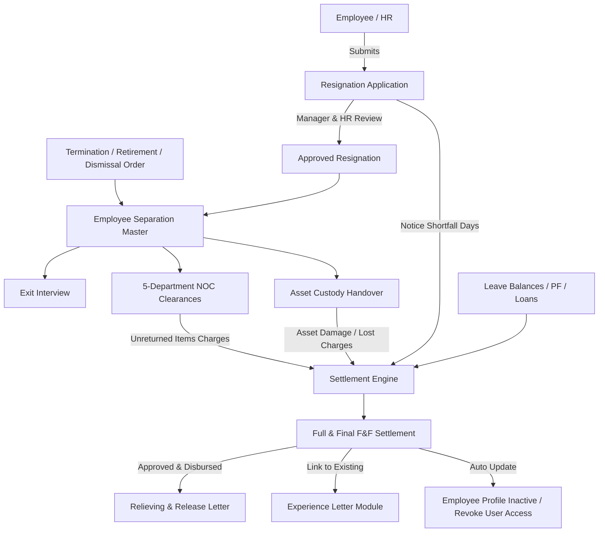

# Implementation Plan: Separation & Offboarding Module

Comprehensive architectural and engineering plan to build the enterprise **Separation & Offboarding** module for ProERP SaaS. This module implements statutory compliance with the **Bangladesh Labour Act 2006 (BLA 2006)** and **Income Tax Act 2023 (ITA 2023)**, strict tenancy isolation via `business_id`, and adheres to the frontend UI invariant [.agents/rules/ui_in_place_filtering.md](file:///d:/Onoda%20Inc/Test%20Projects/python/python-fastapi-new/.agents/rules/ui_in_place_filtering.md).

---

## 1. Goal Description

Provide a complete, auditable employee offboarding lifecycle that seamlessly connects employee exit requests to department clearances, asset returns, statutory final settlements (gratuity, earned leave encashment, PF, notice shortfall), and official release/experience certification.

The module encompasses 8 core functional pillars:
1. **Resignation Application & Workflow**: Employee/HR-initiated resignation, contractual notice period audit (e.g. 30/60 days), served days vs. shortfall tracking, and manager review.
2. **Employee Separation Master**: Universal registry supporting all BLA-2006 separation types: Voluntary Resignation (Sec 27), Termination without Misconduct (Sec 26), Disciplinary Dismissal (Sec 23-24), Statutory Retirement (Sec 28), Retrenchment (Sec 20), and Demise (Sec 19).
3. **Exit Interview Engine**: Structured questionnaire evaluating reasons for exit, culture, management, growth, work-life balance, and confidential HR feedback.
4. **Multi-Department Clearance (NOC)**: 5-department digital sign-off matrix (Operations/Line Manager, IT & Systems, Finance & Accounts, Admin & Facilities, HR) with checklist tracking and recovery deductions.
5. **Asset Handover Desk**: Integration with `company_assets` and `asset_assignments` to inspect returned equipment, verify condition, and assess damage recovery charges.
6. **Full & Final Settlement (FnF)**: BLA 2006 computational engine calculating:
   - Pro-rated salary for exit month.
   - Earned leave encashment (unavailed annual leave $\times$ basic rate per Sec 117).
   - Statutory Gratuity (30 days basic wages $\times$ completed service years $> 5$ years per Sec 2(10) / Sec 27).
   - Provident Fund contribution refund (Employee + Employer matching).
   - Severance compensation (if retrenchment/termination per Sec 20/26).
   - Deductions: notice shortfall deduction, loan/advance balance recovery, asset damage, and tax withholding.
7. **Relieving & Release Letter Generation**: Official certificate releasing employee from employment duties with printable layout, plus direct linking to the existing [Experience Letters](file:///d:/Onoda%20Inc/Test%20Projects/python/python-fastapi-new/frontend/src/app/hr-payroll/experience-letters/page.tsx) module.
8. **Employee Status Auto-Transition**: Once settlement is completed or exit date arrives, employee profile status is transitioned to `resigned`/`terminated`/`inactive` and associated user system access is revoked.

---

## 2. User Review Required

> [!IMPORTANT]
> **Statutory BLA 2006 Gratuity & Encashment Invariants**:
> - **Gratuity**: Permanent employees with $\ge 5$ continuous years of service are entitled to 30 days basic wages for each completed year (or 45 days for service $> 10$ years if specified by company policy). For employees leaving with $< 5$ years service, gratuity defaults to 0 unless company policy specifies otherwise.
> - **Notice Shortfall**: If an employee leaves before serving their contractual notice period (e.g., leaving after 10 days out of 30 days notice), the remaining 20 days basic wages are automatically calculated as a notice buyout deduction in the final settlement.
> - **Asset Damage Recovery**: Unreturned or damaged company assets flagged during asset clearance are deducted directly from the final settlement payables.

> [!NOTE]
> **Experience Letter Integration**: As noted in the prompt, the platform already has a dedicated [Experience Letters](file:///d:/Onoda%20Inc/Test%20Projects/python/python-fastapi-new/frontend/src/app/hr-payroll/experience-letters/page.tsx) module. The Separation module will provide both a formal **Relieving & Release Letter** (confirming handover and release from liabilities) and a single-click bridge to the existing **Experience Letter** generator with pre-filled employee employment dates.

---

## 3. Architecture & Data Flow



---

## 4. Proposed Changes

### Backend Components (`app/modules/hr_payroll/separation/`)

#### [NEW] `app/modules/hr_payroll/separation/models.py`
Data models utilizing `UUIDMixin`, `TimestampMixin`, and scoped with `business_id`:
- `ResignationApplication`:
  - `resignation_number` (unique index, e.g. `RES-2026-0001`), `business_id`, `employee_id`.
  - `notice_date`, `proposed_last_working_day`, `approved_last_working_day`.
  - `contractual_notice_days`, `served_notice_days`, `shortfall_notice_days`.
  - `reason_category` (`career_growth`, `better_compensation`, `relocation`, `higher_studies`, `health_personal`, `work_environment`, `other`).
  - `resignation_letter` (text), `handover_notes` (text).
  - `status` (`submitted`, `under_review`, `approved`, `rejected`, `withdrawn`).
  - `reviewed_by_id`, `reviewed_at`, `rejection_reason`.
- `EmployeeSeparation`:
  - Central coordinating offboarding model.
  - `separation_number` (unique index, e.g. `SEP-2026-0001`), `business_id`, `employee_id`.
  - `separation_type` (`resignation`, `termination`, `dismissal`, `retirement`, `retrenchment`, `death`).
  - `resignation_id` (optional FK), `disciplinary_case_id` (optional FK).
  - `order_date`, `last_working_date`, `reason` (text).
  - `status` (`initiated`, `clearance_in_progress`, `settlement_pending`, `completed`, `cancelled`).
  - `severance_entitled` (bool), `service_duration_days`, `service_duration_years`.
- `ExitInterview`:
  - `business_id`, `separation_id`, `employee_id`.
  - `interview_date`, `interviewer_id`.
  - `primary_reason_for_leaving`, ratings (1–5) on `culture`, `management`, `growth_opportunities`, `compensation`, `work_life_balance`.
  - `would_recommend` (`yes`, `no`, `maybe`), `proudest_accomplishment`, `improvement_suggestions`, `confidential_hr_notes`.
  - `status` (`scheduled`, `completed`, `declined`).
- `DepartmentClearance`:
  - `business_id`, `separation_id`, `employee_id`.
  - `department_type` (`line_manager`, `it_systems`, `finance_accounts`, `admin_facilities`, `human_resources`).
  - `status` (`pending`, `cleared`, `waived`, `issue_flagged`).
  - `cleared_by_id`, `cleared_at`.
  - `outstanding_amount` (Numeric(12, 2)), `checklist_remarks` (text).
- `FinalSettlement`:
  - `settlement_number` (unique index, e.g. `FNF-2026-0001`), `business_id`, `separation_id`, `employee_id`.
  - `settlement_date`.
  - **Payables**: `unpaid_salary_days`, `unpaid_salary_amount`, `leave_encashment_days`, `leave_encashment_amount`, `gratuity_years`, `gratuity_amount`, `provident_fund_amount`, `severance_pay_amount`, `bonus_arrears_amount`, `other_payable_amount`, `total_payable_amount`.
  - **Deductions**: `notice_shortfall_days`, `notice_shortfall_deduction`, `loan_advance_deduction`, `asset_damage_deduction`, `clearance_charge_deduction`, `tax_withholding_deduction`, `total_deduction_amount`.
  - **Net**: `net_payable_amount`.
  - `payment_status` (`draft`, `verified`, `approved`, `disbursed`), `payment_method`, `payment_reference`, `disbursed_at`, `notes`.
- `ReleaseLetter`:
  - `letter_number` (unique index, e.g. `REL-2026-0001`), `business_id`, `separation_id`, `employee_id`.
  - `issue_date`, `effective_exit_date`, `designation`, `department`.
  - `status` (`draft`, `issued`, `revoked`).
  - `letter_content` (text).

#### [NEW] `app/modules/hr_payroll/separation/schemas.py`
Pydantic DTOs for Base, Create, Update, and Out representations for all models.

#### [NEW] `app/modules/hr_payroll/separation/repository.py`
Data access layer with multi-tenant filtering on `business_id`, employee lookups, and sequence number generators (`RES-YYYY-XXXX`, `SEP-YYYY-XXXX`, `FNF-YYYY-XXXX`, `REL-YYYY-XXXX`).

#### [NEW] `app/modules/hr_payroll/separation/service.py`
Business logic engine:
- `apply_resignation()`, `review_resignation()`.
- `initiate_separation()`: Creates separation record and automatically provisions the 5 initial `DepartmentClearance` checklist records.
- `conduct_exit_interview()`.
- `update_department_clearance()`.
- `calculate_final_settlement()`:
  - Fetches employee basic salary, gross salary, joining date, and last working date.
  - Queries unavailed earned leave balance from leave ledger.
  - Queries active loan balance from `LoanRepaymentSchedule`.
  - Sums up clearance charges and notice shortfall days.
  - Computes statutory Gratuity (30 days basic wages $\times$ completed service years if $\ge 5$).
  - Produces complete F&F settlement breakdown.
- `disburse_settlement()`: Marks settlement disbursed, updates employee `is_active=False`, and locks user login.
- `generate_release_letter()`.

#### [NEW] `app/modules/hr_payroll/separation/router.py`
Exposes REST endpoints with RBAC checks (`hrm:resignations:*`, `hrm:employee_separations:*`, etc.):
- `/separation/resignations` (GET, POST, GET /{id}, PATCH /{id}/review)
- `/separation/separations` (GET, POST, GET /{id}, PATCH /{id}/status)
- `/separation/exit-interviews` (GET, POST, GET /{id}, PUT /{id})
- `/separation/clearances` (GET, PATCH /{id})
- `/separation/assets/{employee_id}` (GET active custody assets, POST return/inspect)
- `/separation/settlements` (GET, POST calculate, GET /{id}, POST /{id}/disburse)
- `/separation/release-letters` (GET, POST, GET /{id})

#### [MODIFY] `app/models_registry.py`
Register `ResignationApplication`, `EmployeeSeparation`, `ExitInterview`, `DepartmentClearance`, `FinalSettlement`, `ReleaseLetter`.

#### [MODIFY] `app/main.py`
Include `separation_router` with `/api/v1` and un-prefixed routing.

#### [MODIFY] `app/core/identity/seed.py`
Seed RBAC permissions for `resignations`, `employee_separations`, `exit_interviews`, `department_clearances`, `final_settlements`, `release_letters`.

#### [NEW] `tests/test_hr_payroll_separation.py`
Comprehensive pytest suite covering:
- Resignation submission and approval with notice shortfall calculation.
- Separation initiation with automatic 5-department clearance checklist initialization.
- Department clearance sign-offs and issue flaggings with penalty charges.
- Full & Final settlement calculation verifying BLA-2006 gratuity and leave encashment formulas.
- Release letter generation and employee status deactivation.

---

### Frontend Components (`frontend/src/`)

#### [MODIFY] `frontend/src/types/index.ts`
Add TypeScript interfaces: `ResignationApplicationOut`, `ResignationCreatePayload`, `EmployeeSeparationOut`, `ExitInterviewOut`, `DepartmentClearanceOut`, `FinalSettlementOut`, `ReleaseLetterOut`, etc.

#### [MODIFY] `frontend/src/components/layout/sidebar.tsx`
Add "Separation & Offboarding" navigation item under "HR & Payroll":
```tsx
{
  name: "Separation & Offboarding",
  href: "/hr-payroll/separation",
  permission: { module: "hrm", feature: "employee_separations", action: "view" },
}
```

#### [NEW] `frontend/src/components/hr-payroll/separation/`
Tab components adhering strictly to [.agents/rules/ui_in_place_filtering.md](file:///d:/Onoda%20Inc/Test%20Projects/python/python-fastapi-new/.agents/rules/ui_in_place_filtering.md):
1. `resignations/resignation-tab.tsx`: Filterable table of resignation applications with status badges (`submitted`, `under_review`, `approved`, `rejected`), Review / Notice buyout modal, and New Resignation dialog.
2. `separations/separation-tab.tsx`: Master offboarding registry showing exit types (Resignation, Termination, Dismissal, Retirement), status pipeline, and "Initiate Separation" action.
3. `exit-interviews/exit-interview-tab.tsx`: Interview calendar, ratings summary (Culture, Growth, Management, Compensation), and Interview Record dialog.
4. `clearance/department-clearance-tab.tsx`: Interactive multi-department clearance matrix (Operations, IT, Finance, Admin, HR) with single-click "Clear Department" or "Flag Dues" modal.
5. `assets/asset-handover-tab.tsx`: Custody asset return ledger showing hardware assigned to separating employee with "Mark Returned" / "Assess Damage" modal.
6. `settlement/final-settlement-tab.tsx`: Settlement ledger showing Total Payables, Total Deductions, Net FnF Amount, and "Generate Settlement" calculator.
7. `release-letters/release-letter-tab.tsx`: Relieving letters catalog, view/print buttons, and quick bridge button to existing Experience Letters.

#### [NEW] `frontend/src/app/hr-payroll/separation/page.tsx`
Main hub page with top statistical KPI cards (Pending Resignations, Active Clearances, Pending FnF Disbursements, Average Tenure at Exit) and responsive horizontal tab bar mounting the 7 tab views.

#### [NEW] `frontend/src/app/hr-payroll/separation/settlement/[id]/page.tsx`
Official printable **Full & Final Settlement (FnF) Statement** with corporate letterhead, employee service duration, dual-column breakdown of earnings and deductions, net payout in BDT words, and signature approvals.

#### [NEW] `frontend/src/app/hr-payroll/separation/release-letters/[id]/page.tsx`
Official printable **Relieving & Release Certificate** verifying completion of handover, absence of liabilities, and formal release from duties.

---

## 5. Verification Plan

### Automated Tests
Run pytest in virtual environment:
```powershell
.\venv\Scripts\python.exe -m pytest tests/test_hr_payroll_separation.py -v
```
Run full payroll & separation test suite:
```powershell
.\venv\Scripts\python.exe -m pytest tests/test_hr_payroll_payroll.py tests/test_payroll_extended_features.py tests/test_hr_payroll_separation.py -v
```

### Frontend Type-Check & Build
Run Next.js build verification:
```powershell
cd frontend
npm run build
```

### Manual Verification
1. Open `/hr-payroll/separation` in browser.
2. Submit a resignation application with 30-day notice and approve it with 10 days notice shortfall.
3. Verify that the separation is initiated and 5 department clearance records (Ops, IT, Finance, Admin, HR) are automatically created.
4. Clear IT and Admin departments, and flag a ৳2,000 lost ID/equipment charge in Finance.
5. Inspect the asset handover tab and return assigned laptop.
6. Generate Full & Final settlement and verify that:
   - Notice shortfall deduction is factored in.
   - ৳2,000 clearance charge is factored in.
   - Leave encashment and statutory gratuity match BLA-2006 tenure formulas.
7. Open and preview the printable F&F Settlement sheet and Relieving Letter.
8. Verify that clicking "Experience Letters" bridges seamlessly to `/hr-payroll/experience-letters`.
