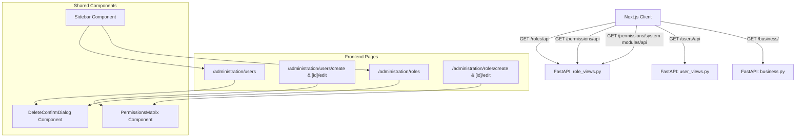

# Implementation Plan - User & Role Permission in Next.js Frontend

Implement full-featured **User Management** and **Role & Permission Management** within the Next.js frontend, matching the existing enterprise design system, layout standards, and strictly following the UI invariants defined in [.agents/rules/ui_in_place_filtering.md](file:///d:/Onoda%20Inc/Test%20Projects/python/python-fastapi-new/.agents/rules/ui_in_place_filtering.md).

## Goal Description
The backend FastAPI application has a complete multi-tenant Role-Based Access Control (RBAC) system with database tables (`users`, `roles`, `permissions`, `user_roles`, `role_permissions`, `user_permissions`), services, and REST APIs. The previous frontend relied on server-rendered Jinja2 HTML templates (`user_list.html`, `role_list.html`, `user_form.html`, `role_form.html`).
This plan outlines the architecture and implementation to bring this functionality into the modern Next.js 16 (React 19) frontend with full parity:
- Roles Directory with in-place non-destructive filtering, search, and tenancy scoping.
- Role Creation & Editing with interactive Module Permissions Matrix (global toggles, module toggles, column toggles, row toggles).
- Users Directory with in-place non-destructive filtering, search, role filters, status indicators, and superuser indicators.
- User Creation & Editing with identity fields, role assignment cards, and direct permission overrides.
- Sidebar and Dashboard navigation integration.
- Full compatibility with the existing auth context, API client, and backend RBAC endpoints.

---

## User Review Required

> [!IMPORTANT]
> **Route Structure**: We propose placing the new views under `/administration`:
> - `/administration/users` (User Directory)
> - `/administration/users/create` & `/administration/users/[id]/edit`
> - `/administration/roles` (Roles & Permissions Directory)
> - `/administration/roles/create` & `/administration/roles/[id]/edit`
>
> If you prefer a different route (e.g. `/settings/users`, `/users`, etc.), please let us know.

> [!NOTE]
> **Backend Endpoint Enhancement**:
> 1. We will expose `GET /permissions/system-modules/api` to return `SYSTEM_MODULES` structure so the Next.js frontend renders all modules, categories, and features dynamically without hardcoded drift from the backend seed.
> 2. We will expand `UserCreate` schema on the backend to accept `role_ids`, `permission_ids`, `is_active`, `is_superuser`, and `can_use_offline_mode` so user creation via Admin UI immediately sets assigned roles and direct permissions.

---

## Architecture & Data Flow



---

## Proposed Changes

### 1. Backend Enhancements (FastAPI)

#### [MODIFY] [schemas.py](file:///d:/Onoda%20Inc/Test%20Projects/python/python-fastapi-new/app/core/identity/schemas.py)
- Expand `UserCreate` schema to support administrative creation:
  - `role_ids: list[int] = []`
  - `permission_ids: list[int] = []`
  - `is_active: bool = True`
  - `is_superuser: bool = False`
  - `can_use_offline_mode: bool = False`

#### [MODIFY] [service.py](file:///d:/Onoda%20Inc/Test%20Projects/python/python-fastapi-new/app/core/identity/service.py)
- In `UserService.create_user`:
  - When `data.role_ids` is provided, assign the specified roles instead of defaulting to customer role.
  - When `data.permission_ids` is provided, assign `direct_permissions`.
  - Set `is_active`, `is_superuser`, `can_use_offline_mode` if specified.

#### [MODIFY] [role_views.py](file:///d:/Onoda%20Inc/Test%20Projects/python/python-fastapi-new/app/routers/role_views.py)
- Add `GET /permissions/system-modules/api` returning `SYSTEM_MODULES` dictionary with categories and features.

---

### 2. Frontend Shared Types & Context

#### [MODIFY] [types/index.ts](file:///d:/Onoda%20Inc/Test%20Projects/python/python-fastapi-new/frontend/src/types/index.ts)
- Add detailed types:
  - `Permission`: `{ id: number; module: string; feature: string; action: string; code: string; name?: string }`
  - `Role`: `{ id: number; name: string; description?: string | null; business_id?: number | null; permissions: Permission[] }`
  - `User`: `{ id: number; username: string; email: string; phone?: string | null; business_id?: number | null; is_superuser: boolean; is_active: boolean; is_verified?: boolean; can_use_offline_mode?: boolean; created_at?: string; roles: Role[]; direct_permissions: Permission[] }`
  - `SystemModuleCategory`: `{ category: string; features: [string, string][] }`
  - `SystemModule`: `{ title: string; icon: string; categories?: SystemModuleCategory[]; features: [string, string][] }`
  - `RoleCreateInput`, `RoleUpdateInput`, `UserCreateInput`, `UserUpdateInput`

#### [MODIFY] [auth-context.tsx](file:///d:/Onoda%20Inc/Test%20Projects/python/python-fastapi-new/frontend/src/context/auth-context.tsx)
- Update `hasPermission`: Also inspect `user.direct_permissions` so direct user permission overrides apply in client-side permission checks.

#### [MODIFY] [sidebar.tsx](file:///d:/Onoda%20Inc/Test%20Projects/python/python-fastapi-new/frontend/src/components/layout/sidebar.tsx)
- Add "Administration" navigation section:
  - Icon: `ShieldCheck`
  - Sub-items:
    - `User Accounts` -> `/administration/users`
    - `Roles & Permissions` -> `/administration/roles`

#### [MODIFY] [page.tsx](file:///d:/Onoda%20Inc/Test%20Projects/python/python-fastapi-new/frontend/src/app/page.tsx)
- Add quick access card for Administration (Users, Roles & Permissions) to the main dashboard.

---

### 3. Frontend Reusable Components

#### [NEW] [permissions-matrix.tsx](file:///d:/Onoda%20Inc/Test%20Projects/python/python-fastapi-new/frontend/src/components/administration/permissions-matrix.tsx)
- Interactive, responsive Permission Matrix component:
  - Renders all system modules grouped by module and category.
  - Controls:
    - "Select All" / "Deselect All" globally
    - "Check All" / "Clear All" per module
    - Clickable column headers (toggle all VIEW, CREATE, UPDATE, DELETE for the module)
    - Clickable "Toggle Row" button for each feature row
    - Checkbox for each granular permission code (`module:feature:action`)
  - Supports `disabled` / `readonly` states.

#### [NEW] [delete-confirm-dialog.tsx](file:///d:/Onoda%20Inc/Test%20Projects/python/python-fastapi-new/frontend/src/components/administration/delete-confirm-dialog.tsx)
- Consistent delete confirmation dialog with loading spinner, item details, and error handling.

---

### 4. Frontend Pages (Roles Management)

#### [NEW] [app/administration/roles/page.tsx](file:///d:/Onoda%20Inc/Test%20Projects/python/python-fastapi-new/frontend/src/app/administration/roles/page.tsx)
- **Role Listing View**:
  - Top stat cards: Total Roles, Global Roles, Tenant Scoped Roles, System Permissions.
  - Toolbar with Search input, Business selector filter, and "Create Role" button.
  - Data table strictly adhering to [.agents/rules/ui_in_place_filtering.md](file:///d:/Onoda%20Inc/Test%20Projects/python/python-fastapi-new/.agents/rules/ui_in_place_filtering.md):
    - Top-rim indeterminate progress bar during `isFetching`.
    - Subtle row dimming (`opacity-50` when fetching, `opacity-100` when ready).
    - Batched filter changes using React `startTransition`.
    - No unmounting of table on filter or page change.
  - Actions: Edit Role, Delete Role (with confirmation modal; system admin role protected).

#### [NEW] [app/administration/roles/create/page.tsx](file:///d:/Onoda%20Inc/Test%20Projects/python/python-fastapi-new/frontend/src/app/administration/roles/create/page.tsx)
- Role creation form:
  - Role Name, Business Scope dropdown (Global vs Tenant), Description.
  - Full Permissions Matrix with instant state tracking.
  - Submission to `POST /roles/api`, with error handling and toast notification.

#### [NEW] [app/administration/roles/[id]/edit/page.tsx](file:///d:/Onoda%20Inc/Test%20Projects/python/python-fastapi-new/frontend/src/app/administration/roles/[id]/edit/page.tsx)
- Role edit form:
  - Fetches role by ID from `GET /roles/api/{id}`.
  - Pre-populates name, scope, description, and selected permission IDs.
  - Submission to `PUT /roles/api/{id}`.

---

### 5. Frontend Pages (User Management)

#### [NEW] [app/administration/users/page.tsx](file:///d:/Onoda%20Inc/Test%20Projects/python/python-fastapi-new/frontend/src/app/administration/users/page.tsx)
- **User Listing View**:
  - Top stat cards: Total Users, Active Users, System Superadmins, Offline Sync Enabled.
  - Toolbar with Search input, Business filter, Role filter, Status filter, and "Create User" button.
  - Data table strictly adhering to [.agents/rules/ui_in_place_filtering.md](file:///d:/Onoda%20Inc/Test%20Projects/python/python-fastapi-new/.agents/rules/ui_in_place_filtering.md):
    - In-place non-destructive filtering.
    - Columns: User info (avatar, username, email, phone), Business Profile, Assigned Roles (badges), Direct Permissions count, Status badge, Superuser badge, Actions (Edit, Delete).
  - Actions: Edit User, Delete User (with confirmation modal; superuser protected).

#### [NEW] [app/administration/users/create/page.tsx](file:///d:/Onoda%20Inc/Test%20Projects/python/python-fastapi-new/frontend/src/app/administration/users/create/page.tsx)
- User creation form:
  - Credentials: Username, Email, Password, Phone.
  - Tenancy: Business Profile selector.
  - Account flags: Active, Superadmin, Allow Offline Mode & Sync.
  - Role Assignment: Grid of role cards with checkboxes.
  - Direct Custom Permissions: Collapsible/Full Permissions Matrix for custom direct overrides.
  - Submission to `POST /users/api`.

#### [NEW] [app/administration/users/[id]/edit/page.tsx](file:///d:/Onoda%20Inc/Test%20Projects/python/python-fastapi-new/frontend/src/app/administration/users/[id]/edit/page.tsx)
- User edit form:
  - Fetches user details by ID from `GET /users/api/{id}`.
  - Pre-populates all user information.
  - Password field optional (leave blank to keep current password).
  - Pre-selects assigned role IDs and direct permission IDs.
  - Submission to `PUT /users/api/{id}`.

---

## Verification Plan

### Automated Tests & Lint Verification
1. Verify backend schema and router endpoints:
   ```bash
   python -m py_compile app/core/identity/schemas.py app/core/identity/service.py app/routers/role_views.py
   ```
2. Run Next.js lint / build check in frontend:
   ```bash
   npm --prefix frontend run lint
   ```
   or
   ```bash
   npm --prefix frontend run build
   ```

### Manual Verification
1. **Roles Management**:
   - Navigate to `/administration/roles`.
   - Verify stat cards and table display all existing roles.
   - Filter by Business and Search keyword; verify in-place smooth loading (no table unmount).
   - Click "Create New Role" -> enter Role Name, toggle various permissions via row, column, and global buttons -> Save.
   - Verify new role appears in the list.
   - Click Edit on the role -> verify previously checked permissions are selected -> update description/permissions -> Save.
   - Delete the test role -> verify modal confirmation and deletion.
2. **User Management**:
   - Navigate to `/administration/users`.
   - Verify stat cards, user listing, role badges, and status badges.
   - Filter by Role, Business, and Search; verify in-place smooth loading.
   - Click "Create New User" -> enter username, email, password, select roles and direct permissions -> Save.
   - Verify new user appears in the list with correct role badges and status.
   - Click Edit on the user -> modify phone or role assignment -> Save.
   - Test delete confirmation modal.
3. **Sidebar & Layout**:
   - Verify sidebar collapses and expands cleanly with new "Administration" section.
   - Verify mobile drawer works seamlessly.
