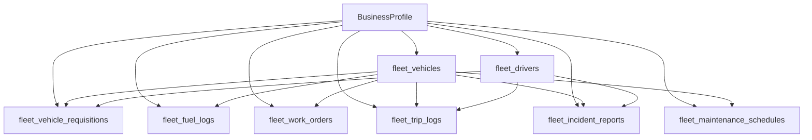

# Implementation Plan: Vehicle & Fleet Management System (VMS)

**Module Name**: `app/modules/vehicles` (Vehicle & Fleet Management System)  
**Target Platform**: ProERP Enterprise SaaS  
**Ecosystem Benchmark**: Global (Fleetio, Samsara, Geotab, Webfleet) & Bangladesh Local (BRTA Regulations, Bondstein/NFleet, Truck Lagbe, Shohoz Fleet)  
**Status**: Proposal & Architecture Plan (Awaiting User Review & Approval)  

---

## 1. Goal Description

Design and implement an enterprise-grade **Vehicle & Fleet Management System (VMS)** integrated into the ProERP platform. The module manages the entire lifecycle of corporate vehicle fleets, transport logistics, employee pool requisitions, driver regulatory compliance, preventative maintenance, fuel/energy logistics, and total cost of ownership (TCO).

The architecture is specifically tailored to balance:
- **Global Fleet Standards**: Preventative Maintenance (PM) schedules, Work Orders, Parts & Tire lifecycle, Fuel efficiency metrics ($L/100km$ and $km/L$), Geofencing, Engine Odometer sync, and Driver Safety Scorecards.
- **Bangladesh Regulatory & Operational Context**: BRTA registration plate series (`Dhaka Metro-Ga`, `Chatto Metro-Cha`, etc.), annual BRTA Fitness certificate renewal, annual Tax Token renewal, commercial Route Permits, CNG re-testing compliance (5-year mandatory testing), third-party/comprehensive motor insurance, toll logistics (Padma Bridge, Dhaka Elevated Expressway, Bangabandhu Tunnel), and Driver BRTA Smart Card License tracking.

> [!IMPORTANT]
> **No implementation code will be written until this design plan is reviewed and approved by the user.**

---

## 2. User Review Required

> [!IMPORTANT]
> **Key Architectural Decisions for User Confirmation**:
> 1. **Module Namespace & Path**: Proposed as `app/modules/vehicles` with frontend at `frontend/src/app/(dashboard)/fleet/` (or `/vehicles/`).
> 2. **Driver Profile Linkage**: Drivers can be linked directly to `app/modules/hr_payroll/employees/models.py` (`Employee`) when drivers are permanent staff, or created as independent contracted drivers if external/outsourced.
> 3. **Inventory Spares Linkage**: When workshop mechanics replace parts (batteries, tires, lubricants, filters), should it deduct from the existing `app/modules/ecommerce/inventory` module or maintain an independent fleet spare log? (Recommended: Hybrid — optional deduction if spare SKU exists in inventory).

---

## 3. Bangladesh & Global Industry Benchmark Analysis

### 3.1 Bangladesh Regulatory & Operational Realities
1. **BRTA Registration System**:
   - Registration format: `[Metro/District] [Vehicle Class Letter] [Serial Number]-[Vehicle Number]` (e.g. `Dhaka Metro-Ga 21-4589`, `Dhaka Metro-Cha 54-1122` for microbuses, `Dhaka Metro-Ta 14-9988` for trucks).
   - Vehicle classification: Private Car (`Ga`/`Bha`), Microbus (`Cha`), Pickup/Covered Van (`Na`/`Ma`), Heavy Truck/Prime Mover (`Ta`/`Sha`), Motorbike (`Ha`/`La`).
2. **BRTA Statutory Renewals**:
   - **Fitness Certificate**: Mandatory annual inspection and fee renewal. Driving an expired fitness vehicle risks heavy fines and police impoundment.
   - **Tax Token**: Annual road tax renewal.
   - **Route Permit**: Commercial multi-passenger and freight transport permits across designated routes/divisions.
   - **CNG Cylinder Re-Testing**: Mandatory cylinder hydraulic pressure test every 5 years under Explosives Department & RPGCL rules.
3. **Local Fuel Logistics**:
   - Dual-fuel engines common in BD: Octane/Petrol + CNG or Diesel + CNG.
   - Company fuel slips and monthly fuel vendor accounts (e.g. Padma Oil, Meghna Petroleum, Jamuna, or private CNG pumps).
4. **Local Telematics Integrations**:
   - IoT trackers prevalent in BD: Bondstein (NFleet), TrackSolid, Concox, Teltonika.

### 3.2 Global Enterprise Benchmarks (Fleetio / Samsara / Geotab)
1. **Preventative Maintenance Schedules (PM)**:
   - Calendar-based (e.g. every 6 months) OR Usage-based (e.g. every 5,000 km) — whichever comes first.
   - Automatic triggers for engine oil, coolant flush, transmission fluid, brake pad replacement, and tire rotation.
2. **Pre-Trip / Post-Trip Digital Inspections (DVIR)**:
   - Mobile-friendly checklist (brakes, lights, tire pressure, windshield, horn, body dents) completed by drivers before vehicle departure.
3. **Total Cost of Ownership (TCO)**:
   - Real-time aggregation of Asset Depreciation + Fuel Expenses + Scheduled Maintenance + Repair Work Orders + Statutory Fees + Insurance + Fines.
   - Cost-per-kilometer ($CPK$) calculation to evaluate vehicle retirement and replacement thresholds.

---

## 4. Entity Architecture & PostgreSQL Database Schema

### 4.1 Schema Definitions (10 Core Tables)

#### 1. `fleet_vehicles` (Master Vehicle Register)
- `id`: UUID (Primary Key)
- `business_id`: Integer (FK $\rightarrow$ `business_profiles.id`, CASCADE, Index)
- `vehicle_number`: String(50) — e.g. `Dhaka Metro-Ga 23-4567` (Unique per tenant)
- `vehicle_type`: Enum (`sedan`, `suv`, `microbus`, `pickup`, `covered_van`, `prime_mover`, `motorcycle`, `cng_auto`, `electric_van`, `ambulance`)
- `brand_make`: String(100) — e.g. `Toyota`, `Mitsubishi`, `Tata`, `Hino`, `Hyundai`
- `model_name`: String(100) — e.g. `HiAce Super GL`, `Corolla Axio`, `L200 Triton`
- `model_year`: Integer — e.g. `2022`
- `chassis_number`: String(100) — VIN (Unique per tenant)
- `engine_number`: String(100)
- `color`: String(50)
- `seating_capacity`: Integer (default 4)
- `payload_capacity_kg`: Numeric(10, 2) (for cargo/delivery vans)
- `fuel_type`: Enum (`octane`, `diesel`, `petrol`, `cng`, `lpg`, `hybrid_octane`, `electric`)
- `cng_cylinder_capacity_liters`: Numeric(6, 2) (nullable)
- `cng_last_test_date`: Date (nullable)
- `cng_test_expiry_date`: Date (nullable)
- `current_odometer_km`: Numeric(12, 2) (default 0.0)
- `ownership_type`: Enum (`company_owned`, `leased`, `rented_vendor`, `employee_owned`)
- `status`: Enum (`available`, `on_trip`, `under_maintenance`, `out_of_service`, `decommissioned`)
- `assigned_driver_id`: UUID (FK $\rightarrow$ `fleet_drivers.id`, SET NULL, nullable)
- `default_warehouse_or_hub`: String(100) — Base depot/parking station
- `brta_fitness_expiry_date`: Date (indexed for renewal alerts)
- `brta_tax_token_expiry_date`: Date (indexed for renewal alerts)
- `brta_route_permit_expiry_date`: Date (nullable)
- `insurance_policy_number`: String(100)
- `insurance_company`: String(100)
- `insurance_expiry_date`: Date
- `is_active`: Boolean (default True)

#### 2. `fleet_drivers` (Driver Profiles & Licenses)
- `id`: UUID (Primary Key)
- `business_id`: Integer (FK $\rightarrow$ `business_profiles.id`, CASCADE, Index)
- `employee_id`: UUID (FK $\rightarrow$ `employees.id`, SET NULL, nullable — for corporate staff drivers)
- `full_name`: String(150)
- `phone`: String(20) (Index)
- `emergency_phone`: String(20)
- `nid_number`: String(50) — National ID
- `license_number`: String(50) — BRTA Driving License (Unique per tenant)
- `license_grade`: Enum (`light`, `medium`, `heavy`, `motorcycle`, `psv`)
- `license_expiry_date`: Date (indexed for expiration alerts)
- `blood_group`: String(10)
- `joining_date`: Date
- `status`: Enum (`active`, `on_duty`, `on_leave`, `suspended`, `terminated`)
- `safety_score`: Numeric(5, 2) (default 100.0)
- `notes`: Text

#### 3. `fleet_vehicle_requisitions` (Pool Car Requisition & Booking)
- `id`: UUID (Primary Key)
- `business_id`: Integer (FK $\rightarrow$ `business_profiles.id`, CASCADE, Index)
- `requisition_number`: String(50) (e.g. `REQ-2026-001`, Unique per tenant)
- `requester_employee_id`: UUID (FK $\rightarrow$ `employees.id`, CASCADE)
- `department`: String(100)
- `purpose`: Text (e.g. `Client site visit to Gazipur industrial plant`)
- `destination`: String(255)
- `start_datetime`: DateTime(timezone=True)
- `estimated_end_datetime`: DateTime(timezone=True)
- `passenger_count`: Integer (default 1)
- `priority`: Enum (`routine`, `urgent`, `executive`)
- `status`: Enum (`draft`, `pending_approval`, `approved`, `rejected`, `allocated`, `completed`, `cancelled`)
- `approved_by_id`: Integer (FK $\rightarrow$ `users.id`, SET NULL)
- `allocated_vehicle_id`: UUID (FK $\rightarrow$ `fleet_vehicles.id`, SET NULL)
- `allocated_driver_id`: UUID (FK $\rightarrow$ `fleet_drivers.id`, SET NULL)

#### 4. `fleet_trip_logs` (Trip Sheets & Tolls)
- `id`: UUID (Primary Key)
- `business_id`: Integer (FK $\rightarrow$ `business_profiles.id`, CASCADE, Index)
- `trip_number`: String(50) (e.g. `TRIP-2026-001`, Unique per tenant)
- `requisition_id`: UUID (FK $\rightarrow$ `fleet_vehicle_requisitions.id`, SET NULL, nullable)
- `vehicle_id`: UUID (FK $\rightarrow$ `fleet_vehicles.id`, CASCADE, Index)
- `driver_id`: UUID (FK $\rightarrow$ `fleet_drivers.id`, RESTRICT, Index)
- `start_time`: DateTime(timezone=True)
- `end_time`: DateTime(timezone=True, nullable)
- `start_odometer_km`: Numeric(12, 2)
- `end_odometer_km`: Numeric(12, 2, nullable)
- `distance_covered_km`: Numeric(12, 2, nullable) — computed on trip completion
- `toll_expenses`: Numeric(10, 2) (default 0.0) — Padma bridge, toll plazas, parking
- `toll_receipt_urls`: JSON (array of receipt image links)
- `fuel_consumed_estimate_liters`: Numeric(8, 2, nullable)
- `driver_trip_allowance_da`: Numeric(10, 2) (default 0.0) — for driver food/overnight allowance
- `status`: Enum (`in_progress`, `completed`, `cancelled`)
- `route_summary`: Text
- `remarks`: Text

#### 5. `fleet_fuel_logs` (Fuel & Energy Tracking)
- `id`: UUID (Primary Key)
- `business_id`: Integer (FK $\rightarrow$ `business_profiles.id`, CASCADE, Index)
- `vehicle_id`: UUID (FK $\rightarrow$ `fleet_vehicles.id`, CASCADE, Index)
- `driver_id`: UUID (FK $\rightarrow$ `fleet_drivers.id`, SET NULL, nullable)
- `logged_at`: DateTime(timezone=True)
- `odometer_at_fueling`: Numeric(12, 2)
- `fuel_type`: Enum (`octane`, `diesel`, `petrol`, `cng`, `lpg`, `electric_kwh`)
- `quantity`: Numeric(10, 2) — liters or m3 or kWh
- `unit_price`: Numeric(10, 2) — Price per unit in BDT
- `total_cost`: Numeric(12, 2)
- `filling_station_name`: String(150)
- `payment_mode`: Enum (`company_fuel_card`, `driver_cash`, `vendor_credit_slip`, `petty_cash`)
- `fuel_card_number`: String(50, nullable)
- `slip_receipt_url`: String(255, nullable)
- `calculated_km_per_liter`: Numeric(6, 2, nullable) — delta distance / fuel quantity
- `is_anomaly_flagged`: Boolean (default False) — abnormal drop in fuel efficiency alert

#### 6. `fleet_maintenance_schedules` (Preventative Maintenance Rules)
- `id`: UUID (Primary Key)
- `business_id`: Integer (FK $\rightarrow$ `business_profiles.id`, CASCADE, Index)
- `title`: String(150) — e.g. `Engine Oil & Filter Service (5,000 km)`
- `vehicle_type`: Enum (`all`, `sedan`, `suv`, `microbus`, `van`, `heavy_truck`)
- `interval_odometer_km`: Integer — e.g. `5000` (every 5,000 km)
- `interval_days`: Integer — e.g. `180` (or every 6 months)
- `description`: Text
- `is_active`: Boolean (default True)

#### 7. `fleet_work_orders` (Maintenance Work Orders & Workshop Invoices)
- `id`: UUID (Primary Key)
- `business_id`: Integer (FK $\rightarrow$ `business_profiles.id`, CASCADE, Index)
- `work_order_number`: String(50) (e.g. `WO-2026-001`, Unique per tenant)
- `vehicle_id`: UUID (FK $\rightarrow$ `fleet_vehicles.id`, CASCADE, Index)
- `maintenance_type`: Enum (`scheduled_preventive`, `corrective_breakdown`, `accident_repair`, `tire_replacement`, `battery_service`, `ac_servicing`)
- `priority`: Enum (`low`, `medium`, `high`, `critical`)
- `odometer_at_service`: Numeric(12, 2)
- `service_vendor_name`: String(150) — Workshop / Service Center
- `issued_at`: DateTime(timezone=True)
- `completed_at`: DateTime(timezone=True, nullable)
- `total_labor_cost`: Numeric(12, 2) (default 0.0)
- `total_parts_cost`: Numeric(12, 2) (default 0.0)
- `total_cost`: Numeric(12, 2) (default 0.0)
- `status`: Enum (`draft`, `in_progress`, `completed`, `cancelled`)
- `tasks_performed`: JSON (checklist of service items performed)
- `invoice_receipt_url`: String(255, nullable)

#### 8. `fleet_tire_logs` (Tire Tracking & Wear)
- `id`: UUID (Primary Key)
- `business_id`: Integer (FK $\rightarrow$ `business_profiles.id`, CASCADE, Index)
- `vehicle_id`: UUID (FK $\rightarrow$ `fleet_vehicles.id`, CASCADE, Index)
- `tire_serial_number`: String(100)
- `brand_and_size`: String(100) — e.g. `Bridgestone 195/65 R15`
- `position`: Enum (`front_left`, `front_right`, `rear_left`, `rear_right`, `rear_inner_left`, `rear_inner_right`, `spare`)
- `installed_date`: Date
- `installed_odometer_km`: Numeric(12, 2)
- `tread_depth_mm`: Numeric(4, 1) — e.g. `8.5 mm` (critical alert when $< 2.0 mm$)
- `status`: Enum (`in_service`, `rotated`, `retreaded`, `scrapped`)

#### 9. `fleet_incident_reports` (Accidents, Traffic Challans & Fines)
- `id`: UUID (Primary Key)
- `business_id`: Integer (FK $\rightarrow$ `business_profiles.id`, CASCADE, Index)
- `incident_number`: String(50) (Unique per tenant)
- `vehicle_id`: UUID (FK $\rightarrow$ `fleet_vehicles.id`, CASCADE, Index)
- `driver_id`: UUID (FK $\rightarrow$ `fleet_drivers.id`, SET NULL)
- `incident_type`: Enum (`accident`, `traffic_fine_challan`, `theft_attempt`, `breakdown`)
- `incident_date`: DateTime(timezone=True)
- `location_description`: String(255)
- `police_station_thana`: String(100, nullable) — local Thana
- `police_gd_or_case_no`: String(100, nullable)
- `fine_amount`: Numeric(10, 2) (default 0.0)
- `estimated_damage_cost`: Numeric(12, 2) (default 0.0)
- `insurance_claim_filed`: Boolean (default False)
- `insurance_claim_status`: Enum (`not_applicable`, `submitted`, `survey_in_progress`, `approved_settled`, `rejected`)
- `settled_amount`: Numeric(12, 2) (default 0.0)
- `photos`: JSON (array of damage photos)

#### 10. `fleet_telematics_events` (IoT GPS & Sensor Feeds)
- `id`: UUID (Primary Key)
- `business_id`: Integer (FK $\rightarrow$ `business_profiles.id`, CASCADE, Index)
- `vehicle_id`: UUID (FK $\rightarrow$ `fleet_vehicles.id`, CASCADE, Index)
- `device_imei`: String(50, Index)
- `latitude`: Numeric(10, 7)
- `longitude`: Numeric(10, 7)
- `speed_kmh`: Numeric(5, 1)
- `engine_ignition`: Boolean
- `odometer_reading`: Numeric(12, 2, nullable)
- `event_type`: Enum (`location_ping`, `harsh_acceleration`, `harsh_braking`, `overspeed_alert`, `idle_exceeded`, `geofence_breach`, `sos_panic`)
- `timestamp`: DateTime(timezone=True, Index)

---

## 5. Implementation Breakdown & Phases

### Phase 1: Core Vehicle Register & BRTA Statutory Compliance (Immediate)
- **Backend**:
  - Implement models: `Vehicle`, `Driver`.
  - Service functions: Vehicle CRUD with unique registration formatting (`Dhaka Metro-...`), BRTA expiry tracking, Driver licensing with license grade validations.
  - Expiry alert queries: Automated alerts for documents expiring within 30 days (`brta_fitness_expiry_date`, `brta_tax_token_expiry_date`, `license_expiry_date`, `insurance_expiry_date`, `cng_test_expiry_date`).
- **Frontend**:
  - Vehicle Catalog with In-Place Non-Destructive Filtering (`frontend/src/app/(dashboard)/fleet/vehicles/page.tsx`).
  - Vehicle Registration & Edit Modal (`vehicle-form-modal.tsx`).
  - Driver Roster page with license expiration badge tags (`frontend/src/app/(dashboard)/fleet/drivers/page.tsx`).

### Phase 2: Trip Requisition, Dispatch & Logbook (Pool Car Management)
- **Backend**:
  - Implement models: `VehicleRequisition`, `TripLog`.
  - Workflow engine: Requisition Draft $\rightarrow$ Approval $\rightarrow$ Vehicle/Driver Dispatch $\rightarrow$ Trip Start (Odometer) $\rightarrow$ Trip Finish (Distance, Toll, DA).
  - Validation guards: Prevent double-booking a vehicle or driver during overlapping time intervals.
- **Frontend**:
  - Employee Pool Car Requisition Form (`requisition-modal.tsx`).
  - Fleet Manager Dispatch Desk with live calendar/Gantt allocation view.
  - Digital Trip Sheet with start/end odometer verification and toll slip attachment.

### Phase 3: Fuel Logistics & Anomaly Detection
- **Backend**:
  - Implement `FuelLog` model.
  - Formula: $\text{Fuel Efficiency} = \frac{\text{Odometer}_{\text{current}} - \text{Odometer}_{\text{previous}}}{\text{Fuel Liters}}$.
  - Anomaly Detector: Flags refuels where consumption is $> 30\%$ below expected average (potential fuel pilferage alert).
- **Frontend**:
  - Fuel refill entry modal with auto-calculation of mileage.
  - Visual fuel consumption trend charts per vehicle and per driver.

### Phase 4: Preventative Maintenance (PM) & Work Orders
- **Backend**:
  - Implement `MaintenanceSchedule`, `WorkOrder`, `TireLog`.
  - Automated PM scheduler evaluating `current_odometer_km >= last_service_odometer + interval_km`.
  - Work order costing (Labor + Parts) updating Total Cost of Ownership.
- **Frontend**:
  - Preventative maintenance service board (Kanban / Table view).
  - Work Order detail modal with parts replacement checklist.

### Phase 5: IoT Telematics & Incident Insurance (Future Scope)
- Webhook receiver for GPS devices (Bondstein / Teltonika / Concox OBD-II).
- Live fleet map with real-time breadcrumb trails and geofence alerts.
- Accident & insurance claim recovery workflow.

---

## 6. Verification & Testing Strategy

### 6.1 Automated Backend Tests (`pytest`)
- `tests/test_fleet_vehicles_brta_compliance.py`:
  - Asserts BRTA vehicle registration unique constraints per tenant.
  - Verifies document expiration alerts (fitness, tax token, insurance, CNG test) within 30-day thresholds.
- `tests/test_fleet_requisition_dispatch_lifecycle.py`:
  - Requisition approval and vehicle allocation state machine.
  - Blocks double-booking of assigned vehicles during overlapping trip windows.
  - Verifies trip completion math: `distance_covered_km = end_odometer_km - start_odometer_km`.
- `tests/test_fleet_fuel_efficiency_and_anomaly.py`:
  - Calculates km/L and asserts fuel pilferage anomaly flag on abnormal drops.
- `tests/test_fleet_preventive_maintenance_triggers.py`:
  - Odometer threshold trigger generating scheduled work orders.

### 6.2 Automated Frontend Tests (`Vitest` + RTL)
- `vehicle-form-modal.test.tsx`:
  - Validates required registration number, vehicle type, and BRTA date pickers.
- `in-place-filtering-fleet.test.tsx`:
  - Asserts compliance with [ui_in_place_filtering.md](file:///d:/Onoda%20Inc/Test%20Projects/python/python-fastapi-new/.agents/rules/ui_in_place_filtering.md):
  - Table remains mounted during search query updates.
  - Dynamic status tabs (`Available`, `On Trip`, `In Workshop`) update view without page unmounting.
- TypeScript build check: `npx tsc --noEmit` (**0 errors**).

---

## 7. Next Actions

1. Review this architectural plan document.
2. Confirm or adjust domain fields (BRTA requirements, driver linkage, requisition approvals).
3. Upon your explicit approval, we will proceed to execute Phase 1 implementation (database models, backend service & router, frontend vehicle catalog with in-place non-destructive filtering).
